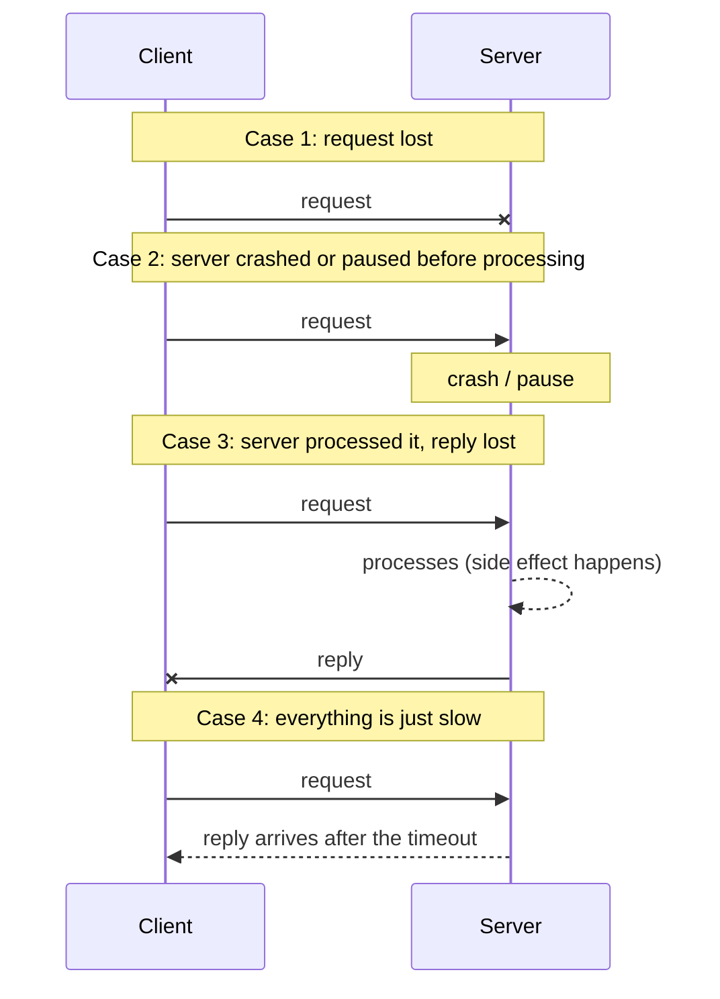

# Chapter 2. Networks, Failures and Failure Detection

> "The network is reliable" is the first fallacy for a reason.

## What you will learn

- What actually happens to a message between two machines, and why it can be lost, delayed, duplicated or reordered.
- The taxonomy of failures: crash, omission, timing and Byzantine, and how they're used to state what a protocol tolerates.
- Network partitions, and why they happen even in modern data centres.
- Why you can't distinguish a crashed node from a slow one, and what that means.
- How failure detectors work (timeouts, heartbeats, phi-accrual), and the formal properties they're judged by.
- How gossip protocols spread information and membership through large clusters.

---

## 2.1 What happens to a message

When a node sends a message to another, the bytes pass through the sender's operating system, its network interface card (NIC), cables, switches and routers, the receiver's NIC and operating system, and finally the receiving process. At each step something can go wrong:

| What happens | Where | Effect on the message |
|---|---|---|
| Queue full in a switch or router | Network | Dropped (lost) |
| Congestion, retransmission | Network, TCP | Delayed, sometimes by seconds |
| Route change, multipath routing | Network | Reordered relative to other messages |
| Sender times out and resends | Application | Duplicated |
| Receiver's process paused (garbage collection, overloaded CPU, VM migration) | Receiving host | Delayed processing; replies late |
| Cable cut, switch failure, misconfiguration | Network | Lost until repaired; possibly a partition |
| Bit flip in memory or on the wire not caught by checksums | Anywhere | Corrupted (rare, but real at scale) |

### What TCP gives you, and what it doesn't

**TCP** (Transmission Control Protocol) provides a reliable, ordered byte stream *between two endpoints while the connection lasts*. It retransmits lost packets, discards duplicates and reorders out-of-order packets. This hides a lot, but not everything:

- If the connection breaks, TCP doesn't tell you which of your sent bytes the application on the other side actually processed.
- A TCP acknowledgement means the remote *operating system* received the data, not that the remote *application* processed it, let alone durably.
- TCP can't make a message arrive faster than the network allows; it turns loss into delay.
- When you reconnect and resend, you may duplicate work the other side already did.

So even over TCP, applications must handle lost requests, lost replies and duplicates. That's why the idempotency and deduplication techniques of Chapter 14 exist.

### The asymmetry of a timeout

A client sends a request and waits. No reply arrives within the timeout. Four quite different things may have happened:



From the client's side, all four look identical. In cases 3 and 4, the operation **did** happen. If the client retries a non-idempotent operation ("transfer £100"), it may happen twice. This single diagram explains a large share of real-world distributed-systems bugs.

## 2.2 Synchrony

How long can a message take, and how slow can a process be? The answer defines the **timing model**, which Chapter 4 treats formally:

- **Synchronous:** known upper bounds on message delay and processing time. Timeouts are reliable: if no reply arrives within the bound, the other side has definitely failed.
- **Asynchronous:** no bounds at all. A message may take arbitrarily long. Timeouts tell you nothing for certain.
- **Partially synchronous:** bounds exist but are unknown, or hold only after some unknown time. This models real systems: usually fast, occasionally very slow.

Real networks (IP networks, cloud data centres) are not synchronous. Packet queues, retransmissions, garbage-collection pauses and virtual-machine scheduling can delay messages for seconds or longer. Designs that assume a bound ("the lease will surely have reached them within 10 seconds") are bugs waiting for a bad day.

## 2.3 A taxonomy of failures

To say what a protocol tolerates, you must say what kind of failures it assumes. The standard taxonomy, from mildest to most severe:

| Failure model | What a faulty node may do | Example causes |
|---|---|---|
| **Crash-stop** (fail-stop) | Stops forever; never recovers | Hardware failure with no restart |
| **Crash-recovery** | Stops, then may restart; loses memory but keeps what was on stable storage | Process restart, reboot |
| **Omission** | Fails to send or receive some messages | Full buffers, packet loss |
| **Timing** (performance) | Responds outside the expected time bounds | Overload, GC pause, slow disk |
| **Byzantine** (arbitrary) | Anything: wrong answers, lies, inconsistent messages to different nodes | Bugs, corruption, malicious attackers |

These form a hierarchy: a protocol that tolerates Byzantine failures tolerates all the others, at significant extra cost (Chapter 13). Most protocols used in data centres assume **crash-recovery** nodes and **omission plus timing** failures in the network, and treat the nodes themselves as honest.

### Fault tolerance thresholds

Protocols typically state how many faulty nodes, *f*, they can tolerate among *n* in total:

| Problem | Failure model | Nodes needed |
|---|---|---|
| Consensus (Paxos, Raft) | Crash | n ≥ 2f + 1 (a majority must be alive) |
| Byzantine consensus (PBFT) | Byzantine | n ≥ 3f + 1 |
| Primary-backup with a reliable failure detector | Crash, synchronous | n ≥ f + 1 |

So a five-node Raft cluster tolerates two crashed nodes; a seven-node one tolerates three. Chapters 11 and 13 prove these bounds.

## 2.4 Network partitions

A **network partition** occurs when the network splits nodes into groups that can communicate within each group but not between groups. It may be **complete** (no messages cross) or **partial** (some pairs can talk and others can't, sometimes asymmetrically: A can send to B, but B's messages don't reach A).

Partitions aren't hypothetical. Peter Bailis and Kyle Kingsbury's survey "The Network is Reliable" (*ACM Queue*, 2014) collected many documented examples, and a 2018 study of partition failures by Ahmed Alquraan and colleagues (OSDI 2018) analysed 136 partition-related failures across 25 widely used distributed systems, finding that most led to catastrophic effects such as data loss or broken locks, and that many were triggered by *partial* partitions. Common causes include switch failures and misconfigurations, firewall rule changes, software bugs in network stacks, overloaded links and maintenance mistakes.

When a partition happens, each side must decide whether to keep serving requests:

- If both sides keep accepting writes, they may diverge (**split brain**), and the divergence must later be reconciled or some writes discarded.
- If only one side (usually the side with a majority of nodes) keeps serving, the other side is unavailable.

This is the core of the CAP theorem (Chapter 4).

## 2.5 Failure detection

A **failure detector** is a component that tells a node which other nodes it suspects have failed. Every replicated system needs one: to elect a new leader when the old one dies, to stop routing requests to dead servers, to trigger re-replication.

### Heartbeats and timeouts

The simplest design: each node sends a **heartbeat** message every *h* seconds; if no heartbeat arrives from node X for *T* seconds, suspect X.

Choosing *T* is a trade-off:

- **Short timeout:** fast detection, but more **false positives**: slow-but-alive nodes are declared dead. Each false positive may trigger an unnecessary failover, which adds load, which slows nodes further, which causes more false positives. Cascading failovers are a classic outage pattern (Chapter 24).
- **Long timeout:** fewer false positives, but slow detection, so the system stays degraded for longer after a real failure.

### ◆ Formal: completeness and accuracy

In 1996, Tushar Chandra and Sam Toueg defined failure detectors by two kinds of property:

- **Completeness:** every node that crashes is eventually suspected by every correct node. (A liveness property.)
- **Accuracy:** correct nodes are not suspected. **Strong accuracy:** no correct node is ever suspected. **Eventual weak accuracy:** eventually, some correct node is never suspected by anyone.

In an asynchronous system, no failure detector can be both complete and accurate, because a slow node is indistinguishable from a crashed one. Chandra and Toueg's key result is that consensus becomes solvable with a failure detector that is only *eventually* accurate (called ◇S, "eventually strong"), and that this is the weakest failure detector that makes consensus solvable (Chandra, Hadzilacos and Toueg, 1996). In practice, a timeout-based detector in a partially synchronous network behaves like ◇S: once the network stabilises and timeouts are long enough, it stops making mistakes. This is exactly the assumption under which Raft guarantees liveness (Chapter 11).

### Phi-accrual failure detectors

Instead of a yes/no answer, the **phi-accrual failure detector** (Hayashibara and colleagues, 2004) outputs a continuous **suspicion level** φ. It keeps a window of recent heartbeat inter-arrival times, models their distribution, and computes how unlikely it is that the next heartbeat is merely late:

```
φ = −log₁₀( P(heartbeat arrives later than now | history) )
```

φ = 1 means roughly a 10% chance that a heartbeat this late would still arrive; φ = 3 means 0.1%. Applications choose their own threshold: a load balancer might act at φ = 3; a leader election at φ = 8. The detector adapts automatically to network conditions: on a jittery network, heartbeats vary more, so lateness is less suspicious. Apache Cassandra and Akka use phi-accrual detectors (Cassandra's `phi_convict_threshold` defaults to 8).

### Detecting gray failures

Heartbeats test whether a node can send heartbeats, not whether it can do its job. A node with a failing disk may heartbeat perfectly while timing out every real request. This is a **gray failure** (Huang and colleagues, "Gray Failure: The Achilles' Heel of Cloud-Scale Systems", HotOS 2017). Better detectors observe real work: request error rates and latencies as seen by clients, not self-reported health (Chapter 22).

## 2.6 Gossip protocols

How do a thousand nodes learn about each other: who joined, who left, who is suspected? Sending every update to every node costs O(n²) messages; a central registry is a bottleneck and a single point of failure. **Gossip protocols** (also called **epidemic protocols**, after Demers and colleagues' 1987 work on replicated databases at Xerox PARC) spread information the way rumours spread.

Each round, every node that knows a piece of information picks a few random peers (the **fan-out**) and sends it to them. Variants:

- **Push:** informed nodes send to random peers.
- **Pull:** every node asks random peers what they know.
- **Push-pull:** both, which converges fastest in the final rounds.

### ◆ Formal: why gossip takes O(log n) rounds

In push gossip with fan-out 1, let *iₜ* be the number of informed nodes after round *t*, out of *n*. While few nodes are informed, almost every push reaches an uninformed node, so *iₜ₊₁ ≈ 2iₜ*: the informed set roughly doubles each round, reaching n/2 after about log₂ n rounds. In the final phase, each uninformed node is missed by all *i* pushes with probability (1 − 1/n)^i ≈ e^(−i/n), so the uninformed fraction shrinks by a factor of about *e* per round once most nodes are informed. Pittel (1987) showed the total is log₂ n + ln n + O(1) rounds with high probability. For n = 1,000, that's about 10 + 7 = 17 rounds; doubling the cluster adds only about two rounds. Each node sends a constant number of messages per round, so the load per node is constant, and the protocol tolerates message loss and node failures gracefully: a lost message just means the rumour reaches that node a round later.

### Membership with gossip

Practical membership protocols combine gossip with failure detection:

- **SWIM** (Das, Gupta and Motivala, 2002) detects failures by pinging a random member each period; if it doesn't reply, it asks *k* other members to ping it indirectly (to rule out a problem with the local link) before marking it **suspect**. Suspicions and joins are spread by piggybacking on ping messages. HashiCorp's `memberlist` library (used by Consul and Nomad) is based on SWIM with extensions.
- **Cassandra** and **Amazon's Dynamo** design (Chapter 20) gossip membership and token ownership.

[`examples/gossip-membership/`](../examples/gossip-membership/) simulates push, pull and push-pull gossip with message loss and measures rounds to full dissemination as the cluster grows, plus a heartbeat failure detector showing the false-positive trade-off.

What the simulation shows (mean rounds for every node to learn a rumour):

| Nodes | Push | Pull | Push-pull |
|---|---|---|---|
| 16 | 7.2 | 6.2 | 4.2 |
| 256 | 14.9 | 11.4 | 7.6 |
| 1,024 | 18.3 | 14.2 | 9.2 |
| 4,096 | 21.2 | 16.1 | 10.6 |

Multiplying the cluster size by 256 adds only about six rounds to push-pull, and with 25% message loss push-pull at 1,024 nodes still finishes in about 12 rounds. The detector half shows the timeout trade-off in numbers. Heartbeats arrive every 100 ms and occasionally pause for 0.3–1.5 s:

| Timeout | False suspicions per hour | Time to detect a real crash |
|---|---|---|
| 150 ms | 557 | 69 ms |
| 500 ms | 69 | 419 ms |
| 2,000 ms | 0 | 1,919 ms |

A phi-accrual detector does no better than a well-chosen fixed timeout on one network. Its advantage is adaptation: a single threshold (φ = 12) kept false suspicions near zero as network jitter rose from 10 ms to 80 ms, while a fixed 250 ms timeout went from about 5 to 877 false suspicions per hour.

## 2.7 Designing for an unreliable network

The practical consequences of this chapter, in order of importance:

1. **Every remote call can fail, time out, or succeed without telling you.** Design every interaction for all three.
2. **Make operations idempotent** (safe to repeat) or deduplicate them with request IDs, so retries are safe (Chapter 14).
3. **Set timeouts on everything**, derived from measured latency (for example, a little above the 99.9th percentile), and propagate deadlines across calls (Chapter 17).
4. **Retry with exponential backoff and jitter**, within a retry budget (Chapter 17).
5. **Treat suspicion as suspicion.** A timeout doesn't prove a node is dead. Protocols that take irreversible actions on suspicion (like handing out a lock) need extra safeguards, such as fencing tokens (Chapter 12).
6. **Spread replicas across failure domains** and test what happens when one is cut off.
7. **Test partitions deliberately**, including partial and asymmetric ones (Chapter 23).

---

## Summary

- Messages can be lost, delayed, duplicated, reordered and (rarely) corrupted. TCP helps within a connection but doesn't tell you what the remote application did.
- A timeout can't distinguish a lost request, a crashed server, a lost reply and slowness. Retries must therefore be safe.
- Timing models (synchronous, asynchronous, partially synchronous) and failure models (crash-stop, crash-recovery, omission, timing, Byzantine) define what a protocol assumes and tolerates. Crash-tolerant consensus needs 2f + 1 nodes; Byzantine, 3f + 1.
- Network partitions, including partial and asymmetric ones, happen in real data centres and frequently cause severe failures.
- Failure detectors trade detection speed against false positives. Formally, they're judged by completeness and accuracy; consensus needs only an eventually accurate detector. Phi-accrual detectors output a suspicion level instead of a binary verdict. Heartbeats miss gray failures.
- Gossip spreads information to n nodes in O(log n) rounds with constant per-node load, and underpins membership protocols such as SWIM.

## Exercises

See [`exercises/02-networks-and-failure.md`](../exercises/02-networks-and-failure.md).

## Further reading

- Peter Bailis and Kyle Kingsbury, "The Network is Reliable", *ACM Queue* (2014).
- Ahmed Alquraan et al., "An Analysis of Network-Partitioning Failures in Cloud Systems", OSDI (2018).
- Tushar Deepak Chandra and Sam Toueg, "Unreliable Failure Detectors for Reliable Distributed Systems", *Journal of the ACM* (1996).
- Naohiro Hayashibara et al., "The φ Accrual Failure Detector", SRDS (2004).
- Abhinandan Das, Indranil Gupta and Ashish Motivala, "SWIM: Scalable Weakly-consistent Infection-style Process Group Membership Protocol", DSN (2002).
- Alan Demers et al., "Epidemic Algorithms for Replicated Database Maintenance", PODC (1987).
- Peng Huang et al., "Gray Failure: The Achilles' Heel of Cloud-Scale Systems", HotOS (2017).
