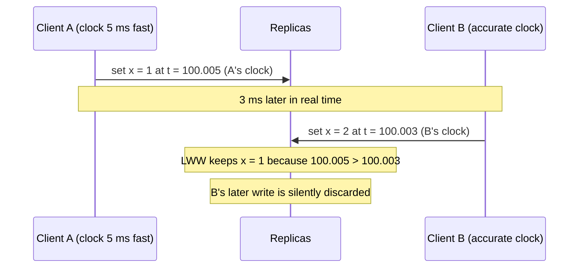
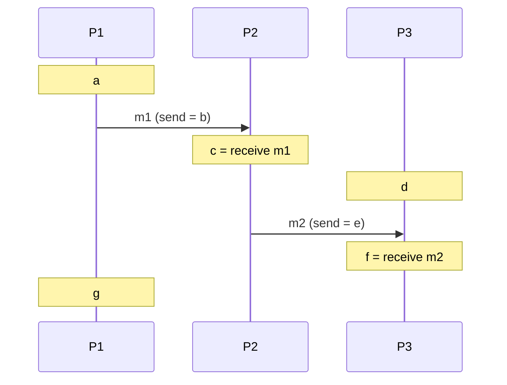

# Chapter 3. Time, Clocks and the Ordering of Events

> "The concept of time is fundamental to our way of thinking. It is derived from the more basic concept of the order in which events occur."
> — Leslie Lamport, "Time, Clocks, and the Ordering of Events in a Distributed System" (1978)

## What you will learn

- Why physical clocks on different machines disagree, and how NTP and PTP reduce (but never remove) the disagreement.
- The danger of using wall-clock timestamps to order events, with a concrete data-loss example.
- Lamport's happened-before relation, the formal foundation of ordering in distributed systems.
- Lamport clocks and vector clocks: what each can and can't tell you, with proofs.
- Hybrid logical clocks, and Google Spanner's TrueTime.
- How to choose a clock for a given job.

---

## 3.1 Why "what happened first?" is hard

On one machine, events are ordered by the CPU: if instruction A executed before instruction B, everyone agrees. In a distributed system, there is no shared CPU and no shared clock. Two nodes each record "event at 10:00:00.123". Which happened first? You can't say unless you know their clocks agree, and they don't.

Yet systems constantly need to order events:

- Which of two concurrent writes to the same key should win?
- Did this message cause that one?
- Has this lease expired?
- Which log entries came before the snapshot?

This chapter gives you three tools: physical clocks (with honest error bounds), logical clocks (which capture causality without real time), and hybrids of the two.

## 3.2 Physical clocks

Every computer has a hardware oscillator (usually a quartz crystal) that ticks at a nominal frequency. The operating system counts ticks to keep the **time of day** (wall-clock time). Two problems:

- **Drift:** oscillators run slightly fast or slow, affected by temperature and manufacturing variation. A typical quartz clock drifts by tens of parts per million (ppm). At 50 ppm, a clock gains or loses about 4.3 seconds per day.
- **Skew:** at any instant, two clocks show different times. Skew grows with drift unless the clocks are corrected.

### Two kinds of clock in every operating system

| Clock | What it measures | Can it jump? | Use for |
|---|---|---|---|
| **Time-of-day** (e.g. `CLOCK_REALTIME`, `time.time()` in Python) | Seconds since an epoch (1 January 1970 UTC for Unix) | Yes: forward or *backward* when corrected | Displaying times to humans; timestamps that must be comparable roughly across machines |
| **Monotonic** (e.g. `CLOCK_MONOTONIC`, `time.monotonic()`) | Time since an arbitrary point (often boot) | No; only moves forward | Measuring durations: timeouts, latencies, lease durations *on one machine* |

**Rule:** measure durations with the monotonic clock. A timeout measured with the time-of-day clock can fire early or never if the clock is stepped. Monotonic clock values from different machines are meaningless relative to each other.

### Synchronisation: NTP and PTP

- **NTP** (Network Time Protocol, designed by David Mills, current version NTPv4, RFC 5905) synchronises clocks with time servers over the network. A client exchanges timestamped packets with a server and estimates the offset, assuming the network delay is symmetric. Over the internet, accuracy is typically within a few to tens of milliseconds; within a data centre, often better than a millisecond. But NTP can be wrong by much more when network paths are asymmetric, servers are misconfigured or the client is overloaded.
- **PTP** (Precision Time Protocol, IEEE 1588) uses hardware timestamping in NICs and switches to achieve sub-microsecond accuracy within a local network. Cloud providers now offer high-precision time services to their virtual machines, for example Amazon Time Sync Service (with microsecond-level accuracy on supported instances) and Google's internal time infrastructure *(as of October 2026)*.

Synchronisation reduces skew. It never eliminates it, and its error is not always known. When the NTP daemon corrects a clock that is far off, it may **step** the clock (jump it), possibly backwards. Leap seconds have historically caused outages when software mishandled a minute with 61 seconds; large providers now **smear** leap seconds over many hours instead, and in 2022 the General Conference on Weights and Measures resolved to stop adding leap seconds by 2035.

## 3.3 The danger of timestamps: last write wins

A common way to resolve concurrent writes is **last write wins (LWW)**: each write carries a timestamp from the writer's clock, and replicas keep the write with the highest timestamp.



B's write happened later in real time, and B may even have read x = 1 before writing x = 2. But because A's clock ran fast, A's earlier write "wins". The system silently loses data. This is not an exotic scenario: it happens whenever skew exceeds the gap between writes. Systems using LWW (Cassandra by default, for example) document this; applications must decide whether that loss is acceptable for each piece of data.

The deeper lesson: **physical timestamps from different machines don't reliably reflect causality.** For that, we need a different notion of order.

## 3.4 Happened-before

In 1978, Leslie Lamport defined an order based only on what could *causally* influence what. It's one of the most cited papers in computer science.

Model each process as a sequence of **events**: local computation, sending a message, receiving a message. The **happened-before** relation, written a → b, is the smallest relation such that:

1. If a and b are events in the same process and a comes before b, then a → b.
2. If a is the sending of a message and b is the receipt of that same message, then a → b.
3. If a → b and b → c, then a → c (transitivity).

If neither a → b nor b → a, the events are **concurrent**, written a ∥ b. "Concurrent" here doesn't mean "at the same instant"; it means neither could have influenced the other.



Here a → b → c → e → f, so a → f. But d ∥ a, d ∥ c and g ∥ f: no chain of messages connects them.

Happened-before is a **partial order**: some pairs of events are ordered, others aren't. That's the truth about a distributed system. Any **total order** (where every pair is ordered) is a choice layered on top.

## 3.5 Lamport clocks

A **Lamport clock** (or **logical clock**) assigns each event a number L(e) such that if a → b then L(a) < L(b). Each process keeps a counter:

1. Before each local event or send, increment the counter.
2. Every message carries the sender's counter value.
3. On receiving a message with value t, set counter = max(counter, t), then increment.

```python
class LamportClock:
    def __init__(self):
        self.time = 0
    def tick(self):                 # local event or send
        self.time += 1
        return self.time
    def receive(self, msg_time):    # on message receipt
        self.time = max(self.time, msg_time) + 1
        return self.time
```

### ◆ Formal: the clock condition, and its converse

**Theorem (clock condition).** If a → b then L(a) < L(b).

*Proof sketch.* By induction on the length of the shortest chain of rules 1 and 2 that establishes a → b. For rule 1, the counter strictly increases between successive events on one process. For rule 2, the receiver sets its counter to at least the message's value, then increments, so the receive event's value exceeds the send event's. Transitivity of < gives the rest. ∎

**The converse is false.** L(a) < L(b) does *not* imply a → b. In the diagram above, d on P3 might have L(d) = 1 and c on P2 might have L(c) = 3, but d ∥ c. Lamport clocks can't detect concurrency.

### A total order from Lamport clocks

Break ties with process IDs: order events by (L(e), process ID). This gives a total order consistent with causality. Lamport used it to build a distributed mutual-exclusion algorithm, and showed that any system that agrees on a total order of commands can implement any state machine: the root of **state machine replication** (Chapter 11).

## 3.6 Vector clocks

To detect concurrency, each process keeps a vector with one counter per process. Vector clocks were introduced independently by Colin Fidge and Friedemann Mattern in 1988.

Process *i* keeps vector V of length n:

1. Before each local event or send, increment V[i].
2. Every message carries the sender's whole vector.
3. On receiving vector W: set V[j] = max(V[j], W[j]) for every j, then increment V[i].

Compare vectors component-wise:

- V ≤ W if V[j] ≤ W[j] for all j.
- V < W if V ≤ W and V ≠ W.
- V ∥ W if neither V ≤ W nor W ≤ V.

### ◆ Formal: vector clocks characterise causality exactly

**Theorem.** For events a and b with vector timestamps V(a) and V(b): a → b if and only if V(a) < V(b). Consequently a ∥ b if and only if V(a) ∥ V(b).

*Proof sketch.* (⇒) As for Lamport clocks: every step along a causal chain is component-wise non-decreasing, and the step at the destination process strictly increases its own component. (⇐) Interpret V(e)[j] as the number of events on process j that happened-before-or-equal e. This is an invariant of the update rules: a process learns about another process's events only through messages, which carry exactly the sender's knowledge, and max merges the two histories. Now suppose V(a) < V(b), with a on process i. Then V(a)[i] ≤ V(b)[i], so b's history includes at least V(a)[i] events of process i, including a itself; hence a → b (or a = b, excluded by strictness). ∎

The cost: each timestamp has n entries, which is fine for a handful of replicas but unwieldy for thousands of clients. Practical systems bound the size by tracking only replicas, not clients (**version vectors**, used to detect conflicting versions of a value in Dynamo-style stores, Chapter 6), or by using **dotted version vectors** (Preguiça and colleagues, 2010) to avoid false conflicts.

[`examples/logical-clocks/`](../examples/logical-clocks/) implements Lamport and vector clocks over randomised message-passing runs, and checks both theorems against the true happened-before relation computed from the event graph. In one seeded run with three processes, 56 of the 136 pairs of events are concurrent, and Lamport timestamps make 47 of those 56 *look* ordered (one has a smaller number than the other). Vector clocks classify all 136 pairs correctly. In the hybrid-logical-clock simulation with ±50 units of clock skew, raw physical timestamps put 4 of 14 message receipts no later than their sends (effects before causes); HLC timestamps get none wrong.

## 3.7 Hybrid logical clocks

Logical clocks capture causality but have nothing to do with real time, so you can't ask "show me the state as of 10:00". Physical clocks relate to real time but can violate causality. A **hybrid logical clock (HLC)**, proposed by Sandeep Kulkarni and colleagues in 2014, combines them.

An HLC timestamp is a pair (l, c):

- l tracks the largest physical time the process has heard of (its own clock, or one carried by a message);
- c is a logical counter that breaks ties when l doesn't advance.

Update rules (pt is the local physical clock):

```
on local event or send:
    l' = max(l, pt)
    c  = c + 1 if l' == l else 0
    l  = l'
on receive (l_m, c_m):
    l' = max(l, l_m, pt)
    if l' == l == l_m: c = max(c, c_m) + 1
    elif l' == l:      c = c + 1
    elif l' == l_m:    c = c_m + 1
    else:              c = 0
    l = l'
```

Properties: HLC timestamps satisfy the clock condition (a → b implies HLC(a) < HLC(b)); l stays within the clock-synchronisation error ε of real physical time; and the counter c stays small (bounded in terms of ε and message rates). HLCs fit in a 64-bit integer, look like timestamps to humans, and support "as of" queries. CockroachDB and YugabyteDB use HLCs to order transactions (Chapter 20).

## 3.8 TrueTime: embracing uncertainty

Google's **Spanner** database (Corbett and colleagues, OSDI 2012) took a different approach. Instead of pretending to know the time, its **TrueTime** API returns an *interval*:

```
TT.now() → [earliest, latest]
```

with the guarantee that the true absolute time lies within the interval. Google keeps the interval small (single-digit milliseconds, reported later as typically under 1 ms in some deployments) using GPS receivers and atomic clocks in every data centre.

Spanner then uses **commit wait**: when a transaction commits with timestamp s, the leader waits until TT.now().earliest > s before making the commit visible. After the wait, any transaction that starts after this one becomes visible, anywhere in the world, is guaranteed a larger timestamp. That gives **external consistency** (equivalent to strict serializability, Chapter 8) across the globe, at the cost of waiting out the uncertainty on every commit. The smaller the uncertainty, the shorter the wait: Google spends on clock hardware to buy latency.

The lesson generalises: **if you must use physical time for correctness, use bounded uncertainty and wait it out.** Amazon's ClockBound, an open-source daemon and library, exposes similar error bounds on AWS instances, and Amazon Aurora DSQL (announced 2024) uses precise time to order transactions *(as of October 2026)*.

## 3.9 Choosing a clock

| Need | Use | Why |
|---|---|---|
| Measure a timeout or latency on one machine | Monotonic clock | Never jumps |
| Show a time to a human | Time-of-day clock | Relates to calendar time |
| Order events consistently with causality | Lamport clock (+ process ID) | Cheap; total order |
| Detect concurrent updates to replicated data | Version vectors / vector clocks | Exact concurrency detection |
| Causality plus approximate real time; "as of" queries | Hybrid logical clock | Compact; human-readable |
| Real-time ordering across the world (strict serializability) | Bounded-uncertainty time (TrueTime-style) with commit wait, or a consensus-based total order | Correct under known uncertainty |
| Decide which concurrent write wins | Be explicit: LWW (accept loss), keep siblings, or merge with a CRDT (Chapter 10) | Silent loss is a design choice, not an accident |

---

## Summary

- Physical clocks drift and skew; NTP and PTP reduce but don't remove disagreement, and time-of-day clocks can jump. Measure durations with monotonic clocks.
- Last-write-wins with wall-clock timestamps silently loses writes when skew exceeds the gap between writes.
- Lamport's happened-before relation defines causality as a partial order; events not related by it are concurrent.
- Lamport clocks satisfy "a → b implies L(a) < L(b)" but can't detect concurrency. Vector clocks characterise causality exactly, at O(n) cost per timestamp.
- Hybrid logical clocks combine causality with approximate physical time in 64 bits. TrueTime exposes clock uncertainty explicitly, and Spanner waits it out to achieve global strict serializability.
- Choose the clock that matches the guarantee you need, and make conflict resolution an explicit design choice.

## Exercises

See [`exercises/03-time-and-order.md`](../exercises/03-time-and-order.md).

## Further reading

- Leslie Lamport, "Time, Clocks, and the Ordering of Events in a Distributed System", *Communications of the ACM* (1978).
- Colin Fidge, "Timestamps in Message-Passing Systems That Preserve the Partial Ordering" (1988); Friedemann Mattern, "Virtual Time and Global States of Distributed Systems" (1988).
- Sandeep Kulkarni et al., "Logical Physical Clocks" (OPODIS 2014), introducing hybrid logical clocks.
- James C. Corbett et al., "Spanner: Google's Globally-Distributed Database", OSDI (2012).
- David Mills et al., RFC 5905, "Network Time Protocol Version 4" (2010).
- Justin Sheehy, "There Is No Now", *ACM Queue* (2015).
