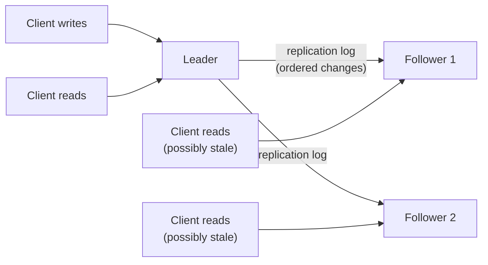
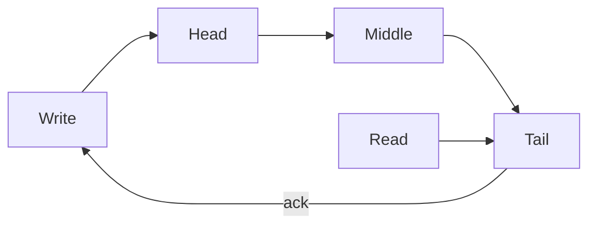

# Chapter 6. Replication

> "Keeping copies is easy. Keeping them the same is the whole problem."

## What you will learn

- Why we replicate data, and the three main architectures: single-leader, multi-leader and leaderless.
- Synchronous versus asynchronous replication, and what each costs in latency and durability.
- How followers are added, how failover works, and the ways failover goes wrong.
- Replication lag and the anomalies it causes, with the guarantees that fix them.
- Conflict handling in multi-leader and leaderless systems.
- Quorums, with a proof of the intersection property and a careful account of what quorums do *not* guarantee.
- Chain replication, and how replicated logs connect replication to consensus.

---

## 6.1 Why replicate

**Replication** keeps copies of the same data on several nodes, called **replicas**. Reasons:

- **Durability:** data survives the loss of a disk, machine or data centre.
- **Availability:** the system keeps serving when some replicas are down.
- **Read scalability:** more replicas can serve more reads.
- **Latency:** replicas close to users answer faster.

If data never changed, replication would be trivial: copy it once. Every difficulty comes from **changes**: making sure every replica applies every write, in an order that leaves them consistent, despite crashes, lost messages and concurrent writes.

There are three broad architectures, distinguished by *who accepts writes*.

## 6.2 Single-leader replication

One replica is the **leader** (also called **primary** or **master**). All writes go to the leader, which applies them and sends them, in order, to the other replicas, the **followers** (**secondaries**, **replicas**). Reads can go to the leader (fresh) or to followers (possibly stale).

This is how PostgreSQL streaming replication, MySQL replication, MongoDB replica sets and many others work. It's popular because the leader imposes a single order on all writes, so followers never see conflicting writes.

### What gets replicated

- **Statement-based:** send the SQL statements. Fragile: statements with non-deterministic functions (`NOW()`, `RAND()`) or side effects give different results on different replicas.
- **Write-ahead log (WAL) shipping:** send the storage engine's low-level log. Exact, but tied to the storage format, which complicates upgrades with mixed versions.
- **Logical (row-based) replication:** send a log of row-level changes (insert this row, update these columns). Decoupled from storage internals and readable by other systems: this is also the basis of **change data capture** (CDC, Chapter 14).

### Synchronous versus asynchronous

| Mode | Leader acknowledges the write when… | Durability on leader failure | Latency | Availability of writes |
|---|---|---|---|---|
| **Synchronous** | All (or specific) followers confirm | No acknowledged write lost | Waits for slowest synchronous follower | One slow follower blocks writes |
| **Semi-synchronous** | At least one follower confirms | Acknowledged writes survive loss of the leader | Waits for one follower | Tolerates slow followers |
| **Asynchronous** | Leader has written locally | Recent acknowledged writes may be lost | Fastest | Highest |

Fully synchronous replication to every follower is rarely used, because any single slow or failed follower stalls all writes. Most production systems use asynchronous replication, or semi-synchronous replication to one or a quorum of followers. Consensus-based replication (Raft, Paxos) acknowledges once a **majority** has the write, which is the principled form of this compromise (Chapter 11).

### Adding a follower

You can't just copy the data files while writes continue: the copy would be inconsistent. The standard procedure:

1. Take a consistent **snapshot** of the leader's data, associated with a precise position in the replication log (PostgreSQL's log sequence number, MySQL's binlog coordinates or GTID).
2. Copy the snapshot to the new follower.
3. The follower requests all changes since that log position and applies them until it has caught up.

### Failover

When the leader fails, a follower must be promoted. Failover is where single-leader replication gets dangerous.

1. **Detect** that the leader has failed: usually by timeout, with all the uncertainty of Chapter 2.
2. **Choose** a new leader: ideally the follower with the most up-to-date data. Choosing requires agreement, which is a consensus problem (Chapter 11).
3. **Reconfigure** clients and other followers to use the new leader, and ensure the old leader, if it comes back, steps down.

What goes wrong:

- **Lost writes.** With asynchronous replication, the new leader may lack writes the old leader acknowledged. When the old leader returns, its extra writes conflict with new ones and are usually discarded. A GitHub incident in 2012 involved a promoted MySQL follower that was behind; reused auto-increment primary keys then collided with keys also stored in a Redis cache, so some users briefly saw other users' private data.
- **Split brain.** If the old leader didn't actually die (it was just slow or partitioned), two nodes may both accept writes. Without a mechanism to stop the old leader (**fencing**, Chapter 12), data diverges.
- **Bad timeouts.** Too short, and a temporary load spike triggers unnecessary failovers that make things worse; too long, and recovery is slow.

Safe automatic failover needs consensus on who the leader is, plus fencing of old leaders. Many systems use an external coordination service (ZooKeeper, etcd) or a built-in consensus protocol for exactly this reason.

## 6.3 Replication lag and read anomalies

With asynchronous followers, reads from followers may return stale data. In steady state the lag is often milliseconds, but under load or after a network hiccup it can grow to seconds or minutes. Three anomalies matter to users, each with a corresponding guarantee:

| Anomaly | Example | Guarantee that prevents it | How to implement |
|---|---|---|---|
| A user doesn't see their own write | Posts a comment, reloads, comment is missing | **Read-your-writes** (read-after-write consistency) | Read your own recent data from the leader; or track the log position of the user's last write and read only from replicas that have reached it |
| Time goes backwards | Sees a comment, reloads, it's gone (second read hit a staler replica) | **Monotonic reads** | Route each user's reads to the same replica; or track the highest log position seen |
| Effects appear before causes | Sees an answer before the question it replies to | **Consistent prefix reads** (causal ordering) | Keep causally related writes in the same partition; or track causal dependencies |

These are examples of **session guarantees**, introduced in the Bayou system (Terry and colleagues, 1994): read-your-writes, monotonic reads, writes-follow-reads and monotonic writes. Chapter 8 places them in the wider hierarchy of consistency models.

## 6.4 Multi-leader replication

In **multi-leader** (or **active-active**) replication, several replicas accept writes and replicate them to each other. Use cases:

- **Multiple data centres or regions,** each with a local leader, so writes are fast everywhere and each region keeps working if inter-region links fail.
- **Offline-capable clients:** a phone's local database is effectively a leader that syncs later.
- **Collaborative editing:** each user's copy accepts edits (Chapter 10).

The price is **write conflicts**: two leaders accept concurrent writes to the same data.

### Conflict resolution strategies

| Strategy | How it works | Risk |
|---|---|---|
| **Avoid conflicts** | Route all writes for a given record to the same leader (e.g. a user's "home" region) | Breaks down when the home region fails or the user moves |
| **Last write wins (LWW)** | Keep the write with the highest timestamp or ID | Silent data loss (Chapter 3 §3.3) |
| **Keep all versions (siblings)** | Store the conflicting versions; let the application or user merge them | Application complexity |
| **Merge automatically** | Use data types whose concurrent updates always merge sensibly | Needs CRDTs or operational transformation (Chapter 10) |
| **Custom resolution logic** | Application code runs on conflict (on write or on read) | Hard to get right; must be deterministic and commutative |

### Topologies

Leaders may replicate in a circle, a star, or all-to-all. All-to-all is the most fault-tolerant but can deliver writes out of causal order (a later update arriving at some replica before the insert it modifies), so writes need causal metadata such as version vectors.

## 6.5 Leaderless replication

In **leaderless** replication, popularised by Amazon's Dynamo paper (DeCandia and colleagues, SOSP 2007) and used by Cassandra, Riak and ScyllaDB, any replica can accept writes, and clients (or a coordinator node acting for them) send each write to several replicas in parallel.

With **n** replicas for a key:

- a write is sent to all n and considered successful when **w** replicas acknowledge it;
- a read is sent to (some or all) replicas and returns once **r** have responded; the client takes the newest version among them.

### ◆ Formal: quorum intersection

**Theorem.** If r + w > n, every set of r replicas intersects every set of w replicas.

*Proof.* Let R and W be subsets of the n replicas with |R| = r and |W| = w. By inclusion–exclusion, |R ∩ W| = |R| + |W| − |R ∪ W| ≥ r + w − n > 0, since |R ∪ W| ≤ n. ∎

**Conversely**, if r + w ≤ n, there exist disjoint R and W (take W as any w replicas and R from the remaining n − w ≥ r). So r + w > n is exactly the condition for guaranteed overlap.

Intersection means that at least one replica in any read quorum has seen any write that completed with a write quorum. If versions are totally ordered (for example by a version number assigned by the writer), the reader can identify the latest one. Common choices: n = 3, w = 2, r = 2; or n = 5, w = 3, r = 3. With w = n and r = 1, reads are fast but a single slow replica blocks writes; with r = n and w = 1, the reverse.

[`examples/quorum-store/`](../examples/quorum-store/) simulates a leaderless store and verifies the theorem by brute force, then shows, over many randomised runs, that stale reads occur when r + w ≤ n and don't (for completed writes) when r + w > n. With n = 3 and replicas crashing and recovering at random, the measured stale-read rates over 40,000 operations were:

| | w = 1 | w = 2 | w = 3 |
|---|---|---|---|
| **r = 1** | 34.4% | 15.0% | 0% |
| **r = 2** | 10.2% | 0% | 0% |
| **r = 3** | 0% | 0% | 0% |

Every cell with r + w > 3 is zero, as the theorem predicts. The cost appears elsewhere: with w = 3, 36.8% of writes failed because a replica was down, against 5.4% with w = 2. [`examples/tla/QuorumIntersection.tla`](../examples/tla/) checks the same property with TLC.

### What quorums do *not* guarantee

Quorums are often described as giving "strong consistency". On their own, they don't give linearizability (Chapter 8):

1. **Concurrent writes and reads.** A read that overlaps a write in progress may see the new value on one replica and the old value on others. If two such reads happen one after the other, the first may return the new value and the second the old one, which linearizability forbids. Fix: **read repair before returning** (the reader writes the newest value it saw back to a quorum before replying), as in the ABD algorithm (Attiya, Bar-Noy and Dolev, 1995).
2. **Failed writes aren't rolled back.** A write that reached fewer than w replicas is reported as failed but may remain on the replicas it reached, and later reads may return it.
3. **Sloppy quorums.** During failures, Dynamo-style systems may accept writes on nodes outside the key's designated n replicas (**hinted handoff**), to stay available. Then r + w > n no longer implies intersection with the designated replicas.
4. **LWW conflict resolution with clock skew** can drop writes that did complete (Chapter 3).
5. **A node that loses data** (restored from an old backup, or a disk failure) silently breaks the quorum assumption.

### Anti-entropy

Leaderless systems need background processes to bring replicas back into agreement:

- **Read repair:** when a read sees stale replicas, it writes the newest version to them.
- **Hinted handoff:** a node that temporarily accepted a write for an unavailable replica forwards it when the replica returns.
- **Anti-entropy with Merkle trees:** replicas periodically compare hashes of data ranges, arranged in a **Merkle tree** (a tree in which each internal node is a hash of its children), so they can find differing ranges by exchanging only O(log n) hashes per difference, then sync only those ranges.

## 6.6 Chain replication

**Chain replication** (van Renesse and Schneider, OSDI 2004) arranges replicas in a chain. Writes enter at the **head**, pass down the chain, and are acknowledged by the **tail**. Reads go to the tail.

Because the tail only has writes that every replica has, reads from the tail are linearizable, and writes are durable on all replicas when acknowledged. Throughput is high because each node forwards to just one successor. Failures are handled by a separate configuration service that removes failed nodes and splices the chain. Variants such as **CRAQ** (Terrace and Freedman, 2009) allow reads from any replica by checking with the tail when a replica has uncommitted versions. Chain replication and its variants appear in storage systems; for example, the stream layer of Microsoft's Windows Azure Storage (Calder and colleagues, SOSP 2011) replicates each extent through a chain-like sequence of extent nodes.

## 6.7 Replicated logs and state machine replication

All replication schemes are variations on one idea: **state machine replication** (Lamport 1978; Schneider 1990). If every replica:

1. starts in the same state,
2. applies the same sequence of deterministic commands,

then every replica passes through the same sequence of states. So the replication problem reduces to agreeing on a **log**: an ordered sequence of commands. Single-leader replication gets the order from the leader; consensus protocols (Chapter 11) get it in a way that survives leader failure without losing acknowledged entries or creating split brain. That's why consensus is at the heart of every strongly consistent replicated system.

Two caveats make "deterministic commands" harder than it sounds: commands must not depend on local time, randomness or local state not in the log; and the order must be agreed even across failover. Systems that let replicas compute timestamps or random IDs independently are a common source of divergence.

## 6.8 Choosing a replication approach

| Need | Approach |
|---|---|
| Strong consistency, simple model, moderate write volume | Single leader with consensus-based failover (e.g. Raft); synchronous or quorum acknowledgement |
| Read scaling, tolerate slightly stale reads | Single leader with asynchronous read replicas, plus session guarantees |
| Writes in many regions, low latency, tolerate conflicts | Multi-leader with explicit conflict resolution (prefer CRDTs) |
| Very high availability for writes, simple key-value access | Leaderless quorums with anti-entropy; understand the caveats |
| Offline clients and collaboration | Multi-leader at the edge with CRDTs (Chapter 10) |

---

## Summary

- Replication provides durability, availability, read scaling and low latency. All the difficulty comes from writes.
- Single-leader replication orders writes at the leader. Synchronous, semi-synchronous and asynchronous modes trade durability against latency. Failover risks lost writes and split brain, and needs consensus plus fencing.
- Replication lag causes stale reads; session guarantees (read-your-writes, monotonic reads, consistent prefix) restore sanity for users.
- Multi-leader replication enables multi-region writes and offline use, at the cost of conflicts; LWW silently loses data.
- Leaderless quorums intersect exactly when r + w > n, but don't by themselves give linearizability. Read repair, hinted handoff and Merkle-tree anti-entropy keep replicas converging.
- Chain replication gives linearizable reads at the tail with high throughput.
- All replication reduces to agreeing on a log of deterministic commands: state machine replication, which consensus makes fault-tolerant.

## Exercises

See [`exercises/06-replication.md`](../exercises/06-replication.md).

## Further reading

- Giuseppe DeCandia et al., "Dynamo: Amazon's Highly Available Key-value Store", SOSP (2007).
- Robbert van Renesse and Fred B. Schneider, "Chain Replication for Supporting High Throughput and Availability", OSDI (2004).
- Fred B. Schneider, "Implementing Fault-Tolerant Services Using the State Machine Approach: A Tutorial", *ACM Computing Surveys* (1990).
- Douglas B. Terry et al., "Session Guarantees for Weakly Consistent Replicated Data", PDIS (1994).
- Hagit Attiya, Amotz Bar-Noy and Danny Dolev, "Sharing Memory Robustly in Message-Passing Systems", *Journal of the ACM* (1995).
- Martin Kleppmann and Chris Riccomini, *Designing Data-Intensive Applications* (2nd edition, 2026), chapter on replication.
- GitHub blog, "GitHub availability this week" (September 2012), the incident report behind the failover example in §6.2.
