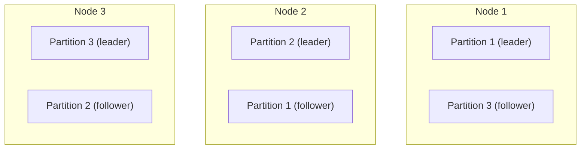
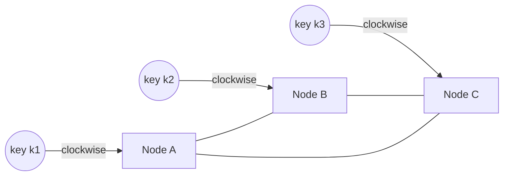

# Chapter 7. Partitioning

> "Divide and conquer works until the data refuses to divide evenly."

## What you will learn

- Why and when to partition (shard) data across machines.
- Partitioning by key range and by hash, with their trade-offs.
- Consistent hashing and rendezvous hashing, with the math of how much data moves when nodes change.
- Skew and hot spots, and techniques for handling hot keys.
- Secondary indexes on partitioned data: local versus global.
- Rebalancing strategies, and routing requests to the right partition.
- How partitioning interacts with transactions and queries.

---

## 7.1 Why partition

**Partitioning** (also called **sharding**) splits a dataset into subsets, called **partitions** or **shards**, each stored on a different node (or set of replicas). It's needed when the data or the write load is too large for one machine (Chapter 1 §1.6). Each record belongs to exactly one partition; each partition is usually replicated (Chapter 6), so a node typically holds replicas of several partitions.

The goals:

1. **Spread data and load evenly**, so no node becomes a bottleneck.
2. **Keep related data together**, so common queries touch one partition.
3. **Move little data** when nodes are added or removed.

These goals conflict, and the choice of partitioning scheme is one of the hardest-to-change decisions in a system's design.

## 7.2 Partitioning by key range

Assign each partition a contiguous range of keys, like volumes of an encyclopaedia: A–C, D–F, and so on. Used by HBase, Bigtable, Spanner, CockroachDB, TiKV, MongoDB (range-based sharding) and others.

| Strengths | Weaknesses |
|---|---|
| Range scans are efficient: "all events for sensor 42 between 10:00 and 11:00" reads one or a few partitions | Skew: if keys aren't evenly distributed, partitions are uneven |
| Keys stay sorted, which suits time-series and prefix queries | Hot spots for sequential keys: if the key is a timestamp, all current writes go to the last partition |
| Partitions can split when they grow and merge when they shrink | Boundaries must be chosen and adjusted, ideally automatically |

The sequential-key hot spot is a classic mistake. Fixes: prefix the key with something that spreads writes (sensor ID before timestamp), or add a small hash prefix ("salting") at the cost of fanning range scans out to every prefix.

Systems that partition by range usually **split** a partition automatically when it exceeds a size threshold (for example, CockroachDB's default range size is 512 MiB *(as of October 2026)*), and some split on load as well as size.

## 7.3 Partitioning by hash

Apply a hash function to the key and assign partitions by hash value. A good hash spreads even skewed or sequential keys uniformly. Used by Cassandra, DynamoDB, Redis Cluster, Riak and many others.

The cost: range queries on the key become scatter-gather across all partitions, because adjacent keys land on different partitions. A common compromise is a **compound key**: hash the first part to choose the partition and keep the rest sorted within it. Cassandra's partition key plus clustering columns, and DynamoDB's partition key plus sort key, work this way: "all orders for customer 123, sorted by date" lives in one partition.

### The trouble with hash mod N

The obvious scheme, `partition = hash(key) mod N` for N nodes, is a trap. When N changes to N + 1, a key stays put only if hash mod N = hash mod (N + 1), which for a uniform hash happens for roughly 1/(N + 1) of keys. **Almost all data moves.** Adding a node to a 10-node cluster would move about 91% of the data.

## 7.4 Consistent hashing

**Consistent hashing** (Karger and colleagues, STOC 1997, originally for web caches) fixes this. Map both nodes and keys onto a circle of hash values (the **ring**). Each key belongs to the first node clockwise from the key's position.

When a node joins, it takes over only the keys between its position and its predecessor's; every other key stays where it is. When a node leaves, only its keys move, to its successor.

### ◆ Formal: how much data moves

**Claim.** With N nodes placed uniformly at random on the ring and keys hashed uniformly, adding one node moves an expected 1/(N + 1) of the keys, all of them to the new node.

*Argument.* After the addition there are N + 1 nodes placed uniformly at random. By symmetry each node owns, in expectation, 1/(N + 1) of the ring, and hence of the keys. Keys move only if they now fall in the new node's arc, which belonged to its successor before. So the expected fraction moved is 1/(N + 1), the minimum possible for an even redistribution. (Compare hash mod N, which moves about N/(N + 1).) ∎

### Virtual nodes

With one point per node, arcs vary wildly in size: the largest arc among N random points is about (ln N)/N of the ring, so the most-loaded node gets roughly ln N times its fair share. The fix is **virtual nodes** (vnodes): each physical node is placed at many points (say 100–256). Each node's total share is then a sum of many small arcs and concentrates near 1/N; the imbalance shrinks roughly in proportion to 1/√v for v virtual nodes per node. Virtual nodes also let a more powerful machine take more points, and when a node leaves, its load spreads across many others rather than all landing on one successor. Cassandra historically used 256 vnodes per node; newer versions recommend fewer (16 in Cassandra 4.0 and later defaults) combined with a token allocation algorithm that places them evenly *(as of October 2026)*.

### Rendezvous hashing

**Rendezvous hashing** (Thaler and Ravishankar, 1996), also called **highest random weight (HRW)** hashing, is a simpler alternative: for each key, compute a score hash(key, node) for every node, and assign the key to the highest-scoring node (or the top k, for k replicas). Adding a node moves exactly the keys for which the new node now scores highest, again an expected 1/(N + 1). It needs no ring or virtual nodes and balances well, at the cost of O(N) hash computations per lookup (fine for tens or hundreds of nodes, and the lookup result can be cached).

[`examples/consistent-hashing/`](../examples/consistent-hashing/) measures key movement for mod-N, ring and rendezvous hashing, and load imbalance as the number of virtual nodes grows. Growing a cluster from 10 to 11 nodes with 20,000 keys (ideal movement 1/11 ≈ 9.1%):

| Scheme | Keys moved |
|---|---|
| hash mod N | 90.8% |
| Ring, 100 virtual nodes per node | 9.6% |
| Rendezvous hashing | 9.3% |

Load imbalance (busiest node's load ÷ average) on a 10-node ring falls from 2.32 with one point per node, to 1.51 with 10 virtual nodes, 1.12 with 100 and 1.05 with 1,000; rendezvous hashing achieves 1.06 with no virtual nodes at all.

## 7.5 Fixed partitions and dynamic splitting

Many production systems avoid moving individual keys at all:

- **A fixed, large number of partitions.** Create many more partitions than nodes (say 1,000 partitions for 10 nodes). Keys map to partitions by hash and never move between partitions. Rebalancing moves whole partitions between nodes. Used by Elasticsearch (shards are fixed at index creation), Riak, Couchbase and Kafka (topic partitions; Chapter 21). The downside: the partition count must be chosen up front, and changing it is expensive.
- **Dynamic splitting.** Partitions split when they grow too big or too hot, and merge when small (HBase, Bigtable, CockroachDB, TiKV, DynamoDB).
- **Partitioning proportional to nodes.** A fixed number of partitions per node; new nodes split existing partitions (Cassandra's vnodes are an example).

## 7.6 Skew and hot keys

Even with perfect hashing, load can be skewed because **some keys are far more popular than others**. A celebrity's posts, a viral product, a global configuration key. Hashing spreads *keys* evenly; it can't spread the load of a *single* key.

Techniques:

| Technique | How it works | Cost |
|---|---|---|
| **Caching** hot reads | Serve hot keys from a cache layer (Chapter 18) | Staleness; invalidation |
| **Read replicas** for hot partitions | More copies serve more reads | Writes still go to one place |
| **Key splitting (salting)** for hot writes | Write to `key#0` … `key#9` at random; read all ten and combine | Reads fan out; only works for combinable data (counters, append-only lists) |
| **Adaptive capacity** | The system detects and isolates hot keys automatically (DynamoDB's adaptive capacity and split-for-heat) | Opaque; has limits |
| **Application redesign** | Avoid a single global counter or lock | Engineering effort |

Measure skew rather than guessing: per-partition request rates and the top keys by traffic. A useful rule: the busiest partition, not the average, determines whether you're overloaded.

## 7.7 Secondary indexes

Partitioning by primary key works for lookups by primary key. What about "find all red cars" when cars are partitioned by ID?

### Local (document-partitioned) indexes

Each partition indexes only its own data. Writes touch one partition. Reads by the secondary key must query **every** partition and merge the results (**scatter-gather**). Used by MongoDB, Cassandra's local secondary indexes, Elasticsearch.

Scatter-gather suffers from **tail latency amplification**: the query is as slow as the slowest partition. If each partition independently has a 1% chance of a slow response, a query that touches 100 partitions has a 1 − 0.99¹⁰⁰ ≈ 63% chance of being slow. Jeff Dean and Luiz André Barroso's "The Tail at Scale" (2013) analyses this and describes mitigations such as hedged requests (Chapter 17).

### Global (term-partitioned) indexes

The index itself is partitioned by the indexed value: all entries for "colour = red" live in one index partition. Reads by the secondary key touch one index partition. Writes must update the record's partition *and* one or more index partitions, which are usually different, so the index is either updated with a distributed transaction (slow) or **asynchronously** (the index lags). DynamoDB's global secondary indexes are asynchronous: they're **eventually consistent** with the base table.

| | Local index | Global index |
|---|---|---|
| Write cost | One partition | Several partitions |
| Read by secondary key | All partitions (scatter-gather) | One index partition |
| Index freshness | Synchronous with the record | Often asynchronous (eventually consistent) |

## 7.8 Rebalancing

Moving partitions between nodes is called **rebalancing**. Requirements: after rebalancing, load is fair; during it, the system keeps serving; and it moves no more data than necessary.

**Automatic or manual?** Fully automatic rebalancing is convenient but dangerous in combination with automatic failure detection: a node that's slow because it's overloaded is declared dead, its partitions move to other nodes, adding load to them and to the network, which makes more nodes slow, and so on. Many operators prefer the system to *propose* a rebalancing plan and a human (or a rate-limited controller) to apply it. Either way, **rate-limit data movement** so rebalancing never starves foreground traffic.

## 7.9 Request routing

How does a client find the node holding a key? Three approaches:

1. **Any node routes.** The client contacts any node; if that node doesn't own the key, it forwards the request (Cassandra's coordinator, Redis Cluster's redirect responses).
2. **A routing tier.** A partition-aware proxy or router forwards requests (MongoDB's `mongos`, Vitess's VTGate for MySQL).
3. **Partition-aware clients.** The client library knows the partition map and connects directly (Kafka clients, many Cassandra drivers).

In all cases, someone must hold the authoritative **partition map** (which partition lives where) and propagate changes. Common choices are a coordination service (ZooKeeper, etcd, Chapter 12), a consensus group inside the database (CockroachDB, TiKV's Placement Driver), or gossip (Cassandra). During a move, requests may hit the old owner; robust systems use versioned maps and have stale owners redirect or reject with "wrong partition", so clients refresh.

## 7.10 Partitioning and transactions

Partitioning makes single-partition operations cheap and cross-partition operations expensive:

- A transaction touching one partition can be handled by that partition's leader alone.
- A transaction touching several partitions needs a distributed commit protocol (Chapter 9), with extra round trips and failure modes.

So choose partition keys so that **the most frequent and most important transactions are single-partition.** Multi-tenant SaaS systems usually partition by tenant (customer) ID for exactly this reason: almost every request concerns one tenant. Social systems partition by user. Systems that must keep a global invariant across partitions (unique usernames, account transfers between arbitrary users) need either cross-partition transactions or a design that avoids the global invariant.

---

## Summary

- Partitioning splits data across nodes to scale storage and writes. Goals: even load, related data together, minimal movement.
- Range partitioning supports range scans but risks skew and sequential-key hot spots; hash partitioning spreads load but makes range scans scatter-gather. Compound keys combine the two.
- Hash mod N moves almost all data when N changes. Consistent hashing and rendezvous hashing move an expected 1/(N + 1). Virtual nodes even out load.
- Fixed partition counts and dynamic splitting avoid moving individual keys.
- Hashing can't spread a single hot key: cache, replicate, split the key or redesign.
- Local secondary indexes make writes cheap and reads scatter-gather (with tail-latency amplification); global indexes make reads cheap and writes multi-partition, often with asynchronous, eventually consistent indexes.
- Rate-limit rebalancing, and be cautious about combining automatic rebalancing with automatic failure detection.
- Routing needs an authoritative, versioned partition map. Choose partition keys so important transactions stay within one partition.

## Exercises

See [`exercises/07-partitioning.md`](../exercises/07-partitioning.md).

## Further reading

- David Karger et al., "Consistent Hashing and Random Trees", STOC (1997).
- David Thaler and Chinya Ravishankar, "Using Name-Based Mappings to Increase Hit Rates", *IEEE/ACM Transactions on Networking* (1998), on rendezvous hashing.
- Fay Chang et al., "Bigtable: A Distributed Storage System for Structured Data", OSDI (2006).
- Jeffrey Dean and Luiz André Barroso, "The Tail at Scale", *Communications of the ACM* (2013).
- Mostafa Elhemali et al., "Amazon DynamoDB: A Scalable, Predictably Performant, and Fully Managed NoSQL Database Service", USENIX ATC (2022).
