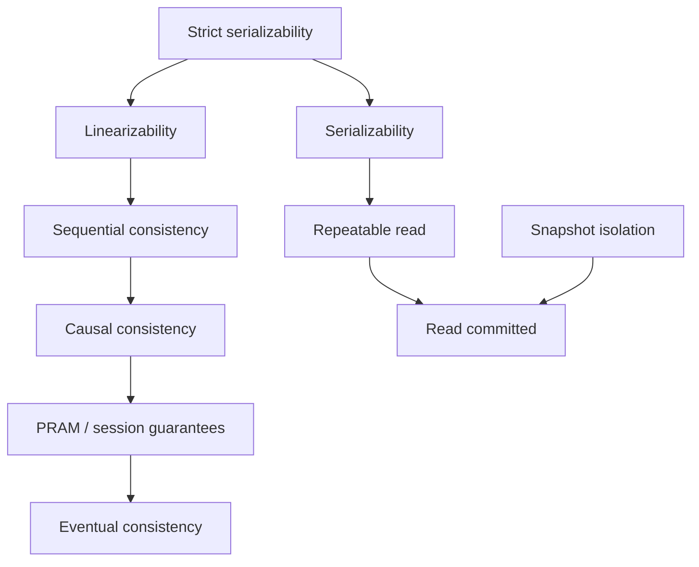

# Chapter 8. Consistency Models

> "Consistency is a contract between the system and the programmer: if you follow these rules, you'll see these results."

## What you will learn

- What a consistency model is, and why the word "consistency" is so overloaded.
- How to describe executions as histories of operations with invocation and response times.
- Linearizability, defined precisely, with examples of histories that pass and fail.
- Sequential consistency, causal consistency, the session guarantees and eventual consistency.
- Transactional models: serializability and strict serializability, and how they relate to linearizability.
- The hierarchy of models, and which ones can stay available during partitions.
- How to check a history for linearizability, and how to choose a model for each piece of data.

---

## 8.1 What a consistency model is

A **consistency model** defines which results a system may return to concurrent operations. It's a contract: the stronger the model, the fewer surprising results programmers must handle, and (usually) the more coordination, latency and unavailability the system must pay for.

"Consistency" means different things in different contexts:

| Context | Meaning |
|---|---|
| CAP theorem | Linearizability (§8.3) |
| ACID transactions | The application's invariants are preserved (Chapter 9) |
| Replication | Replicas hold the same data (or will, eventually) |
| This chapter | The guarantees about what concurrent operations can observe |

When someone says a system is "consistent", ask: *which* model?

## 8.2 Histories

To reason precisely, describe an execution as a **history**: a set of operations, each with:

- the **process** (or client) that performed it;
- an **invocation** (the moment the client issues the request, with its arguments);
- a **response** (the moment the client receives the result).

Each operation occupies an interval of real time. Two operations are **concurrent** if their intervals overlap; otherwise one **precedes** the other (in **real-time order**).

```
Client A: |--- write(x, 1) ---|
Client B:        |----- read(x) → ? -----|
Client C:                                   |-- read(x) → ? --|
```

A's write and B's read are concurrent. Both precede C's read.

A consistency model is a set of allowed histories. The question "is this system linearizable?" means "is every history it can produce in the set of linearizable histories?"

## 8.3 Linearizability

**Linearizability** (Herlihy and Wing, 1990), also called **atomic consistency**, is the strongest single-object model and the most intuitive: the system behaves as if there were a single copy of the data and every operation took effect atomically at some instant (its **linearization point**) between its invocation and its response.

### ◆ Formal: definition

A history H is **linearizable** if there exists a sequential ordering S of its operations (ignoring operations that never completed, or treating them as either taking effect or not) such that:

1. **Legality:** S is a valid sequential execution of the object's specification. For a register, every read returns the value of the latest preceding write in S (or the initial value).
2. **Real-time order:** if operation a's response precedes operation b's invocation in H, then a comes before b in S.

### Examples

**Linearizable:**

```
A: |-- write(1) --|
B:      |-- read → 1 --|
C:                         |-- read → 1 --|
```

Order S: write(1), B's read, C's read. Legal, and respects real time.

**Also linearizable** (concurrent operations may go either way):

```
A: |------ write(1) ------|
B:    |-- read → 0 --|
```

B's read overlaps the write, so it may be ordered before it.

**Not linearizable:**

```
A: |----------- write(1) -----------|
B:    |-- read → 1 --|
C:                      |-- read → 0 --|
```

B's read returned 1, so in S the write precedes B's read. C's read starts after B's read finished, so C's read must come after B's read, and therefore after the write. But it returned 0. No valid S exists. This "new value, then old value" pattern is exactly what naive quorum reads can produce (Chapter 6 §6.5) and what read repair before returning prevents.

### Why linearizability matters

- **Locks and leader election** need it: if two nodes can both read "lock is free" after one acquired it, mutual exclusion fails.
- **Uniqueness constraints** (usernames, seat bookings) need it, or an equivalent.
- **Cross-channel timing:** a user updates a profile picture then sends a message saying "look at my new photo"; a friend's client fetches the photo after receiving the message. Without linearizability (or at least causality across channels), the friend may see the old photo.

Linearizability is **composable** (Herlihy and Wing call it a *local* property): if each object in a system is linearizable, the system as a whole is linearizable. Sequential consistency doesn't compose this way, which is one reason linearizability is preferred as a building block.

### The cost

Linearizability is expensive in a distributed system:

- Every operation must reflect all operations that completed before it started, anywhere. So reads can't just be served from a local replica without some coordination (a quorum read, a lease held by a leader, or a consensus round).
- During a partition, nodes cut off from the majority can't serve linearizable operations (CAP, Chapter 4).
- Even without partitions, latency is bounded below by the time to reach other replicas (PACELC). Hagit Attiya and Jennifer Welch proved in 1994 that, with message delays varying by u, the response time of linearizable reads or writes must be at least proportional to u; no clever algorithm makes linearizability "free".

### Implementing linearizability

| Approach | How | Notes |
|---|---|---|
| Single-leader with consensus (Raft, Paxos) | Writes go through the log; reads go through the log, or use a leader lease, or a "read index" confirmation round | Standard in etcd, Spanner, CockroachDB |
| Quorums with read repair (ABD) | Read from a quorum, write back the latest value to a quorum, then return | Works for registers; not for compare-and-set without consensus |
| Chain replication | Writes at head, reads at tail | Chapter 6 §6.6 |
| Synchronised clocks with bounded error | Commit wait (TrueTime) | Chapter 3 §3.8 |

## 8.4 Sequential consistency

**Sequential consistency** (Lamport, 1979) drops the real-time requirement: there must be some sequential order S, legal for the object, that respects **each process's own program order**, but S needn't respect real-time order between different processes.

The "not linearizable" example above *is* sequentially consistent: order C's read (→ 0) first, then the write, then B's read (→ 1). Each client's own operations are still in order.

Sequential consistency allows stale reads, as long as each client's view is consistent with *some* single global order. It's the model many multiprocessor memory designs aimed for, and it's still strong: it requires global agreement on order, so it isn't available under partitions either.

## 8.5 Causal consistency

**Causal consistency** requires that operations related by **potential causality** (Chapter 3's happened-before, extended to reads: a read is causally after the write it reads from) are seen by every process in the same order. Concurrent operations may be seen in different orders by different processes.

Example: Alice posts "Is anyone free for lunch?" (write 1). Bob reads it and replies "Yes!" (write 2, causally after write 1). Causal consistency guarantees no one sees Bob's reply without Alice's question. But if Carol independently posts "Nice weather today" (concurrent with both), different readers may see it before or after them.

### Why causal consistency is special

Causal consistency is, in a precise sense, **the strongest model that can remain available during network partitions**. Mahajan, Alvisi and Dahlin (2011) proved that no model stronger than a variant they call real-time causal consistency can be both "always available" and "one-way convergent" in the presence of partitions. So when a system must stay available everywhere (mobile, multi-region active-active, edge), causal consistency is the best you can get, and it's much better than eventual consistency.

Implementations track dependencies explicitly: each write carries metadata (vector clocks, dependency lists, or hybrid timestamps), and a replica makes a write visible only after its dependencies are visible. Research systems COPS (Lloyd and colleagues, SOSP 2011) and Eiger showed this can scale; MongoDB offers **causally consistent sessions**.

## 8.6 Session guarantees

The four **session guarantees** (Terry and colleagues, 1994) are weaker than causal consistency but cheap and very useful (Chapter 6 §6.3):

| Guarantee | Within a session, … |
|---|---|
| **Read your writes** | reads reflect the session's earlier writes |
| **Monotonic reads** | later reads never see an older state than earlier reads |
| **Monotonic writes** | the session's writes are applied in order everywhere |
| **Writes follow reads** | a write is ordered after the writes the session had read |

Together, the four are equivalent to causal consistency *for a single session* (Brzeziński and colleagues, 2004). They can be implemented with a little client-side state: the log position or version vector of what the session has seen.

## 8.7 Eventual consistency

**Eventual consistency** promises only that if no new updates are made, all replicas eventually converge to the same value. It says nothing about what you see in the meantime, or *which* value they converge to. It's a liveness property with no safety component, so taken alone it's very weak: a system that returns random garbage until updates stop would technically satisfy it.

**Strong eventual consistency** (Shapiro and colleagues, 2011) adds a safety property: any two replicas that have received the same set of updates are in the same state, regardless of order. This is what CRDTs provide (Chapter 10), and it makes eventual consistency something you can program against.

## 8.8 Transactional models

The models so far are about single operations on single objects. Transactions group many operations on many objects (Chapter 9). Their main isolation model is:

- **Serializability:** the result of executing concurrent transactions is the same as executing them in *some* serial order. (Like sequential consistency, it doesn't require that order to match real time.)
- **Strict serializability** (also called **strong serializability**, or **external consistency** in Spanner's terminology): serializable, *and* the serial order respects real time: if T1 commits before T2 starts, T1 precedes T2.

The relationship: strict serializability = serializability + linearizability. It's the gold standard: a database that provides it behaves like a single machine running one transaction at a time. Spanner, CockroachDB (which provides serializability, and strict serializability under some conditions; Chapter 20), FoundationDB and FaunaDB aim for it. Many other databases default to weaker isolation levels, which Chapter 9 catalogues.

## 8.9 The hierarchy



An arrow from A to B means A is strictly stronger: every history allowed by A is allowed by B. Snapshot isolation has no arrow from serializability because the two are **incomparable**: snapshot isolation allows write skew, which serializability forbids, while serializability allows some histories that read from no single snapshot, which snapshot isolation forbids (Chapter 9). (Jepsen's consistency-model map at jepsen.io/consistency and Viotti and Vukolić's survey (2016) give fuller pictures with dozens of models.)

Availability under partitions divides the hierarchy:

- **Unavailable during partitions** (must refuse some requests): strict serializability, serializability, linearizability, sequential consistency, snapshot isolation.
- **Available** (every non-failed node can respond, in the "sticky" sense of clients staying with one replica): causal consistency and weaker.

## 8.10 Checking linearizability

Given a history, is it linearizable? Checking means searching for a valid order S. The problem is NP-complete in general (Gibbons and Korach, 1997), but practical checkers work well on the histories real tests produce:

- **Wing and Gong's algorithm** (1993) searches orders depth-first: repeatedly pick a "minimal" operation (one that no unplaced operation precedes in real time), apply it to the object model, and backtrack if the result doesn't match.
- **Lowe's improvement** (2017) and the **Porcupine** checker (used for testing Raft implementations in MIT's 6.824/6.5840 course) add memoization of (set of linearized operations, object state) pairs, and partition histories by key, since linearizability is composable.
- **Knossos** and **Elle** in Jepsen (Chapter 23): Knossos checks linearizability; Elle checks transactional isolation by building dependency graphs and finding cycles, which scales to very large histories.

[`examples/linearizability-checker/`](../examples/linearizability-checker/) implements a memoizing Wing–Gong checker for a register, including textbook histories that are sequentially consistent but not linearizable, and a simulated replicated register with a stale-follower-read bug that the checker catches.

## 8.11 Choosing a model

Pick per piece of data and per operation, not per system:

| Data or operation | Typical requirement | Why |
|---|---|---|
| Leader election, locks, configuration | Linearizable | Correctness depends on a single truth |
| Account balances, inventory with hard limits | Strict serializability (or serializable with care) | Invariants span objects |
| User's own profile and settings | Read-your-writes + monotonic reads | Users notice their own stale data |
| Social feeds, comments | Causal | Replies must follow what they reply to |
| View counts, likes, metrics | Eventual (with CRDT counters) | Small staleness is harmless; availability matters |
| Caches | Explicitly bounded staleness | Must be invalidated or expire (Chapter 18) |

Then check what the database actually provides at the settings you use. Default isolation levels are often weaker than people assume, and documentation sometimes uses the same words for different guarantees. Jepsen analyses (Chapter 23) have repeatedly found databases that didn't meet their documented models.

---

## Summary

- A consistency model is the set of histories a system may produce. "Consistency" is overloaded; always ask which model.
- Linearizability: operations appear atomic at a point between invocation and response, respecting real time. It's composable, intuitive and expensive (no partition availability; latency lower bounds).
- Sequential consistency drops real-time order; causal consistency keeps only causal order, and is the strongest model that stays available under partitions. Session guarantees give per-client sanity cheaply.
- Eventual consistency is only a liveness promise; strong eventual consistency (CRDTs) adds convergence as a safety property.
- Serializability orders transactions; strict serializability adds real-time order and equals serializability plus linearizability.
- Linearizability checking is NP-complete in general but practical with memoized search and per-key decomposition.
- Choose the weakest model that keeps each piece of data correct, and verify what your database really provides.

## Exercises

See [`exercises/08-consistency-models.md`](../exercises/08-consistency-models.md).

## Further reading

- Maurice Herlihy and Jeannette Wing, "Linearizability: A Correctness Condition for Concurrent Objects", *ACM TOPLAS* (1990).
- Leslie Lamport, "How to Make a Multiprocessor Computer That Correctly Executes Multiprocess Programs", *IEEE Transactions on Computers* (1979).
- Prince Mahajan, Lorenzo Alvisi and Mike Dahlin, "Consistency, Availability, and Convergence", UT Austin technical report (2011).
- Paolo Viotti and Marko Vukolić, "Consistency in Non-Transactional Distributed Storage Systems", *ACM Computing Surveys* (2016).
- Kyle Kingsbury, "Consistency Models" (jepsen.io/consistency).
- Wyatt Lloyd et al., "Don't Settle for Eventual: Scalable Causal Consistency for Wide-Area Storage with COPS", SOSP (2011).
- Gavin Lowe, "Testing for Linearizability", *Concurrency and Computation: Practice and Experience* (2017).
- Hagit Attiya and Jennifer Welch, "Sequential Consistency versus Linearizability", *ACM TOCS* (1994).
