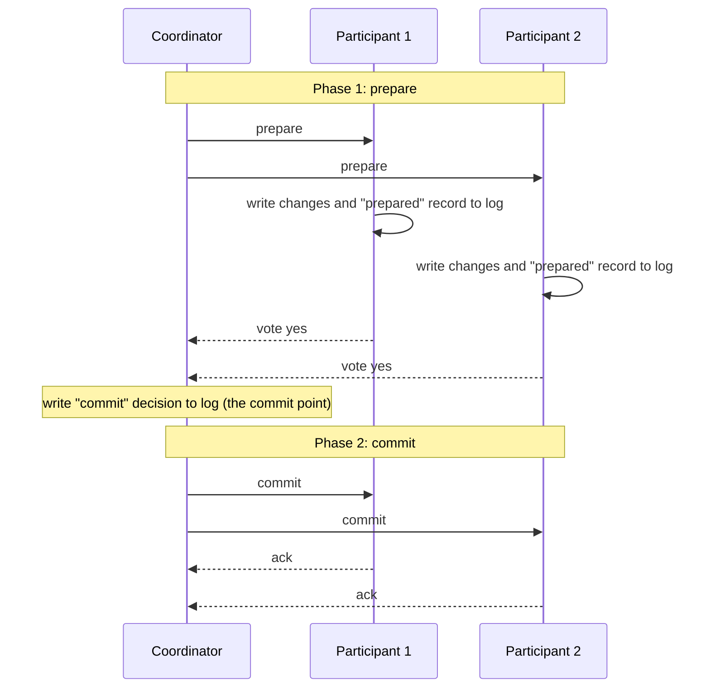

# Chapter 9. Transactions Across Machines

> "Two-phase commit is the protocol everyone uses and nobody loves."

## What you will learn

- What transactions guarantee (ACID), stated precisely.
- Isolation levels and their anomalies: dirty reads, lost updates, read skew, write skew and phantoms.
- How databases implement isolation: two-phase locking, snapshot isolation (MVCC) and serializable snapshot isolation.
- Atomic commitment across machines: two-phase commit, its blocking problem, and how consensus fixes it.
- Deterministic and timestamp-ordered approaches (Calvin, Spanner, Percolator).
- Sagas, the outbox pattern and idempotency: transactions without a distributed commit.

---

## 9.1 What transactions give you

A **transaction** groups several reads and writes into one logical unit. The classic guarantees are abbreviated **ACID** (Theo Härder and Andreas Reuter, 1983):

- **Atomicity:** either all of the transaction's writes take effect, or none do. If anything fails midway, the partial writes are undone. ("Abortability" would be a better name.)
- **Consistency:** the transaction takes the database from one state satisfying the application's invariants to another. This is mostly the application's responsibility; the database helps with constraints (foreign keys, uniqueness, checks).
- **Isolation:** concurrent transactions don't interfere; ideally the result is as if they ran one at a time (serializability, Chapter 8).
- **Durability:** once committed, writes survive crashes (written to stable storage, and in a distributed system, to enough replicas).

Transactions are a programming model as much as a database feature: they let application code ignore whole classes of concurrency and failure problems. In a distributed system, providing them gets harder, because the data a transaction touches may live on several machines that fail independently.

## 9.2 Isolation levels and anomalies

Full serializability costs throughput, so databases offer weaker **isolation levels**. The ANSI SQL standard defined levels by the anomalies they prevent; Berenson and colleagues' "A Critique of ANSI SQL Isolation Levels" (1995) and Atul Adya's thesis (1999) made the definitions precise.

| Anomaly | What happens | Example |
|---|---|---|
| **Dirty write** | A transaction overwrites another's uncommitted write | Two concurrent purchases interleave writes to the listing and the invoice |
| **Dirty read** | A transaction reads another's uncommitted write, which may later abort | A report includes a payment that was rolled back |
| **Lost update** | Two transactions read-modify-write the same value; one update is lost | Two clients increment a counter from 5; result 6 instead of 7 |
| **Read skew** (non-repeatable read) | A transaction sees different parts of the database at different points in time | A balance check sees account A before a transfer and account B after it, so £100 appears to vanish |
| **Write skew** | Two transactions read overlapping data, make decisions, and write *different* objects, together breaking an invariant | Two on-call doctors each check that another doctor is on call, then both go off call |
| **Phantom** | A transaction's search result changes because another inserts or deletes matching rows | Two bookings each check a room is free, then both insert a booking |

| Level | Prevents | Typical implementation |
|---|---|---|
| **Read uncommitted** | Dirty writes | Write locks |
| **Read committed** | + dirty reads | Write locks; reads see latest committed value (default in PostgreSQL, Oracle, SQL Server) |
| **Snapshot isolation** (often called "repeatable read") | + read skew, most lost updates | Multi-version concurrency control (MVCC) |
| **Serializable** | All of the above, including write skew and phantoms | Two-phase locking, serializable snapshot isolation, or actual serial execution |

Write skew is the anomaly that catches experienced engineers, because snapshot isolation prevents most of the others and is often marketed as "repeatable read". The doctors example:

```
Invariant: at least one doctor on call.
T1: SELECT count(*) FROM on_call WHERE shift = 42   → 2
T2: SELECT count(*) FROM on_call WHERE shift = 42   → 2
T1: DELETE FROM on_call WHERE doctor = 'Alice' AND shift = 42
T2: DELETE FROM on_call WHERE doctor = 'Bob'   AND shift = 42
Both commit under snapshot isolation. Nobody is on call.
```

Each transaction read a consistent snapshot and wrote a different row, so snapshot isolation sees no conflict.

## 9.3 Implementing isolation

### Two-phase locking (2PL)

Not to be confused with two-phase *commit*. Under **two-phase locking**, a transaction acquires shared locks to read and exclusive locks to write, and releases no lock until it has acquired all the locks it will ever need (in practice, it holds all locks until commit, which is **strict 2PL**). To prevent phantoms, it also locks *ranges* or index entries covering its search conditions (**predicate** or **index-range locks**). 2PL guarantees serializability, at the cost of blocking and deadlocks (which the database detects and resolves by aborting a transaction).

### Snapshot isolation and MVCC

**Multi-version concurrency control (MVCC)** keeps several versions of each row, tagged with the transaction that wrote them. A transaction reads from a **snapshot**: the versions committed before it started. Readers never block writers and writers never block readers. On commit, a transaction aborts if another committed transaction wrote the same row since its snapshot (**first committer wins**), which prevents lost updates on the same row but not write skew.

### Serializable snapshot isolation (SSI)

**SSI** (Cahill, Röhm and Fekete, SIGMOD 2008) keeps snapshot isolation's non-blocking reads but tracks read-write dependencies between concurrent transactions. Serialisation anomalies under snapshot isolation always involve a "dangerous structure" of two consecutive read-write anti-dependencies among concurrent transactions; SSI aborts a transaction when it detects one. PostgreSQL's `SERIALIZABLE` level uses SSI (since version 9.1). CockroachDB's default `SERIALIZABLE` level uses a related optimistic approach based on timestamp ordering, in which transactions whose reads may have been invalidated are refreshed or restarted.

### Actual serial execution

If transactions are short and data fits in memory, run them one at a time on a single thread per partition. No locks, no anomalies. VoltDB and Redis (for its scripts) work this way. Throughput is limited to one core per partition, and cross-partition transactions need coordination.

## 9.4 Atomic commitment

Now distribute the data. A transaction writes to partitions on three nodes. Each node can decide on its own to commit or abort (a constraint violation, a deadlock, a crash). How do we ensure that **all commit or all abort**?

This is the **atomic commitment** problem. Its properties:

- **Agreement:** no two participants decide differently.
- **Validity:** if any participant votes to abort, the decision is abort; if all vote to commit and there are no failures, the decision is commit.
- **Termination:** every non-failed participant eventually decides.

## 9.5 Two-phase commit

**Two-phase commit (2PC)** is the classic protocol (Jim Gray, 1978). A **coordinator** (often the node the client connected to) runs it:



1. **Prepare:** the coordinator asks each participant whether it can commit. A participant that votes **yes** must first durably record everything needed to commit (the writes and a "prepared" record), because by voting yes it **promises** to commit if told to, even after a crash.
2. **Decision:** if all vote yes, the coordinator durably logs **commit**; if any votes no (or times out), it logs **abort**. Writing the decision is the **commit point**: from then on, the outcome is fixed.
3. **Commit/abort:** the coordinator tells every participant the decision and retries until each acknowledges.

### The blocking problem

Suppose a participant has voted yes, and then the coordinator crashes before telling it the decision. The participant is **in doubt**:

- It can't commit: the coordinator may have decided to abort (because another participant voted no).
- It can't abort: the coordinator may have decided to commit, and other participants may already have committed.
- It must keep holding its locks on the affected rows, blocking other transactions, until the coordinator recovers.

If the coordinator's log is lost, a human may have to resolve the in-doubt transactions by hand. This is why 2PC is called a **blocking** protocol, and why a crashed transaction coordinator is so painful in practice.

### ◆ Formal: why 2PC can't be non-blocking

Skeen (1981) showed that 2PC is blocking whenever the coordinator and a participant fail together; more generally, in an asynchronous system with crash failures, atomic commitment can't guarantee both agreement and termination (it's at least as hard as consensus, so FLP applies). Three-phase commit (3PC) adds a "pre-commit" phase to avoid blocking, but only under synchronous assumptions: with network partitions and unbounded delays, 3PC can violate agreement. It's rarely used.

The practical fix is to **replicate the coordinator's decision with consensus**. Gray and Lamport's **Paxos Commit** (2006) runs a Paxos instance per participant's vote, so the outcome survives the coordinator's failure as long as a majority of acceptors survive. Systems like Spanner and CockroachDB do the equivalent by making the coordinator and every participant a Raft or Paxos group: a "crash" of one machine just means a new leader of that group takes over, with the log intact. 2PC then runs between highly available groups rather than single machines, and the blocking problem mostly disappears.

[`examples/transactions/`](../examples/transactions/) simulates 2PC with crashes injected at every step, shows participants stuck in doubt when the coordinator dies after the decision, and shows recovery from the logs restoring atomicity. Its demo walks through each crash point. When the coordinator crashes after logging COMMIT, all three participants report "in doubt"; another transaction trying to read the locked inventory row is blocked; a participant that asks its peers learns nothing, because they're all in doubt too. Only when the coordinator recovers and reads its log do they commit. If the coordinator crashes *before* logging a decision, recovery finds no decision and aborts everyone (**presumed abort**), which is safe because no participant can have committed. [`examples/tla/TwoPhaseCommit.tla`](../examples/tla/) checks the consistency property with TLC; [`examples/model-checker/`](../examples/model-checker/) has a Python model of the same protocol.

### XA

The **X/Open XA** standard (1991) lets a transaction manager run 2PC across heterogeneous resources, such as two different databases and a message broker. It works, but inherits all of 2PC's problems plus the lowest-common-denominator behaviour of every participant, and many modern systems (and cloud services) don't support it. Most microservice architectures avoid XA in favour of the patterns in §9.8.

## 9.6 Ordering transactions across machines

2PC ensures atomicity. Isolation across partitions also needs a consistent **order** of transactions. Approaches:

- **Distributed 2PL:** each partition locks locally, 2PC commits; deadlocks can span machines and need distributed detection or timeouts.
- **Timestamp ordering with MVCC:** assign each transaction a timestamp; read snapshots at that timestamp on every partition. The challenge is choosing timestamps that respect real time across machines:
  - **Spanner** uses TrueTime and commit wait (Chapter 3 §3.8) for strict serializability.
  - **CockroachDB** uses hybrid logical clocks and an uncertainty interval (a maximum clock offset, 500 ms by default): a read that encounters a value with a timestamp inside its uncertainty window restarts at a higher timestamp, because it can't tell whether that write happened before it (Chapter 20).
  - **Percolator** (Google, OSDI 2010) and **TiDB** use a centralised **timestamp oracle** that hands out monotonically increasing timestamps, adding a round trip but avoiding clock assumptions.
- **Deterministic databases:** **Calvin** (Thomson and colleagues, SIGMOD 2012) first agrees on the order of a batch of transactions using a replicated log, then every partition executes them deterministically in that order. No 2PC is needed, because no partition can unilaterally abort a transaction for non-deterministic reasons. The cost is that transactions must declare their read and write sets in advance (or discover them with a reconnaissance step). FaunaDB was inspired by Calvin.

## 9.7 Why many systems avoid distributed transactions

Distributed transactions cost latency (several round trips, plus durable writes on each), reduce availability (all participants must be reachable), and couple services together. In microservice architectures in particular, each service usually owns its own database, and the database-level transaction can't span services. So most such systems use **local transactions plus asynchronous, reliable messaging**, accepting that the overall business process is **eventually consistent**, and designing explicitly for the intermediate states.

## 9.8 Sagas, outboxes and idempotency

### Sagas

A **saga** (Garcia-Molina and Salem, SIGMOD 1987) is a sequence of local transactions T₁, T₂, …, Tₙ, each in one service, where each Tᵢ (except the last) has a **compensating transaction** Cᵢ that semantically undoes it. If Tₖ fails, the saga runs Cₖ₋₁, …, C₁.

Example, booking an order:

| Step | Transaction | Compensation |
|---|---|---|
| 1 | Reserve stock | Release stock |
| 2 | Charge card | Refund card |
| 3 | Book shipment | (last step; no compensation needed) |

If booking the shipment fails, the saga refunds the card and releases the stock.

Two coordination styles:

- **Orchestration:** a central orchestrator (often a workflow engine such as Temporal, AWS Step Functions or Camunda) tells each service what to do and tracks progress durably.
- **Choreography:** each service reacts to events from the previous one ("StockReserved" → payment service charges the card). Simpler for short sagas; hard to follow and change for long ones.

### What sagas do *not* give you

- **Isolation.** Other transactions see intermediate states: stock reserved but payment not yet taken; a refund visible after a charge. Design for this with semantic locks ("order pending" status), commutative updates, or re-reading values before acting.
- **Exact undo.** Compensation is semantic, not a rollback. You can refund a charge, but the customer still saw it on their statement; you can cancel a sent email only by sending another.
- **Automatic retry safety.** Every step and compensation will be retried after failures and must be **idempotent**.

### The outbox pattern

A service must update its database *and* publish an event ("OrderPlaced"). Doing both separately risks one succeeding and the other failing (the **dual-write problem**). The **transactional outbox** fixes this: in the same local database transaction, write the business change and insert the event into an **outbox table**. A separate relay process reads the outbox (by polling, or by change data capture from the database log) and publishes the events, marking them sent. Events may be published more than once (if the relay crashes after publishing but before marking), so consumers must deduplicate (Chapter 14). The companion book's [`outbox` example](../../integration-design-engineer/examples/outbox/) implements the pattern.

### Idempotency keys

An **idempotent** operation has the same effect whether performed once or many times. Make non-idempotent operations safe to retry by attaching a client-generated **idempotency key** to each request; the server records the key with the result in the same transaction as the effect, and on a repeat returns the recorded result instead of acting again. Payment APIs such as Stripe's popularised this pattern.

---

## Summary

- ACID transactions give atomicity, (application) consistency, isolation and durability. Isolation levels trade anomalies for throughput; write skew survives snapshot isolation.
- Isolation is implemented by two-phase locking, MVCC snapshot isolation, serializable snapshot isolation or serial execution.
- Atomic commitment across machines uses two-phase commit. Participants that vote yes are in doubt until they hear the decision; a coordinator crash blocks them. Non-blocking commitment is impossible in the general asynchronous model; replicating the coordinator (and participants) with consensus makes 2PC practical.
- Cross-partition isolation needs a transaction order: distributed locking, timestamps from TrueTime, HLCs with uncertainty intervals or a timestamp oracle, or deterministic ordering (Calvin).
- Many systems avoid distributed transactions: sagas with compensations, the transactional outbox, and idempotency keys give reliable, eventually consistent business processes, provided you design for the intermediate states.

## Exercises

See [`exercises/09-distributed-transactions.md`](../exercises/09-distributed-transactions.md).

## Further reading

- Hal Berenson et al., "A Critique of ANSI SQL Isolation Levels", SIGMOD (1995).
- Atul Adya, *Weak Consistency: A Generalized Theory and Optimistic Implementations for Distributed Transactions* (PhD thesis, MIT, 1999).
- Michael J. Cahill, Uwe Röhm and Alan D. Fekete, "Serializable Isolation for Snapshot Databases", SIGMOD (2008).
- Jim Gray and Leslie Lamport, "Consensus on Transaction Commit", *ACM TODS* (2006).
- Hector Garcia-Molina and Kenneth Salem, "Sagas", SIGMOD (1987).
- Alexander Thomson et al., "Calvin: Fast Distributed Transactions for Partitioned Database Systems", SIGMOD (2012).
- Daniel Peng and Frank Dabek, "Large-scale Incremental Processing Using Distributed Transactions and Notifications" (Percolator), OSDI (2010).
- Pat Helland, "Life beyond Distributed Transactions: an Apostate's Opinion", CIDR (2007).
