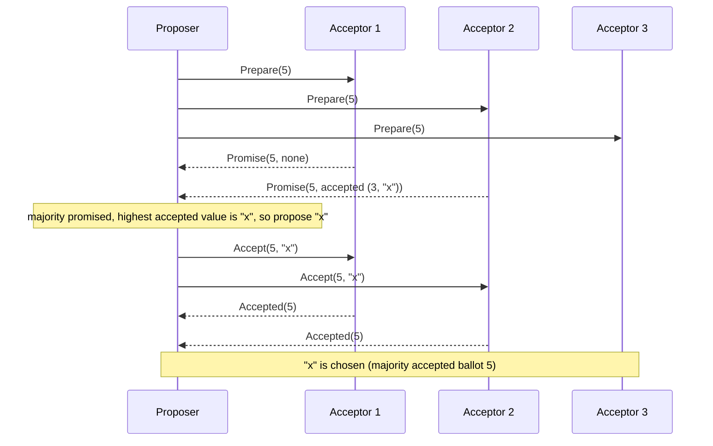
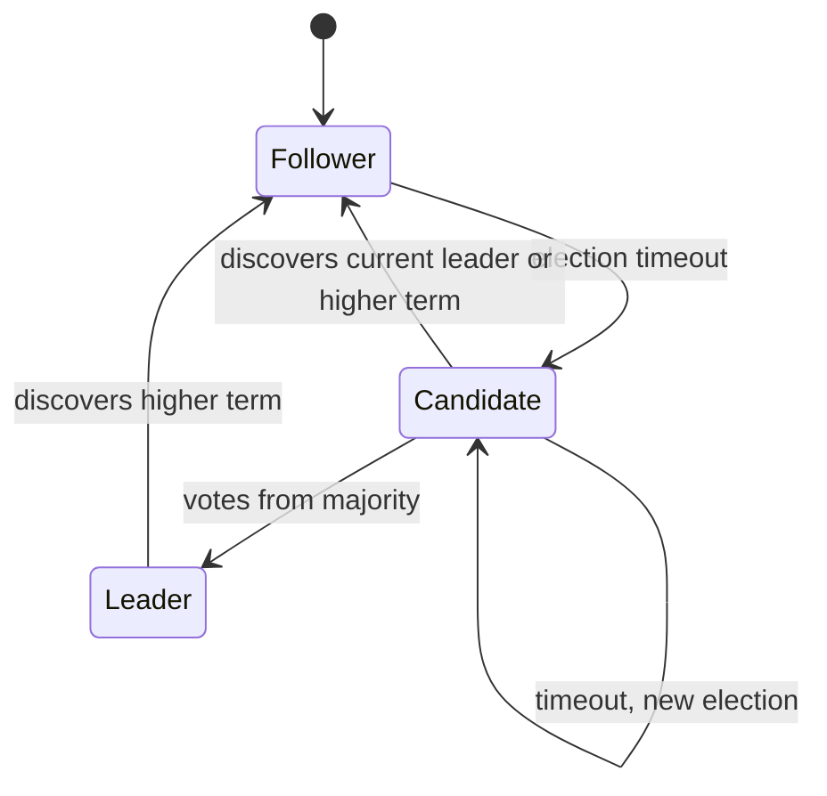

# Chapter 11. Consensus: Paxos and Raft

> "There is only one consensus protocol, and that's Paxos. All other approaches are just broken versions of Paxos."
> — Mike Burrows (as quoted by many; the point is the core idea, not the slogan)

## What you will learn

- Why consensus underlies leader election, replicated logs, locks and atomic commit.
- Why majorities: the quorum argument that makes consensus safe with 2f + 1 nodes.
- Single-decree Paxos, step by step, with a proof sketch of its safety.
- Multi-Paxos and the replicated log.
- Raft in detail: terms, leader election, log replication, the commit rule, safety proof, membership changes and log compaction.
- Reads in a consensus system: why naive leader reads aren't linearizable, and how read index and leases fix it.
- Performance, variants (EPaxos, Flexible Paxos) and what consensus costs.

---

## 11.1 Why consensus

Chapter 4 defined consensus: processes propose values and must agree on one (agreement, validity, integrity, termination). Chapter 6 showed that any service can be made fault-tolerant by **state machine replication**: if every replica applies the same commands in the same order, they stay identical. Consensus is how replicas agree on that order, one log slot at a time, without a single point of failure and without split brain.

Systems built directly on consensus include etcd and Consul (Raft), ZooKeeper (Zab, a Paxos-like protocol), Google's Chubby and Spanner (Paxos), CockroachDB, TiKV, YugabyteDB and MongoDB's replication protocol (Raft-derived), and Kafka's KRaft metadata quorum (Raft-based). If you use any modern infrastructure, you depend on consensus.

## 11.2 Why majorities

Consensus protocols for crash failures use **majority quorums**: a decision needs agreement from more than half of the n nodes.

**Key fact.** Any two majorities of the same set of n nodes intersect. (Two disjoint sets of size > n/2 would contain more than n nodes.)

This one fact is the heart of every safety argument in this chapter: if a value was chosen by one majority, any later majority contains at least one node that knows about it.

With n = 2f + 1 nodes, a majority is f + 1, so the protocol can make progress while up to f nodes are crashed or unreachable. Why not fewer nodes? With n = 2f, a network partition into two halves of f nodes each leaves neither side a majority; and if we let a side of f nodes decide, both sides might decide differently. So **n ≥ 2f + 1 is necessary** for crash-tolerant consensus in a partially synchronous network. Hence clusters of 3 (tolerating 1 failure) or 5 (tolerating 2). Even sizes add cost without adding tolerance: 4 nodes tolerate only 1 failure, the same as 3.

## 11.3 Paxos

Leslie Lamport described Paxos in "The Part-Time Parliament" (written 1989, published 1998), framed as the parliament of a fictional Greek island; the allegory confused readers, and he later wrote "Paxos Made Simple" (2001), which opens with "The Paxos algorithm, when presented in plain English, is very simple."

### Roles

- **Proposers** propose values.
- **Acceptors** vote; a majority of acceptors constitutes a quorum.
- **Learners** learn the chosen value.

In practice each node plays all three roles.

### Single-decree Paxos: choosing one value

Each proposal has a unique **ballot number** (also called a proposal number), totally ordered; proposers make them unique by combining a counter with their node ID.

**Phase 1 (prepare / promise)**

1a. A proposer picks a ballot number b and sends **Prepare(b)** to the acceptors.

1b. An acceptor that receives Prepare(b), and has not already promised a ballot ≥ b, **promises** not to accept any proposal with ballot < b, and replies with the highest-ballot proposal it has already accepted (if any): **Promise(b, accepted_ballot, accepted_value)**.

**Phase 2 (accept / accepted)**

2a. If the proposer receives promises from a majority, it chooses a value: **the value of the highest-ballot proposal reported in the promises**, or, if none of them had accepted anything, its own value. It sends **Accept(b, v)**.

2b. An acceptor that receives Accept(b, v), and has not promised a ballot > b, **accepts** it, records (b, v) durably, and notifies learners.

A value is **chosen** once a majority of acceptors have accepted it in the same ballot.

The surprising step is 2a: the proposer may have to **abandon its own value** and propose one it learned in phase 1. That's what makes Paxos safe.

### ◆ Formal: Paxos safety

**Theorem.** At most one value is chosen.

*Proof sketch.* We show: if a value v is chosen in ballot b, then every proposal issued with a ballot b' > b has value v. Then any value chosen in any later ballot is v, and two different values can't both be chosen.

Proceed by induction on b'. Suppose v was chosen in ballot b, so a majority Q₁ accepted (b, v). A proposer issuing ballot b' > b first got promises from a majority Q₂. Q₁ and Q₂ intersect in some acceptor a.

- Acceptor a accepted (b, v) before promising b' (otherwise its promise for b' > b would have prevented it from accepting ballot b). So a's promise reports an accepted proposal with ballot ≥ b.
- The proposer picks the value of the highest-ballot proposal among the promises it received, with ballot b'' where b ≤ b'' < b'. If b'' = b, the value is v (only one value is proposed per ballot). If b < b'' < b', then by the induction hypothesis the proposal in ballot b'' has value v.

Either way, ballot b' proposes v. ∎

### Liveness: duelling proposers

Two proposers can block each other forever: P1 prepares ballot 1; P2 prepares ballot 2 (so acceptors reject P1's accept); P1 prepares ballot 3 (so acceptors reject P2's accept); and so on. FLP (Chapter 4) says some such schedule must exist. In practice, Paxos elects a **distinguished proposer** (a leader) and uses randomised backoff, which makes progress likely once the network is stable.

## 11.4 Multi-Paxos and the replicated log

To replicate a log, run one Paxos instance per log slot. Doing two phases per slot would be slow, but phase 1 can be shared: a stable leader runs phase 1 **once** for all future slots (with one ballot number), and then each new command needs only phase 2: one round trip to a majority. This is **Multi-Paxos**. When the leader fails, a new one runs phase 1, learns any values that may have been chosen in slots it doesn't know about, and fills gaps with no-ops.

Multi-Paxos is efficient, but the original papers left many practical details unspecified (leader election, log management, membership changes, snapshots). "Paxos Made Live" (Chandra, Griesemer and Redstone, PODC 2007), about Google's Chubby, describes the substantial engineering needed to turn the algorithm into a production system. That gap motivated Raft.

## 11.5 Raft

**Raft** (Diego Ongaro and John Ousterhout, USENIX ATC 2014, "In Search of an Understandable Consensus Algorithm") was designed for understandability. It provides the same guarantees as Multi-Paxos, but specifies leader election, log replication, membership changes and compaction completely, and decomposes the problem so each part can be understood separately. A user study in the paper found students understood it better than Paxos. It's now the most widely implemented consensus protocol.

### Server states and terms

Each server is a **follower**, **candidate** or **leader**. Time is divided into **terms**, numbered with consecutive integers. Each term begins with an election; at most one leader is elected per term. Terms act as a logical clock: every message carries the sender's term; a server that sees a higher term updates its own and reverts to follower; messages with stale terms are rejected.

Each server persists three things to stable storage before responding to any RPC: **currentTerm**, **votedFor** (the candidate it voted for in the current term) and its **log**.

### Leader election

A follower that hears nothing from a leader for an **election timeout** (randomised, for example between 150 and 300 ms) becomes a candidate: it increments its term, votes for itself, and sends **RequestVote** to all others.

A server grants its vote if:

1. the candidate's term is at least its own;
2. it hasn't already voted for someone else in this term; and
3. the candidate's log is **at least as up-to-date** as its own: the candidate's last entry has a higher term, or the same last term and an index at least as long.

A candidate that gets votes from a majority becomes leader and immediately sends heartbeats (empty **AppendEntries**) to assert its leadership. If the vote splits, candidates time out and start a new election in a new term; randomised timeouts make repeated splits unlikely.

**Election safety:** at most one leader per term, because each server votes at most once per term (votedFor is persisted) and two majorities intersect. The book's [`examples/tla/RaftElection.tla`](../examples/tla/) checks this with TLC (24,139 distinct states for three servers and terms up to 3), and refutes two buggy variants: one lets a server vote twice in a term, the other lets a server forget its vote across a restart (it doesn't persist votedFor). Each produces a counterexample with two leaders in term 1 in under ten steps.

### Log replication

The leader appends each client command to its log as an **entry** (with the current term and an index) and sends **AppendEntries** to followers. Each AppendEntries carries the index and term of the entry immediately **preceding** the new ones (prevLogIndex, prevLogTerm). A follower rejects the request unless its log contains an entry at prevLogIndex with term prevLogTerm. On rejection, the leader backs up and retries with an earlier prevLogIndex until they match, then overwrites any conflicting entries in the follower's log.

This **consistency check** maintains the **Log Matching property**:

- If two logs contain an entry with the same index and term, the entries store the same command; and
- the logs are identical in all preceding entries.

(The first holds because a leader creates at most one entry per index in its term and never changes it; the second follows by induction from the consistency check.)

### Commitment

An entry is **committed** once the leader that created it has replicated it on a majority. Committed entries are durable and will eventually be applied by every state machine. The leader tracks the highest committed index and includes it in AppendEntries so followers apply entries too.

There's one subtle rule. **A leader only counts replicas to commit entries from its own current term.** Entries from previous terms become committed indirectly, when an entry from the current term after them commits.

### The Figure 8 scenario

Why the special rule? Figure 8 of the Raft paper shows the danger:

1. S1 is leader in term 2 and replicates entry (index 2, term 2) to S2, then crashes.
2. S5 is elected in term 3 (with votes from S3, S4 and itself), appends (index 2, term 3) locally, then crashes.
3. S1 restarts, is elected in term 4, and continues replicating its old entry (2, term 2), which now reaches S1, S2 and S3: a majority.
4. If S1 treated (2, term 2) as committed now, and then crashed, S5 could be elected again (its last log term, 3, is higher than the others'), and it would overwrite index 2 on everyone with its own (2, term 3) entry, erasing an entry that was "committed".

With Raft's rule, S1 doesn't commit (2, term 2) by counting replicas. It commits only once it replicates an entry from term 4 to a majority; after that, S5 can't win an election (its log is no longer up to date with a majority), so the earlier entry is safe. [`examples/raft/`](../examples/raft/) includes a flag that removes this rule, and its randomised tests find schedules where committed entries are lost.

### ◆ Formal: Raft safety

The Raft paper proves **State Machine Safety**: if a server has applied a log entry at a given index, no other server ever applies a different entry at that index. The argument rests on **Leader Completeness**:

**Leader Completeness.** If an entry is committed in term T, it's present in the logs of the leaders of all terms > T.

*Proof sketch* (by contradiction). Suppose entry e is committed by leader L_T in term T, and let U > T be the smallest later term whose leader L_U lacks e.

1. e was replicated by L_T to a majority M₁ before being committed. L_U won its election with votes from a majority M₂. M₁ and M₂ intersect in some voter v.
2. v must have accepted e from L_T **before** voting for L_U. (If v had voted for L_U first, v's currentTerm would have been ≥ U > T, and it would have rejected L_T's AppendEntries.) Since every leader between T and U had e (by minimality of U), and followers only delete entries that conflict with a leader's log, v still had e when it voted.
3. v voted for L_U, so L_U's log was at least as up-to-date as v's. Two cases:
   - L_U's last log term equals v's. Then L_U's log is at least as long as v's, and by Log Matching, since both logs contain v's last entry, L_U's log contains everything in v's log, including e. Contradiction.
   - L_U's last log term is greater than v's. That last entry was created by some leader of a term between T and U, which (by minimality of U) contained e. By Log Matching, L_U's log then contains e. Contradiction.

So no such U exists. ∎ The commit rule from the Figure 8 discussion is what makes step 1 sound: the paper's definition of "committed" (replicated by the leader of its own term to a majority) is exactly what the argument needs.

Raft's safety has been machine-checked: the Verdi project (Wilcox and colleagues, PLDI 2015; Woos and colleagues, CPP 2016) verified a Raft implementation in the Coq proof assistant, and Ongaro's thesis includes a TLA+ specification.

[`examples/raft/`](../examples/raft/) is a complete simulated five-node Raft cluster on a deterministic network that delays, drops, duplicates and reorders messages, partitions nodes and crashes them. After every step, it checks Election Safety, Log Matching, Leader Completeness and State Machine Safety.

### Membership changes

Changing the set of servers is dangerous: if some servers switch to the new configuration before others, there may be a moment when the old and new configurations have disjoint majorities, so two leaders could be elected in the same term. Raft offers two approaches:

- **Joint consensus:** move through an intermediate configuration C_old,new in which decisions need separate majorities of *both* the old and new configurations; once C_old,new is committed, switch to C_new.
- **Single-server changes:** add or remove one server at a time; any majority of the old configuration then overlaps any majority of the new one, so no joint phase is needed. (A bug in the original single-server algorithm was found and fixed by Ongaro in 2015; the fix is for a new leader to commit an entry in its term before starting a configuration change.)

Most implementations also add **learners** (non-voting members) that catch up before being promoted to voters, so adding a server doesn't make the cluster temporarily unable to reach a quorum.

### Log compaction

The log can't grow forever. Each server periodically takes a **snapshot** of its state machine at some log index and discards the entries before it. A leader sends **InstallSnapshot** to followers too far behind to catch up from the log.

## 11.6 Reads in a consensus system

A tempting shortcut is to serve reads from the leader's local state. It isn't linearizable: a leader that has been partitioned away may not know it's been replaced, and would serve stale data while a new leader accepts writes. Options:

| Approach | How | Cost |
|---|---|---|
| **Log reads** | Put the read through the log like a write | One consensus round per read |
| **Read index** | Leader records its commit index, confirms it's still leader by a heartbeat round to a majority, waits until applied up to that index, then reads locally | One round trip, no disk write |
| **Leader leases** | Followers promise not to elect a new leader for a lease period; the leader serves reads locally while its lease is valid | No round trip, but **depends on bounded clock drift** |
| **Follower reads** | A follower asks the leader for the current commit index (read index), waits to apply it, then serves the read | Offloads the leader |

etcd uses read index by default for linearizable reads, and offers explicitly "serializable" (possibly stale) local reads as a cheaper option. Leases are faster but trade a safety dependence on timing; Chapter 12 explains why that dependence needs care.

## 11.7 Performance and variants

In the common case (stable leader), a write in Raft or Multi-Paxos costs one round trip from the leader to a majority plus a durable write on each (often batched). Throughput is limited by the leader, which handles all writes. Variants address specific limits:

| Variant | Idea | Benefit |
|---|---|---|
| **Flexible Paxos** (Howard, Malkhi and Spiegelman, 2016) | Phase 1 and phase 2 quorums need only intersect each other, not each be majorities | Smaller replication quorums (faster writes) at the cost of larger leader-election quorums |
| **EPaxos** (Moraru, Andersen and Kaminsky, SOSP 2013) | Leaderless: any replica can commit non-conflicting commands in one round trip | Lower latency in wide-area deployments; much more complex |
| **Multi-Raft** | Partition data into many ranges, each its own Raft group with its own leader | Scales writes across leaders (CockroachDB, TiKV, YugabyteDB) |
| **Batching and pipelining** | Group many commands per round; send the next AppendEntries before the previous is acknowledged | Throughput |
| **Witnesses / non-voting replicas** | Cheaper replicas that vote or store only metadata | Lower cost for the third copy |

Geo-distributed consensus pays at least one wide-area round trip per write, which is why databases like Spanner and CockroachDB let you choose where each range's replicas and leader live.

## 11.8 Common implementation pitfalls

Consensus protocols are notoriously easy to get subtly wrong in implementation:

- **Not persisting votedFor or currentTerm** before replying (double voting after restart: one of the refuted TLA+ variants).
- **Trusting fsync**: disks and filesystems that acknowledge writes they haven't made durable violate the model. "Protocol-Aware Recovery for Consensus-Based Storage" (Alagappan and colleagues, FAST 2018) showed that many systems handled disk corruption poorly.
- **Committing previous-term entries by counting replicas** (Figure 8).
- **Treating local leader state as authoritative for reads** without read index or leases.
- **Using wall-clock time** where the algorithm assumes a monotonic clock.
- **Unbounded log growth** and slow snapshot transfer stalling recovery.
- **Configuration changes** without joint consensus or the single-server rules.

Jepsen analyses (Chapter 23) have found real bugs of most of these kinds in production systems. Test with partitions, crashes, clock jumps and disk faults, not just with a healthy cluster.

---

## Summary

- Consensus lets replicas agree on a log of commands, giving fault-tolerant state machine replication without split brain. It underpins etcd, ZooKeeper, Spanner, CockroachDB, Kafka's KRaft and more.
- Any two majorities intersect; this gives safety with n = 2f + 1 nodes tolerating f crashes.
- Paxos: prepare/promise then accept/accepted; a proposer must adopt the highest-ballot value it learns in phase 1. Safety follows by induction on ballots; liveness needs a stable leader. Multi-Paxos amortises phase 1.
- Raft: terms, randomised elections with an up-to-date-log check, AppendEntries with a consistency check (Log Matching), commitment by majority only for current-term entries (Figure 8), and Leader Completeness as the core safety invariant. Membership changes use joint consensus or one-at-a-time changes; snapshots compact the log.
- Linearizable reads need log reads, read index or (clock-dependent) leases.
- Variants trade complexity for latency or throughput: Flexible Paxos, EPaxos, Multi-Raft, batching.
- Most real bugs are implementation errors against the model: persistence, fsync, the commit rule, leader reads and membership changes.

## Exercises

See [`exercises/11-consensus.md`](../exercises/11-consensus.md).

## Further reading

- Leslie Lamport, "The Part-Time Parliament", *ACM TOCS* (1998), and "Paxos Made Simple", *ACM SIGACT News* (2001).
- Diego Ongaro and John Ousterhout, "In Search of an Understandable Consensus Algorithm", USENIX ATC (2014); Diego Ongaro, *Consensus: Bridging Theory and Practice* (PhD thesis, Stanford, 2014). The Raft website (raft.github.io) has the paper, a visualisation and a list of implementations.
- Tushar Chandra, Robert Griesemer and Joshua Redstone, "Paxos Made Live: An Engineering Perspective", PODC (2007).
- Robbert van Renesse and Deniz Altinbuken, "Paxos Made Moderately Complex", *ACM Computing Surveys* (2015).
- Heidi Howard, Dahlia Malkhi and Alexander Spiegelman, "Flexible Paxos: Quorum Intersection Revisited" (2016).
- Iulian Moraru, David G. Andersen and Michael Kaminsky, "There Is More Consensus in Egalitarian Parliaments" (EPaxos), SOSP (2013).
- James R. Wilcox et al., "Verdi: A Framework for Implementing and Formally Verifying Distributed Systems", PLDI (2015).
- Heidi Howard and Richard Mortier, "Paxos vs Raft: Have We Reached Consensus on Distributed Consensus?", PaPoC (2020).
