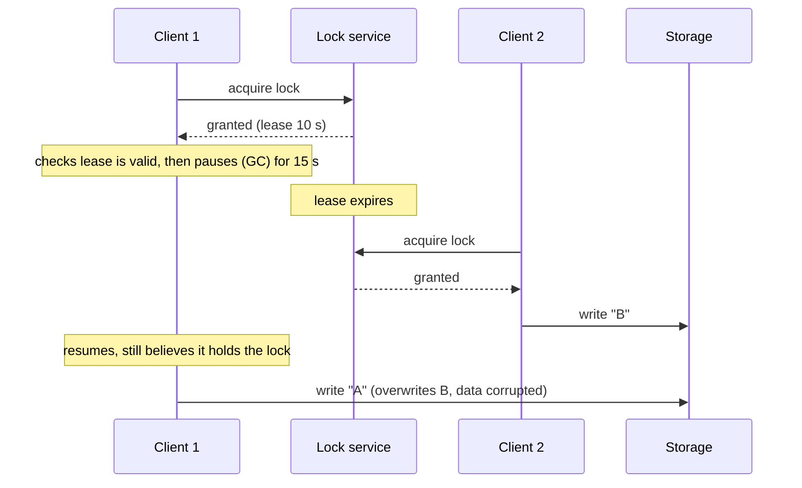

# Chapter 12. Coordination: Leases, Locks, Leader Election and Membership

> "A distributed lock is a lock that might not be held by the process that thinks it holds it."

## What you will learn

- What coordination services are and why most systems use one rather than implementing consensus themselves.
- The primitives they offer: linearizable key-value storage, watches, ephemeral nodes, sessions and leases.
- How to build leader election and distributed locks on these primitives.
- Why every lease-based lock is unsafe without fencing tokens, with a model-checked counterexample.
- When a lock is for efficiency and when it's for correctness, and why the difference matters.
- Group membership, configuration management and service discovery.

---

## 12.1 Coordination services

Most applications need consensus for a handful of small, critical decisions: who is the leader, who holds a lock, what's the current configuration, which nodes are alive. Implementing Raft for each would be wasteful and error-prone. Instead, systems delegate these decisions to a **coordination service**: a small cluster (typically 3 or 5 nodes) running consensus and exposing a simple, linearizable data store.

| Service | Consensus protocol | Data model | Notable users |
|---|---|---|---|
| **Chubby** (Google, Burrows, OSDI 2006) | Paxos | Small files and locks in a filesystem-like namespace | Bigtable, GFS, Spanner (internal) |
| **Apache ZooKeeper** (Hunt and colleagues, USENIX ATC 2010) | Zab | Hierarchical tree of **znodes** | Hadoop, HBase, older Kafka, many others |
| **etcd** (CNCF) | Raft | Flat key-value with revisions | Kubernetes (all cluster state), many cloud-native systems |
| **Consul** (HashiCorp) | Raft (plus SWIM gossip for membership) | Key-value, service catalogue | Service discovery and configuration |

They're designed for **small amounts of slowly changing data** (configuration, metadata, coordination records), not as general-purpose databases. ZooKeeper's guidance limits znodes to 1 MB of data; etcd recommends a total database size of no more than 8 GB, with requests up to 1.5 MiB by default *(as of October 2026)*.

## 12.2 Primitives

The services differ in API, but offer similar building blocks.

### Linearizable writes and compare-and-set

Every write goes through consensus and gets a **revision** (etcd) or **zxid** (ZooKeeper transaction ID): a monotonically increasing number that totally orders all changes. Conditional writes ("set key to v only if its revision is still r") let clients implement atomic read-modify-write without locks. etcd generalises this into **transactions** of the form *if (comparisons) then (operations) else (operations)*.

### Reads

ZooKeeper serves reads from any server's local state, which is fast but may be stale (ZooKeeper guarantees per-client FIFO order and that a client never sees an older state than it has already seen, but not linearizable reads); a client can call `sync` first to catch up. etcd's reads are linearizable by default (via read index, Chapter 11 §11.6), with an opt-in serializable (local) mode.

### Watches

A client can **watch** a key or prefix and be notified when it changes. Watches let clients react to leadership changes or configuration updates without polling. etcd watches are a stream of every change from a given revision, so clients can resume after a disconnect without missing events (provided the revision hasn't been compacted away).

### Sessions, ephemeral nodes and leases

A client keeps a **session** (ZooKeeper) or **lease** (etcd) alive with periodic heartbeats. Keys can be attached to it:

- ZooKeeper **ephemeral znodes** are deleted automatically when the session ends.
- etcd keys can be attached to a **lease** with a time-to-live; when the lease isn't renewed, the keys are deleted.

This turns liveness into data: "node X is alive" is represented by the existence of an ephemeral key, which disappears when X stops heartbeating.

### Sequential nodes

ZooKeeper can append a monotonically increasing counter to a znode's name at creation (`/locks/lock-0000000017`). etcd achieves the same with each key's creation revision. This gives a fair, total order of waiters.

## 12.3 Leader election

A standard recipe on etcd (simplified):

1. Each candidate creates a lease and tries to create the key `/election/leader` with its ID, attached to the lease, using a transaction "create if not exists".
2. The candidate that succeeds is leader. It keeps renewing its lease.
3. Others watch the key. When it's deleted (the leader's lease expired or it resigned), they retry.

On ZooKeeper, each candidate creates an ephemeral sequential znode under `/election`; the one with the lowest sequence number is leader; each other candidate watches only the znode immediately before its own (avoiding a "herd" of notifications when the leader changes).

Both recipes are correct **as far as the coordination service is concerned**: at any revision, exactly one key holds leadership. The trouble is what happens *outside* the service.

## 12.4 Why leases are dangerous

A lease says "you're the leader (or lock holder) until time T, unless you renew". The holder acts on that belief. But:

- The holder's process may **pause** for an arbitrary time: a stop-the-world garbage-collection pause, a virtual-machine migration, the operating system swapping, a `SIGSTOP`, a laptop lid closing. Pauses of many seconds are documented in production.
- The holder's **clock** may run slow, so it believes its lease is still valid after the service has expired it.
- A request sent while the lease was valid may be **delayed in the network** and arrive after expiry.

In each case, the old holder acts after the service has granted the lease to someone else. Two "leaders" act at once.

Checking the lease immediately before the write doesn't help: the pause can happen between the check and the write, or the write can be delayed in the network. There's no way for the client alone to make this safe.

## 12.5 Fencing tokens

The fix, described by Martin Kleppmann in "How to do distributed locking" (2016) and earlier in Chubby's "sequencers", moves the check to the **resource**:

1. Every time the lock service grants the lock, it returns a **fencing token**: a number that increases with every grant (etcd's revision or ZooKeeper's zxid of the lock key serve perfectly).
2. The client includes the token with every request to the protected resource.
3. The resource remembers the highest token it has seen and **rejects** any request with a lower token.

In the scenario above, client 1 gets token 33 and client 2 gets token 34. Storage accepts client 2's write with token 34; when client 1's delayed write arrives with token 33, storage rejects it.

### ◆ Formal: what fencing guarantees, precisely

The book's [`examples/tla/LockWithFencing.tla`](../examples/tla/) models a lock service with expiring leases, clients that can pause arbitrarily, and a storage service. TLC finds the bug without fencing in nine states: client 1 acquires token 1 and checks its lease, pauses while the clock advances, the lease expires, client 2 acquires token 2 and writes, then client 1's write lands on top.

With fencing, the invariant that holds is:

> **NoStaleWrite:** the sequence of writes accepted by storage carries non-decreasing tokens.

That is, once storage has accepted a write from a newer lock holder, it never accepts a write from an older one. Notice what this does *not* say. A stronger-sounding invariant, "storage only ever accepts writes from the *current* lock holder", is **false even with fencing**, and TLC refutes it in seven states: an old holder's write can arrive after the lock has been re-granted but **before** the new holder has written anything, and storage has no way to know the old token is stale, because it hasn't yet seen a newer one. Fencing guarantees ordering of writes at the resource, not exclusive access. Usually ordering is what you need; if not, the resource itself must check with the lock service (or be the lock service).

The same idea appears throughout the field: Raft's **terms**, Paxos's **ballot numbers**, Kafka's **leader epochs** and **producer epochs**, and storage systems' **generation numbers** are all fencing tokens. Whenever you see "reject requests with an old epoch", that's fencing.

### When the resource can't check tokens

Many resources don't support fencing: a third-party API, an email server, a legacy database. Options:

- Use the resource's own conditional operations (compare-and-set on a version column, which acts like a token).
- Make the operations idempotent and order-insensitive, so duplicates and reordering are harmless.
- Accept the risk explicitly, and size it: how long can pauses be, and what does a double action cost?

## 12.6 Efficiency versus correctness

Kleppmann's essay distinguishes two reasons to use a lock:

- **Efficiency:** avoid doing the same work twice (for example, two workers recomputing the same report). If the lock occasionally fails, the cost is some wasted work. A simple lease-based lock, even a single Redis instance with expiry, is fine.
- **Correctness:** prevent concurrent processes from corrupting data or violating invariants. If the lock fails, the system is wrong. You need a lock service built on consensus **and** fencing at the resource.

The **Redlock** algorithm, proposed for Redis, acquires locks on a majority of independent Redis instances with timeouts. Kleppmann argued (2016) that it's unsafe for correctness because it depends on timing assumptions (bounded pauses, bounded clock drift, bounded network delay) and doesn't produce fencing tokens; Salvatore Sanfilippo, Redis's creator, replied defending it under its stated assumptions. The exchange is worth reading as a case study in how system models (Chapter 4) determine what "safe" means. The practical conclusion most engineers draw: for correctness, use a consensus-based service *and* fencing; for efficiency, use whatever is simplest.

## 12.7 Group membership and configuration

### Membership

Which nodes are currently in the cluster? Two approaches:

- **Consensus-based membership:** the member list is stored in the coordination service; nodes register with ephemeral keys. Everyone sees the same list at each revision. Accurate but limited to the scale the service can handle (thousands of nodes, not millions).
- **Gossip-based membership** (SWIM, Chapter 2 §2.6): each node maintains its own view, converging over time. Scales to very large clusters; views may temporarily disagree.

Systems often combine them: gossip for "who seems alive" (fast, scalable), consensus for decisions that must be agreed (who owns which partition).

### Configuration management

Store configuration in the coordination service; clients watch it and reload. Practices:

- Version every configuration change and keep history for rollback.
- Roll out changes gradually (some outages in Chapter 24 began with a configuration change pushed everywhere at once).
- Validate configuration before writing it, because every client will act on it.

### Service discovery

Services register their address and health in a registry (Consul, etcd, ZooKeeper, or Kubernetes' API server backed by etcd); clients look them up or watch for changes. DNS-based discovery is simpler but caches aggressively, so clients may keep using dead addresses until TTLs expire (Chapter 19).

## 12.8 Using coordination services well

- **Keep data small** and change rates moderate; the service replicates every write through consensus.
- **Don't put the coordination service in the request path** of every user request. It's for control-plane decisions.
- **Use watches with resumption** (from a revision) to avoid missing events after disconnects.
- **Tune session and lease timeouts** to your pause and network behaviour: too short causes leadership flapping; too long delays failover.
- **Fence everything** that relies on leadership or locks for correctness.
- **Plan for the service's own failure.** If the coordination service is unavailable, what happens? Usually existing leaders keep working (if they can), but nothing can change. Make sure that state is visible and alerted.
- **Run 3 or 5 nodes across failure domains.** More nodes make writes slower without much benefit.

---

## Summary

- Coordination services (Chubby, ZooKeeper, etcd, Consul) run consensus once and expose linearizable storage, watches, sessions or leases, ephemeral keys and sequence numbers, for small, critical control-plane data.
- Leader election and locks are easy to build on these primitives, but a lease holder can pause, have a slow clock, or send delayed messages, so it may act after losing the lease.
- Fencing tokens (monotonic numbers checked by the resource) make this safe. Formally, fencing guarantees that accepted writes carry non-decreasing tokens, not that only the current holder writes.
- Terms, ballots, epochs and generation numbers are all fencing tokens.
- Use simple locks for efficiency; for correctness, use consensus plus fencing.
- Membership can be consensus-based (accurate) or gossip-based (scalable); configuration and service discovery build on the same primitives.

## Exercises

See [`exercises/12-coordination.md`](../exercises/12-coordination.md).

## Further reading

- Mike Burrows, "The Chubby Lock Service for Loosely-Coupled Distributed Systems", OSDI (2006).
- Patrick Hunt et al., "ZooKeeper: Wait-free Coordination for Internet-scale Systems", USENIX ATC (2010).
- etcd documentation, "API guarantees" and "Concurrency" packages (etcd.io).
- Martin Kleppmann, "How to do distributed locking" (martin.kleppmann.com, February 2016), and Salvatore Sanfilippo, "Is Redlock safe?" (antirez.com, 2016).
- Cary G. Gray and David R. Cheriton, "Leases: An Efficient Fault-Tolerant Mechanism for Distributed File Cache Consistency", SOSP (1989).
