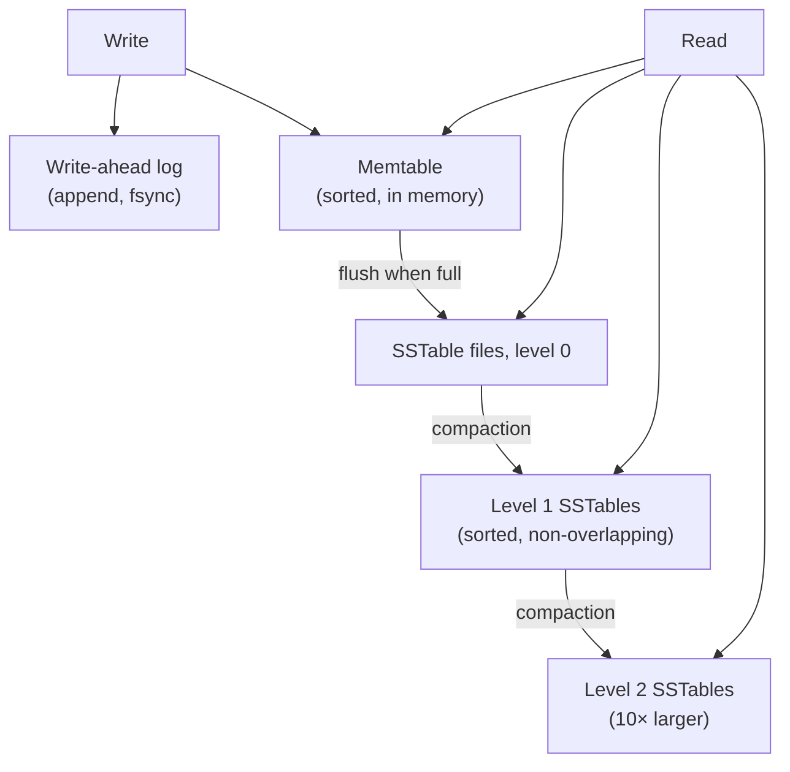

# Chapter 15. Storage Engines

> "Every distributed database is, at the bottom, a single-machine storage engine that someone taught to talk."

## What you will learn

- Why a distributed systems engineer needs to understand single-node storage.
- Write-ahead logging and what "durable" actually means, including fsync and its pitfalls.
- B-trees and log-structured merge trees (LSM trees): how each works and when each wins.
- Bloom filters, with the false-positive formula.
- Read, write and space amplification: the trade-off triangle of storage engines.
- Compaction strategies and their operational consequences.
- How storage engines appear inside distributed databases.

---

## 15.1 Why storage matters here

Replication and consensus decide *which* writes every replica should have and in what order. Each replica then hands those writes to a local **storage engine**, which must store them durably and serve reads efficiently. The engine's behaviour shapes the whole system:

- Raft's safety assumes a node's log and votes survive a crash (Chapter 11). If the engine acknowledges writes that aren't really on disk, the protocol's guarantees evaporate.
- Compaction or garbage collection pauses in the engine cause latency spikes, which cause timeouts, which cause failovers (Chapter 2).
- Write amplification determines how much disk bandwidth, and how many SSDs, a cluster needs.

Most distributed databases embed a well-known engine: **RocksDB** (an LSM tree derived from Google's LevelDB) underlies CockroachDB (via its Pebble reimplementation, which is RocksDB-compatible), TiKV, YugabyteDB's DocDB and many others; **InnoDB** (a B-tree) underlies MySQL; PostgreSQL uses B-tree indexes over heap tables; Cassandra and ScyllaDB use LSM designs; FoundationDB's newer Redwood engine is a B-tree variant.

## 15.2 Durability and the write-ahead log

A **write-ahead log (WAL)** is an append-only file to which every change is written **before** it's applied to the main data structures. After a crash, the engine replays the log to restore any changes that hadn't reached the main structures. Appending is fast because it's sequential.

### What "durable" means

A write is durable once it's on **stable storage**: it will survive a power failure. Writing to a file isn't enough: the operating system holds written data in its **page cache** in memory and flushes it later. To force it to the device, a program calls **`fsync`** (or `fdatasync`), which returns only once the device reports the data is stable.

Subtleties that have caused real data loss:

- **fsync failure semantics.** In 2018, PostgreSQL developers found that on Linux, if `fsync` reports an I/O error, the kernel may mark the failed pages clean and discard them, so retrying `fsync` reports success while the data is lost ("fsyncgate"). The fix in PostgreSQL was to treat an fsync failure as fatal and recover from the WAL. Rebello and colleagues' study (USENIX ATC 2020) found that many systems handled fsync failures incorrectly.
- **Directory entries.** Creating or renaming a file requires an `fsync` on the **directory** too, or the file may vanish after a crash.
- **Device write caches.** Disks and SSDs have volatile caches; correct behaviour depends on the device honouring flush commands (or having power-loss protection).
- **Torn writes.** A crash during a write may leave a block partially written. Engines detect this with checksums on each log record or page.

The rule for distributed systems: **a node must not acknowledge a write (or a vote) until it's durable on that node**, unless the protocol explicitly tolerates losing it. Group commit, which batches many writes into one `fsync`, amortises the cost.

## 15.3 B-trees

The **B-tree** (Bayer and McCreight, 1970) has been the standard index structure for half a century. Data is stored in fixed-size **pages** (typically 4–16 KB) arranged as a balanced tree: internal pages hold keys and pointers to child pages; leaf pages hold keys and values (or pointers to them). With a branching factor of a few hundred, a tree four levels deep can address billions of keys, so a lookup reads about four pages, most of which are cached.

- **Reads:** walk from the root to a leaf. O(log n) pages, highly cache-friendly.
- **Writes:** find the leaf and update it **in place**; if it overflows, split it and update the parent. To stay crash-safe, the change is first written to the WAL.
- **Concurrency:** latches (lightweight locks) on pages, with careful protocols for splits.

B-trees give predictable read performance and efficient range scans. Their weakness is writes: each small update rewrites a whole page (and its WAL record), and random updates mean random I/O.

## 15.4 Log-structured merge trees

The **log-structured merge tree** (O'Neil and colleagues, 1996), popularised by Google's Bigtable (2006) and LevelDB, turns random writes into sequential ones.



1. **Writes** go to the WAL and to an in-memory sorted structure, the **memtable**.
2. When the memtable fills, it's written to disk as an immutable **sorted string table (SSTable)**: a file of key-value pairs sorted by key, with an index of key ranges and (usually) a Bloom filter.
3. **Reads** check the memtable, then SSTables from newest to oldest, until the key is found. Bloom filters skip files that can't contain the key.
4. **Deletes** write a **tombstone** marker; the data is removed later.
5. **Compaction** merges SSTables in the background, discarding overwritten values and (eventually) tombstones, keeping the number of files a read must check under control.

### Compaction strategies

| Strategy | How | Strength | Weakness |
|---|---|---|---|
| **Size-tiered** (STCS) | Merge several files of similar size into one bigger file | Low write amplification; good for write-heavy loads | Reads may check many files; temporary space needs up to 2× during big merges |
| **Leveled** (LCS) | Each level is a set of non-overlapping files, about 10× bigger than the previous level; files are merged into the next level incrementally | Reads check about one file per level; low space amplification | Higher write amplification |
| **Time-window** (TWCS) | Group data by time window; never merge across windows | Ideal for time-series data with TTLs | Only suits append-mostly time-ordered data |

[`examples/lsm-tree/`](../examples/lsm-tree/) implements a small LSM tree with a WAL and crash recovery, a memtable, SSTables with sparse indexes and Bloom filters, tombstones, size-tiered compaction and range scans,  With 20,000 writes over 4,000 keys:

| Configuration | SSTables | Disk used | Write amplification (with WAL) | Disk blocks read per lookup of a missing key |
|---|---|---|---|---|
| No compaction, no Bloom filters | 38 | 1,911 KB | 2.16 | 37.9 |
| No compaction, Bloom filters (10 bits/key) | 38 | 1,935 KB | 2.17 | 0.33 |
| Size-tiered compaction | 5 | 962 KB | 3.38 | 0.04 |
| After a full compaction | 1 | 400 KB | 3.60 | 0.01 |

Bloom filters cut the cost of looking up absent keys by two orders of magnitude for 1% more space. Compaction trades extra writes for less space and fewer files to search: the amplification triangle in miniature. Calling `fsync` on every write made 2,000 puts take 3.1 seconds instead of 0.02, which is why engines group commits.

## 15.5 Bloom filters

A **Bloom filter** (Burton Bloom, 1970) is a compact data structure that answers "is x in the set?" with **no false negatives** and a tunable rate of **false positives**. LSM trees use one per SSTable so a read can skip files that definitely don't contain the key.

A Bloom filter is an array of m bits, initially 0, and k hash functions. To add x, set the bits at positions h₁(x), …, hₖ(x). To query x, check those k bits: if any is 0, x is definitely absent; if all are 1, x is *probably* present.

### ◆ Formal: the false-positive rate

After inserting n elements, the probability that a particular bit is still 0 is (1 − 1/m)^(kn) ≈ e^(−kn/m). A query for an absent element returns "present" only if all k bits are 1, which (treating bits as independent, a good approximation) has probability:

```
p ≈ (1 − e^(−kn/m))^k
```

For a given ratio m/n (bits per element), this is minimised at k = (m/n) ln 2, giving p ≈ (0.6185)^(m/n). So:

| Bits per element | Optimal k | False-positive rate |
|---|---|---|
| 5 | 3 | ~9% |
| 10 | 7 | ~0.8% |
| 15 | 10 | ~0.07% |
| 20 | 14 | ~0.007% |

Ten bits per key (1.25 bytes) cuts disk reads for absent keys by over 99%. RocksDB's default Bloom filter configuration uses about 10 bits per key *(as of October 2026)*. The example's tests compare measured false-positive rates with this formula. With 10,000 keys, it measured 14.7% at 4 bits per key (formula 14.7%), 2.05% at 8 bits (2.16%), 0.72% at 10 bits (0.82%) and 0.03% at 16 bits (0.05%).

## 15.6 The amplification triangle

Storage engines trade three costs, and you can't minimise all three at once:

- **Write amplification:** bytes written to the device ÷ bytes written by the application. LSM compaction rewrites data many times as it moves down levels; B-trees rewrite whole pages for small changes.
- **Read amplification:** number of disk reads (or bytes read) per logical read. LSM trees may check several files; B-trees read a few pages.
- **Space amplification:** bytes on disk ÷ bytes of live data. LSM trees keep overwritten values and tombstones until compaction; B-trees leave pages partly empty.

Athanassoulis and colleagues' **RUM conjecture** (EDBT 2016) states that an access method can't simultaneously be optimal for **R**ead overhead, **U**pdate overhead and **M**emory (space) overhead: improving two worsens the third.

| | B-tree | LSM (leveled) | LSM (size-tiered) |
|---|---|---|---|
| Write amplification | Medium–high (page rewrites) | High (often 10–30×) | Lower |
| Read amplification | Low | Low–medium | Higher |
| Space amplification | Medium (fragmentation) | Low (~1.1×) | Higher (up to ~2×) |
| Write throughput | Lower | High | Highest |
| Latency predictability | Good | Compaction spikes possible | Compaction spikes possible |

SSDs make write amplification especially important, because flash cells wear out with writes and the SSD's own internal garbage collection adds a further layer of amplification.

## 15.7 Other designs worth knowing

- **Copy-on-write B-trees** (LMDB, BoltDB/bbolt used by etcd): never update pages in place; write new pages and switch the root atomically. Simple crash recovery and consistent snapshots for readers.
- **WiscKey** (Lu and colleagues, FAST 2016): separate keys from values; keep keys in an LSM tree and values in a log, cutting write amplification for large values. RocksDB's BlobDB and Badger use the idea.
- **Bw-tree** and **latch-free** structures for in-memory, many-core performance (used in Microsoft's Hekaton).
- **Column stores** (Parquet files, ClickHouse, Snowflake, BigQuery): store each column separately, for analytical scans that read a few columns of many rows; often append-only with background merging, like an LSM.

## 15.8 Storage inside a distributed database

A distributed database adds layers on top of the engine:

- **The replication log and the engine's WAL** may be separate (double logging) or unified. Some systems write the Raft log into the storage engine itself; others keep it separately for performance.
- **MVCC versions** (Chapter 9) are stored as multiple keys (key plus timestamp), so the engine sees many more keys than the application.
- **Range scans** for partitions (Chapter 7) rely on the engine's ordered iteration.
- **Snapshots** for new replicas or Raft log compaction (Chapter 11) rely on the engine's ability to produce a consistent point-in-time copy; LSM trees make this cheap because SSTables are immutable.
- **Compaction and garbage collection** of old MVCC versions must be coordinated with the oldest snapshot any transaction might still read.

When you operate a distributed database, many performance incidents trace back to the engine: compaction falling behind, tombstones accumulating (a classic Cassandra problem, where reads slow to a crawl scanning tombstones), page cache pressure, or a disk running out of space during a large compaction.

---

## Summary

- Distributed guarantees rest on single-node durability. A write is durable only after fsync (and directory fsync); fsync failures, device caches and torn writes need explicit handling. Never acknowledge before durability.
- B-trees update pages in place: predictable reads and good range scans, with costlier random writes.
- LSM trees turn writes into sequential appends (WAL, memtable, immutable SSTables) and merge in the background with size-tiered, leveled or time-window compaction.
- Bloom filters skip files that can't contain a key; false positives follow (1 − e^(−kn/m))^k, about 1% at 10 bits per key.
- Read, write and space amplification trade against each other (the RUM conjecture).
- Engine behaviour (compaction, tombstones, snapshots, MVCC garbage) surfaces as distributed-system latency and incidents.

## Exercises

See [`exercises/15-storage-engines.md`](../exercises/15-storage-engines.md).

## Further reading

- Patrick O'Neil, Edward Cheng, Dieter Gawlick and Elizabeth O'Neil, "The Log-Structured Merge-Tree (LSM-Tree)", *Acta Informatica* (1996).
- Rudolf Bayer and Edward McCreight, "Organization and Maintenance of Large Ordered Indexes" (1970).
- Burton H. Bloom, "Space/Time Trade-offs in Hash Coding with Allowable Errors", *Communications of the ACM* (1970).
- Manos Athanassoulis et al., "Designing Access Methods: The RUM Conjecture", EDBT (2016).
- Lanyue Lu et al., "WiscKey: Separating Keys from Values in SSD-Conscious Storage", FAST (2016).
- Anthony Rebello et al., "Can Applications Recover from fsync Failures?", USENIX ATC (2020).
- Alex Petrov, *Database Internals* (O'Reilly, 2019).
- RocksDB wiki (github.com/facebook/rocksdb/wiki), especially "RocksDB Overview" and the tuning guide.
