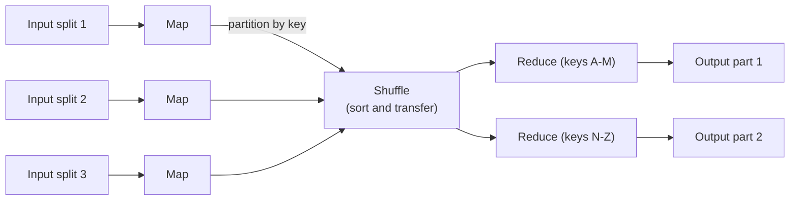

# Chapter 16. Batch and Stream Processing

> "A batch is just a stream that ends."

## What you will learn

- How distributed batch processing works: MapReduce, its shuffle, and the dataflow engines that replaced it.
- Fault tolerance in batch jobs: why deterministic recomputation makes them simple.
- Stream processing fundamentals: event time versus processing time, windows, watermarks and late data.
- How stream processors keep state and recover from failures with consistent snapshots (Chandy–Lamport).
- Exactly-once processing in streams, and joins between streams and tables.
- The relationship between batch and streaming, and when to use each.

---

## 16.1 Two ways to process data at scale

- **Batch processing** takes a bounded input (yesterday's logs, a database snapshot), runs a job over all of it, and produces output. Latency is minutes to hours; throughput is very high.
- **Stream processing** takes an unbounded input (events arriving continuously) and produces output continuously. Latency is milliseconds to seconds.

Both spread work across many machines, and both must tolerate failures of those machines mid-computation. They do so in different ways, and understanding why is a good lens on the whole book.

## 16.2 MapReduce

Google's **MapReduce** (Dean and Ghemawat, OSDI 2004) and its open-source implementation in Apache Hadoop made large-scale batch processing accessible. A job has two user-supplied functions:

- **map(record) → list of (key, value)**: applied to each input record independently, in parallel across machines, each reading a chunk of the input from a distributed filesystem.
- **reduce(key, list of values) → output**: applied to all values for one key.

Between them, the framework performs the **shuffle**: it partitions map outputs by key (usually hash of key mod number of reducers, Chapter 7), sorts them, and transfers each partition to the reducer responsible for it.

Word count is the canonical example: map emits (word, 1) for each word; reduce sums the counts per word.

### Fault tolerance by recomputation

MapReduce's fault tolerance is beautifully simple:

- Inputs are **immutable** files in a replicated filesystem.
- Map and reduce functions are **deterministic** and have no side effects beyond writing their output.
- If a task fails (or its machine dies), the scheduler **reruns it** elsewhere. Map outputs are written to local disk; if a machine holding map outputs dies before reducers fetch them, the map task is rerun.
- A task's output is committed atomically (written to a temporary file, then renamed), so a rerun or a duplicate **speculative** execution (launched to work around a slow machine, a "straggler") never produces duplicate output.

No consensus, no distributed transactions: just determinism plus atomic output commit. This is the same idea as state machine replication (Chapter 6 §6.7): deterministic computation over the same input gives the same result.

### Dataflow engines

MapReduce materialises every intermediate result to disk and forces every job into map-shuffle-reduce stages. **Dataflow engines** (Apache Spark, Apache Flink in batch mode, Google's Dataflow, and earlier Microsoft Dryad) model a job as a **directed acyclic graph** of operators, keep intermediate data in memory where possible, and pipeline operators. Spark's **resilient distributed datasets** (Zaharia and colleagues, NSDI 2012) recover lost partitions by recomputing them from their **lineage** (the recorded chain of transformations), with checkpoints to bound the recomputation. Distributed SQL engines (Trino, Spark SQL, BigQuery, Snowflake) compile queries into similar dataflow plans.

## 16.3 Streams: event time and processing time

Every event has (at least) two times:

- **Event time:** when the event actually happened (a timestamp set by the device or service that produced it).
- **Processing time:** when the stream processor sees it.

They differ, often a lot: mobile devices go offline and upload hours later; networks delay; producers batch. Events therefore arrive **out of order** relative to event time.

If you count "clicks per minute" by processing time, a network hiccup that delays a burst of events makes it look as though clicks fell and then spiked. Counting by event time gives the right answer, but raises a question: when can you be sure a minute is complete?

## 16.4 Windows

A **window** groups events by time for aggregation:

| Window type | Shape | Use |
|---|---|---|
| **Tumbling** | Fixed size, non-overlapping (each minute) | Per-minute counts |
| **Sliding / hopping** | Fixed size, overlapping (5-minute windows every minute) | Moving averages |
| **Session** | Gaps of inactivity close the window | User sessions on a website |
| **Global** with triggers | One window; output on custom conditions | Running totals |

## 16.5 Watermarks and late data

A **watermark** is the stream processor's assertion that **no more events with event time earlier than W are expected**. When the watermark passes the end of a window, the processor can emit that window's result.

Watermarks are heuristics. A common one is **bounded out-of-orderness**: watermark = (largest event time seen) − (allowed lateness bound, say 5 seconds). If the bound is too small, windows close before their events arrive; if too large, results are delayed.

Events that arrive after the watermark has passed their window are **late**. Options:

- **Drop** them (and count how many, so you know).
- Send them to a **side output** for separate handling.
- Keep window state for an **allowed lateness** period and emit **updated** results (retractions or upserts) when late events arrive.

The model of windows, triggers, watermarks and accumulation modes was laid out in Google's "The Dataflow Model" paper (Akidau and colleagues, VLDB 2015) and the book *Streaming Systems* (Akidau, Chernyak and Lax, 2018); Apache Beam implements it, and Flink's model is closely related.

[`examples/stream-windows/`](../examples/stream-windows/) generates out-of-order events, computes tumbling and sliding windows by event time with a bounded-out-of-orderness watermark, and compares the results with processing-time windows.  It also shows the three ways of handling late events. In its workload, 2,355 events arrive over two minutes, and an ingestion outage holds back ten seconds of events, then releases them all at once. Processing-time windows count 21 events and then 357 for two ten-second windows whose true counts are 192 and 190. Event-time windows get them right, provided the watermark waits long enough: with a 2-second watermark delay, 88.4% of events are counted on time; with 10 seconds, 99.0%; with 60 seconds, 100%, at the cost of results arriving a minute late. Allowing 60 seconds of lateness with updated results recovers every window exactly while still emitting early results.

## 16.6 State and fault tolerance in stream processing

Stream operators keep **state**: counts per window, the last value per key, join buffers. If a machine fails, its state must be recovered, and the operator must resume from exactly the right point in its input, or results will double-count or miss events.

### Consistent distributed snapshots

The classic solution is the **Chandy–Lamport snapshot algorithm** (K. Mani Chandy and Leslie Lamport, 1985). It records a consistent global state of a distributed system **without stopping it**.

Processes communicate over FIFO channels. To take a snapshot:

1. The initiator records its own state and sends a **marker** on every outgoing channel.
2. When a process receives a marker on some channel for the first time, it records its own state, records that channel's state as empty, and sends markers on all its outgoing channels.
3. After recording its state, a process records every message that arrives on each other incoming channel **until** the marker arrives on that channel; those messages are the channel's recorded state.

The result is a **consistent cut**: a global state that could have occurred, in which every message recorded as received was also recorded as sent.

### ◆ Formal: why the snapshot is consistent

A cut is consistent if, for every message m, if the receipt of m is in the cut then the sending of m is in the cut. Suppose process q records receiving m from p before q recorded its state. Channels are FIFO and p sends a marker immediately after recording its state, so if p had recorded its state before sending m, the marker would have reached q before m, and q would have recorded its state before receiving m. So p sent m before recording its state: the send is in the cut. Messages sent before the sender's snapshot but received after the receiver's snapshot are exactly those recorded as channel state, so no message is lost from the picture. A useful corollary is **conservation**: in a money-transfer system, the sum of recorded balances plus recorded in-flight transfers equals the true total. ∎

The example implements Chandy–Lamport among three processes transferring money over simulated FIFO channels, and checks conservation across randomised runs. Over 1,000 runs with a true total of 3,000, the snapshot's total was exact every time. Break the FIFO assumption (let channels reorder messages) and 974 of 1,000 snapshots are wrong, by up to 2,193. Reading each balance in turn without the algorithm is wrong in 998 of 1,000 runs.

### Flink's checkpoints

Apache Flink adapts the idea (Carbone and colleagues, "Lightweight Asynchronous Snapshots for Distributed Dataflows", 2015): sources inject **checkpoint barriers** into the stream; when an operator has received a barrier on all its inputs, it snapshots its state to durable storage and forwards the barrier. On failure, every operator restores the last completed checkpoint and the sources rewind to the corresponding offsets (for example, Kafka offsets). This gives **exactly-once state semantics**: each event affects the operators' state exactly once, even though some events are processed twice after a failure.

For **output** to external systems to be exactly-once too, the sink must cooperate: either writes are idempotent (upserts by key), or the sink participates in the checkpoint with a two-phase commit (in Flink, the older `TwoPhaseCommitSinkFunction` and the newer Sink API's committers, used by its transactional Kafka sink). The end-to-end argument (Chapter 14 §14.6) applies again.

## 16.7 Joins in streams

- **Stream–table join:** enrich each event with the current value from a table (customer details for each order). The table is often kept as local state, updated from a changelog (CDC, Chapter 14 §14.9).
- **Stream–stream join:** match events from two streams within a time window (an ad impression and a click within 10 minutes). Both sides are buffered in state until the window passes the watermark.
- **Table–table join:** maintain a materialised view of a join, updated as either side changes.

Time matters: a stream–table join gives different results depending on whether you join with the table's state *as of the event's time* or *as of processing*. Reproducible results need versioned tables or deterministic ordering.

## 16.8 Batch, streaming and their unification

The **Lambda architecture** (Nathan Marz, around 2011) ran a batch layer (accurate, slow) and a speed layer (approximate, fast) side by side and merged their results. Maintaining the same logic twice was painful. The **Kappa architecture** (Jay Kreps, 2014) argued for a single streaming pipeline over a replayable log: to recompute, replay the log through a new version of the job. Modern engines (Flink, Beam, Spark Structured Streaming) treat batch as a special case of streaming over a bounded input, so one program can run either way.

When to use which:

| Use batch when | Use streaming when |
|---|---|
| Inputs arrive in bulk (daily exports) | Inputs are continuous |
| Results are needed hourly or daily | Results are needed in seconds |
| Logic is complex and changes often (easy to rerun) | Freshness has business value (fraud, alerting, personalisation) |
| Simplicity and cost matter most | You can invest in state management and operations |

---

## Summary

- Batch jobs process bounded data at high throughput; MapReduce's map, shuffle and reduce, and later dataflow engines like Spark, spread work across many machines.
- Batch fault tolerance comes from immutable inputs, deterministic tasks and atomic output commit: just rerun failed tasks. Spark recomputes from lineage.
- Streams process unbounded data. Event time differs from processing time; events arrive out of order.
- Windows (tumbling, sliding, session) group events; watermarks estimate completeness; late events are dropped, side-output or used to update results.
- Chandy–Lamport snapshots record a consistent global state without stopping the system; Flink's checkpoint barriers apply the idea to give exactly-once state, and transactional or idempotent sinks extend it to outputs.
- Stream joins need careful time semantics. Modern engines unify batch and streaming.

## Exercises

See [`exercises/16-batch-and-stream.md`](../exercises/16-batch-and-stream.md).

## Further reading

- Jeffrey Dean and Sanjay Ghemawat, "MapReduce: Simplified Data Processing on Large Clusters", OSDI (2004).
- Matei Zaharia et al., "Resilient Distributed Datasets: A Fault-Tolerant Abstraction for In-Memory Cluster Computing", NSDI (2012).
- Tyler Akidau et al., "The Dataflow Model", VLDB (2015); Tyler Akidau, Slava Chernyak and Reuven Lax, *Streaming Systems* (O'Reilly, 2018).
- K. Mani Chandy and Leslie Lamport, "Distributed Snapshots: Determining Global States of Distributed Systems", *ACM TOCS* (1985).
- Paris Carbone et al., "Lightweight Asynchronous Snapshots for Distributed Dataflows" (arXiv, 2015).
- Jay Kreps, "Questioning the Lambda Architecture" (O'Reilly Radar, 2014).
