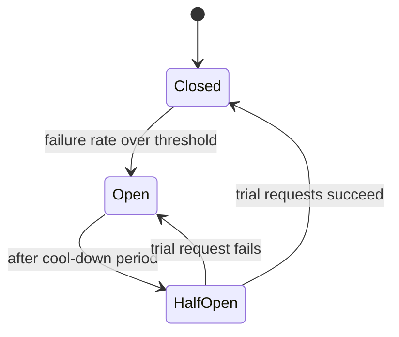
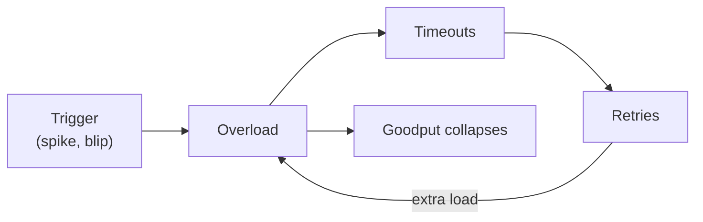

# Chapter 17. Resilience: Timeouts, Retries, Backpressure and Overload

> "Retries are a loaded gun pointed at your own dependencies."

## What you will learn

- How to set timeouts from data, and why deadlines must propagate.
- When to retry, and how: exponential backoff, jitter and retry budgets, with the math of retry amplification.
- Circuit breakers, bulkheads and hedged requests.
- Queueing theory you can use: Little's law, utilisation and why latency explodes near capacity.
- Overload: load shedding, admission control, backpressure and graceful degradation.
- Metastable failures: how systems get stuck in a failed state after the trigger has gone, and how to design against them.

---

## 17.1 Why resilience is its own discipline

Chapters 2 and 14 established that every remote call can fail, time out or succeed silently. This chapter is about the **policies** that decide what to do then, because those policies interact across services in ways that can turn a small fault into a large outage. Many of the outages in Chapter 24 weren't caused by the original fault but by the system's reaction to it: retries multiplying load, failovers overloading survivors, caches emptying and stampeding the database.

## 17.2 Timeouts and deadlines

Every remote call needs a **timeout**. Without one, a hung dependency holds threads, connections and memory until the caller itself runs out and fails.

### Setting timeouts from data

- Measure the dependency's latency distribution under normal load.
- Set the timeout a little above a high percentile (say the 99.9th), so that it rarely fires on healthy requests but cuts off hung ones.
- Revisit it when the dependency or traffic changes.

A timeout chosen by guesswork ("30 seconds should be plenty") is usually far too long to protect the caller.

### Deadline propagation

A user request has a total budget (say 2 seconds). It calls service A, which calls B, which calls C. If each uses its own fixed timeout, A may give up while B and C are still working on a request nobody will use. **Deadline propagation** passes the absolute deadline (or remaining budget) along the call chain; each service checks it before starting work and sets downstream timeouts to fit within it. gRPC propagates deadlines natively. Work for requests whose deadline has passed should be abandoned immediately: it's pure waste under load.

## 17.3 Retries

Retrying a failed call can turn a transient fault (one dropped packet, one restarted instance) into success. It can also turn an overloaded dependency into a dead one.

### When to retry

- Retry only **idempotent** operations, or operations made safe with idempotency keys (Chapter 9 §9.8).
- Retry on errors that are plausibly transient: timeouts, connection failures, "unavailable", "too many requests" (respecting any `Retry-After`).
- Don't retry errors that will recur: validation errors, "not found", "forbidden".

### Exponential backoff with jitter

Retrying immediately hammers a struggling service at the worst moment. **Exponential backoff** waits base × 2^attempt between attempts, up to a cap. But if many clients fail at the same moment, they retry at the same moments too, in synchronised waves. **Jitter** randomises the delay. Marc Brooker's analysis on the AWS Architecture Blog ("Exponential Backoff and Jitter", 2015) compared strategies and recommended **full jitter**:

```python
import random

def full_jitter_delays(base=0.1, cap=10.0, attempts=5):
    for attempt in range(attempts):
        yield random.uniform(0, min(cap, base * 2 ** attempt))
```

Full jitter spreads retries uniformly over the backoff window, which greatly reduces contention and total work when many clients fail together (other jitter variants, such as "decorrelated jitter", perform similarly).

### ◆ Formal: retry amplification

Suppose each layer of a call chain retries up to r times (so up to r + 1 attempts) when its dependency fails. With a chain of d layers each retrying independently, a failure at the bottom can cause up to (r + 1)^d attempts on the bottom service for one user request. Three layers with three retries each: 4³ = 64 times the load, precisely when the bottom service is failing. This is **retry amplification**.

Rules that follow:

1. **Retry at one layer only**, ideally the one closest to the user (or the one with the most context), and have other layers fail fast.
2. Use a **retry budget**: retries are allowed only while they're a small fraction (say 10%) of requests. Implement it as a token bucket: each successful request adds a fraction of a token; each retry spends one. When failures are widespread, the budget empties and retries stop, capping amplification at 1.1× instead of (r + 1)^d.
3. Count and expose retries as a metric; a rising retry rate is an early warning.

## 17.4 Circuit breakers

A **circuit breaker** (popularised by Michael Nygard's *Release It!*, 2007) stops calling a dependency that is failing, giving it time to recover and making the caller fail fast instead of waiting for timeouts.



- **Closed:** requests flow; failures are counted over a sliding window.
- **Open:** requests fail immediately (or use a fallback) without calling the dependency.
- **Half-open:** after a cool-down, a few trial requests are allowed; success closes the breaker, failure reopens it.

Breakers protect the caller's resources and reduce load on the failing dependency. Tune thresholds carefully: a breaker that opens on one slow instance among many can remove more capacity than the fault itself. Per-instance breakers in the load balancer (**outlier detection** in Envoy, Chapter 19) are often better than one breaker for the whole dependency.

## 17.5 Bulkheads

Ships are divided into watertight compartments so a breach floods only one. A **bulkhead** in software isolates resources so that one failing dependency or tenant can't consume everything:

- separate thread pools or connection pools per dependency;
- per-tenant quotas, so one noisy customer can't starve others;
- **cell-based architecture**: divide the whole service into independent cells, each serving a subset of customers, so a bad deployment or a poisonous request affects one cell. AWS has written extensively about cells and **shuffle sharding** (assigning each customer to a random small subset of workers so that two customers rarely share all their workers, limiting the blast radius of a bad customer).

## 17.6 Hedged and tied requests

In large fan-out systems, the slowest of many parallel calls determines latency (Chapter 7 §7.7). Dean and Barroso's "The Tail at Scale" (2013) describes:

- **Hedged requests:** send a request to one replica; if no reply arrives within, say, the 95th-percentile latency, send it to a second replica and use whichever replies first. This costs a few percent extra load but cuts tail latency dramatically.
- **Tied requests:** send to two replicas at once, each told about the other; the first to start work cancels the other.

Hedging must be bounded (only after the expected latency, only for idempotent reads) or it becomes another form of retry amplification.

## 17.7 Queueing theory you can use

### Little's law

For any stable system, **L = λW**: the average number of items in the system (L) equals the arrival rate (λ) times the average time each spends in it (W). It holds regardless of distributions. Uses:

- A service handles 2,000 requests per second with 50 ms average latency: on average 2,000 × 0.05 = 100 requests are in flight, so you need at least 100 concurrent workers or connections.
- If latency doubles under a slow dependency, in-flight requests double, which is how slowness turns into resource exhaustion.

### Utilisation and latency

For a simple single-server queue with random (Poisson) arrivals and exponential service times (an **M/M/1** queue), with utilisation ρ = arrival rate ÷ service rate, the average time in the system is:

```
W = (1 / μ) / (1 − ρ)
```

where 1/μ is the average service time. At 50% utilisation, requests take 2× the service time; at 80%, 5×; at 90%, 10×; at 95%, 20×. Latency rises **non-linearly** as utilisation approaches 1, and at ρ ≥ 1 the queue grows without bound. Real systems differ in detail, but the shape is universal: **run with headroom**, because the last 10–20% of capacity costs enormous latency. This is also why a small loss of capacity (one instance in five failing) can push a busy system over the edge.

## 17.8 Overload

When demand exceeds capacity, something must be refused. The only question is whether the system chooses what, or the overload chooses for it.

### Load shedding and admission control

- **Shed load early and cheaply:** reject excess requests at the edge with a fast error (HTTP 503 or 429), before they consume resources. A rejected request costs microseconds; a request that times out after consuming a thread for seconds costs far more.
- **Bound every queue.** An unbounded queue converts overload into latency for everyone, and eventually memory exhaustion.
- **Prefer LIFO or adaptive LIFO under overload**, or drop requests that have waited longer than their deadline: the oldest requests in a queue are the ones whose clients have most likely given up.
- **Prioritise:** shed low-priority work (batch jobs, prefetches, analytics) before user-facing work; shed new sessions before existing ones mid-transaction.
- **Concurrency limits** that adapt to measured latency (Netflix's open-source `concurrency-limits` library, based on TCP congestion control ideas) protect services without hand-tuned thresholds.

### Backpressure

Instead of rejecting, slow the sender down (Chapter 14 §14.8): bounded queues that block, flow-control windows, explicit demand signalling. Backpressure works within a pipeline you control; at the edge, where you can't slow users down, you must shed.

### Graceful degradation

Design reduced modes in advance: serve cached or default content, disable expensive features (recommendations, search suggestions), switch to read-only. A degraded service is better than an unavailable one, but only if the degraded mode is tested.

## 17.9 Metastable failures

A **metastable failure** (Bronson, Aghayev, Charapko and Zhu, HotOS 2021; Huang and colleagues, OSDI 2022) is a state in which a system remains overloaded **after the trigger that caused it has gone**, because of a **sustaining effect**, typically a feedback loop:

1. A trigger (a brief load spike, a short network blip, a cache flush) pushes the system over capacity.
2. Latency rises; requests time out; clients **retry**.
3. Retries add load, so more requests time out, so more retries are sent.
4. The trigger ends, but the retry load alone now exceeds capacity. The system stays down.

Other sustaining effects: a cache that empties during the incident (so all reads now hit the database, which can't serve them fast enough to refill the cache); failovers that move load onto already-busy nodes; garbage collection thrashing.



The defining feature is that **reducing load to the original level doesn't fix it**: you must reduce it far below, for example by shedding most traffic, disabling retries, or warming caches, before the system recovers. Defences:

- retry budgets (§17.3), which cap the feedback loop (jitter alone doesn't: it spreads retries out but doesn't reduce their number);
- load shedding and bounded queues (§17.8), which keep goodput up under overload;
- deadline propagation and dropping expired work, so capacity isn't spent on requests nobody is waiting for;
- caches with request coalescing and stale-while-revalidate (Chapter 18), so a cold cache doesn't stampede;
- testing recovery from overload, not just behaviour under it (Chapter 23).

[`examples/resilience/`](../examples/resilience/) simulates clients and a server with limited capacity through a brief overload spike. It compares no-backoff retries, exponential backoff, full jitter, retry budgets, circuit breaking and load shedding, and reports goodput, latency percentiles and recovery time for each. The server has capacity for 100 requests per second; normal load is 70; a five-second spike sends 200. Results after the spike (seed 1):

| Strategy | Goodput after spike (ideal 70/s) | Recovered after | Load amplification |
|---|---|---|---|
| No retries | 47.0/s | 15 s | 1.00 |
| Naive immediate retries | 0/s | never (queue reaches 11,035) | 3.51 |
| Exponential backoff | 0/s | never | 2.67 |
| Backoff with full jitter | 0/s | never | 3.38 |
| Full jitter + retry budget | 33.2/s | 24 s | 1.06 |
| Full jitter + circuit breaker | 67.5/s | 2 s | 0.90 |
| Load shedding alone | 69.8/s | immediately | 1.27 |
| Budget + jitter + shedding + deadlines | 69.8/s | immediately | 1.02 |

Three lessons stand out. First, the retry-only strategies, including jittered ones, never recover: the system is metastable. **Jitter changes *when* retries happen, not *how many***, so on its own it can't break a feedback loop driven by the volume of retries. Jitter's real benefit is against synchronised bursts: in the folder's separate thundering-herd experiment, 200 clients failing at the same instant needed 2,100 calls and 13.3 seconds to drain with plain exponential backoff, but about 1,000 calls and 0.8 seconds with full jitter. Second, the retry budget caps amplification at about 1.06× but recovers slowly, because the queue built during the spike still has to drain. Third, **shedding load at a bounded queue is what keeps goodput at capacity during and after overload**. The tipping points are sharp: the same setup absorbs a 0.4-second spike and never recovers from a 0.6-second one.

---

## Summary

- Many outages come from the system's reaction to a fault rather than the fault itself.
- Set timeouts from measured latency; propagate deadlines; abandon work whose deadline has passed.
- Retry only idempotent, transient failures, with exponential backoff and full jitter, at one layer, within a retry budget. Retries amplify as (r + 1)^d across d layers.
- Circuit breakers fail fast and give dependencies room to recover; bulkheads, cells and shuffle sharding contain blast radius; hedged requests cut tail latency.
- Little's law relates concurrency, throughput and latency; M/M/1 shows latency exploding as utilisation nears 1. Keep headroom.
- Under overload, shed early and cheaply, bound queues, prioritise, apply backpressure and degrade gracefully.
- Metastable failures persist after their trigger because of feedback loops like retries and cold caches; break the loops by design.

## Exercises

See [`exercises/17-resilience.md`](../exercises/17-resilience.md).

## Further reading

- Marc Brooker, "Exponential Backoff and Jitter", AWS Architecture Blog (2015), and the Amazon Builders' Library articles "Timeouts, retries, and backoff with jitter" and "Using load shedding to avoid overload".
- Michael T. Nygard, *Release It!* (2nd edition, Pragmatic Bookshelf, 2018).
- Jeffrey Dean and Luiz André Barroso, "The Tail at Scale", *Communications of the ACM* (2013).
- Nathan Bronson et al., "Metastable Failures in Distributed Systems", HotOS (2021); Lexiang Huang et al., "Metastable Failures in the Wild", OSDI (2022).
- Betsy Beyer et al., *Site Reliability Engineering* (Google, 2016), chapters "Handling Overload" and "Addressing Cascading Failures".
- Mor Harchol-Balter, *Performance Modeling and Design of Computer Systems: Queueing Theory in Action* (Cambridge, 2013).
