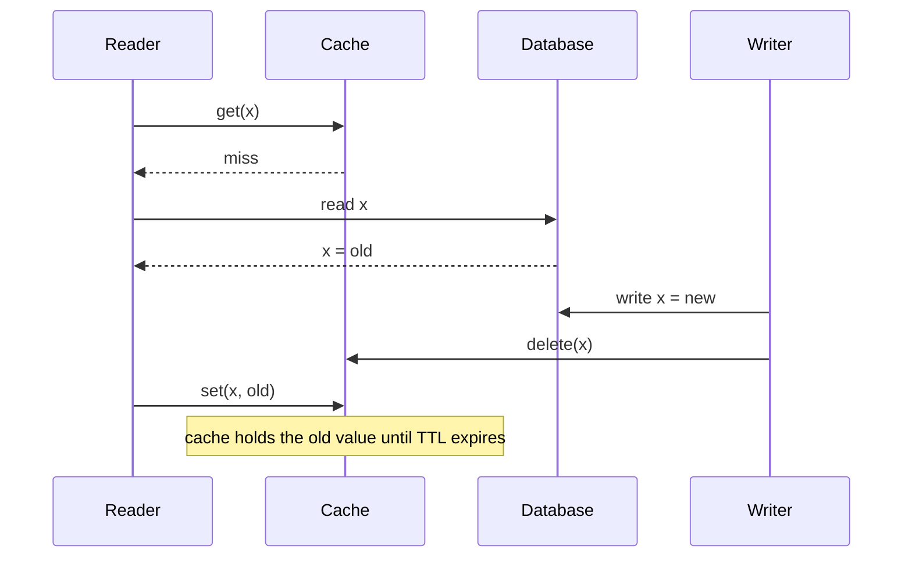

# Chapter 18. Caching, Load Balancing and Content Delivery

> "There are only two hard things in Computer Science: cache invalidation and naming things."
> — attributed to Phil Karlton

## What you will learn

- Where caches sit in a distributed system and what each placement buys.
- Caching patterns: cache-aside, read-through, write-through, write-behind and refresh-ahead.
- Invalidation strategies and the consistency problems they cause, with concrete race conditions.
- Thundering herds, cache stampedes and how to prevent them.
- Distributed caches: partitioning, replication and the hot-key problem.
- Load balancing algorithms, including the power of two choices, with the math behind it.
- Content delivery networks and edge computing.

---

## 18.1 Why caching

A **cache** keeps a copy of data closer to where it's used, or in a faster medium, so later requests avoid the slower path. Caches reduce latency and load on the source, and often make the difference between a system that scales and one that doesn't. They also introduce a second copy of the data, with all the consistency questions of Chapter 6, usually without any of the protocols that make replication safe.

### Where caches live

| Layer | Examples | Typical latency saved |
|---|---|---|
| Client / browser | HTTP cache, app memory | A whole network round trip |
| CDN edge | Cloudflare, Akamai, CloudFront, Fastly | Cross-continent latency (tens to hundreds of ms) |
| Service in-process | An LRU map in the application | A network hop to the cache server |
| Distributed cache tier | Redis, Memcached, Valkey | A database query |
| Database | Buffer pool, query cache | Disk reads |

**Hit rate** (the fraction of requests served from cache) determines value. A cache with a 99% hit rate cuts load on the source by 100×; at 90%, by only 10×. Small changes in hit rate have large effects on the source, which is why losing a cache (a restart, a flush) can overload the database behind it.

## 18.2 Caching patterns

| Pattern | Reads | Writes | Notes |
|---|---|---|---|
| **Cache-aside** (lazy loading) | App checks cache; on miss, reads source and populates cache | App writes source, then invalidates (deletes) the cache entry | Most common; app owns the logic |
| **Read-through** | Cache loads from source on miss | — | Cache library or service owns loading |
| **Write-through** | — | Writes go to cache and source synchronously | Cache always fresh for written keys; slower writes |
| **Write-behind** (write-back) | — | Write to cache; flush to source asynchronously | Fast writes; data lost if cache fails before flush |
| **Refresh-ahead** | Cache refreshes popular entries before they expire | — | Avoids expiry-time misses for hot keys |

## 18.3 Invalidation and consistency

### Time-to-live

The simplest invalidation is a **time-to-live (TTL)**: entries expire after a fixed period. TTL bounds staleness (an entry is at most TTL old) and needs no coordination. Choose TTLs per kind of data: seconds for prices, hours for product descriptions. Add random jitter to TTLs so that entries populated together don't all expire together.

### Explicit invalidation, and its races

When the source changes, delete or update the cache entry. Even this simple scheme has races. The classic one with cache-aside:

The reader fetched the old value before the write, but populated the cache after the writer's invalidation. The stale value then lives in the cache indefinitely (or until TTL). Mitigations:

- **Short TTLs** as a backstop: every bug becomes bounded staleness.
- **Leases**, as in Facebook's memcache design (Nishtala and colleagues, "Scaling Memcache at Facebook", NSDI 2013): on a miss, the cache gives the reader a lease token; a `delete` invalidates outstanding leases; a `set` is accepted only with a valid token. This is a fencing token (Chapter 12) applied to caches.
- **Versioned sets:** store a version with the value and only overwrite with a newer version (compare-and-set).
- **Invalidate from the database's change stream** (CDC, Chapter 14) rather than from application code, so every committed change triggers invalidation in commit order. Facebook's McSqueal and many modern systems do this.

### What consistency can a cache give?

A cache in front of a linearizable database is not linearizable: it serves values without checking whether they're current. At best it gives **bounded staleness** (via TTL) and, with care, **read-your-writes** for the writer (by updating or bypassing the cache in the writer's session). Treat cached data as possibly stale, and don't cache data whose staleness breaks invariants (balances used for authorisation, lock state).

## 18.4 Thundering herds and stampedes

When a popular entry expires or is invalidated, many concurrent requests miss at once and all go to the source together: a **cache stampede** (or **thundering herd**, or **dog-pile**). For a very hot key, this can overload the source instantly, and if the source slows, more requests miss, which is a metastable loop (Chapter 17 §17.9).

Defences:

- **Request coalescing** (single flight): only one request per key fetches from the source; others wait for its result. Go's `singleflight` package is a common implementation; CDNs call this "request collapsing".
- **Stale-while-revalidate:** serve the expired value while one request refreshes it in the background (an HTTP `Cache-Control` extension, RFC 5861, and a feature of most CDNs).
- **Probabilistic early expiration:** each request refreshes the entry early with a probability that rises as expiry approaches, so refreshes spread out (Vattani, Chierichetti and Lowenstein, "Optimal Probabilistic Cache Stampede Prevention", VLDB 2015).
- **Warm caches before traffic** after deployments or failovers; don't let a cold cache take full load.

## 18.5 Distributed caches

A cache tier spread over many servers is partitioned like any data store (Chapter 7), usually with consistent hashing in the client library so adding a cache node moves few keys. Considerations:

- **Hot keys:** a single very popular key overloads one cache server. Fixes: replicate hot keys to several servers, add a small in-process cache in front (a "near cache"), or split the key.
- **Replication:** a cache server's failure means all its keys miss at once. Some deployments replicate caches (Redis replicas) or accept the miss storm with stampede protection.
- **Memory pressure and eviction:** policies such as LRU (least recently used), LFU (least frequently used) and newer algorithms with better hit rates on real workloads, such as W-TinyLFU (used by the Caffeine Java library) and S3-FIFO (Yang and colleagues, SOSP 2023).

## 18.6 Load balancing

A **load balancer** distributes requests across a pool of backend instances. It can run as a dedicated proxy (HAProxy, NGINX, Envoy, cloud load balancers), in the client library, or in a service-mesh sidecar (Chapter 19).

### Layer 4 versus layer 7

- **Layer 4** (transport) balancers route TCP or UDP connections by address and port without understanding the protocol. Fast, but they balance *connections*, not requests; with long-lived HTTP/2 or gRPC connections, a few connections can carry most of the load.
- **Layer 7** (application) balancers understand HTTP or gRPC and route individual requests, by path, header or method, and can retry, apply timeouts and collect per-request metrics.

### Algorithms

| Algorithm | How | Weakness |
|---|---|---|
| **Round robin** | Each backend in turn | Ignores differences in request cost and backend speed |
| **Weighted round robin** | Proportional to configured weights | Static |
| **Random** | Uniformly at random | Load variance |
| **Least connections / least outstanding requests** | Pick the backend with the fewest in-flight requests | Needs global knowledge; herding when many balancers see the same "least loaded" backend |
| **Power of two choices** | Pick two backends at random; send to the less loaded | Tiny overhead; excellent balance |
| **Consistent hashing** | Route by key, for cache affinity | Hot keys |
| **Latency-aware (e.g. peak EWMA)** | Prefer backends with low recent latency | Tuning |

### ◆ Formal: the power of two choices

Throw n balls into n bins, each into a uniformly random bin. The fullest bin then has about (ln n)/(ln ln n) balls with high probability. Now, for each ball, choose **two** bins at random and put the ball in the less full one. The maximum load drops to about (ln ln n)/(ln 2) + O(1) (Azar, Broder, Karlin and Upfal, 1994; Mitzenmacher's thesis, 1996). For n = 1,000,000, that's roughly a reduction from 8 or 9 to about 4 or 5; more importantly, the growth is doubly logarithmic, so balance stays excellent at any scale. Going from two choices to d choices only improves the constant (ln ln n / ln d); the big win is from one to two.

The practical value: load balancers that query every backend's load are expensive and herd (all balancers pick the same "least loaded" backend at once, overloading it). Sampling two at random gets almost all the benefit with none of the herding. Envoy's least-request balancer and NGINX's `random two least_conn` use it.

### Health checking and outlier detection

Load balancers remove unhealthy backends:

- **Active health checks:** periodic probes to a health endpoint. Make the endpoint meaningful (can the instance serve a real request?) but cheap, and beware of health checks that fail because a *shared* dependency is down, removing every instance at once.
- **Passive outlier detection:** eject backends that return errors or slow responses on real traffic (Envoy's outlier detection), with a cap on the fraction that can be ejected so a widespread problem doesn't empty the pool.

## 18.7 Content delivery networks and the edge

A **content delivery network (CDN)** is a globally distributed cache: hundreds of **points of presence** (PoPs) near users cache content from an **origin** server. Users reach the nearest PoP via **anycast** routing (the same IP address announced from many locations, so the internet's routing delivers packets to the nearest) or DNS-based steering.

CDNs reduce latency (light-speed limits, Chapter 1 §1.6), absorb traffic spikes, and protect origins from denial-of-service attacks. Caching rules follow HTTP semantics: `Cache-Control` headers, `ETag` validation, `Vary`, and purge APIs for invalidation.

Modern CDNs also run code at the edge: **edge computing** platforms (Cloudflare Workers, Fastly Compute, AWS Lambda@Edge and CloudFront Functions, Deno Deploy) execute application logic in PoPs, and some offer edge key-value stores and databases with replication back to a primary region. These bring the trade-offs of this book to the edge: an edge database that accepts writes in many locations faces exactly the multi-leader and consistency problems of Chapters 6 and 8.

---

## Summary

- Caches reduce latency and source load; hit rate determines value, and losing a cache can overload the source.
- Choose a pattern (cache-aside, read-through, write-through, write-behind, refresh-ahead) per use case. TTLs bound staleness; explicit invalidation has races, fixed with leases, versioned sets or CDC-driven invalidation.
- A cache gives bounded staleness, not linearizability; don't cache data whose staleness breaks invariants.
- Prevent stampedes with request coalescing, stale-while-revalidate, probabilistic early expiration and cache warming.
- Distributed caches partition with consistent hashing and must handle hot keys and node loss.
- Load balancers work at layer 4 or 7. The power of two choices gives near-optimal balance without herding, reducing maximum load from Θ(log n / log log n) to Θ(log log n).
- CDNs and edge platforms bring caching and computation near users, along with the consistency trade-offs of multi-leader systems.

## Exercises

See [`exercises/18-caching-and-load-balancing.md`](../exercises/18-caching-and-load-balancing.md).

## Further reading

- Rajesh Nishtala et al., "Scaling Memcache at Facebook", NSDI (2013).
- Michael Mitzenmacher, "The Power of Two Choices in Randomized Load Balancing", *IEEE TPDS* (2001), and Mitzenmacher, Richa and Sitaraman's survey (2001).
- Andrea Vattani, Flavio Chierichetti and Keegan Lowenstein, "Optimal Probabilistic Cache Stampede Prevention", VLDB (2015).
- Juncheng Yang et al., "FIFO Queues Are All You Need for Cache Eviction" (S3-FIFO), SOSP (2023).
- Bruce Maggs and Ramesh Sitaraman, "Algorithmic Nuggets in Content Delivery", *ACM SIGCOMM CCR* (2015).
- Envoy proxy documentation on load balancing and outlier detection (envoyproxy.io).
