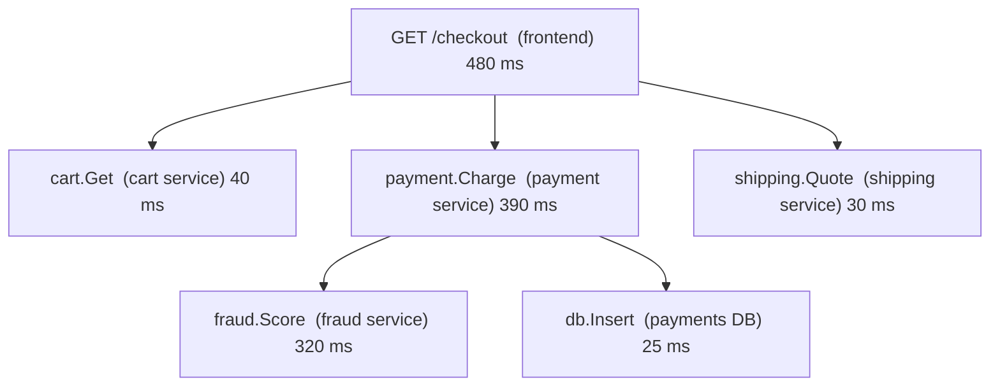

# Chapter 22. Observability and Debugging

> "You can't debug a distributed system by attaching a debugger to it. You can only interrogate what it left behind."

## What you will learn

- Why debugging distributed systems is different, and what observability means.
- Metrics, logs and traces: what each is good for, and how to make them useful.
- Distributed tracing: context propagation, spans, sampling and OpenTelemetry.
- Service level indicators and objectives, and alerting on symptoms.
- Debugging techniques for partial, intermittent and gray failures.
- Correlating time across machines when clocks disagree.

---

## 22.1 Why debugging is different

On one machine, you can pause a program, inspect its state and step through it. In a distributed system:

- the "state" is spread across many machines and the messages between them;
- the bug may depend on a specific interleaving that has already passed;
- adding logging or a debugger changes timing and may hide the bug (a **Heisenbug**);
- failures are often **partial** (some users, some requests, some regions) and **gray** (slow rather than down, Chapter 2 §2.5).

**Observability** is the property of a system that lets you understand its internal state from its external outputs, well enough to answer questions you didn't anticipate when you built it. Charity Majors and others popularised the distinction from **monitoring**, which checks known failure conditions ("is CPU above 90%?"). Monitoring tells you *that* something is wrong; observability helps you find *what* and *why*.

## 22.2 The three signals

| Signal | What it is | Good for | Weakness |
|---|---|---|---|
| **Metrics** | Numeric time series, aggregated (request rate, error rate, latency histograms, queue depth) | Dashboards, alerting, trends; cheap at any scale | Aggregation loses detail; high-cardinality labels are expensive |
| **Logs** | Timestamped records of discrete events | Detail about specific events; audit | Volume and cost; hard to correlate across services without IDs |
| **Traces** | The path of one request through many services, as a tree of timed spans | Latency breakdowns; understanding call graphs; finding where a request failed | Usually sampled; needs instrumentation everywhere |

Newer practice adds **continuous profiling** (always-on, low-overhead CPU and memory profiles across the fleet) and **wide structured events** (one rich event per request per service, with many fields, which can be sliced arbitrarily).

### Metrics that matter

For every service, start with:

- **The four golden signals** (Google SRE book): latency, traffic, errors and saturation.
- **RED** (for request-driven services): Rate, Errors, Duration.
- **USE** (for resources, Brendan Gregg): Utilisation, Saturation, Errors.

Record latency as **histograms**, not averages. Averages hide the tail, and the tail is what users of a fan-out system experience (Chapter 7 §7.7). Report percentiles (p50, p99, p99.9) computed from histograms; never average percentiles across instances (the average of two p99s is not a p99).

### Logs that help

- **Structured** (JSON or key-value), not free text, so they can be queried.
- Every line carries a **request ID** or **trace ID**, so logs from different services for the same request can be joined.
- Log **state transitions** in distributed protocols (became leader in term 7; stepped down; lease expired; rejected write with stale token 33). These are the lines that make post-incident analysis possible.
- Avoid logging secrets and personal data; control volume with levels and sampling.

## 22.3 Distributed tracing

A **trace** represents one request's journey. It's a tree of **spans**; each span records an operation (an RPC, a database query, a queue publish) with a start time, duration, the service, attributes, and its parent span.

The tree makes the latency breakdown obvious: checkout is slow because fraud scoring is slow. Google's **Dapper** paper (Sigelman and colleagues, 2010) described the approach; Zipkin and Jaeger implemented it in open source.

### Context propagation

For spans from different services to join into one trace, each outgoing call must carry the **trace context**: the trace ID and the parent span ID. The W3C **Trace Context** standard defines the `traceparent` HTTP header for this. Message-based systems carry it in message headers, so a trace can span asynchronous hops too.

### OpenTelemetry

**OpenTelemetry** (a CNCF project formed in 2019 by merging OpenTracing and OpenCensus) is the industry standard for instrumentation: APIs and SDKs in many languages for traces, metrics and logs, automatic instrumentation for common frameworks, the OTLP wire protocol, and the **Collector** for processing and exporting telemetry to any back end. Instrument with OpenTelemetry and you can change back ends without re-instrumenting.

### Sampling

Tracing every request at scale is expensive. Strategies:

- **Head-based sampling:** decide at the start of the trace (keep 1%). Cheap, but rare errors are usually dropped.
- **Tail-based sampling:** buffer spans, decide after the trace completes (keep all errors, all slow traces, and 1% of the rest). Better for debugging; needs a buffering tier.

## 22.4 SLIs, SLOs and alerting

- A **service level indicator (SLI)** is a measured ratio of good events to all events: the fraction of requests that succeed in under 300 ms, measured at the load balancer.
- A **service level objective (SLO)** is a target for an SLI over a window: 99.9% over 30 days.
- The **error budget** is what's left: 0.1% of requests may be bad. When the budget is spent, reliability work takes priority over features.

**Alert on symptoms users feel**, not on causes. "Error rate SLO burning fast" is actionable; "CPU at 85% on one node" usually isn't. The SRE Workbook recommends **multi-window burn-rate alerts**: page when the error budget is being consumed at, for example, 14.4× the sustainable rate over both the last hour and the last five minutes (which would exhaust a 30-day budget in about two days), and open a ticket for slower burns.

Every alert should link to a **runbook** and be actionable. Alerts that fire without needing action train people to ignore them.

## 22.5 Debugging techniques

### Start from the symptom and narrow

1. **Scope:** which users, regions, endpoints, versions, instances? A problem that affects one availability zone, one deployment cohort or one customer points to very different causes.
2. **Timeline:** when did it start? What changed then? (Deployments, configuration changes, traffic shifts, dependency incidents.) Most incidents start with a change.
3. **Traces of bad requests:** where does the time go, or where does the error originate?
4. **Compare good and bad:** what differs between failing and succeeding requests (attributes, paths, instances)?
5. **Hypothesise and test:** form a hypothesis that explains *all* the evidence, then confirm it.

### Gray failures

A node is "up" by its health check but failing real work (Chapter 2 §2.5). Signs: one instance with higher latency or error rate than its peers; retries that succeed on a different instance. Detect with **per-instance** metrics from the **client's** perspective, outlier detection in load balancers (Chapter 18 §18.6), and health checks that exercise real dependencies.

### Correlating time across machines

Log timestamps from different machines can't be ordered precisely, because clocks skew (Chapter 3). Use:

- **causal links** (trace parent/child, message IDs) rather than timestamps to order events across services;
- **logical timestamps** (terms, epochs, log indices, Kafka offsets) for protocol events;
- awareness of the clock-error bound when reading timelines: two events 2 ms apart on different machines may have happened in either order.

### Reproducing distributed bugs

- Capture the **inputs and the schedule**: deterministic simulation (Chapter 23) makes failures reproducible by seed.
- Record **protocol state transitions** in logs so the sequence can be reconstructed.
- Build **tools to replay** production traffic or event logs against a test environment.

### Post-incident reviews

After an incident, write a **blameless postmortem** (template: [`templates/postmortem.md`](../templates/postmortem.md)): timeline, impact, contributing factors, what went well, what was lucky, and action items with owners. Distributed-systems incidents rarely have a single "root cause"; they usually involve several conditions combining (a trigger plus a sustaining effect plus a missing safeguard, as in metastable failures, Chapter 17 §17.9). Richard Cook's "How Complex Systems Fail" (1998) is essential reading on why.

---

## Summary

- Distributed bugs depend on vanished interleavings, partial and gray failures; observability lets you ask new questions of a running system.
- Metrics (golden signals, RED, USE; histograms, not averages), structured logs with trace IDs and protocol state transitions, and distributed traces complement each other.
- Traces are trees of spans joined by propagated context (W3C Trace Context); OpenTelemetry standardises instrumentation; tail-based sampling keeps the interesting traces.
- Define SLIs and SLOs, manage error budgets, and alert on symptom burn rates with runbooks.
- Debug by scoping, building a timeline, comparing good and bad requests, and testing hypotheses. Detect gray failures from the client's view. Order cross-machine events causally, not by wall clock.
- Write blameless postmortems that look for combinations of contributing factors.

## Exercises

See [`exercises/22-observability.md`](../exercises/22-observability.md).

## Further reading

- Benjamin H. Sigelman et al., "Dapper, a Large-Scale Distributed Systems Tracing Infrastructure", Google technical report (2010).
- Charity Majors, Liz Fong-Jones and George Miranda, *Observability Engineering* (O'Reilly, 2022).
- Betsy Beyer et al., *The Site Reliability Workbook* (O'Reilly, 2018), chapters on SLOs and alerting.
- W3C, *Trace Context* recommendation (w3.org/TR/trace-context).
- OpenTelemetry documentation (opentelemetry.io).
- Richard I. Cook, "How Complex Systems Fail" (1998).
- Brendan Gregg, "The USE Method" (brendangregg.com).
