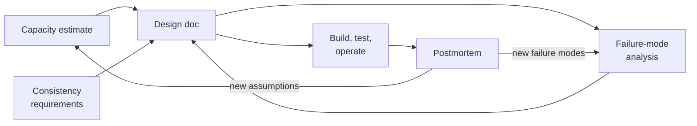

# Templates

Copy these documents into real design and operations work. Each one opens with a short "How to use this template" note saying what it's for, when you use it, who owns it and who signs it off. Each one also points back to the chapters that explain *why* its questions matter.

Conventions used throughout:

- `<Angle brackets>` mark text to replace.
- Empty table cells are for you to fill.
- *Italic notes* are guidance. Delete them before you circulate the document.
- Worked examples use fictional organisations and services (Contoso, Fabrikam, Northwind, Tailspin Toys, Woodgrove Bank). Any resemblance to a real system is coincidental.
- Product facts in examples (defaults, limits, versions) are *as of October 2026*. Check them against current documentation before you rely on them.

| Template | Purpose | When | Chapters |
|---|---|---|---|
| [`design-doc.md`](design-doc.md) | Design document for a distributed system: requirements and SLOs, data model, partitioning, replication, consistency per operation, failure modes, capacity, alternatives, rollout, observability, testing and database evaluation | Before building, or before a significant change | [1](../chapters/01-introduction.md), [4](../chapters/04-models-and-impossibility.md), [6](../chapters/06-replication.md)–[9](../chapters/09-distributed-transactions.md), [17](../chapters/17-resilience.md), [19](../chapters/19-service-architecture.md), [20](../chapters/20-databases-in-practice.md) |
| [`failure-mode-analysis.md`](failure-mode-analysis.md) | Failure mode and effects analysis (FMEA): every component, how it fails, how you detect it, what it does to users, and how you mitigate and test it; filled example for a three-node Raft-backed service | During design review; refreshed after incidents | [2](../chapters/02-networks-and-failure.md), [11](../chapters/11-consensus.md), [12](../chapters/12-coordination.md), [17](../chapters/17-resilience.md), [23](../chapters/23-testing.md), [24](../chapters/24-outages.md) |
| [`consistency-requirements.md`](consistency-requirements.md) | Worksheet that decides, per data item and operation, the consistency model, partition behaviour, latency budget, PACELC choice, conflict resolution and whether it's monotonic (CALM); filled examples | Early in design; whenever a new kind of data appears | [3](../chapters/03-time-and-order.md), [4](../chapters/04-models-and-impossibility.md), [8](../chapters/08-consistency-models.md), [9](../chapters/09-distributed-transactions.md), [10](../chapters/10-crdts.md) |
| [`capacity-estimate.md`](capacity-estimate.md) | Back-of-the-envelope worksheet: storage, request rates, bandwidth, Little's law, utilisation, availability composition and quorum sizing, with Chapter 1's worked example | Before choosing an architecture; at each capacity review | [1](../chapters/01-introduction.md), [7](../chapters/07-partitioning.md), [11](../chapters/11-consensus.md), [17](../chapters/17-resilience.md) |
| [`postmortem.md`](postmortem.md) | Blameless post-incident review: impact, timeline, trigger, propagation, sustaining effect, detection, recovery, contributing factors, luck and action items | Within five working days of an incident | [17](../chapters/17-resilience.md), [22](../chapters/22-observability.md), [24](../chapters/24-outages.md) |

## How the templates connect

The design doc is the spine. The capacity estimate and the consistency worksheet feed its requirements and data sections; the failure-mode analysis tests the design and usually changes it; postmortems feed new failure modes and corrected assumptions back into the analysis and the estimate.

## Adapting the templates

- **Cut, don't pad.** A small internal service needs a two-page design doc, not every section here. Delete sections that don't apply rather than writing "N/A" everywhere, but say explicitly why you skipped consistency or failure analysis if you do.
- **Write down the system model.** Every guarantee in a design is relative to assumptions about timing, failures and communication ([Chapter 4 §4.1](../chapters/04-models-and-impossibility.md)). If the document doesn't state them, reviewers can't check them.
- **Prefer numbers to adjectives.** "Low latency" and "highly available" aren't requirements; "p99 under 200 ms" and "99.95% of requests succeed over 30 days" are.
- **Date everything.** Versions, defaults, limits and prices change. Put a date and version on every document.
- **Keep one source of truth.** Link to the consistency worksheet or the FMEA from the design doc instead of copying tables that will drift apart.
- **Use the checklists.** [Appendix D](../appendices/D-checklists.md) has design-review checklists that pair with these templates, and [Appendix C](../appendices/C-numbers.md) has the reference numbers for estimates.
