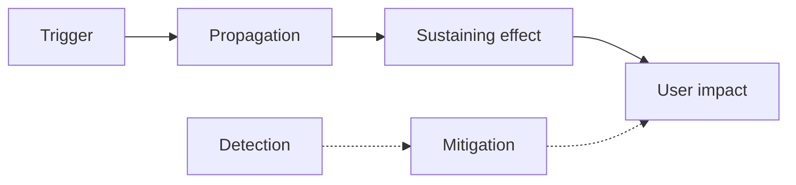

# Postmortem: <Short incident title>

*Incident ID: <INC-nnnn> · Date of incident: <YYYY-MM-DD> · Status: draft / in review / final · Author(s): <names> · Incident commander: <name> · Reviewers: <names> · Severity: <SEV-n>*

## How to use this template

- **Purpose:** learn from an incident, without blame, so the system and the organisation become harder to break. A postmortem explains what happened, why it spread, why it didn't stop on its own, how it was found and fixed, and what will change. In distributed systems, incidents rarely have a single "root cause"; they usually need several conditions to combine: a trigger, a way to propagate, a sustaining effect and a missing safeguard ([Chapter 22 §22.5](../chapters/22-observability.md), [Chapter 17 §17.9](../chapters/17-resilience.md)).
- **When:** for every incident above your severity threshold, any data loss or safety violation (lost acknowledged write, split brain, oversell), and any near miss worth learning from. Draft within two working days; review within five.
- **Owner:** the incident commander or a designated author, ideally with someone who wasn't on call facilitating the review.
- **Sign-off:** the owning team's lead approves the action items; leadership reviews severe incidents. Publish internally (and externally, where appropriate) once final.

Background reading: [Chapter 24](../chapters/24-outages.md), especially §24.1 on reading an incident through trigger, propagation, sustaining effect, detection and recovery; [Chapter 22](../chapters/22-observability.md) on debugging; and Richard Cook, "How Complex Systems Fail" (1998), listed in [Appendix B](../appendices/B-bibliography.md).

*Blameless means asking "what made this the reasonable thing to do at the time, given what the person knew?" rather than "who got it wrong?". People acting under uncertainty with the tools and information they had are part of the system; if a person could make the mistake, the system allowed it. Write in neutral language, use roles rather than names where possible, and never let a postmortem be used in performance reviews.*

---

## 1. Summary

*Three to five sentences a busy reader can stop after: what users experienced, for how long, the trigger, why it was so big or long, and the most important change you'll make.*

<…>

## 2. Impact

| Measure | Value | Source |
|---|---|---|
| Start and end of user impact (UTC) | | |
| Duration of impact | | |
| Detection time (start of impact → first alert or report) | | |
| Mitigation time (detection → impact ended) | | |
| Users, tenants or regions affected | | |
| Requests failed or degraded (count, %) | | |
| SLOs breached; error budget consumed | | |
| Data lost, corrupted or inconsistent (records, and whether recovered) | | |
| Safety violations (split brain, duplicate processing, oversell, stale reads) | | |
| Financial, contractual or regulatory impact | | |
| Dependent systems and customers affected | | |

## 3. Timeline

*All times in UTC. Include when things were first noticeable in data, not just when someone noticed. Mark decisions and the information available when they were made. Order events across machines by causal evidence (trace links, log indices, terms, offsets) rather than by wall-clock timestamps alone ([Chapter 22 §22.5](../chapters/22-observability.md)).*

| Time (UTC) | Event | Source (log, metric, chat, person) |
|---|---|---|
| | Change or condition that later became the trigger | |
| | Trigger | |
| | First symptom in data | |
| | First alert / first customer report | |
| | Incident declared; commander assigned | |
| | Key hypotheses tried (and why) | |
| | Mitigation applied | |
| | Impact ends | |
| | Full recovery (backlogs drained, replicas resynchronised, data repaired) | |
| | Incident closed | |

## 4. Analysis

*Answer each question from [Chapter 24 §24.1](../chapters/24-outages.md). Diagrams help; a Mermaid flowchart of the causal chain is often clearer than prose.*

### 4.1 Trigger

*What started it? Often a routine change: a deployment, configuration push, maintenance command, traffic shift, certificate expiry, capacity change or dependency incident.*

<…>

### 4.2 Propagation

*Why did it spread beyond the component that first failed? Look for global or simultaneous changes, shared dependencies, replicated configuration, health checks that removed capacity, synchronous call chains, missing bulkheads or cells, and failovers that moved load onto busy nodes.*

<…>

### 4.3 Sustaining effect

*Why didn't it stop when the trigger stopped? Look for feedback loops: retries and reconnection storms, cold caches, backlogs, failover load, leadership flapping, restarts stampeding a shared dependency ([Chapter 17 §17.9](../chapters/17-resilience.md)). If load had to be cut far below normal before recovery, the system was metastable.*

<…>

### 4.4 Detection

*How was it noticed, and how long did that take? Did alerts fire on user-facing symptoms (SLO burn) or only on causes? Were monitoring, dashboards or status pages affected by the incident itself? Was it a gray failure that health checks missed?*

<…>

### 4.5 Recovery

*What slowed diagnosis and repair? Were runbooks accurate? Did recovery tools, access paths or kill switches depend on the failing system? Was a recovery procedure being run at a scale it had never been tested at? Did recovery itself cause load surges?*

<…>

### 4.6 Causal chain

*Replace with the incident's actual chain.*

## 5. Contributing factors

*List every condition that, had it been different, would have prevented the incident or made it smaller. Classify each so patterns show up across postmortems.*

| # | Contributing factor | Category | Principle it relates to | Chapter |
|---|---|---|---|---|
| 1 | | Change management / design / capacity / dependency / tooling / observability / process / knowledge | e.g. staged rollout; fencing; retry budget; bounded queues | |
| 2 | | | | |

*Useful categories from [Chapter 24 §24.10](../chapters/24-outages.md): a change applied everywhere at once; automation or failover acting on uncertain information; retries and reconnection storms; metastable states after the trigger; health checks that removed all capacity; monitoring and tooling sharing fate; unexercised recovery procedures.*

## 6. What went well

*Things to keep doing: alerts that fired early, safeguards that held, good decisions under pressure, tools that worked.*

- <…>

## 7. Where we got lucky

*Conditions outside our control that made it smaller than it could have been: time of day, low traffic, an engineer who happened to know an obscure system, a backup that happened to be recent. Each one is a latent risk; consider an action item for it.*

- <…>

## 8. Action items

*Each action has one owner and a due date, and is tracked in the normal work tracker. Prefer actions that change the system (guards in tools, staged rollout enforced by the deployment system, fencing, retry budgets, independent monitoring) over actions that ask people to be more careful. Include at least one action that tests the fix.*

| # | Action | Type (prevent / detect / mitigate / process) | Contributing factor(s) addressed | Owner | Due | Tracking link | Status |
|---|---|---|---|---|---|---|---|
| 1 | | | | | | | |
| 2 | | | | | | | |

**Updates to other documents:** <failure-mode analysis rows added or re-rated ([`failure-mode-analysis.md`](failure-mode-analysis.md)); runbooks; capacity estimate assumptions ([`capacity-estimate.md`](capacity-estimate.md)); design doc>

## 9. Supporting information

- Dashboards and graphs: <links, with screenshots in case they expire>
- Logs and traces: <links>
- Incident channel and call recording: <links>
- Related incidents and postmortems: <links>
- External communications (status page posts, customer notices): <links>

---

## Review checklist

- [ ] The summary makes sense to someone outside the team.
- [ ] Impact is quantified, including data and safety impact, not just availability.
- [ ] The timeline shows when the problem was first visible in data, and the information behind each decision.
- [ ] Trigger, propagation, sustaining effect, detection and recovery are each answered.
- [ ] Contributing factors look beyond the trigger; no single "root cause" is presented as the whole story.
- [ ] The language is blameless: roles, systems and information, not individuals' failings.
- [ ] "Where we got lucky" is filled in, and each lucky condition has been considered for an action.
- [ ] Every action item has one owner, a due date and a tracking link; most change the system rather than relying on vigilance.
- [ ] At least one action tests the fix (game day, fault injection, recovery drill at scale; [Chapter 23](../chapters/23-testing.md)).
- [ ] The failure-mode analysis has been updated.
