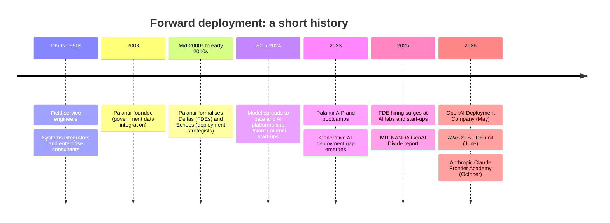

# Chapter 2. From Palantir's Deltas to the AI Deployment Boom

> "The product is not finished when it ships. It is finished when it works for the customer."

## What you will learn

- The older traditions that forward deployment grew out of: field engineers, systems integrators, sales engineers and professional services.
- How Palantir turned forward deployment into an operating model, and why.
- How the model spread to data and software companies.
- Why generative AI triggered the 2025–2026 boom, and what OpenAI, AWS, Anthropic and the consultancies did about it.
- Which lessons from this history matter to an FDE today.

---

## 2.1 Before the name: engineers in the field

Sending engineers to customers is not new.

- **Field service engineers** (1950s onwards). Mainframe and industrial equipment makers such as IBM sent engineers to install, maintain and adapt machines on customer premises. Large customers often had a resident engineer on site for years.
- **Systems integrators and enterprise consultants** (1980s–2000s). Packaged software (SAP, Oracle, Siebel) required long implementations. Consultancies (Accenture, Deloitte, IBM Global Services and many others) and vendors' own professional-services arms configured and customised software for each client. This created a large industry, and a reputation for expensive, slow projects whose customisations made upgrades painful.
- **Sales engineers and solutions engineers.** Technical staff who explain and demonstrate the product during the sale and design a solution, then hand over to implementation teams.
- **Military field representatives.** Defence contractors embedded technical representatives with operational units to support complex systems. This tradition shaped the vocabulary ("forward deployed") and the culture of one company in particular.

These roles shared a limitation. **The people closest to customers rarely changed the product.** Customisations stayed with each customer, consultants left when projects ended, and product teams heard about the field second-hand.

## 2.2 Palantir: forward deployment as an operating model

Palantir Technologies was founded in 2003 to build data integration and analysis software, first for US government intelligence and defence agencies (the platform later known as **Gotham**), then for commercial customers (**Foundry**, introduced in the mid-2010s).

Palantir's early problem was the deployment gap in its purest form. Customers' data sat in incompatible, classified systems; their problems (finding networks in intelligence data, for example) were ill-defined; and the environments were secure and disconnected. Generic software would not work out of the box, and Palantir did not want to become a consultancy.

Its answer was the **forward deployed software engineer**, internally called a **Delta**. The name is a throwback to early business-development teams named after letters of the NATO phonetic alphabet. Sources date the role's formalisation to between the mid-2000s and the early 2010s. Palantir's own engineering blog describes it, and early employee Shyam Sankar (later Palantir's CTO) is generally credited with making it a repeatable model.

Key features of Palantir's model, as described in its engineering blog and widely discussed since:

1. **Deltas are software engineers,** hired with the same technical bar as product engineers ("Devs").
2. **Focus:** Palantir contrasts the two roles as "one capability, many customers" (Dev) versus "one customer, many capabilities" (Delta).
3. **Embedded:** Deltas work at customer sites, often for long stretches, including on secure government premises.
4. **Paired with Echoes:** **deployment strategists** ("Echoes") own the operational problem, institutional politics, workflow realities and adoption, closer to a product manager or consultant.
5. **Field to product:** what Deltas build for one customer is pulled back into the platform. Repeated custom work becomes product features.
6. **Scale:** for its first decade or so (sources commonly say until about 2016), Palantir employed more Deltas than product engineers.

The model was controversial. Critics saw Palantir as a services business wearing software clothes, with lower margins and slower scaling than a pure software company. Defenders argued the field presence produced a product that worked in the hardest environments, plus deep, sticky customer relationships. Palantir listed on the New York Stock Exchange in September 2020. In 2023 it launched its **Artificial Intelligence Platform (AIP)** and a go-to-market motion built on intensive **bootcamps**: short, hands-on engagements in which Palantir engineers and customer staff build working AI use cases on the customer's own data in days. On its Q4 2023 earnings call, Palantir said it had run more than 560 bootcamps for 465 organisations, and credited them as the go-to-market motion behind sharp US commercial growth. The bootcamp is forward deployment compressed into a sales tool.

## 2.3 The model spreads (2015–2024)

Between roughly 2015 and 2024 the FDE idea spread, often under other names:

- **Data and AI platforms** (Databricks, Scale AI, C3 AI, Snowflake's field engineering) built teams that deployed their platforms into complex enterprises.
- **Fintech and vertical SaaS** used embedded engineers to integrate with banks, payers or government systems.
- **Developer-tool companies** used "solutions engineers" and "customer engineers" with increasingly hands-on mandates.
- **Former Palantir employees** founded or joined many start-ups and brought the model with them.

Still, for most of the software industry the FDE was a niche idea, associated with Palantir and with government work.

## 2.4 Generative AI and the deployment boom (2023–2026)

### Why AI changed the economics

From 2023, foundation-model companies and AI start-ups found that enterprises were eager to buy but struggled to deploy:

- **General-purpose capability:** a model can do thousands of things, so someone must find the few that matter to a given customer, and frame them precisely.
- **Probabilistic output:** quality must be measured with evaluation sets and monitored, which is unfamiliar to most enterprise IT teams.
- **Context is the product:** value depends on connecting models to private data and tools, which means integration, permissions and security.
- **New risks:** hallucination, prompt injection, data leakage, regulatory uncertainty (the EU AI Act, sector regulators) and reputational exposure.
- **Change management:** AI changes how people work, so adoption is an organisational problem.

The MIT NANDA *GenAI Divide* report (2025) put a sharp number on the gap: 95% of organisations in its research saw no measurable return from generative-AI pilots, a result its authors attributed mainly to implementation. Whatever the exact number, the industry's conclusion was that **deployment capacity, not model capability, had become the bottleneck.**

### The response *(as of October 2026)*

- **AI labs built FDE teams.** OpenAI and Anthropic grew forward deployed and applied-AI teams through 2024–2025, embedding engineers with large customers. *The Pragmatic Engineer* described FDE hiring rising sharply from early 2025, driven mainly by AI integration.
- **AI start-ups adopted FDEs as a growth strategy.** Many AI application companies (in legal, customer service, finance and healthcare) put engineers inside customers to configure agents, connect data and prove value. Some publicly debated the margin cost (Chapter 3).
- **OpenAI Deployment Company (May 2026).** OpenAI launched a majority-owned subsidiary focused on deploying AI inside enterprises, modelled explicitly on forward deployment. It was founded with outside capital (reported at more than $4 billion from a consortium led by TPG), seeded by acquiring the AI consultancy Tomoro (about 150 FDEs and deployment specialists), and later grew through further acquisitions. OpenAI also committed $150 million to a partner programme for third-party implementers.
- **AWS (June 2026).** Amazon Web Services announced a $1 billion forward deployed engineering unit, starting with hundreds of engineers working in pods of five or six with customers for roughly 45-day engagements, with early customers including the NBA, the NFL, Southwest Airlines and Cox Automotive.
- **Anthropic (October 2026).** Anthropic announced the **Claude Frontier Academy**, a $100 million programme to train 10,000 "frontier deployed engineers" at companies in its partner network (consultancies, banks and enterprises) by the end of 2027. The programme has an in-person phase with a graded simulated deployment, then a 12-week residency leading a real use case, with the first credentials expected in early 2027. Unlike OpenAI's and AWS's in-house approach, Anthropic chose to train engineers who stay at partner and customer organisations. Commentators noted that it is a vendor-specific credential.
- **Consultancies.** Lightcast data cited by CNBC showed Deloitte, Accenture and KPMG among the largest posters of FDE jobs in 2026, reflecting systems integrators repositioning their AI practices around the term.
- **Relabelling.** Much of the posting growth was existing roles renamed. Chapter 1 §1.5 gives tests to tell real FDE roles from relabelled ones.

## 2.5 Lessons from the history

| Lesson | Implication for FDEs today |
|---|---|
| Customisation without productisation creates technical debt and low margins (the systems-integrator trap) | Always ask what part of your work should become product (Chapter 16) |
| Being close to customers produces products that work in hard environments | Field insight is your most valuable output, beyond the deployment itself |
| Deployment is a people problem as much as a technical one | Pair engineering with strategy and change management (Chapters 5–8) |
| Bootcamps and short, intense engagements can prove value fast | Design engagements around fast, visible wins on real data (Chapters 4 and 6) |
| Hype cycles relabel roles | Judge roles by what they ship and whether the product learns |
| Restricted environments shaped the original model | Security and compliance competence is a core skill, not a specialism (Chapter 14) |

---

## Summary

- Field engineering, systems integration and sales engineering predate the FDE, but rarely changed the product.
- Palantir formalised forward deployment with Deltas (engineers) and Echoes (strategists), embedded at customers and paired with a product feedback loop. For years it employed more Deltas than product engineers.
- The model spread slowly until generative AI made deployment the bottleneck. In 2025–2026, AI labs, cloud providers, start-ups and consultancies raced to build or train FDE capacity: OpenAI's Deployment Company, AWS's $1 billion unit, and Anthropic's Claude Frontier Academy.
- The durable lessons: productise field work, treat deployment as socio-technical, and judge roles by what they ship.

## Exercises

See [`exercises/02-history.md`](../exercises/02-history.md).

## Further reading

- Palantir engineering blog posts on Deltas and Devs.
- Palantir Q4 2023 earnings call transcript (AIP bootcamps).
- Coverage of the OpenAI Deployment Company (May 2026), AWS's FDE unit (June 2026) and Anthropic's Claude Frontier Academy (October 2026).
