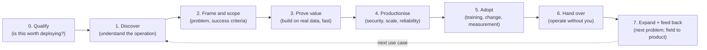

# Chapter 4. The Engagement Lifecycle

> "Every engagement is a project with an ending, even when the relationship isn't."

## What you will learn

- The phases of a forward deployed engagement, from pre-sale to product feedback.
- What happens in each phase, who is involved, what it produces, and how it ends.
- Common engagement shapes: bootcamp, pilot, production deployment and expansion.
- How to plan an engagement and run it week by week.
- The warning signs that an engagement is failing, and what to do about each.

This chapter is the map for Part II. Chapters 5–8 go deep on the people side; Part III on the technical side.

---

## 4.1 The lifecycle at a glance

Phases overlap in practice. Discovery never fully stops, and you may productionise one workflow while proving another. But each phase has a distinct purpose and exit criteria.

## 4.2 Phase 0: Qualify

**Purpose:** decide whether this customer and this problem justify forward deployment (Chapter 3 §3.5).

Questions:

- Is there an executive sponsor with budget and authority?
- Is there a specific, painful, valuable problem, or just "we want to do AI"?
- Can we access the data and systems we would need, within weeks rather than quarters?
- Is the customer willing to commit people's time (subject-matter experts, IT, security)?
- Does the problem fit our product, or would we be building a custom application?
- What is the commercial upside (expansion, reference value)?

**Output:** a go or no-go decision and an engagement hypothesis. Saying no to a bad engagement protects scarce FDE capacity and the customer's trust.

## 4.3 Phase 1: Discover

**Purpose:** understand how the customer's operation actually works, beyond the pitch deck (Chapter 5).

Activities: interviews with leaders and front-line staff; shadowing work as it happens; mapping workflows, systems and data; collecting artefacts (spreadsheets, reports, forms); identifying constraints (security, regulation, unions, budgets).

**Output:** a discovery summary, a current-state workflow map, a systems and data inventory, and a ranked list of candidate problems.

**Exit criteria:** the team can explain the customer's operation in their own words, and the sponsor agrees with the picture.

## 4.4 Phase 2: Frame and scope

**Purpose:** choose the first problem and define what success means (Chapter 6).

Activities: problem decomposition; value estimation; feasibility checks (data access, integration effort, model capability); success criteria with baselines; scope and timeline; agreement on roles and responsibilities.

**Output:** a **success plan** (template: [`templates/success-plan.md`](../templates/success-plan.md)) signed off by the sponsor; a statement of work where commercially required.

**Exit criteria:** measurable success criteria, a baseline (or a plan to measure one), named customer owners, and access requests submitted.

## 4.5 Phase 3: Prove value

**Purpose:** show the solution working on real data with real users, fast.

Principles:

- **Real data, early.** A demo on synthetic data proves little. Start on the customer's actual data in the first week or two, even with a narrow slice.
- **Thin end-to-end slice** rather than a polished component. Connect source data, logic and a user-facing output, however rough.
- **Weekly visible progress.** Show working software to users every week.
- **Measure from the start.** Build the evaluation set and impact measurement alongside the system (Chapter 13).
- **Timebox.** Proofs of value commonly run 2–8 weeks. Palantir-style bootcamps compress first value into days; AWS described its FDE pod engagements as roughly 45 days.

**Output:** a working system used by a pilot group, evidence against the success criteria, and a production plan.

**Exit criteria:** success criteria met (or a clear, accepted reason they weren't), a go decision for production, and a production scope.

## 4.6 Phase 4: Productionise

**Purpose:** turn the proof into something reliable, secure and supportable (Chapters 14 and 15).

Activities: security review and approvals; hardened integrations; access control; scale and performance; monitoring and alerting; disaster recovery; documentation; cost controls; regression evaluation for AI components.

**Output:** a production system that meets the customer's operational and security standards.

**Exit criteria:** production readiness review passed (see [`examples/readiness-gate/`](../examples/readiness-gate/) and Appendix C), and sign-off from customer IT and security.

## 4.7 Phase 5: Adopt

**Purpose:** get people to use the system, and measure the outcome.

Activities: training; champions in each team; workflow changes; feedback loops; usage monitoring; fixing friction quickly; measuring impact against the baseline.

**Output:** sustained usage and measured impact.

**Exit criteria:** adoption targets met; impact report delivered to the sponsor.

Adoption is where many deployments quietly die: the system works, but people keep using the old spreadsheet. Plan adoption from day one (Chapter 7).

## 4.8 Phase 6: Hand over

**Purpose:** make the solution sustainable without the FDE (Chapter 15).

Activities: runbooks; training customer engineers or a support team; knowledge transfer sessions; transitioning ownership of code and configuration; defining the support model and escalation paths.

**Output:** a handover pack (template: [`templates/handover-pack.md`](../templates/handover-pack.md)) accepted by the receiving team.

**Exit criteria:** the receiving team has operated the system unaided for an agreed period (for example two weeks), including handling at least one incident or change.

## 4.9 Phase 7: Expand and feed back

**Purpose:** capture the value of what you learned, for the customer and for your company.

Activities: identify the next problem (expansion); write field reports; contribute reusable components to the product; publish internal patterns; support a case study or reference.

**Output:** an expansion proposal; product feedback and pull requests; reusable assets.

## 4.10 Engagement shapes

| Shape | Duration | Goal | Typical team |
|---|---|---|---|
| **Bootcamp / hackathon** | 1–5 days | Prove value on real data; generate a use-case backlog | 2–5 FDEs + customer team |
| **Proof of value / pilot** | 2–8 weeks | Meet success criteria for one use case | 1–3 FDEs (+ strategist) |
| **Production deployment** | 1–6 months | Ship, harden, adopt, hand over | 1–4 FDEs |
| **Embedded programme** | 6 months to years | Many use cases; strategic partnership | Pod of FDEs + strategist + product liaison |
| **Partner-led deployment** | Varies | Partner engineers deliver; vendor FDEs coach and review | 0.5–1 vendor FDE + partner team |

## 4.11 Planning and running an engagement

### The engagement plan

A one-page plan, agreed with the sponsor:

- **Objective** and success criteria (with baselines).
- **Scope:** in, out, and "later".
- **Milestones** by week.
- **People:** customer sponsor, day-to-day owner, subject-matter experts, IT and security contacts, your team.
- **Dependencies:** data access, environments, approvals. These are usually the critical path.
- **Risks** and mitigations.
- **Cadence:** weekly working session, weekly written update, fortnightly sponsor check-in.

### The weekly rhythm

| Day | Typical activity |
|---|---|
| Monday | Plan the week with the customer owner; unblock dependencies |
| Midweek | Build; user sessions; evaluation |
| Thursday | Demo working software to users |
| Friday | Written weekly update (template: [`templates/weekly-update.md`](../templates/weekly-update.md)); field notes for the product team |

### Access: the hidden critical path

In enterprise engagements, **access** (accounts, VPN, data permissions, environment provisioning, security approvals) often takes longer than building. Start access requests in Phase 2, track them like deliverables, escalate early through the sponsor, and have a plan B (sample extracts, a sandbox, synthetic data clearly labelled as such).

## 4.12 Warning signs and responses

| Warning sign | Likely cause | Response |
|---|---|---|
| No data access after two weeks | Security process, low priority, wrong contacts | Escalate via sponsor; propose a restricted extract; reset the timeline in writing |
| Sponsor cancels check-ins | Priorities shifted; lost interest | Ask directly; re-anchor on their goals; consider pausing |
| Users don't come to demos | No champion; wrong users; too busy | Go to them; find a champion; shrink the ask |
| Scope grows every meeting | No agreed scope; eager stakeholders | Write it down; "yes, and that goes in phase 2" |
| Success criteria keep changing | Unclear problem; political disagreement | Reconvene the sponsor and stakeholders; re-sign the success plan |
| You're the only one who understands the system | No handover planning | Pair with customer engineers now; document as you go |
| The customer wants a custom feature that forks the product | Product gap | Configure or extend; raise a field report; negotiate (Chapter 11) |
| Pilot "succeeds" but nobody moves to production | No budget, no owner, unclear value | Quantify impact; identify the production owner early; involve procurement |

## 4.13 Ending well

Engagements end, even when relationships continue. End well:

- **Close the loop on success criteria** with a written impact report.
- **Hold a retrospective** with the customer and internally (template: [`templates/engagement-retrospective.md`](../templates/engagement-retrospective.md)).
- **Make the next step explicit:** expansion, steady state, or a clean exit.
- **Thank people by name,** especially customer staff who made it work.

---

## Summary

- An engagement runs through qualify, discover, frame and scope, prove value, productionise, adopt, hand over, and expand and feed back, with clear outputs and exit criteria for each phase.
- Engagement shapes range from multi-day bootcamps to multi-year embedded programmes.
- Plan on one page; run a weekly rhythm of build, demo and written update. Treat access as the hidden critical path.
- Recognise warning signs early (no access, absent sponsor, scope creep, no adoption, pilot purgatory) and respond in writing.
- End engagements deliberately, with an impact report, a retrospective and an explicit next step.

## Exercises

See [`exercises/04-engagement-lifecycle.md`](../exercises/04-engagement-lifecycle.md).

## Further reading

- Palantir blog, "A Day in the Life of a Palantir Forward Deployed Software Engineer."
- Andy Grove, *High Output Management* (1983), on planning and outputs.
- Atul Gawande, *The Checklist Manifesto* (2009), on checklists in complex work.
