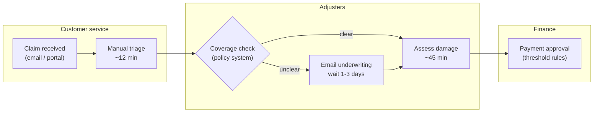
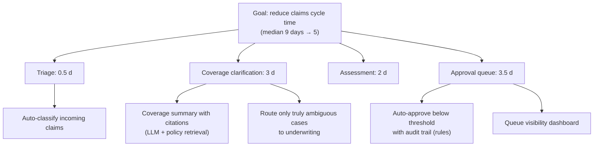

# Chapter 5. Discovery and Problem Decomposition

> "Customers will tell you what they want. Watch what they do to find out what they need."

## What you will learn

- Why discovery is the highest-leverage activity in an engagement.
- How to interview executives, managers and front-line staff, with question banks for each.
- Field observation ("shadowing"), and why it beats interviews.
- How to map workflows, systems and data.
- **Problem decomposition**: turning a vague goal into buildable, measurable pieces. This is the skill Palantir tests in its FDE interviews.
- How to estimate value and feasibility and choose the first problem.

---

## 5.1 Why discovery matters

The most expensive mistake an FDE can make is to **build the wrong thing well**. Customers describe solutions ("we need a chatbot"), symptoms ("our reports are always late") or aspirations ("we want to be AI-first"). Rarely do they describe the underlying problem precisely enough to build against. Discovery closes that gap.

Good discovery:

- finds the problem that matters most to the business, not just the loudest stakeholder;
- uncovers constraints early (data, security, regulation, politics);
- builds relationships and credibility with users;
- produces the baseline you will measure impact against.

## 5.2 Preparing

Before the first meeting:

1. **Read everything public:** annual reports (look for stated strategic priorities and risks), investor presentations, regulatory filings, press releases, job postings (they reveal systems and pain), industry analyses.
2. **Read the deal history:** what did sales promise? What did the customer say they wanted? What was in the proof of concept?
3. **Learn the domain vocabulary.** Spend a few hours on the industry (logistics, insurance underwriting, clinical operations). Being able to ask informed questions changes how people treat you.
4. **Draft hypotheses:** "We think the biggest opportunity is X because Y." Be ready to discard them.
5. **Plan who to talk to** across levels and functions (§5.3).

## 5.3 Who to talk to

| Level | Examples | What you learn |
|---|---|---|
| **Executive sponsor** | COO, CIO, business-unit head | Strategic goals, budget, definition of success, politics |
| **Middle managers** | Operations managers, team leads | Where the process breaks, metrics they're judged on, resource constraints |
| **Front-line operators** | Analysts, clerks, nurses, dispatchers, underwriters | How work is really done, workarounds, tools they love and hate |
| **IT and data owners** | Enterprise architects, DBAs, integration teams | Systems, data access, constraints, past failures |
| **Security, risk, legal, compliance** | CISO's team, privacy officers | Approval processes and red lines |
| **Sceptics** | People whose work will change most | Real risks; reasons adoption could fail |

**Talk to the front line early.** Executives describe the process as designed; operators know the process as performed.

## 5.4 Interviewing

### Principles

- **Ask about the past, not hypotheticals.** "Tell me about the last time a shipment was late" produces facts. "Would you use a tool that predicts delays?" produces polite yeses.
- **Follow the work:** "What happened next? Who did you ask? Where did you look that up?"
- **Ask for artefacts:** "Can you show me the spreadsheet?" Screens and documents beat descriptions.
- **Quantify:** "How often? How long does it take? How many people do this?"
- **Listen for emotion:** frustration, fear and pride point to what matters.
- **Don't pitch.** Discovery is not a demo.
- **Write it down** the same day, with quotes.

### Question bank

**Executives**

- What are the top three outcomes you're accountable for this year?
- If this engagement succeeds wildly, what's different in 12 months? How would you know?
- What has been tried before? Why didn't it work?
- Who else needs to be convinced? Who might resist?
- What would make you cancel this project?

**Managers**

- Walk me through a typical week for your team. Where does time go?
- Which metrics are you measured on? Which are hardest to hit?
- Where do errors or delays come from? Show me an example from last week.
- If you had two extra people, what would you have them do?

**Front-line operators**

- Show me how you do [task], step by step, on a real case.
- What do you do when [exception] happens?
- Which tools or spreadsheets do you keep on the side? Why?
- What's the most annoying part of your day?
- What would you never trust a computer to do here?

**IT and data**

- Which systems are involved in this process? Who owns each?
- How do we get access, realistically, and how long does it take?
- What data is sensitive or regulated?
- What integrations exist? What breaks?
- What has the security team rejected before, and why?

A fuller guide is in [`templates/discovery-guide.md`](../templates/discovery-guide.md).

## 5.5 Field observation (shadowing)

Sit with people while they work, for half a day or a shift. You will see:

- **Workarounds:** sticky notes, personal spreadsheets, copy-paste between systems.
- **Exceptions:** the 20% of cases that take 80% of the time.
- **Hidden dependencies:** waiting for another team, phone calls, emails.
- **Real timing:** how long each step takes, versus what the process document says.
- **Trust:** which data people double-check and which they rely on.

Ask permission, explain your purpose, take notes rather than recordings unless agreed, and respect confidentiality. In regulated settings (healthcare, finance, defence) follow the customer's rules on what you may observe.

## 5.6 Mapping the current state

Produce three maps:

### 1. Workflow map

Steps, actors, decisions, handoffs, systems used, time per step, error points. Swimlane diagrams work well:



### 2. Systems map

Every system in the workflow: owner, technology, data held, interfaces available (APIs, exports, database access), access process.

### 3. Data inventory

For each data source: contents, volume, freshness, quality, sensitivity classification, legal basis, access path. Chapter 10 covers profiling the data itself.

## 5.7 Problem decomposition

**Decomposition** turns an ambiguous goal into a structured set of sub-problems, each concrete enough to build and measure. It is the FDE's signature skill. Palantir's FDE interview loop includes a dedicated "decomposition" round in which candidates break a vague real-world prompt into a working, extensible model.

### A method

1. **State the goal in the customer's terms:** "Reduce claims processing time."
2. **Define the measurable outcome:** "Median time from claim receipt to payment decision, currently 9 days."
3. **Break down the outcome into drivers.** Where does the time go? (Triage 0.5 days; waiting for coverage clarification 3 days; assessment 2 days; approval queue 3.5 days.)
4. **For each driver, identify the decisions and information needed.** Coverage clarification needs policy terms, endorsements and claim facts, which are spread across the policy admin system and PDFs.
5. **Identify the users and the workflow change:** adjusters would see a coverage summary with citations instead of emailing underwriting.
6. **Identify the data, integration and model capabilities required:** policy documents (PDF), policy system API, claims system, LLM extraction, a retrieval index, a UI panel in the claims system.
7. **Estimate value and feasibility for each sub-problem** (§5.8).
8. **Sequence:** pick the slice that delivers measurable value soonest and builds foundations for the rest.

Use the **problem decomposition canvas** ([`templates/problem-decomposition-canvas.md`](../templates/problem-decomposition-canvas.md)).

### A worked decomposition tree



Notice that the best sub-solutions are not all AI. S3 (rules-based auto-approval) and S4 (a dashboard) may deliver more value, faster, than the AI pieces. **Good FDEs solve the problem, not the technology brief.**

### Decomposition pitfalls

- **Decomposing by technology** ("ingestion, model, UI") instead of by business driver.
- **Ignoring the human workflow:** a perfect prediction nobody acts on is worthless.
- **Boiling the ocean:** a decomposition so broad that nothing ships for months.
- **Anchoring on the customer's proposed solution** ("we want a chatbot") without asking what it is for.

## 5.8 Estimating value and feasibility

For each candidate sub-problem, estimate:

| Dimension | Questions | Scale |
|---|---|---|
| **Value** | How much time, money or risk? How many people affected? Strategic importance? | £/$ per year, hours per week, risk reduction |
| **Feasibility (data)** | Is the data accessible, complete and of good enough quality? | High / medium / low |
| **Feasibility (technical)** | Can our product plus reasonable engineering do it? Is model capability sufficient (test it)? | High / medium / low |
| **Feasibility (organisational)** | Is there a willing user group and owner? Political obstacles? | High / medium / low |
| **Time to value** | Weeks to first measurable result | Number |
| **Risk** | Safety, compliance, reputational | Low / medium / high |

Plot value against feasibility and pick a first use case that is **high value, high feasibility, short time to value and low risk**: the "lighthouse" that builds credibility for harder problems. Avoid starting with the hardest, highest-risk problem, however exciting.

### Quick value estimation

```
annual_value ≈ (people affected) × (hours saved per person per week) × (weeks per year) × (loaded hourly cost)
             + (error reduction) × (cost per error)
             + (revenue uplift)
```

Example: 60 adjusters × 3 hours/week × 46 weeks × £45/hour ≈ **£373,000 per year** in time, before counting faster settlement and customer satisfaction. Use conservative numbers, state assumptions, and have the customer's finance team check them. [`examples/impact-calculator/`](../examples/impact-calculator/) automates this.

## 5.9 Discovery outputs

At the end of discovery, deliver (and get agreement on):

1. **Discovery summary:** what you learned, in the customer's language, with quotes.
2. **Current-state maps:** workflow, systems, data.
3. **Problem decomposition** with value and feasibility estimates.
4. **Recommended first use case** with rationale, and a backlog of others.
5. **Risks and constraints.**
6. **Proposed success criteria** (Chapter 6).

Present it as a short document plus a 30-minute readout. Executives should leave the readout able to explain the plan to their peers.

---

## Summary

- Discovery prevents the costliest FDE failure: building the wrong thing well.
- Prepare thoroughly; talk across levels; start with the front line; interview about past events; ask for artefacts; quantify.
- Shadow work to see workarounds, exceptions and real timing.
- Map workflows, systems and data.
- Decompose goals by business driver into buildable, measurable pieces; solve the problem, not the technology brief.
- Estimate value and feasibility; start with a high-value, feasible, low-risk lighthouse use case.

## Exercises

See [`exercises/05-discovery-and-decomposition.md`](../exercises/05-discovery-and-decomposition.md).

## Further reading

- Rob Fitzpatrick, *The Mom Test* (2013), on asking questions that produce truthful answers.
- Teresa Torres, *Continuous Discovery Habits* (2021).
- Karen Holtzblatt and Hugh Beyer, *Contextual Design* (2nd edition, 2016), on field observation.
- Barbara Minto, *The Pyramid Principle* (1987), on structured problem breakdown and communication.
