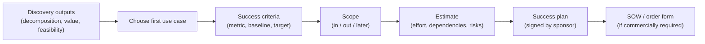

# Chapter 6. Scoping, Success Criteria and Statements of Work

> "If you can't say what done looks like, you'll never get there, and you'll never get paid for it."

## What you will learn

- Why scope is the FDE's main defence against both failure and endless work.
- How to write success criteria that are measurable, owned and agreed before you build.
- How to set baselines, and what to do when no baseline exists.
- The parts of a success plan and of a statement of work (SOW), and how they differ.
- How to estimate an engagement, and why access and approvals dominate the timeline.
- How to manage scope change without damaging the relationship.

---

## 6.1 Why scope matters

**Scope** is the agreed boundary of the work: what you will deliver, for whom, by when, and what you will not do. In product engineering, scope is negotiated inside your own company. In forward deployment, it is negotiated with a customer who is paying (directly or indirectly), who has their own politics, and who will naturally ask for more once they see something working.

Without clear scope, three things happen:

1. **The engagement never ends.** Each demo produces new requests. The FDE becomes a permanent, unpaid contractor (the agency trap of Chapter 3 §3.6, at the scale of one customer).
2. **Success is undefined.** If nobody agreed what success meant, the customer's sponsor cannot claim a win internally, renewal is harder, and your company cannot learn whether the deployment worked.
3. **Trust erodes.** Unspoken expectations diverge. The customer thought they were getting a production system; you thought you were running a pilot.

Scoping is therefore not bureaucracy. It is how you protect the customer's time, your company's capacity, and your own sanity.

## 6.2 From problem to scope

Scoping takes the output of discovery (Chapter 5): the decomposition, value estimates and recommended first use case. It turns that into a commitment. The sequence:

The success plan is the working agreement between the delivery teams. The SOW, when one exists, is the contractual document. Keep them consistent: a success plan that promises more than the SOW creates disputes; an SOW written without the success plan is usually vague about outcomes.

## 6.3 Success criteria

A **success criterion** is a statement of a measurable outcome that, if achieved, means the engagement worked. Good criteria have five properties. A useful mnemonic is the familiar **SMART** (specific, measurable, achievable, relevant, time-bound), but in forward deployment two more matter: **owned** (a named customer person agrees to the measurement) and **baselined** (you know the starting value).

### Levels of criteria

Write criteria at three levels, because each answers a different stakeholder's question:

| Level | Question it answers | Example (claims processing) |
|---|---|---|
| **Business outcome** | Did it matter to the business? | Median claim cycle time falls from 9 days to 6 days for the pilot team within 10 weeks of go-live |
| **Adoption** | Are people actually using it? | ≥ 80% of pilot adjusters open the coverage summary on ≥ 70% of eligible claims by week 6 |
| **System quality** | Does it work well enough to trust? | Coverage summaries are rated correct and complete on ≥ 90% of a 200-claim evaluation set; 100% include citations to the policy text |

Business outcomes take time to appear. Adoption and system-quality criteria give earlier evidence, and explain *why* the business outcome did or did not move.

### Leading and lagging indicators

A **lagging indicator** measures the result after the fact (cycle time, revenue, error rate). A **leading indicator** moves first and predicts the lagging one (usage, time per task, model accuracy). In a short pilot, the lagging business metric may not move measurably. Agree in advance which leading indicators will count as success, and how the lagging metric will be measured later.

### Criteria to avoid

| Weak criterion | Why it's weak | Better |
|---|---|---|
| "Deploy an AI assistant" | An output, not an outcome | "Reduce time to answer policy questions from 25 minutes to under 5" |
| "Users are satisfied" | Unmeasured, unowned | "Average rating ≥ 4/5 from ≥ 20 pilot users in the week-6 survey" |
| "95% accuracy" | Accuracy of what, on which data, judged by whom? | "≥ 95% of extracted invoice totals match the ledger on a 500-invoice test set sampled from Q3" |
| "Save money" | No baseline, no number | "Reduce external review spend by £150k annualised, measured from finance's monthly report" |
| "Production-ready" | Means different things to everyone | "Passes the customer's security review and the production readiness checklist (Appendix C)" |

### Who should own each criterion

Every criterion needs a **customer owner** who agrees that the metric is the right one and who will confirm the result. Usually that is the operational manager whose team does the work, not the executive sponsor. If nobody on the customer side will put their name to a metric, it is a sign the metric doesn't matter to them.

## 6.4 Baselines

A **baseline** is the value of a metric before your change. Without it, you cannot show impact.

Sources of baselines, from best to worst:

1. **System data:** timestamps in the claims system, ticket logs, transaction records. Objective, often available for historical periods.
2. **Time-and-motion sampling:** observe or have people log a sample of tasks for one or two weeks (Chapter 5 §5.5).
3. **Reports the customer already trusts:** finance reports, operational dashboards. Their definitions may differ from yours; reconcile them early.
4. **Surveys and estimates:** "how long does this usually take?" Useful for sizing, weak as proof.

When no baseline exists, **measure one before you deploy.** A two-week measurement period at the start of a ten-week engagement is a good investment. Alternatively, design the rollout so that a comparison group continues working the old way (a **control group**). This is often more convincing than a before-and-after comparison, because it controls for seasonality and other changes. Chapter 13 covers measurement design.

## 6.5 Scope: in, out and later

Write scope as three explicit lists. The third list is the one that saves relationships.

| In scope | Out of scope | Later (backlog, not committed) |
|---|---|---|
| Coverage summaries for home insurance claims | Motor and commercial lines | Motor claims (phase 2 candidate) |
| Pilot team of 15 adjusters in Leeds | Other offices | Rollout to Bristol office |
| Read-only integration with the policy system | Writing decisions back to the claims system | Write-back once audit design is agreed |
| English-language policy documents | Welsh-language documents | Welsh language support |

"Later" tells stakeholders their idea has been heard and has a home, without committing to it. When a new request arrives mid-engagement, the response "yes, that's a great candidate for the later list" is far easier to say, and to hear, than "no".

### Scope dimensions to pin down

- **Users:** which team, how many, which locations.
- **Process:** which steps of the workflow, which case types, which exceptions are excluded.
- **Data:** which sources, which date ranges, which classifications.
- **Integration:** read-only or read-write; which systems; which environments.
- **Non-functional requirements:** availability, latency, security, data residency, accessibility, languages.
- **Deliverables:** software, configuration, documentation, training, handover.
- **Support:** who supports what after go-live, and for how long.

## 6.6 Estimating an engagement

Estimating forward deployed work is hard, because most uncertainty lies outside the code: access, data quality, approvals and people's availability. Practical techniques:

### Estimate in phases, with a re-plan point

Commit firmly to the next phase (for example, a two-week discovery and data-access phase) and loosely to later phases. At the end of each phase, re-estimate with what you now know. This matches the reality that uncertainty falls as you learn.

### Separate effort from elapsed time

**Effort** is engineering work (person-days). **Elapsed time** is calendar time, dominated by waiting: for accounts, data extracts, security reviews, change-advisory boards, procurement. A two-week build can take three months of elapsed time if access is slow. State both, and make the waiting visible.

### Use a dependency list

| Dependency | Owner (customer) | Needed by | Typical lead time | Status |
|---|---|---|---|---|
| VPN and laptop accounts | IT service desk | Week 1 | 1–3 weeks | Requested |
| Read access to policy database (replica) | Data platform team | Week 2 | 2–6 weeks | Not started |
| Security architecture review | CISO's office | Week 4 | 4–8 weeks | Scheduled |
| Data protection impact assessment | Privacy officer | Week 4 | 2–6 weeks | Draft |
| SME availability (4 h/week) | Claims operations | Weeks 1–10 | — | Agreed |

*(Lead times are illustrative; ask the customer's teams for their real ones.)*

### Add contingency explicitly

Name the contingency rather than hiding it in padded estimates. "We estimate eight weeks, with two weeks' contingency for data-quality remediation" is honest and gives you something to negotiate with.

### Reference-class estimates

Over time, keep a record of how long engagements of each shape actually took (Chapter 17). The best estimate for a new engagement is usually the actual duration of similar past engagements, adjusted for known differences. This is called **reference-class forecasting**, and it corrects the optimism that afflicts bottom-up estimates.

## 6.7 The success plan

The **success plan** is a short (two- to four-page) document agreed by the sponsor and the delivery team. Template: [`templates/success-plan.md`](../templates/success-plan.md). It contains:

1. **Objective:** one paragraph, in business language.
2. **Success criteria:** business outcome, adoption and system quality, each with baseline, target, measurement method, owner and date.
3. **Scope:** in, out, later.
4. **Approach and milestones:** phases with dates and exit criteria.
5. **Roles and responsibilities:** a **RACI** table (who is Responsible, Accountable, Consulted and Informed for each activity).
6. **Dependencies and access** (the table in §6.6).
7. **Risks and mitigations.**
8. **Governance and cadence:** weekly working session, written weekly update, fortnightly or monthly sponsor review, escalation path.
9. **Sign-off:** names and dates.

The act of agreeing the success plan is as valuable as the document. It forces conversations about measurement, ownership and scope early, when they are cheap.

## 6.8 Statements of work

A **statement of work (SOW)** is a contractual document that defines the work a supplier will perform for a customer, usually under a master agreement (often called a **master services agreement**, MSA). Not every FDE engagement has one: many are bundled into a platform subscription (Chapter 3 §3.4). But paid pilots, professional-services engagements and partner-delivered work usually do.

FDEs rarely write SOWs alone. Sales, legal and services operations own them. But the FDE should **review every SOW for an engagement they will deliver**, because SOWs written without delivery input routinely commit to the impossible. Template: [`templates/statement-of-work.md`](../templates/statement-of-work.md).

### Parts of an SOW

| Section | What to check as the FDE |
|---|---|
| **Objectives** | Consistent with the success plan; outcomes, not just activities |
| **Scope and deliverables** | Each deliverable is specific and has acceptance criteria |
| **Out of scope** | Explicit; covers likely misunderstandings |
| **Assumptions** | Data access dates, customer staff availability, environments, decision turnaround times |
| **Customer responsibilities** | Named roles and time commitments; access provision |
| **Timeline** | Realistic elapsed time, including approvals |
| **Acceptance** | How and by whom deliverables are accepted; deemed acceptance after N days of silence |
| **Change control** | How scope changes are requested, estimated and approved |
| **Commercials** | Fixed fee, time and materials, milestone payments, credits against subscription |
| **Intellectual property** | Who owns custom code and configuration; vendor's right to reuse generic components in the product |
| **Data handling** | What customer data the vendor may access, where, and for how long |

### Fixed fee versus time and materials

| | Fixed fee | Time and materials (T&M) |
|---|---|---|
| **How it works** | A set price for defined deliverables | Customer pays for hours or days worked |
| **Risk sits with** | Vendor (overruns cost the vendor) | Customer (overruns cost the customer) |
| **Needs** | Tight scope, strong change control | Trust, transparent reporting |
| **Fits** | Well-understood work, paid pilots | Exploratory or open-ended work |

Many FDE engagements use a **fixed-fee pilot credited against the subscription**: the customer pays, say, $100,000 for a ten-week pilot, and if they sign a platform contract the fee is credited. This filters out unserious buyers and aligns both sides on conversion.

### Intellectual property: protect the feedback loop

The IP clause matters more for FDEs than for traditional consultants. If the contract gives the customer ownership of everything built during the engagement, your company may be unable to turn a reusable connector or evaluation method into product (Chapter 16). A common structure: the customer owns its data and customer-specific configuration; the vendor owns its platform, plus any generic tools, templates and improvements, and may reuse them. Have your legal team advise; this is not legal advice.

## 6.9 Managing scope change

Scope will change: discovery is never finished, and success often reveals the next problem. Change is not the enemy. *Unmanaged* change is.

### A lightweight change process

1. **Capture** the request in writing, with who asked and why.
2. **Assess** impact on effort, timeline, risk and success criteria.
3. **Decide** with the sponsor: swap it for something in scope, add it with more time or money, or put it on the later list.
4. **Record** the decision in the success plan (and a change order, if there is an SOW).

### Phrases that help

- "That's a great idea. Let's put it on the later list and look at it at the phase review."
- "We can do that. To keep the go-live date, which of these should we drop?"
- "That changes the success criteria, so let's update the plan with [sponsor] so we're all aligned."
- "I want to make sure we deliver what we promised first. Can we revisit this in two weeks?"

### When to say yes without ceremony

Small changes that increase adoption, take less than a day and don't affect commitments are often worth just doing. Goodwill matters, and responsiveness is part of the FDE's value. The judgement is cumulative: ten "small" changes are a large one. Track them, even when you don't charge for them.

## 6.10 Pilots that convert

A depressingly common outcome is **pilot purgatory**: a pilot that "succeeds" but never moves to production. Avoid it at the scoping stage:

- **Agree the production decision up front.** "If we meet these criteria, the next step is a production contract for X." Get the sponsor to say who makes that decision and what budget it comes from.
- **Involve production owners early.** IT, security and the team that will run the system should be in the pilot, not surprised by it.
- **Pilot in production conditions** where possible: real data, real users, real security controls. A pilot in a sandbox proves less and leaves more work for later.
- **Size the production case** during the pilot, using measured results (Chapter 13).
- **Set a decision date.** Open-ended pilots drift.

---

## Summary

- Scope protects the customer's time, your company's capacity and the relationship. Without it, engagements never end and success is undefined.
- Write success criteria at three levels (business outcome, adoption, system quality), each specific, measurable, owned, baselined and time-bound.
- Establish baselines from system data or measurement periods; use control groups when you can.
- Write scope as in, out and later. The later list lets you defer without refusing.
- Estimate in phases, separate effort from elapsed time, list dependencies with owners, and name contingency.
- The success plan is the working agreement; the SOW is the contract. Review every SOW you will deliver, especially assumptions, acceptance, change control and IP.
- Manage change with a light, written process; design pilots so that success leads to a production decision.

## Exercises

See [`exercises/06-scoping.md`](../exercises/06-scoping.md).

## Further reading

- Bent Flyvbjerg and Dan Gardner, *How Big Things Get Done* (2023), on reference-class forecasting.
- Steve McConnell, *Software Estimation: Demystifying the Black Art* (2006).
- Douglas W. Hubbard, *How to Measure Anything* (3rd edition, 2014), on measuring "intangible" outcomes.
- Project Management Institute, *PMBOK Guide* (7th edition, 2021), for scope and change-control vocabulary.
