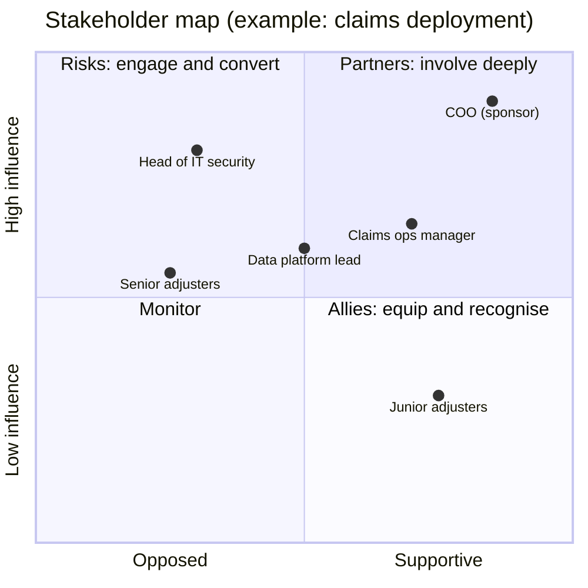

# Chapter 7. Stakeholders, Politics and Trust

> "Every deployment changes someone's job. Find out whose, before they find out about you."

## What you will learn

- Who the stakeholders in a deployment are, and what each of them needs.
- How to map stakeholders by influence and attitude, and what to do with the map.
- Why organisational politics is not a distraction from the work, but part of it.
- How trust is built (and lost) with customer staff, and the specific behaviours that build it.
- How to drive adoption and change, including with sceptical or threatened users.
- How to handle the awkward position of serving two organisations at once.

---

## 7.1 Why this is an engineering topic

Engineers are often taught to see politics as noise around the real work. For an FDE, that view is fatal. Most failed deployments fail for organisational reasons:

- the sponsor moved jobs and nobody else cared;
- the IT team was not consulted and blocked the release;
- the front-line users were never convinced and kept using their spreadsheets;
- two departments disagreed on who owned the data, and the project stalled in between.

The MIT NANDA *GenAI Divide* report (2025), cited in Chapter 2, attributed most failed AI pilots to implementation and organisational factors rather than model quality. Whether or not you accept its headline figure, the pattern is familiar to anyone who has deployed enterprise software. An FDE who can navigate the organisation ships; one who can't writes good code that nobody uses.

**Politics**, in this chapter, means the ordinary process by which people with different interests, incentives and information make decisions together. It is not inherently cynical. Understanding it is a form of empathy: seeing the situation from each person's position.

## 7.2 The cast

| Role | What they care about | What they fear | How to help them |
|---|---|---|---|
| **Executive sponsor** | Strategic outcome; looking good to their boss and board; budget well spent | A visible failure; wasted money; surprises | Short, regular, honest updates; early warning of problems; results framed in their goals |
| **Day-to-day owner** (often a manager) | Hitting operational targets; their team's workload | Disruption; blame if it fails; more work for their team | Make their life easier quickly; credit them publicly |
| **Front-line users** | Doing their job well; not looking foolish; workload | Being replaced; being monitored; learning a new tool under pressure | Involve them early; build for their real workflow; respond to feedback fast |
| **Subject-matter experts (SMEs)** | Being respected for their knowledge | Their expertise being captured and discarded | Treat them as co-designers; acknowledge their contribution |
| **IT and platform teams** | Stability; standards; not inheriting something unsupportable | Shadow IT; incidents at 3 a.m.; vendor lock-in | Follow their standards; involve them in design; plan handover |
| **Security, risk and privacy** | No breaches, no fines, no headlines | Data leaving the perimeter; unknown AI risks | Bring documentation early; answer precisely; accept constraints |
| **Legal and procurement** | Contract terms; liability; cost control | Unclear IP or data terms; unapproved spend | Give them what they need early; don't bypass them |
| **Works councils and unions** (in some countries) | Employees' rights; job security; monitoring | Undisclosed automation; surveillance | Engage through the customer's HR, early and transparently |
| **Internal competitors** | Their own project, budget or vendor | Being displaced | Find a role for them; don't publicly undermine them |
| **Your own company** (sales, product, leadership) | Revenue, renewals, product learning | Over-servicing; a failed reference account | Report clearly; escalate early; capture learnings |

In some European countries (Germany is the best-known example), a **works council** (an elected employee body) has legal rights to be consulted about technology that can monitor employee behaviour or performance. An AI tool that logs what each user does may require its agreement. Ask the customer's HR or legal team at the start of any deployment that affects how people work.

## 7.3 Stakeholder mapping

A **stakeholder map** places each person on two axes: their **influence** over the deployment (can they make it succeed or fail?) and their **attitude** towards it (supportive, neutral, opposed). A common variant uses "interest" instead of attitude; the version below is more useful for FDEs because it tells you whom to worry about.



What to do in each quadrant:

- **High influence, supportive (partners):** involve them in decisions; ask them to open doors; keep them informed before anyone else.
- **High influence, opposed or unknown (risks):** this is where deployments die. Meet them early, one to one. Understand their objection; it is often legitimate. Adapt the plan where you can; where you can't, involve the sponsor.
- **Low influence, supportive (allies):** these are your future **champions**. Give them early access, training and recognition.
- **Low influence, opposed:** listen, and don't dismiss them. Front-line sceptics often know exactly how the system will fail. Many become your best testers.

Keep the map private and update it as you learn. Write about people respectfully, assuming the document could be read by them; one day it might be.

## 7.4 Finding the real decision-makers

Organisation charts show reporting lines, not influence. Ask:

- "Who needs to say yes for this to go to production?"
- "Who could stop it, even if they don't formally approve it?"
- "Whose opinion does [the sponsor] trust on technical matters?"
- "Has anything like this been tried before? Who was involved, and what happened?"
- "Who will be measured on the result?"

Watch for **informal influencers**: the senior analyst everyone asks, the architect whose approval is never formally required but always sought, the executive assistant who controls the sponsor's diary.

## 7.5 Building trust

**Trust** is the customer's belief that you will act competently and in their interests. FDEs need it because they ask for things that are risky to give: access to data and systems, time from busy staff, changes to established work. Trust is built by evidence over time, and lost quickly.

A useful model is the **trust equation** from David Maister, Charles Green and Robert Galford's *The Trusted Advisor* (2000):

```
trust = (credibility + reliability + intimacy) / self-orientation
```

- **Credibility:** you know what you're talking about. For FDEs this means technical depth, and visible effort to learn the customer's domain.
- **Reliability:** you do what you said, when you said. Small promises kept build more trust than big promises.
- **Intimacy:** people feel safe telling you things, including bad news and frustrations.
- **Self-orientation:** the extent to which you seem focused on yourself (your product, your quota, looking clever) rather than them. It divides everything else.

### Behaviours that build trust

1. **Ship something useful early.** A small tool that saves someone an hour in week two earns more trust than a roadmap.
2. **Keep small promises.** "I'll send that by Thursday" and then sending it by Thursday.
3. **Tell the truth about your product.** Including what it doesn't do. Customers find out anyway, and they remember who told them first.
4. **Bring bad news early, with a plan.** "The data extract has a gap from March to May. Here's what it means and what I suggest."
5. **Learn their language.** Use their terms for their processes, not your product's terms.
6. **Respect their constraints.** Don't work around their security or change processes, even when they're slow. If a process is unreasonable, raise it through the right person.
7. **Give credit away.** Publicly credit customer staff for the results.
8. **Protect confidences.** What an operator tells you about their manager stays with you.

### Behaviours that destroy trust

- Promising features your product doesn't have.
- Surprising the sponsor in front of their boss.
- Blaming the customer's data, systems or staff in front of them, or behind their backs.
- Bypassing security or IT "to save time".
- Disappearing after the deal closes.
- Being seen to report everything back to your sales team.

## 7.6 Driving adoption

A system that works but isn't used delivers no value. **Adoption** is the process by which people start using a new system as part of their normal work, and stop using the old way. It is the most underestimated phase of deployment (Chapter 4 §4.7).

### Why people don't adopt

| Reason | What it looks like | Response |
|---|---|---|
| It doesn't fit the workflow | Users must switch screens, re-enter data, or wait | Embed the output where they already work; remove steps |
| It isn't trusted | Users double-check everything, so it saves no time | Show sources and reasoning; publish evaluation results; fix visible errors fast |
| Fear for their job | Quiet non-use; objections about edge cases | Be honest about intent; frame it around the work they want to stop doing; involve management |
| No time to learn | "I'll try it when things calm down" | Short, in-context training; champions; office hours |
| Incentives point the other way | Metrics reward the old behaviour | Work with management to align targets |
| It's actually worse | Users are right | Listen, fix it, or stop |

### Techniques

- **Co-design with users.** Users who helped shape a system are more likely to use it, and they will design out the failures you would never have noticed.
- **Champions.** Recruit one or two respected users per team. Give them early access, a direct line to you, and recognition. Peers trust peers more than vendors.
- **Start where the pain is greatest.** Launch with the team or task where the improvement is most obvious.
- **Make the default easy.** If the new path requires one click and the old path requires five, adoption follows.
- **Measure usage**, not just logins: are people using it on the tasks that matter? Chapter 13 covers adoption metrics.
- **Close the loop on feedback.** When a user reports a problem and sees it fixed within days, they become an advocate. When feedback disappears into a void, they stop giving it.

### The ADKAR model

Many enterprises use formal change-management models. One widely used model is Prosci's **ADKAR**: **A**wareness of the need to change, **D**esire to participate, **K**nowledge of how to change, **A**bility to implement new skills, and **R**einforcement to sustain the change. You don't need to adopt the vocabulary, but if the customer has a change-management team that uses it, map your adoption plan onto their framework, and they will become an ally.

## 7.7 AI deployments and job anxiety

AI deployments carry a specific charge: users may reasonably worry that the system is designed to replace them. Handle this honestly:

- **Know the customer's intent.** Ask the sponsor directly: is the goal to reduce headcount, to absorb growth without hiring, to improve quality, or to redeploy people to higher-value work? Don't guess.
- **Don't make promises you can't keep.** "This won't affect anyone's job" is not yours to say. "The goal of this phase is to remove the manual coverage lookups; I don't make staffing decisions" is honest.
- **Involve management in communication.** Messages about the impact on jobs must come from the customer's leadership, not the vendor.
- **Design for human judgement where it matters.** Systems that support experts' decisions, with clear accountability, are both safer and more acceptable (Chapter 12).

If you believe a deployment is being used in a way that is deceptive to staff or harmful, raise it within your own company (Chapter 18 covers ethics).

## 7.8 Serving two organisations

An FDE works for their employer but spends their days inside the customer. This creates real tensions:

| Tension | Example | How to handle it |
|---|---|---|
| **Customer interest vs company interest** | The customer would be better served by a simpler, cheaper approach | Be honest. Long-term trust is worth more than a short-term upsell, and your company's leadership will usually agree if you explain why |
| **Confidentiality both ways** | The customer shares internal plans; your company has unannounced roadmap | Share neither side's secrets with the other without permission; know your NDA |
| **Going native** | After months on site, you start advocating for the customer against your own product team | Some of this is healthy (it's the feedback loop), but stay calibrated: one customer's need is not the market's |
| **Sales pressure** | Sales wants you to support a claim you think is untrue | Don't. Offer a true statement that still helps the deal |
| **Who you report to** | The customer's manager starts directing your work | Be helpful, but keep priorities agreed with your own lead and the success plan |

**Going native** is the term for an embedded person who identifies so strongly with their host that they stop representing their own organisation. A little of it makes you a better advocate. A lot of it makes you an unpaid customer employee.

## 7.9 When stakeholders conflict

Two stakeholders want different things: operations wants speed, compliance wants control. Or two departments both claim the data. Your job is not to decide, but to make the decision possible:

1. **Understand each position** and the interest behind it ("compliance needs an audit trail of who approved each payment", not just "compliance says no").
2. **Look for designs that satisfy both interests** (automatic approval below a threshold, with a full audit log and sampling review).
3. **Put the options in writing** with trade-offs.
4. **Escalate to the person who can decide**, usually the sponsor, with a recommendation.
5. **Record the decision** and move on.

FDEs who try to resolve political disputes by choosing a side, or by building both versions, usually lose both sides.

## 7.10 When the sponsor leaves

Sponsors change jobs, get promoted or lose interest. When it happens:

- **Act immediately.** Ask the departing sponsor for an introduction to a successor, and a word of endorsement.
- **Re-sell to the new sponsor** from their perspective: their goals may differ. Present results so far and what's next.
- **Broaden your base** from the start, so the deployment never depends on one person. Multi-threaded relationships (several senior supporters) survive reorganisations.

---

## Summary

- Most deployment failures are organisational. Understanding stakeholders is part of the engineering job.
- Map stakeholders by influence and attitude; engage high-influence sceptics early and turn supportive users into champions.
- Trust comes from credibility, reliability and intimacy, divided by self-orientation. Ship early, keep small promises, tell the truth and give credit away.
- Adoption needs fit with the workflow, visible trustworthiness, honest communication about intent, champions and fast feedback loops.
- Handle AI job anxiety honestly; leave staffing messages to the customer's leadership.
- Serving two organisations creates real tensions. Be honest, protect confidences, and stay calibrated.
- When stakeholders conflict, make the decision possible rather than taking sides; when sponsors leave, act fast.

## Exercises

See [`exercises/07-stakeholders.md`](../exercises/07-stakeholders.md).

## Further reading

- David Maister, Charles Green and Robert Galford, *The Trusted Advisor* (2000).
- Jeffrey Hiatt, *ADKAR: A Model for Change in Business, Government and our Community* (Prosci, 2006).
- John Kotter, *Leading Change* (1996).
- Peter Block, *Flawless Consulting* (3rd edition, 2011), on the consultant's role inside client organisations.
- MIT NANDA, *The GenAI Divide: State of AI in Business 2025*.
