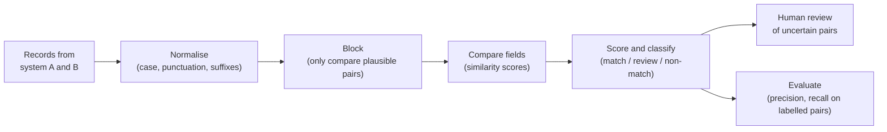

# Chapter 10. Enterprise Data in the Wild

> "The data dictionary says the field is mandatory. The data says otherwise."

## What you will learn

- Why enterprise data is the hardest part of most deployments.
- How to get access to data responsibly, and the forms that access takes.
- How to profile a dataset quickly to learn what it really contains.
- The common data-quality problems and how to handle each.
- How to match records across systems (entity resolution).
- How to model data for the deployment: ontologies, semantic layers and pipelines.
- How to handle sensitive data, lineage and freshness.

---

## 10.1 Why data is the hard part

The value of most enterprise software, and nearly all enterprise AI, depends on the customer's own data. Palantir built its business on integrating fragmented data; its Foundry platform centres on an **ontology** (§10.7) that turns raw tables into business objects. AI deployments face the same problem: a model can only answer questions about a customer's policies, contracts or patients if it can reach the right data, correctly, with permission.

Enterprise data is hard because:

- **It's fragmented.** The same customer appears in the CRM, the billing system, the support desk and a spreadsheet, under four different IDs.
- **It reflects history, not design.** Systems were bought, merged, migrated and patched over decades. Fields were repurposed. Codes mean different things in different eras.
- **Quality is uneven.** Missing values, duplicates, typos, placeholder values and inconsistent formats are normal.
- **It's guarded.** Sensitive data is subject to privacy law, contracts and internal policy, and access takes time.
- **Knowledge about it is tribal.** The meaning of a field often lives in one person's head.

The most reliable way to make an engagement late is to assume the data will be as described.

## 10.2 Getting access

### Forms of access

| Form | Description | Pros | Cons |
|---|---|---|---|
| **Direct read on production** | Query the live operational database | Fresh; complete | Risk to production performance; often refused |
| **Read replica** | A copy of the database kept in sync | Safe for queries; fairly fresh | May lag; may not exist |
| **Warehouse or lake** | Data already copied into an analytical platform | Built for analysis; governed | May be stale, transformed or incomplete |
| **API** | Programmatic access through the system's interfaces | Supported; enforces business rules and permissions | Rate limits; may not expose everything |
| **Extract (file)** | A one-off or scheduled export | Fast to get started | Stale; manual; easy to lose track of copies |
| **Change data capture (CDC)** | A stream of changes from the database log | Near real-time; low load | Needs infrastructure and approval |
| **Synthetic or masked data** | Generated or anonymised data | Unblocks early work | Doesn't reveal real quality problems |

Start with whatever gets you real data fastest within the rules (often an extract or the warehouse), and plan the production access path in parallel. Never let "temporary" extracts become the production integration.

### Requesting access responsibly

- Ask for the **minimum data** needed: specific tables, fields and date ranges. Data minimisation is a principle of privacy law (for example, Article 5 of the EU's General Data Protection Regulation, GDPR) and makes security approval faster.
- Use the customer's **official process**, however slow; escalate through the sponsor if it stalls (Chapter 4 §4.11).
- Agree **where the data may go**: which environment, which region, whether it may leave the customer's network.
- Agree **retention and deletion:** when copies will be deleted at the end of the engagement.

## 10.3 Profiling

**Data profiling** is the systematic examination of a dataset to understand its structure, content and quality. Do it as soon as you have access, before building anything. It takes hours and saves weeks.

For each table or file:

| Check | What it reveals |
|---|---|
| Row count and date range | Completeness; whether you got the extract you asked for |
| Per-column null (missing) rate | Which "mandatory" fields aren't |
| Distinct count and top values | Codes in use; dominant placeholder values |
| Inferred type vs declared type | Dates stored as text; numbers with currency symbols |
| Min, max and distribution | Outliers; impossible values (negative ages, future birth dates) |
| Pattern shapes | Formats in use, e.g. `AA9999` vs `AA-9999` for policy numbers |
| Key uniqueness | Duplicate IDs that should be unique |
| Referential integrity | Foreign keys pointing at nothing |
| Placeholder values | `N/A`, `unknown`, `9999-12-31`, `0000000`, `test` |

[`examples/data-profiler/`](../examples/data-profiler/) implements these checks in standard-library Python. Run it on every new dataset, and share the output with the data owner. Their reaction ("oh, that's because the 2019 migration…") is often the most valuable information you'll get all week.

### Profiling in SQL

On a large table in a warehouse, profile in place rather than downloading:

```sql
SELECT
  COUNT(*)                                        AS row_count,
  COUNT(DISTINCT policy_id)                       AS distinct_policies,
  SUM(CASE WHEN claim_date IS NULL THEN 1 ELSE 0 END) * 1.0 / COUNT(*) AS claim_date_null_rate,
  MIN(claim_date)                                 AS earliest,
  MAX(claim_date)                                 AS latest,
  SUM(CASE WHEN postcode IN ('N/A', 'UNKNOWN', '') THEN 1 ELSE 0 END) AS postcode_placeholders
FROM claims;
```

Check the query plan and the warehouse's cost model before running full scans on very large tables.

## 10.4 Common data-quality problems

| Problem | Example | Handling |
|---|---|---|
| **Missing values** | 30% of claims lack a loss date | Ask why; impute only if safe; exclude with explicit counts; fix at source if possible |
| **Placeholders** | `01/01/1900` as "unknown date" | Treat as missing; document |
| **Inconsistent formats** | Dates as `DD/MM/YYYY` and `MM/DD/YYYY` in the same column | Infer by source system or era; flag ambiguous rows |
| **Duplicates** | Same customer created twice by two branches | Entity resolution (§10.5) |
| **Code drift** | Status `C` meant "closed" before 2018 and "cancelled" after | Interview data owners; map by date range |
| **Free text** | Reasons, notes, descriptions | Classification or extraction (often with an LLM; Chapter 12), validated |
| **Orphans** | Claims pointing at deleted policies | Report; decide to exclude or repair |
| **Units and currencies** | Mixed GBP and EUR without a currency column | Derive from context; flag uncertainty |
| **Timezones** | Timestamps in local time with no zone | Establish source conventions; normalise to UTC |
| **Stale data** | Warehouse refreshed weekly, users expect real time | Display "data as of"; seek fresher access |

Three principles:

1. **Fix at the source where you can.** Cleaning data downstream, forever, is a tax on every future use. Report problems to the data owner with evidence and counts.
2. **Make cleaning explicit and tested.** Transformation code with unit tests, not manual edits in a spreadsheet.
3. **Never silently drop data.** Every exclusion is counted and reported, so users know what the system doesn't see.

## 10.5 Matching records across systems

**Entity resolution** (also called **record linkage** or **deduplication**) is the task of working out which records, in one or more systems, refer to the same real-world entity: the same customer, supplier, patient or asset. It is one of the most common FDE tasks, and one of the most underestimated.

### The standard pipeline



1. **Normalise:** lower-case, strip punctuation, standardise company suffixes (`Ltd`, `Limited`, `Inc.`), expand abbreviations, standardise addresses and phone numbers.
2. **Block:** comparing every record in A with every record in B is quadratic (a million records each means a trillion comparisons). **Blocking** only compares records that share a cheap key, such as the same postcode or the same first three letters of the name.
3. **Compare:** compute similarity per field. Common string measures include **Levenshtein distance** (the number of single-character edits) and **Jaro–Winkler similarity** (which rewards matching prefixes and suits names).
4. **Score and classify:** combine field scores with weights (a matching tax ID is strong evidence; a matching city is weak), then apply two thresholds: above the upper threshold is a match, below the lower is a non-match, and between them goes to human review.
5. **Evaluate:** label a sample of pairs by hand and measure **precision** (of the pairs you called matches, how many were right?) and **recall** (of the true matches, how many did you find?). Tune thresholds for the business cost of each error type: a false merge of two patients is far worse than a missed duplicate.

The weighted approach is a simplified form of the **Fellegi–Sunter model** (1969), the classical statistical foundation of record linkage. [`examples/record-linkage/`](../examples/record-linkage/) implements the full pipeline with evaluation.

### Worked example

The example's sample data has 9 customer records in a CRM and 10 in a billing system: 90 possible pairs. Blocking on normalised name prefixes leaves 14 pairs to score. With a match threshold of 0.88 and a review band of 0.70–0.88:

| CRM name | Billing name | Score | Decision |
|---|---|---|---|
| Contoso Ltd | CONTOSO LIMITED | 1.000 | match (suffixes normalised away) |
| Litware Inc | Litwear Ltd | 0.970 | match (typo tolerated by Jaro–Winkler) |
| Contoso Pharmaceuticals | Contoso Pharma | 0.959 | match |
| Tailspin Toys | Tailspin Toy Co | 0.793 | review |

Automatic matches alone give precision 1.00 and recall 0.88 (7 of 8 true pairs found). Sending the one uncertain pair to a human brings both to 1.00. That is the usual shape of a good linkage design: automate the confident cases, route the uncertain band to people, and measure both.

### Golden records

The output of entity resolution is often a **golden record** (or **master record**): a single, best version of each entity, assembled from the matched records with rules about which source wins for each field ("take the address from billing, the email from the CRM"). Building and maintaining golden records across an enterprise is the discipline of **master data management (MDM)**. If the customer already has an MDM system, use it rather than building a competing one.

## 10.6 Pipelines

A **data pipeline** moves data from sources, transforms it, and delivers it where it's needed. FDE pipelines should be:

- **Idempotent:** re-running a pipeline step produces the same result, so failures can be retried safely.
- **Incremental** where volume demands it: process only new or changed records, using timestamps or CDC.
- **Observable:** row counts in and out, failures, durations, freshness. An alert when yesterday's load didn't arrive.
- **Tested:** unit tests for transformations; data tests (expected row counts, uniqueness, non-null constraints, accepted values) on outputs. Tools such as dbt make data tests routine.
- **Owned:** someone at the customer knows it exists and will look after it after handover (Chapter 15).

### ETL or ELT

**ETL** (extract, transform, load) transforms data before loading it into the destination. **ELT** (extract, load, transform) loads raw data into a warehouse first, then transforms it there with SQL. Modern cloud warehouses favour ELT, because storage is cheap and transformations can be re-run on the raw data. Follow whatever pattern the customer's data team uses.

## 10.7 Modelling: ontologies and semantic layers

Raw tables describe systems. Users think in **business objects**: customers, policies, claims, shipments, aircraft. A layer that maps one to the other makes everything downstream easier: user interfaces, analytics and AI.

- An **ontology**, in the enterprise-software sense, is a model of the business's objects, their properties, the relationships between them, and the actions that can be taken on them. Palantir's Foundry ontology is the best-known commercial example: it maps datasets to objects such as `Aircraft` and `MaintenanceEvent`, so applications and AI agents work with business concepts rather than tables.
- A **semantic layer** defines business metrics and dimensions once ("active customer", "net revenue") so that every report and tool computes them the same way. dbt's semantic layer and the semantic models in BI tools are examples.

For AI deployments in particular, a good business-object model is a large advantage. An agent that can call `get_policy(policy_id)` and receive a clean, documented object with its endorsements and coverage limits will perform far better (and more safely) than one asked to write SQL against forty undocumented tables.

## 10.8 Sensitive data

Enterprise data routinely includes **personal data** (any information relating to an identifiable person, in GDPR's definition), and often special categories (health, biometrics, ethnicity), financial data, trade secrets and, in government, classified information.

Practical rules:

- **Know the classification** of each data source (most enterprises have a scheme: public, internal, confidential, restricted).
- **Minimise:** use only the fields you need; drop or mask the rest at ingestion.
- **Pseudonymise** where you can: replace direct identifiers with consistent tokens, keeping the mapping separately and securely. (Under GDPR, pseudonymised data is still personal data, but the risk is lower.)
- **Keep data where it's allowed to be:** within the customer's environment, region or country as agreed (data residency, Chapter 14).
- **Control access by role**, and log access.
- **Never use customer data outside the engagement**, including for testing your product or in demos to other customers, without explicit written permission.
- **Delete it when agreed**, and confirm deletion in writing.

When sending data to a hosted AI model, check what the provider retains and whether it trains on it. Enterprise agreements from major providers typically exclude training on customer data and offer limited or zero retention, but the specific terms, and the customer's approval, must be confirmed for each deployment (Chapter 14).

## 10.9 Lineage and freshness

**Data lineage** records where each piece of data came from and what was done to it. It answers the question every sceptical user eventually asks: "Where did this number come from?" Even without a lineage tool, you can:

- keep the source system, extract time and pipeline version with each record or batch;
- show "data as of [timestamp]" in user interfaces;
- link AI answers to their source documents (citations; Chapter 12).

**Freshness** is how recent the data is. Agree freshness requirements in scope (Chapter 6): a fraud-detection system needs seconds, a monthly report needs a day. Monitor it, and alert when it breaches the agreed level.

---

## Summary

- Enterprise data is fragmented, historical, uneven in quality, guarded and poorly documented. Assume nothing; profile everything.
- Get real data fast through the official process, ask for the minimum, and plan the production access path in parallel.
- Profile each dataset (nulls, distinct values, types, patterns, keys, placeholders) and review results with data owners.
- Handle quality problems explicitly: fix at source where you can, clean in tested code, and never silently drop data.
- Entity resolution follows normalise, block, compare, score and evaluate; tune thresholds by the business cost of each error.
- Build idempotent, observable, tested and owned pipelines. Model business objects with an ontology or semantic layer, especially for AI.
- Treat sensitive data with minimisation, pseudonymisation, residency, role-based access, logging and deletion. Track lineage and freshness.

## Exercises

See [`exercises/10-enterprise-data.md`](../exercises/10-enterprise-data.md).

## Further reading

- Peter Christen, *Data Matching* (Springer, 2012), on record linkage.
- Ivan P. Fellegi and Alan B. Sunter, "A Theory for Record Linkage", *Journal of the American Statistical Association* (1969).
- Joe Reis and Matt Housley, *Fundamentals of Data Engineering* (2022).
- Palantir Foundry documentation on the Ontology (palantir.com/docs).
- UK Information Commissioner's Office, guidance on anonymisation and pseudonymisation.
