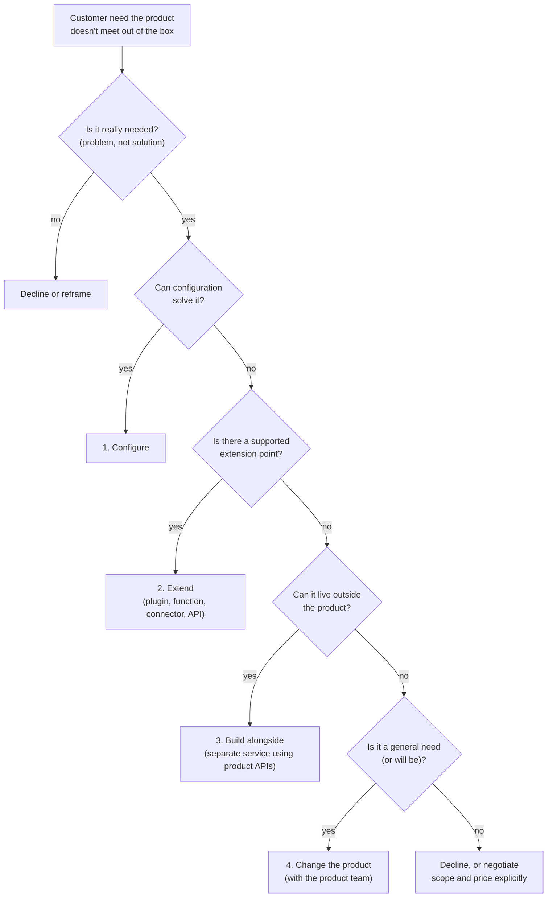

# Chapter 11. Configure, Extend or Change the Product

> "Every line of customer-specific code is a promise to maintain it."

## What you will learn

- The central design decision of forward deployment: when a customer needs something the product doesn't do, what do you build, and where?
- The ladder of options: configure, extend, build alongside, change the product, or decline.
- How to design extensions that survive product upgrades.
- How to manage customer-specific code: repositories, ownership, versioning, testing.
- How to work with your product team on core changes.
- How to recognise and back out of a fork.

---

## 11.1 The decision

Sooner or later in every engagement, the customer needs something the product doesn't quite do. A field is missing. A workflow has an extra approval step. Their identity provider is unusual. Their data has a shape nobody anticipated.

What you do next determines, at the scale of one customer, whether your company stays a product company or drifts into the agency trap (Chapter 3 §3.6). The decision has two failure modes:

- **Too rigid:** refusing anything the product doesn't do out of the box. The deployment fails, and you learn nothing.
- **Too flexible:** building whatever is asked, wherever is fastest, typically inside a customer-specific copy of the product. The deployment succeeds, then becomes unmaintainable, and the product doesn't improve.

The right answer is a ladder: prefer the lowest rung that solves the problem well.

## 11.2 The ladder

### Rung 0: question the need

Before building, revisit the problem (Chapter 5). "We need a custom approval step" might mean "our auditors need evidence that a second person reviewed high-value payments", which an existing audit log and report may satisfy. Many requests are solutions proposed by the customer, and many disappear when you understand the need behind them.

### Rung 1: configure

**Configuration** changes the product's behaviour through settings, metadata or declarative definitions, without code. Examples: custom fields, workflow rules, permission roles, prompt templates, model selection, thresholds, branding.

- **Pros:** supported and upgrade-safe; customer administrators can maintain it.
- **Cons:** limited to what the product exposes.
- **Practice:** keep configuration in version control (export it as files where possible), review changes, and promote it through environments like code.

### Rung 2: extend

An **extension point** is a supported way to add custom behaviour to a product: plugins, user-defined functions, webhooks, custom connectors, SDKs, scripting hooks, custom tools for an AI agent. Palantir Foundry, for example, offers user-written transforms and functions; Salesforce has Apex and Lightning components; most AI platforms let you add custom tools (increasingly via MCP servers).

- **Pros:** custom logic runs inside a contract the product team maintains; upgrades rarely break it.
- **Cons:** you're limited to what the extension point allows; extensions still need owners.
- **Practice:** follow the extension API's versioning; avoid undocumented internals; write tests against the extension contract.

### Rung 3: build alongside

When no extension point fits, build a **separate component** that uses the product's public APIs: an integration service, a custom user interface, a data pipeline, a specialised model. It lives in its own repository and deployment, and talks to the product only through supported interfaces.

- **Pros:** doesn't touch the product core; upgrades are safe as long as the APIs are stable.
- **Cons:** another system to run, monitor and hand over (Chapter 15).
- **Practice:** treat it as a real service with tests, CI, monitoring and an owner, never as "a script on someone's laptop".

### Rung 4: change the product

Sometimes the right answer is to change the product itself: a missing capability that many customers will need, or a bug. FDEs at companies with a strong field-to-product culture contribute these changes directly (with product-team review) or hand them over with a clear specification (Chapter 16).

- **Pros:** everyone benefits; no customer-specific maintenance.
- **Cons:** slower; must fit the product's design, quality bar and roadmap.
- **Practice:** prototype in an extension or alongside first, then propose the generalised version with evidence.

### Declining

Sometimes the right answer is "not this way" or "not at all": the need is unique, expensive and not strategic. Declining is easier when you offer a path: a partner who can build it, a manual workaround, a later-list item (Chapter 6), or a separately priced piece of work with explicit ownership.

## 11.3 Deciding: a scoring guide

| Question | Points toward a lower rung | Points toward a higher rung |
|---|---|---|
| How many customers need this? | One | Several, or a whole segment (rule of three, Chapter 16) |
| How stable is the need? | Experimental; may change | Well understood |
| Who will maintain it? | Customer's admins | Your engineering team |
| How critical is upgrade safety? | Very (regulated, slow change windows) | Less |
| How fast is it needed? | This week | Can wait for a release |
| Does it touch the product's core data model or security? | No | Yes (then it must be a product change, done properly) |

The last row is a hard rule: never implement custom security or data-model changes by patching product internals for one customer. Customer-specific security code is where vulnerabilities live.

## 11.4 Designing extensions that survive upgrades

Products change. Extensions that depend on undocumented behaviour break at upgrade time, often in production, often months after the FDE has moved on.

Practices:

- **Use only documented, versioned interfaces.** If you must use something undocumented, record it, alert the product team, and add a test that fails loudly when it changes.
- **Pin and track versions** of SDKs and APIs; read release notes; subscribe to deprecation notices.
- **Contract tests:** automated tests that check the product still behaves as your extension expects (input and output shapes, error codes). Run them against each new product release in a test environment before production upgrades.
- **Isolate customer logic** behind a clean interface, so product changes require edits in one place.
- **Feature flags:** wrap customer-specific behaviour in flags so it can be turned off without a deploy if an upgrade breaks it.
- **Fail safe:** if an extension fails, the product should degrade gracefully (skip the enrichment, show a warning), not fail entirely.

## 11.5 Managing customer-specific code

Most FDE engagements produce some customer-specific code. Treat it as a product in miniature.

### Where it lives

| Option | When to use |
|---|---|
| **Customer's repository** | They will own and run it after handover; their security policy requires it |
| **Vendor's customer-deployment repository** (one per customer) | Vendor operates it; customer access restricted |
| **Vendor's shared "field" repository** with per-customer modules | Many similar customers; reuse is likely |
| **Product repository** | It's becoming product (rung 4) |

Agree ownership in the SOW (Chapter 6 §6.8) and record it in the handover pack (Chapter 15).

### Rules

1. **Every piece has an owner** (a team, not a person) and a support plan. No orphan code.
2. **Version control and code review**, always, including for configuration, prompts and infrastructure.
3. **Automated tests and CI**, including contract tests against the product.
4. **Documentation:** README, ADRs (Chapter 8 §8.5), runbooks.
5. **No secrets or customer data in repositories.**
6. **Inventory:** your company should be able to list, for each customer, every custom component, its version, owner and the product versions it supports. Without this, upgrades become archaeology.

### Common scaffolding

When many customers need similar extensions, create **templates** or **starter kits**: a skeleton connector, a standard agent tool package, a deployment module. Each engagement starts from the template instead of from scratch, and improvements flow back into the template. This is the first step towards productising field work (Chapter 16).

## 11.6 Working with the product team on core changes

When a product change is the right answer:

1. **Write the field report** (Chapter 8 §8.6): the problem, evidence, impact, other customers affected.
2. **Find the owner:** the product manager and engineering team responsible for the area.
3. **Propose, don't demand.** Offer a design that solves the general problem, not just your customer's version of it.
4. **Agree the path:** the product team builds it; you build it with their review; or you build an extension now and they generalise later.
5. **Manage the customer's expectations:** product changes follow the product's release process. Don't promise dates you don't control.
6. **Close the loop:** when it ships, migrate the customer from any interim workaround, and delete the workaround.

Companies differ in how much FDEs touch product code. At some (Palantir has described FDEs contributing code back to its platforms), field engineers routinely submit product changes. At others, product code is off-limits to field teams, and the field report is the only channel. Learn your company's norms early.

## 11.7 Recognising and backing out of a fork

A **fork**, here, is a customer-specific copy or modification of the product's core that diverges from the main product. Forks happen gradually ("just this once") and are expensive to unwind.

Warning signs:

- the customer runs a product version several releases behind because "upgrades break things";
- there's a branch of the product repository named after the customer;
- bug fixes must be applied twice;
- only one FDE understands how the customer's deployment differs from standard.

Backing out:

1. **Inventory the differences** between the fork and the current product.
2. **Classify each:** now available as configuration; can become an extension; should become product; no longer needed.
3. **Plan a migration** to the standard product plus configuration and extensions, with tests that prove behaviour is preserved.
4. **Get sponsor buy-in:** upgrades bring the customer security fixes and new features; position it as a benefit, not a cost.
5. **Prevent recurrence:** review the decisions (and incentives) that created the fork.

---

## Summary

- When a customer needs something the product doesn't do, climb a ladder: question the need, configure, extend, build alongside, change the product, or decline. Prefer the lowest rung that solves the problem well.
- Never patch product internals for one customer, especially for security or the core data model.
- Design extensions to survive upgrades: documented interfaces, version pinning, contract tests, isolation, feature flags, graceful failure.
- Treat customer-specific code as a product: owner, version control, review, tests, documentation and an inventory.
- Work with the product team through evidence-based proposals; close the loop when product changes ship.
- Recognise forks early and back out with an inventory, classification and tested migration.

## Exercises

See [`exercises/11-configure-extend-change.md`](../exercises/11-configure-extend-change.md).

## Further reading

- Martin Fowler, "Feature Toggles (aka Feature Flags)" (martinfowler.com, 2017).
- Martin Fowler, "Contract Test" (martinfowler.com, 2011), and the consumer-driven contracts pattern.
- Michael Nygard, *Release It!* (2nd edition, 2018), on stability patterns.
- Salesforce and Palantir developer documentation on extension mechanisms, as examples of platform design.
