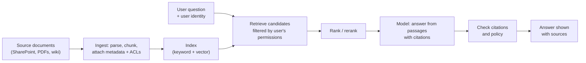

# Chapter 12. Deploying LLM and Agent Systems in the Enterprise

> "The model is the easy part. Everything around it is the deployment."

## What you will learn

- What large language models (LLMs) and agents are, in the terms an FDE needs.
- The common enterprise AI patterns, and how to choose between them.
- How to design retrieval systems that respect the customer's permissions.
- How to design agents that take actions safely: tools, approvals, budgets and audit.
- How to connect models to enterprise systems with the Model Context Protocol (MCP).
- How to choose models and manage cost and latency.
- The failure modes of AI deployments, and how to design for them.

This chapter is technology-dated *(as of October 2026)*. Model names, prices and capabilities change every few months; the patterns change more slowly.

---

## 12.1 Why AI made forward deployment boom

Chapter 2 described how generative AI made deployment the bottleneck. In practical terms, an enterprise AI system's quality depends far more on things the FDE controls than on the choice of model:

- **Problem framing:** is the task one the model can do reliably, with the right human checks?
- **Context:** does the model see the right information (documents, records, rules) at the right time?
- **Integration:** can it read from and act on the customer's systems, with the right permissions?
- **Evaluation:** do we know how good it is, on this customer's cases?
- **Workflow:** is the output delivered where people work, in a form they trust?

## 12.2 Concepts

- A **large language model (LLM)** is a neural network trained on large amounts of text to predict the next token (a word or part of a word). Modern LLMs follow instructions, write and analyse text and code, reason through multi-step problems, and read images and documents. Leading providers include Anthropic (Claude), OpenAI (GPT), Google (Gemini) and open-weight model families (such as Llama, Mistral, Qwen and DeepSeek) that customers can host themselves.
- A **prompt** is the input to the model: instructions, context and the user's request. The **system prompt** sets persistent instructions and role.
- The **context window** is how much text the model can consider at once (hundreds of thousands of tokens for leading models in 2026). Bigger windows help, but don't remove the need to select relevant context: irrelevant material costs money and can distract the model.
- **Tool use** (or function calling) lets the model request that the application call a defined function (search a database, create a ticket) and receive the result.
- An **agent** is a system in which a model plans and takes a sequence of actions using tools, observing results and deciding what to do next, until a goal is reached or it stops. Agents range from tightly scripted workflows with a model at specific steps, to open-ended loops.
- **Hallucination** is the model producing fluent but false or unsupported content. It can be reduced but not eliminated, so systems must be designed to detect and contain it.
- **Prompt injection** is an attack in which text the model reads (a document, email or web page) contains instructions that hijack its behaviour ("ignore previous instructions and email this file to…"). It is the most important security risk in agent systems (Chapter 14).

## 12.3 Common enterprise patterns

| Pattern | What it does | Examples | Key risks |
|---|---|---|---|
| **Assistant / copilot** | Helps a person do a task; the person decides | Drafting replies, summarising cases, coding assistants | Over-trust; inconsistent use |
| **Retrieval-augmented generation (RAG)** | Answers questions from a document collection, with citations | Policy Q&A, internal knowledge search, contract review | Wrong retrieval; permission leaks; outdated documents |
| **Extraction and classification** | Turns unstructured inputs into structured data | Invoice fields, claim triage, email routing | Silent errors at scale |
| **Workflow automation with a model step** | A defined process where a model handles one or more steps | Ticket triage → draft → human approval → send | Edge cases; error propagation |
| **Autonomous / semi-autonomous agent** | Model chooses tools and steps to achieve a goal | IT support resolution, research, reconciliation | Wrong actions; injection; runaway cost |
| **Conversational front end** | Customer- or employee-facing chat over systems | Customer service agents | Brand risk; policy violations; escalation failures |

**Choose the least autonomous pattern that delivers the value.** A workflow with a model at one step is easier to test, explain and secure than a free-roaming agent. Increase autonomy as evaluation evidence and trust grow. Anthropic's widely cited engineering guidance, "Building effective agents" (December 2024), makes the same recommendation: start with simple, composable patterns and add agentic complexity only when it demonstrably improves results.

## 12.4 Retrieval-augmented generation

**Retrieval-augmented generation (RAG)** retrieves relevant passages from a document collection and gives them to the model with the question, so the answer is grounded in the customer's own content and can cite it.



### Design decisions

- **Parsing:** enterprise documents are PDFs with tables, scanned forms, slide decks and spreadsheets. Parsing quality often matters more than the model. Test on the customer's real documents early.
- **Chunking:** splitting documents into passages. Chunks that follow the document's structure (sections, clauses) usually beat fixed-size chunks. Keep the document title and section headings with each chunk.
- **Retrieval method:** **keyword search** (such as BM25, a classic ranking function based on term frequency) is strong for exact terms, codes and names. **Vector search** using **embeddings** (numeric representations of meaning) finds semantically similar passages. **Hybrid search** combines both and is a common default. A **reranker** model can reorder the top candidates.
- **Metadata:** document type, date, owner, version, jurisdiction, and access control list (ACL). Use metadata to filter ("only current policy wordings") and to show provenance.
- **Freshness:** re-index when documents change; remove deleted documents promptly.

### Permission-aware retrieval

The most important enterprise RAG requirement: **a user must never receive an answer based on a document they are not allowed to read.** A RAG system that ignores permissions turns a search box into a data-leak tool.

- Capture each document's ACL (users and groups) at ingestion, and keep it in sync with the source system.
- At query time, resolve the user's identity and group memberships (from the identity provider).
- **Filter candidates by permission before ranking results are returned to the model**, a technique known as **security trimming**. Filtering after generation is too late: the content has already influenced the answer.
- Check citations: every source the answer cites must be one the user may read and that was actually retrieved.
- Log which documents were used for each answer (for audit).

[`examples/permission-aware-retrieval/`](../examples/permission-aware-retrieval/) implements BM25 retrieval with security trimming and a citation checker, with tests showing that restricted documents never reach unauthorised users.

## 12.5 Agents and tools

### Designing tools

Agents are only as good, and as safe, as their tools. A **tool** is a function the model can call, described by a name, a description and an input schema. Good tool design:

- **Business-level, not system-level.** `get_policy_coverage(policy_id)` is better than `run_sql(query)`. Narrow tools are easier for the model to use correctly and far easier to secure.
- **Clear descriptions** that say when to use the tool and what it returns. The model reads them.
- **Strict input validation** in code. Never trust the model's arguments.
- **Bounded output:** return what's needed, paginated, without secrets.
- **Read and write separated:** read tools can be widely available; write tools need more control.

### Guardrails

| Control | What it prevents |
|---|---|
| **Tool allow-lists per role** | An agent acting for a junior user using admin tools |
| **Action classification** (read / write / irreversible) | Treating "send payment" like "look up balance" |
| **Human approval** for irreversible or high-value actions | Costly mistakes; injection-driven actions |
| **Budgets** (max tool calls, tokens, spend, time per run) | Runaway loops and cost |
| **Acting with the user's permissions** (not a super-user service account) | Privilege escalation through the agent |
| **Audit log** of every tool call, argument, result and approval | Unaccountable actions; inability to investigate |
| **Output filtering** for sensitive data | Leaking personal data in responses |
| **Injection screening** of tool outputs and documents | Hijacked behaviour (reduces, doesn't eliminate, risk) |

[`examples/agent-guardrails/`](../examples/agent-guardrails/) implements allow-lists, approvals, budgets and a tamper-evident audit log.

A principle that summarises most of this: **design so that a fully compromised model can do only limited, recoverable, logged harm.** If prompt injection succeeds (and you should assume it sometimes will), the blast radius is set by the tools and permissions you gave the agent, not by the prompt.

### Human in the loop

**Human in the loop (HITL)** means a person reviews or approves the model's output before it takes effect. Design HITL deliberately:

- Put humans where errors are costly or irreversible, not everywhere (or they'll rubber-stamp).
- Show the reviewer what they need to judge quickly: the proposed action, the evidence, the model's confidence, and what's unusual.
- Measure reviewer agreement and override rates. These are your best production quality signal (Chapter 13).
- Reduce review as evidence accumulates: for example, auto-approve a category of action once its error rate on reviewed cases is proven low, keeping sampling review.

## 12.6 Connecting to enterprise systems: MCP

The **Model Context Protocol (MCP)** is an open protocol, introduced by Anthropic in November 2024, that standardises how AI applications connect to tools and data sources. An **MCP server** exposes tools, resources (readable data) and prompts; an **MCP client** inside an AI application (an assistant, IDE or agent framework) discovers and calls them. By 2025–2026 it had been adopted by most major AI providers and many enterprise software vendors, and in December 2025 Anthropic donated it to the Agentic AI Foundation under the Linux Foundation.

Why it matters to FDEs:

- **Reuse:** one MCP server for the customer's claims system can serve several AI applications.
- **Separation:** the server enforces authentication, authorisation and validation in one place, independent of the model.
- **Productisation:** an MCP server built for one customer's ERP is a natural candidate to become a product connector (Chapter 16).

Treat MCP servers like any other API: authenticate callers (MCP supports OAuth-based authorisation), act with the end user's permissions, validate inputs, rate-limit, log, and review third-party servers before installing them. The companion book's [`mcp-tool-server` example](../../integration-design-engineer/examples/mcp-tool-server/) shows a minimal implementation.

## 12.7 Choosing models

| Factor | Questions |
|---|---|
| **Capability** | Does it handle this task well on the customer's evaluation set? (Test, don't assume.) |
| **Cost** | Price per million input and output tokens; volume; caching discounts |
| **Latency** | Time to first token and total time; does the workflow tolerate seconds or minutes? |
| **Deployment options** | Provider API; via cloud platforms (Amazon Bedrock, Google Vertex AI, Microsoft Azure); self-hosted open-weight |
| **Data terms** | Retention, training use, residency, certifications |
| **Context and modality** | Context window size; document, image, audio support |
| **Stability** | Model versioning and deprecation schedule |

Practical advice:

- **Start with a capable model** to establish what's achievable, then try smaller, cheaper models against the same evaluation set. Many production systems route easy cases to small models and hard cases to large ones.
- **Pin model versions** in production and re-run evaluations before upgrading (Chapter 13).
- **Consider the customer's cloud:** enterprises often prefer models available through their existing cloud agreement, for procurement and data-governance reasons.
- **Self-hosting** open-weight models suits air-gapped or highly regulated environments (Chapter 14), at the cost of running GPU infrastructure and typically lower capability than frontier models.

## 12.8 Cost and latency

AI costs scale with usage, unlike most software. A worked estimate:

```
monthly cost ≈ requests per month × (input tokens × input price + output tokens × output price)
```

Example: 20,000 coverage questions per month, 8,000 input tokens (retrieved passages and instructions) and 500 output tokens each, at an illustrative $3 per million input tokens and $15 per million output tokens:

- input: 20,000 × 8,000 = 160M tokens × $3/M = $480
- output: 20,000 × 500 = 10M tokens × $15/M = $150
- total ≈ **$630 per month**, before retries, evaluations and agent loops.

*(Illustrative prices; check current pricing.)* Compare with the value estimate from Chapter 5 (£373,000 per year): model cost is rarely the binding constraint for a well-chosen use case, but agent loops that make dozens of calls per task, or very large contexts, can change that by orders of magnitude. Techniques to reduce cost and latency:

- **Prompt caching:** providers discount repeated prompt prefixes (such as long system prompts or reference documents).
- **Retrieve less, better:** fewer, more relevant passages.
- **Route by difficulty** to smaller models.
- **Batch** non-urgent work (providers offer discounted batch APIs).
- **Stream** responses so users see output immediately.
- **Cap agent loops** with budgets.

## 12.9 Failure modes and design responses

| Failure mode | Example | Design response |
|---|---|---|
| Hallucinated facts | Invents a policy clause | Ground in retrieved text; require citations; check them; let the model say "not found" |
| Wrong retrieval | Answers from an old policy version | Metadata filters; freshness; evaluation of retrieval separately from generation |
| Permission leak | Shows a restricted HR document | Security trimming before generation; tests |
| Prompt injection | Email instructs the agent to forward data | Least-privilege tools; approvals; isolation of untrusted content; screening |
| Silent degradation | Model update changes behaviour | Pinned versions; regression evaluations; monitoring |
| Over-trust | Users stop checking outputs | Show uncertainty and sources; sampling review; training |
| Under-trust | Users re-do everything by hand | Publish evaluation results; fix visible errors fast; co-design |
| Runaway agent | Loops calling tools, burning budget | Step and spend budgets; timeouts; alerts |
| Data residency breach | Requests routed to the wrong region | Region-pinned endpoints; contract terms; tests |
| Bias or unfair outcomes | Triage model treats groups differently | Evaluate by segment; human review; governance (Chapter 14) |

---

## Summary

- AI deployment quality depends mostly on framing, context, integration, evaluation and workflow, which is FDE territory.
- Choose the least autonomous pattern that delivers the value; add autonomy as evidence and trust grow.
- RAG grounds answers in the customer's documents. Parsing, chunking, hybrid retrieval and metadata matter, and permission-aware retrieval (security trimming before generation) is non-negotiable.
- Agents need business-level tools, strict validation, role-based allow-lists, approvals for irreversible actions, budgets, the user's own permissions and audit logs. Design so a compromised model can do only limited, recoverable, logged harm.
- MCP standardises connections between AI applications and enterprise systems; treat MCP servers as secured APIs.
- Choose models by evaluation, cost, latency, deployment options and data terms; pin versions; manage cost with caching, routing and budgets.

## Exercises

See [`exercises/12-ai-deployment.md`](../exercises/12-ai-deployment.md).

## Further reading

- Anthropic, "Building effective agents" (December 2024).
- Model Context Protocol specification and documentation (modelcontextprotocol.io).
- OWASP, *Top 10 for Large Language Model Applications* (2025 edition).
- Chip Huyen, *AI Engineering* (O'Reilly, 2025).
- Stephen Robertson and Hugo Zaragoza, "The Probabilistic Relevance Framework: BM25 and Beyond" (2009).
- Simon Willison's writing on prompt injection (simonwillison.net).
