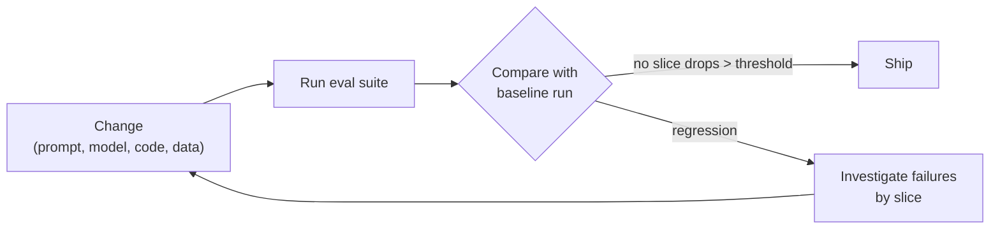

# Chapter 13. Evaluation and Measuring Business Impact

> "Without measurement, a deployment is an anecdote."

## What you will learn

- The difference between evaluating a system and measuring its business impact, and why you need both.
- How to build an evaluation set from the customer's real cases.
- Graders: exact, rule-based, model-based and human, and when to use each.
- How to run evaluations as regression tests that gate every change.
- How to monitor quality in production.
- How to measure adoption and business impact credibly, including with control groups.
- How to report impact in terms the sponsor can take to the board.

---

## 13.1 Two questions

Every deployment must answer two questions:

1. **Does the system work?** On the customer's real cases, how often is it right, and how does it fail? This is **evaluation**.
2. **Did it make a difference?** Did the business outcome in the success plan (Chapter 6) improve, and by how much, because of the system? This is **impact measurement**.

They're connected but different. A system can be highly accurate and have no impact (nobody uses it, or it automates something that didn't matter). A system with modest accuracy can have large impact (if it handles the easy 60% and routes the rest to experts). FDEs need evidence of both: evaluation to build and improve the system safely, and impact to justify it.

## 13.2 Why AI systems need evaluation

Traditional software is mostly deterministic: given the same input, it produces the same output, and unit tests check specific behaviours. AI systems are **probabilistic**: outputs vary, and quality is a rate, not a yes or no. You can't prove an LLM-based system correct; you can only measure how often it does well, on which kinds of cases.

Evaluation also replaces intuition. Without it, teams change prompts based on the last example someone complained about, fix one case and break three others, and can't tell whether a new model is better. With it, every change is a measured experiment.

## 13.3 Building an evaluation set

An **evaluation set** (or **eval set**) is a collection of test cases, each with an input and a way to judge the output (an expected answer, a reference, or criteria).

### Where cases come from

| Source | Strength | Watch out for |
|---|---|---|
| **Historical real cases** with known outcomes | Realistic; plentiful | May contain sensitive data; past decisions may themselves be wrong |
| **SME-written cases** | Cover important and tricky scenarios | Time-consuming; may be unrealistically clean |
| **Production samples** (after launch) | Reflect actual use | Need labelling |
| **Failure cases** reported by users | Target known weaknesses | Over-representation of rare problems |
| **Adversarial cases** | Test safety and injection resistance | Need security input |
| **Synthetic cases** generated with a model | Fast coverage of variations | Can be unrealistic; validate a sample |

### Size and composition

- **Start small and real:** 50–200 well-chosen cases built in the first weeks beat 5,000 synthetic ones built later.
- **Stratify:** tag cases by type (claim type, document type, language, difficulty, customer segment) so you can see where the system is weak. An overall 90% can hide 50% on an important slice.
- **Include the "should refuse" cases:** questions the system shouldn't answer, data the user shouldn't see, requests out of scope.
- **Version it:** the eval set is code. Store it in version control, review changes, and never edit cases to make a failing run pass.
- **Hold some back:** keep a portion that isn't used while iterating on prompts, to check you haven't overfitted to the visible cases.

### Labelling with SMEs

Customer subject-matter experts are the authority on what "correct" means. Make their time count:

- Write a short **rubric**: what makes an answer correct, partially correct or wrong, with examples.
- Have two experts label a sample independently and measure agreement. Low agreement means the task (or rubric) is ambiguous, and that's a finding in itself.
- Use a simple labelling interface (a spreadsheet works); don't make experts read JSON.

## 13.4 Graders

A **grader** decides whether an output passes. Use the simplest grader that is reliable for the property you're checking.

| Grader | How it works | Good for | Limits |
|---|---|---|---|
| **Exact match** | Output equals expected value | Classification labels, extracted fields, yes/no | Brittle for free text |
| **Rule-based** | Code checks properties: contains a keyword, valid JSON, matches a schema, numbers within tolerance, citations present | Format, structure, required elements | Can't judge meaning |
| **Reference similarity** | Compares to a reference answer | Short factual answers | Penalises correct paraphrases |
| **Model-based ("LLM as judge")** | Another model call grades against a rubric | Free-text quality, faithfulness to sources, tone | Judge has its own errors and biases; must be validated against human labels |
| **Human** | Experts grade | Ground truth; calibrating other graders | Slow and expensive |

### Using LLM judges well

- Give the judge a specific rubric and the source material, and ask for a reasoned verdict on one property at a time (for example, "is every claim in the answer supported by the passages?").
- **Validate the judge** against human labels on a sample: measure how often it agrees with experts. Don't use an unvalidated judge as a release gate.
- Watch for known biases: judges may favour longer answers, or answers from their own model family.
- Prefer binary or small-scale judgements (pass/fail, 1–3) over fine-grained scores, which are less consistent.

### Evaluate components, not just the end

For a RAG system, evaluate retrieval separately: did the relevant passage appear in the top results (**recall at k**)? Many "bad answers" are retrieval failures, and you can't fix them by changing the prompt. For agents, evaluate each tool decision as well as the final outcome.

[`examples/llm-eval-harness/`](../examples/llm-eval-harness/) runs a JSONL eval set against a pluggable system, applies exact, rule-based and judge graders, reports pass rates by tag, and compares two runs to detect regressions.

## 13.5 Evaluations as regression tests

Once you have an eval set, run it on **every change**: prompt edits, retrieval tuning, model upgrades, code changes, data refreshes.



Here is what a regression looks like in practice, using the 12-case sample in [`examples/llm-eval-harness/`](../examples/llm-eval-harness/). Version 2 of a prompt fixed a classification case but broke two coverage answers:

```
slice                    v1         v2   delta
all                     92%        83%     -8%  <-- REGRESSION
classification          75%       100%    +25%
coverage-qa            100%        50%    -50%  <-- REGRESSION
high-risk              100%        75%    -25%  <-- REGRESSION

Newly failing: qa-01, qa-03
  qa-01: citations: cites ['HC-200-s12'] not in ['HC-200-s4', 'HC-200-s7']
  qa-03: citations: 0 citation(s), need 1
```

The headline improvement on classification would have hidden a serious problem: one answer now cites a policy section that wasn't retrieved, and another cites nothing. Slicing by tag, and treating any drop on `high-risk` cases as a regression, catches it.

- **Gate releases** on agreed thresholds: overall pass rate, and no critical slice regressing by more than a set margin.
- **Read the failures,** not just the score. Ten minutes reading failed cases teaches more than any dashboard.
- **Track over time:** a chart of pass rate per slice across versions is a powerful artefact for both the customer and the handover team.
- **Add every production failure** to the eval set (after fixing it), so it can't silently return.

## 13.6 Monitoring in production

Evaluation sets age. Production traffic shifts: new document types, new questions, seasonal patterns. Monitor:

| Signal | What it tells you |
|---|---|
| **Volume and usage** by team, task type | Adoption; unexpected use |
| **Latency and errors** | Reliability (Chapter 15) |
| **Cost per request** and in total | Budget; runaway agents |
| **User feedback** (thumbs up/down, corrections) | Perceived quality; specific failures |
| **Human override rate** in review workflows | Real-world accuracy where humans check |
| **"Not found" / refusal rate** | Retrieval coverage gaps or over-cautious prompts |
| **Sampled grading** of production outputs (by humans or validated judges) | Quality drift |
| **Input drift** (distribution of topics, lengths, languages) | When the eval set no longer represents reality |
| **Safety signals** (injection detections, sensitive-data filters triggered) | Attacks and leaks |

Log enough to investigate (inputs, retrieved sources, outputs, tool calls, model version), subject to the customer's data-retention rules.

## 13.7 Measuring adoption

Adoption is the bridge between a working system and business impact (Chapter 7 §7.6). Measure:

- **Reach:** what share of target users have used it?
- **Depth:** on what share of eligible tasks do they use it?
- **Retention:** do users continue after the first weeks?
- **Reliance:** do they act on its output, or redo the work?

Define "eligible tasks" carefully. "72% of eligible claims had the coverage panel opened" is meaningful. "500 active users" is not, on its own.

## 13.8 Measuring business impact

### Before and after

The simplest design compares the metric before and after deployment. It is easy, but vulnerable to everything else that changed at the same time: seasonality, staffing, new policies, a backlog clearing.

### Control groups

A stronger design compares users who have the system with similar users who don't, over the same period:

- **Randomised rollout:** assign teams or cases at random to the new system or the old process. This is a **randomised controlled trial (RCT)**, sometimes called an **A/B test**. It's the gold standard where feasible.
- **Phased rollout:** deploy to one office first and compare with others. Not random, but often practical.
- **Difference-in-differences:** compare the *change* in the metric for the pilot group with the change for a comparison group over the same period. This removes trends that affect both groups.

```
impact ≈ (pilot after − pilot before) − (comparison after − comparison before)
```

Example: the pilot team's median cycle time falls from 9.0 to 6.4 days; a comparison team's falls from 9.2 to 8.6 over the same period (perhaps due to a seasonal dip). Difference-in-differences: (6.4 − 9.0) − (8.6 − 9.2) = −2.6 − (−0.6) = **−2.0 days** attributable to the deployment, not −2.6.

### Converting to money

Translate operational impact into financial terms with the customer's finance team, using the same structure as the value estimate in Chapter 5 §5.8: time saved × loaded cost, errors avoided × cost per error, revenue gained. Be conservative:

- count only time savings that are real (hours freed are not cash saved unless the time is redeployed, overtime falls or hiring is avoided; say which);
- annualise carefully (pilot results may not scale linearly);
- subtract costs: platform, model usage, FDE time, customer staff time.

[`examples/impact-calculator/`](../examples/impact-calculator/) implements annual value, ROI and payback calculations with low, base and high scenarios.

### Confidence and honesty

- Report ranges, not false precision: "£250k–£400k per year, base case £320k".
- State assumptions explicitly.
- Report what didn't improve as well as what did.
- Have the customer's finance or operations team validate the numbers. An impact figure the customer's own finance team endorses is worth far more than one you produced alone.

## 13.9 Reporting impact

The **impact report** closes the loop on the success plan. Structure:

1. **Headline:** the business result in one sentence.
2. **Against the success plan:** each criterion, baseline, target, result, and method.
3. **How it was measured:** design, period, sample sizes, caveats.
4. **Adoption** and quality evidence.
5. **Financial value**, with assumptions and ranges, validated by finance.
6. **What we learned**, including what didn't work.
7. **Recommendation:** scale, expand, adjust or stop.

Turn the headline into an executive brief (Chapter 8 §8.4) the sponsor can forward. If the customer agrees, the report becomes the basis of a case study, one of the most valuable sales assets a vendor has (Chapter 3).

---

## Summary

- Evaluation asks "does it work?"; impact measurement asks "did it matter?". You need both.
- Build eval sets early from real cases, stratified by slice, including refusal cases; version them; label with SMEs using rubrics; check expert agreement.
- Use the simplest reliable grader; validate LLM judges against human labels; evaluate components (retrieval, tool choices) as well as end results.
- Run evals on every change as regression tests, gate releases on thresholds, read failures, and add production failures to the set.
- Monitor usage, cost, feedback, overrides, refusals, sampled quality, drift and safety signals in production.
- Measure adoption by reach, depth, retention and reliance. Measure impact with control groups or difference-in-differences where possible; convert to money conservatively, with ranges and finance validation.

## Exercises

See [`exercises/13-evaluation-and-impact.md`](../exercises/13-evaluation-and-impact.md).

## Further reading

- Hamel Husain, "Your AI Product Needs Evals" (hamel.dev, 2024), and related writing on error analysis.
- Lianmin Zheng et al., "Judging LLM-as-a-Judge with MT-Bench and Chatbot Arena" (2023), on judge biases.
- Ron Kohavi, Diane Tang and Ya Xu, *Trustworthy Online Controlled Experiments* (2020).
- Joshua Angrist and Jörn-Steffen Pischke, *Mastering 'Metrics* (2014), on difference-in-differences and causal inference.
- Douglas W. Hubbard, *How to Measure Anything* (3rd edition, 2014).
