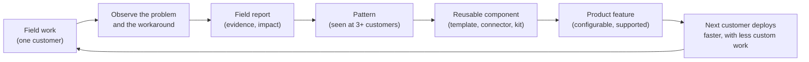

# Chapter 16. Turning Field Work into Product

> "Do things that don't scale, then make them scale."

## What you will learn

- Why the feedback loop from field to product is what separates forward deployment from consulting.
- How field insight flows: field reports, patterns, reusable components and product features.
- The rule of three, and other ways to decide what to productise.
- How to generalise a customer-specific solution without losing what made it work.
- Organisational mechanisms that make the loop work: rotations, product liaisons, field councils, budgets.
- How to measure whether the loop is working.

---

## 16.1 Why the loop matters

Chapter 2 drew the line between FDEs and earlier field roles: systems integrators and consultants customised software for each customer, but **the product rarely learned**. Palantir's model was different because what Deltas built for one customer was pulled back into the platform. Chapter 3 argued that the economics of forward deployment only work if FDE effort per customer falls over time, and that this happens when field work becomes reusable product.

So the feedback loop is not a nice extra. It is the reason forward deployment can be a software business rather than a services business. Paul Graham's essay "Do Things That Don't Scale" (2013) captures the first half: start-ups should do manual, customer-specific work early to learn. The FDE model adds the second half: **systematically convert what you learned into things that do scale.**

## 16.2 What flows back

| Type | Example | Destination |
|---|---|---|
| **Bugs** | The connector fails on documents over 200 pages | Product engineering backlog |
| **Gaps** | No way to restrict an agent tool to a group of users | Product roadmap |
| **Patterns** | Every insurance customer needs the same claims-to-policy join | Industry template or data model |
| **Reusable code** | An MCP server for a common ERP | Product connector library |
| **Playbooks** | How to run discovery for claims operations | FDE playbook (Chapter 17) |
| **Evaluation assets** | Rubrics and test-case designs for contract review | Product evaluation tooling; templates |
| **Market insight** | Banks won't accept models outside their cloud tenancy | Product strategy; partnerships |
| **Documentation gaps** | Every customer's IT asks the same three security questions | Security pack; docs |

## 16.3 Field reports that get acted on

Chapter 8 §8.6 introduced the field report. To make product teams act:

- **Describe the problem**, the user and the context, not your proposed feature. Product managers need to design for many customers; give them the raw material.
- **Show the workaround.** What you built, how long it took, how it's maintained. A workaround is proof the need is real.
- **Quantify:** users affected, frequency, revenue at risk or unlocked, deployment time added.
- **Link to other instances.** The single most persuasive line in a field report is "this is the fourth customer to need this."
- **Make it easy to find:** one system (an issue tracker, a product feedback tool), with consistent tags by product area and industry.

Template: [`templates/field-report.md`](../templates/field-report.md). [`examples/feedback-tracker/`](../examples/feedback-tracker/) clusters field reports by tag, counts distinct customers per need, applies the rule of three, and ranks needs by revenue affected.

## 16.4 Deciding what to productise

### The rule of three

A widely used heuristic: **build it custom the first time; notice it the second time; generalise it the third time.** The idea echoes a long-standing software refactoring rule (attributed to Don Roberts and popularised in Martin Fowler's *Refactoring*): duplicate code once, but refactor on the third occurrence. In forward deployment, "three" means three distinct customers with the same underlying need.

Why three? One instance is an anecdote. Two may be coincidence, and you can't yet tell which parts are general and which are specific. With three, you can see the common core and the variations, which is exactly what a good product design needs.

### Beyond counting

The rule of three is a trigger for consideration, not an automatic decision. Weigh:

| Factor | Productise sooner | Productise later or never |
|---|---|---|
| **Revenue affected** | Large accounts or a strategic segment | Small accounts |
| **Deployment time saved** | Weeks per customer | Hours |
| **Risk of custom versions** | Security-sensitive; error-prone | Low risk |
| **Strategic fit** | Aligns with product direction | Peripheral |
| **Stability of the need** | Well understood | Still changing |
| **Cost to generalise** | Small relative to benefit | Very large |

A single customer's need can justify product work if the customer is large or strategic, or if it opens a segment (the first bank needing a particular compliance feature often means every bank will).

## 16.5 Generalising without losing the point

Generalising a field solution is harder than it looks. The customer-specific version works because it fits one context exactly. Common mistakes:

- **Over-generalising:** building an abstract framework for every conceivable variation, which nobody can configure.
- **Under-generalising:** shipping customer A's version as "the feature", with customer A's assumptions baked in.
- **Losing the insight:** the product team rebuilds the feature from the field report without understanding why the FDE's version made such a difference.

A practical process:

1. **Collect the instances:** the three (or more) custom implementations, their differences and the reasons for them.
2. **Separate core from variation:** what's identical everywhere becomes product logic; what varies becomes configuration.
3. **Design with the FDEs who built the instances.** They know which variations matter.
4. **Build in the product** to product standards: tests, documentation, security review, upgrade path.
5. **Migrate the original customers** to the product version and delete the custom code (Chapter 11 §11.6).
6. **Measure:** did the next deployment get faster?

### Intermediate forms

Not everything should go straight into the core product. Intermediate steps reduce risk:

| Form | Description |
|---|---|
| **Snippets and recipes** | Shared code and how-to notes in an internal library |
| **Templates and starter kits** | Ready-to-fork projects for common deployment types |
| **Solution accelerators** | Packaged, supported-but-optional bundles for an industry or use case |
| **Marketplace components** | Connectors or apps published for customers to install |
| **Core product features** | Fully built into the product |

Many companies (Palantir with its industry offerings and AIP templates, and AI labs with published cookbooks and reference agents) use these intermediate forms to move field patterns into reusable assets before deciding what belongs in the core.

## 16.6 Organisational mechanisms

The loop does not happen naturally. Product teams are busy with their roadmap; FDEs are busy with customers. Companies that make it work typically use several of these:

- **Product liaisons:** a product manager or engineer assigned to each FDE pod or industry, who reads field reports and attends field reviews.
- **Field councils:** a regular (for example monthly) meeting where FDE leads present top field needs and product leaders decide, publicly, what to do with them.
- **Rotations:** FDEs spend time on product teams (building the generalised version of their own field work), and product engineers spend time in the field. Few things build empathy faster.
- **Productisation budget:** an explicit share of FDE and product capacity reserved for generalisation work, so it isn't always displaced by customer urgency.
- **Shared code ownership:** FDEs can contribute to product repositories with product-team review (Chapter 11 §11.6).
- **Recognition:** promotion criteria and awards that value productised contributions, not just customer outcomes (Chapter 17).
- **Closing the loop visibly:** when a field report ships as a feature, tell the FDE who filed it and the customers who needed it.

## 16.7 Measuring the loop

Chapter 3 introduced metrics; the loop-specific ones:

| Metric | What it shows |
|---|---|
| **Productisation rate:** share of field-built components that become product or reusable assets | Whether the loop converts |
| **Time from field report to decision** | Whether the product team is listening |
| **Deployment time for the Nth customer** in a segment | Whether deployments get faster |
| **Custom code per customer** (lines, components) over time | Whether the agency trap is avoided |
| **Share of new deployments using templates or accelerators** | Whether reusable assets are used |
| **FDE-hours per deployment** over time | The end-to-end efficiency effect |

If deployment time and custom code per customer aren't falling over successive customers in a segment, the loop isn't working, whatever the number of field reports filed.

## 16.8 The individual FDE's part

- **Notice patterns.** Keep a running list of "I've built this before" moments.
- **Build with reuse in mind** when you suspect a pattern: clean interfaces, configuration over hard-coding, no customer names in generic code.
- **File field reports** regularly, not just when something is on fire.
- **Talk to other FDEs.** The second and third instances of your problem are probably sitting with a colleague on another account.
- **Volunteer for generalisation work.** It's often the most visible and career-advancing work an FDE does (Chapter 19).
- **Respect IP and confidentiality.** Generalise the pattern, never the customer's data, proprietary logic or confidential details (Chapter 6 §6.8).

---

## Summary

- The field-to-product loop is what makes forward deployment a software business rather than a services business.
- Bugs, gaps, patterns, reusable code, playbooks, evaluation assets and market insight should all flow back.
- Field reports get acted on when they describe the problem, show the workaround, quantify impact and link other instances.
- The rule of three triggers productisation; weigh revenue, time saved, risk, strategy, stability and cost.
- Generalise by separating core from variation, designing with the FDEs who built the instances, migrating original customers and deleting custom code. Use intermediate forms (recipes, kits, accelerators) where appropriate.
- Make the loop real with product liaisons, field councils, rotations, budgets, shared code ownership and recognition, and measure it by falling deployment time and custom code per customer.

## Exercises

See [`exercises/16-field-to-product.md`](../exercises/16-field-to-product.md).

## Further reading

- Paul Graham, "Do Things That Don't Scale" (paulgraham.com, 2013).
- Martin Fowler, *Refactoring* (2nd edition, 2018), on the rule of three.
- Marty Cagan, *Inspired* (2nd edition, 2017), on product discovery.
- Palantir engineering blog, on Deltas, Devs and the product feedback loop.
