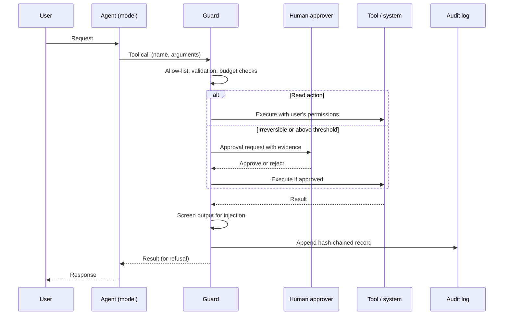

# Agent tool call with guardrails

Relevant chapters: [12](../chapters/12-ai-deployment.md), [14](../chapters/14-security-and-restricted-environments.md). Example: [`agent-guardrails`](../examples/agent-guardrails/).

