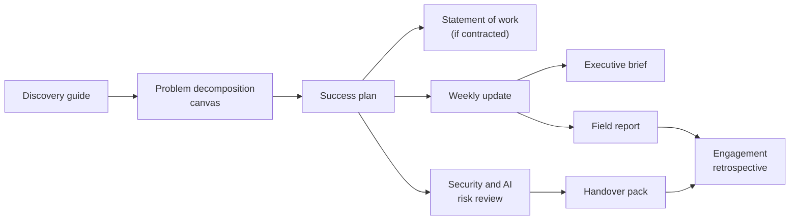

# Templates

Copy these into real engagements. Each template opens with a short "How to use this template" note: what it is for, when in the engagement lifecycle you use it, who owns it and who signs it off.

Conventions used throughout:

- `<Angle brackets>` mark text to replace.
- Empty table cells are for you to fill.
- *Italic notes* are guidance; delete them before you send the document.
- Worked examples use fictional companies (Contoso, Fabrikam, Northwind, Tailspin Toys, Woodgrove Bank, Wide World Importers). Any resemblance to a real engagement is coincidental.

The lifecycle phases are those of [Chapter 4](../chapters/04-engagement-lifecycle.md): 0 Qualify, 1 Discover, 2 Frame and scope, 3 Prove value, 4 Productionise, 5 Adopt, 6 Hand over, 7 Expand and feed back.

| Template | Purpose | Lifecycle phase | Chapter |
|---|---|---|---|
| [`discovery-guide.md`](discovery-guide.md) | Plan and run discovery interviews and shadowing; capture notes; synthesise findings | 1 Discover | [5](../chapters/05-discovery-and-decomposition.md) |
| [`problem-decomposition-canvas.md`](problem-decomposition-canvas.md) | Break a vague goal into measurable drivers and buildable sub-problems; score them; pick the first slice | 1 Discover → 2 Frame and scope | [5](../chapters/05-discovery-and-decomposition.md) |
| [`success-plan.md`](success-plan.md) | Agree objective, success criteria with baselines, scope, milestones, roles and risks with the sponsor | 2 Frame and scope | [4](../chapters/04-engagement-lifecycle.md), [6](../chapters/06-scoping.md) |
| [`statement-of-work.md`](statement-of-work.md) | Structure a contractual statement of work (SOW) for paid delivery | 2 Frame and scope | [6](../chapters/06-scoping.md) |
| [`weekly-update.md`](weekly-update.md) | Written weekly status: progress against success criteria, decisions, risks, access | 3 Prove value → 6 Hand over (every week) | [4](../chapters/04-engagement-lifecycle.md), [8](../chapters/08-communication.md) |
| [`executive-brief.md`](executive-brief.md) | One-page, answer-first brief for the sponsor and executives | Any; typically at phase exits | [8](../chapters/08-communication.md), [13](../chapters/13-evaluation-and-impact.md) |
| [`security-and-ai-risk-review.md`](security-and-ai-risk-review.md) | Describe the system, data flows, AI-specific risks and controls for customer security, privacy and risk teams | 2 Frame and scope (start) → 4 Productionise (approve) | [14](../chapters/14-security-and-restricted-environments.md), [13](../chapters/13-evaluation-and-impact.md) |
| [`handover-pack.md`](handover-pack.md) | Everything the receiving team needs to run the system without you, plus acceptance criteria | 4 Productionise (start) → 6 Hand over | [15](../chapters/15-production-and-handover.md) |
| [`field-report.md`](field-report.md) | Report a product gap or pattern from the field to the product team, with evidence and rule-of-three tracking | Any; especially 3 and 7 | [16](../chapters/16-field-to-product.md) |
| [`engagement-retrospective.md`](engagement-retrospective.md) | Compare goals with results, find root causes, decide what to productise and what to change in the playbook | 7 Expand and feed back (or at any phase exit) | [4](../chapters/04-engagement-lifecycle.md), [16](../chapters/16-field-to-product.md) |

## How the templates connect

The success plan is the spine: the weekly update reports against its success criteria, the executive brief summarises progress against them, the handover pack inherits its scope, and the retrospective compares its targets with what actually happened.

## Adapting the templates

- **Cut, don't pad.** A two-week pilot needs a one-page success plan, not every section here. Delete sections that do not apply rather than writing "N/A" everywhere.
- **Use the customer's words** for goals and metrics, and their document format if they have one (many enterprises insist on their own SOW and security questionnaire; map these templates onto theirs).
- **Date everything.** Versions, prices, regulations and contacts change; put a date and version on every document.
- **Keep one source of truth.** Link to the success plan instead of copying success criteria into five documents that drift apart.
