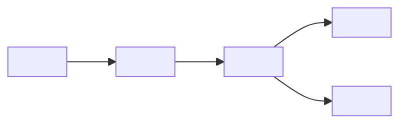

# Handover Pack: <Customer>: <System name>

*Version: <n> · Date: <YYYY-MM-DD> · Handing over: <FDE team> · Receiving: <customer team / support team / partner> · Status: draft / in transition / accepted*

## How to use this template

- **Purpose:** collect everything the receiving team needs to run, support and change the system without the forward deployed engineers, and define how both sides will know the handover has worked. A system that only the FDE understands is a liability, for the customer and for your company.
- **When:** start in Phase 4 (Productionise), fill it in as you build, and complete it in Phase 6 (Hand over) of the [engagement lifecycle](../chapters/04-engagement-lifecycle.md). Writing it at the end, from memory, produces a document nobody can use.
- **Owner:** the lead FDE, with the receiving team's lead as co-author: they should write the runbooks in their own words while pairing with you.
- **Sign-off:** the receiving team's lead and the customer's business owner, once the acceptance criteria in §13 are met; your engagement lead on your side.

Background reading: [Chapter 15](../chapters/15-production-and-handover.md).

*Test every section by asking: "Could someone who joined the receiving team last week do this at 3 a.m. with only this document?"*

---

## 1. System overview

| Item | Entry |
|---|---|
| What the system does (two or three sentences, business terms) | |
| Users and volumes | |
| Business owner | |
| Technical owner (after handover) | |
| Criticality / service tier | <customer's scale> |
| Hours of use | |
| Success plan and latest impact report | <links> |

## 2. Architecture



| Component | Purpose | Technology | Hosted where | Repository / config location | Owner after handover |
|---|---|---|---|---|---|
| | | | | | |

**Key design decisions** *(link architecture decision records where they exist):*

| Decision | Why | Alternatives rejected |
|---|---|---|
| | | |

## 3. Environments

| Environment | Purpose | URL / location | Data (real / masked / synthetic) | Deployment method | Who can deploy |
|---|---|---|---|---|---|
| Development | | | | | |
| Test / staging | | | | | |
| Production | | | | | |

## 4. Access

| Access | Who needs it | How to request | Approver | Notes |
|---|---|---|---|---|
| Production console / cloud account | | | | |
| Code repository | | | | |
| Secrets vault | | | | |
| Monitoring and logs | | | | |
| Model provider / API keys | | | | |
| Source-system service accounts | | | | |

**Supplier access after handover:** <removed on <date> / retained for support under <terms>>

*Remove FDE personal accounts at the end of the handover and record it. List every credential and when it next rotates.*

| Credential / certificate | Used by | Stored in | Expires / rotates | Rotation procedure |
|---|---|---|---|---|
| | | | | |

## 5. Runbooks

*One runbook per routine or failure scenario. Each: trigger, impact, diagnosis steps, fix, verification, escalation.*

| Runbook | Trigger | Link | Last tested (date, by whom) |
|---|---|---|---|
| Deploy a new release | Planned change | | |
| Roll back a release | Failed deployment | | |
| Restart / recover a failed pipeline run | Alert <name> | | |
| Source system unavailable | Alert <name> | | |
| Model provider outage or degraded quality | Alert <name> / user reports | | |
| Disable the AI component (kill switch) | Harmful or wrong outputs | | |
| Rotate secrets | Scheduled / suspected compromise | | |
| Add or remove a user / group | Request | | |
| Restore from backup | Data loss | | |

**Runbook format:**

```
Title:
Trigger / symptoms:
Impact on users:
Diagnosis:  1. ...  2. ...
Fix:        1. ...  2. ...
Verify:
Escalate to (if not fixed in <n> minutes):
```

## 6. Monitoring and alerts

| Signal | Tool / dashboard | Threshold | Alert goes to | Runbook |
|---|---|---|---|---|
| Availability | | | | |
| Latency | | | | |
| Pipeline freshness | | | | |
| Error rate | | | | |
| Model quality (sampled evaluation, user feedback rate) | | | | |
| Cost / usage (model tokens, compute) | | | | |
| Security events | | | | |

## 7. Known issues and limitations

| # | Issue / limitation | Impact | Workaround | Planned fix / owner | Field report raised? |
|---|---|---|---|---|---|
| | | | | | |

*Be candid. An issue the receiving team discovers on their own costs more trust than one you told them about.*

## 8. Support model and escalation

| Level | Who | Hours | Handles | Response target |
|---|---|---|---|---|
| L1 (user support / service desk) | | | | |
| L2 (receiving technical team) | | | | |
| L3 (supplier product support) | | | | |
| Supplier FDE (time-limited, if agreed) | | <until date> | | |

**Severity definitions:**

| Severity | Definition | Example |
|---|---|---|
| 1 | | |
| 2 | | |
| 3 | | |

**Escalation contacts:** <names, roles, contact routes; supplier support portal>

## 9. Evaluation and regression suite (AI components)

| Item | Entry |
|---|---|
| Evaluation dataset(s): location, size, last refreshed | |
| How to run the suite | <command / pipeline> |
| Pass thresholds | |
| When it must run | <every prompt, config, model or retrieval change; before model version upgrades; monthly> |
| Who reviews failures | |
| How to add new cases from production incidents | |
| Latest results | <link, date> |

*Prompts, retrieval settings and model versions are code. Changes without a regression run are the most common cause of silent quality loss after handover.*

## 10. Configuration and code ownership

| Asset | Location | Owner after handover | Change process | Notes |
|---|---|---|---|---|
| Customer-specific code (integrations, pipelines) | | | | |
| Product configuration | | | | |
| Prompts and templates | | | | |
| Infrastructure as code | | | | |
| Dashboards | | | | |
| Product features built during the engagement (now in the core product) | Supplier product | Supplier | Product release process | |

*No orphan code: every piece of code has a named owner after the FDE leaves, or it is deleted.*

## 11. Documentation index

| Document | Link |
|---|---|
| Success plan | |
| Security and AI risk review | |
| Architecture decision records | |
| Data mapping / lineage | |
| User guide | |
| Training materials | |

## 12. Training record

| Session | Audience | Date | Trainer | Attendees | Materials | Competence check (how verified) |
|---|---|---|---|---|---|---|
| System walkthrough | Receiving team | | | | | |
| Runbook drills (deploy, rollback, kill switch) | Receiving team | | | | | Performed unaided |
| Evaluation suite | Receiving team | | | | | |
| End-user training | Users | | | | | |

## 13. Acceptance criteria

*The handover is complete when the receiving team has run the system without help, not when the documents exist.*

| # | Criterion | Evidence | Met? |
|---|---|---|---|
| 1 | Receiving team has operated the system **unaided for an agreed period** of <e.g. two weeks> (dates: <from–to>) | Operations log; no FDE interventions | ☐ |
| 2 | During that period the receiving team handled **at least one incident or change** end to end (real, or a planned drill if none occurred) | Ticket / change record | ☐ |
| 3 | Receiving team has deployed and rolled back a release themselves | Change record | ☐ |
| 4 | Receiving team has run the evaluation suite and interpreted the results | Run record | ☐ |
| 5 | All runbooks reviewed and tested by the receiving team | Runbook table, §5 | ☐ |
| 6 | Access transferred; FDE personal access removed or time-limited | Access table, §4 | ☐ |
| 7 | Known issues reviewed and accepted, with owners | §7 | ☐ |
| 8 | Support model agreed and service desk briefed | §8 | ☐ |
| 9 | <Other agreed criterion> | | ☐ |

**Unaided operation log:**

| Date | Event (incident / change / routine task) | Handled by | FDE help needed? | Notes |
|---|---|---|---|---|
| | | | Yes / no | |

**Example (filled):**

| Date | Event | Handled by | FDE help needed? | Notes |
|---|---|---|---|---|
| 2026-12-03 | Carrier API certificate expired; inbound feed stopped | Wide World Importers integration team (L2) | No | Followed "rotate secrets" runbook; feed restored in 40 min; runbook updated with certificate location |

## 14. Sign-off

| Role | Name | Organisation | Accepted (yes / with conditions) | Date |
|---|---|---|---|---|
| Receiving team lead | | <Customer> | | |
| Business owner | | <Customer> | | |
| Engagement lead | | <Your company> | | |

**Conditions / follow-ups:** <…>
