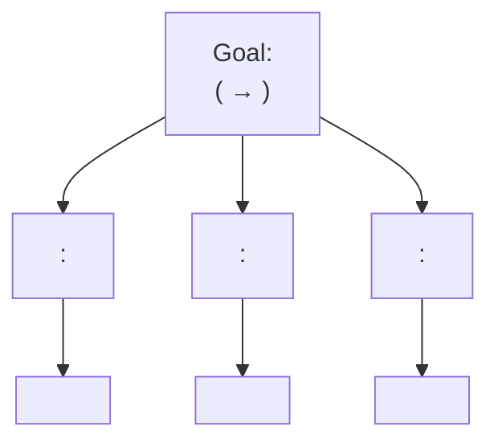
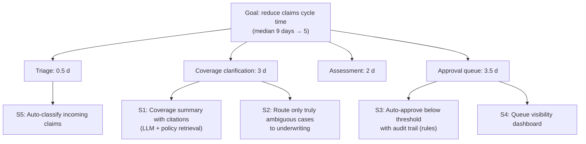

# Problem Decomposition Canvas: <Customer>: <Goal in a few words>

*Version: <n> · Date: <YYYY-MM-DD> · Prepared by: <FDE name(s)> · Reviewed with: <customer owner>*

## How to use this template

- **Purpose:** turn an ambiguous goal ("use AI to speed up claims") into a structured set of sub-problems, each concrete enough to build and measure, then choose the first slice. **Decomposition** means breaking the measurable outcome into the business drivers that produce it, and only then asking what to build for each driver.
- **When:** the end of Phase 1 (Discover) and the start of Phase 2 (Frame and scope) in the [engagement lifecycle](../chapters/04-engagement-lifecycle.md). Revisit it when evidence changes the picture, and when choosing the next use case in Phase 7.
- **Owner:** the lead FDE, working with the customer's day-to-day owner and subject-matter experts.
- **Sign-off:** the customer's executive sponsor agrees the measurable outcome, the baseline and the recommended first slice (usually at the discovery readout). The value estimate should be checked by the customer's finance team.
- **Inputs:** notes and maps from the [discovery guide](discovery-guide.md). **Output:** the first slice and its success criteria flow into the [success plan](success-plan.md).

Background reading: [Chapter 5 §5.7–5.8](../chapters/05-discovery-and-decomposition.md).

*Decompose by business driver, not by technology. "Ingestion, model, UI" is a build plan, not a decomposition. Good sub-solutions are often not AI at all: rules, a dashboard or a routing change may deliver more, faster.*

---

## 1. Goal (in the customer's words)

<The goal as the sponsor would say it, e.g. "Reduce claims processing time.">

*If the customer stated a solution ("we need a chatbot"), write it here too, then ask what it is for and write that as the goal.*

Stated solution, if any: <…>

## 2. Measurable outcome and baseline

| Item | Entry |
|---|---|
| Outcome metric (precise definition) | <e.g. median time from X to Y> |
| Unit and population | <which cases, which teams, which period> |
| Baseline value | <value> |
| Baseline source and date | <system / report / sample; date range> |
| Baseline confidence | High / medium / low; *why* |
| Target | <value> by <date> |
| Who owns this number today | <name, role> |

*No baseline? Write down how and when you will measure one. You cannot claim impact against a number nobody measured.*

## 3. Driver breakdown

*Where does the outcome come from? Break it into drivers that add up (or multiply) to the outcome. Use evidence from shadowing and system data, not only interviews.*

| Driver | Contribution to outcome | Evidence | Controllable by this engagement? |
|---|---|---|---|
| | | | Yes / partly / no |
| | | | |
| | | | |
| **Total** | <should reconcile to the baseline> | | |



## 4. Decisions and information needed per driver

| Driver | Decision being made | Who makes it | Information needed | Where that information lives today | What makes it slow or wrong |
|---|---|---|---|---|---|
| | | | | | |

## 5. Users and workflow change

| Sub-solution | Primary users | Current workflow (one line) | Future workflow (one line) | What they stop doing | Change-management concerns |
|---|---|---|---|---|---|
| | | | | | |

*A perfect prediction nobody acts on is worthless. If you cannot name the user and the moment they act, the sub-solution is not ready.*

## 6. Data, integration and model capabilities

| Sub-solution | Data sources | Integrations (read / write) | Model or logic capability | Product fit (configure / extend / change; see [Chapter 11](../chapters/11-configure-extend-change.md)) | Unknowns to test |
|---|---|---|---|---|---|
| | | | | | |

## 7. Value and feasibility scoring

*Score each sub-solution. Use conservative numbers and state assumptions. Feasibility and risk use High / Medium / Low; "time to value" is weeks to the first measurable result.*

**Value formula:**

```
annual_value ≈ (people affected) × (hours saved per person per week) × (weeks per year) × (loaded hourly cost)
             + (error reduction) × (cost per error)
             + (revenue uplift)
```

*The book's [impact calculator](../examples/impact-calculator/) automates this and records assumptions.*

| # | Sub-solution | Value (£/yr or other unit) | Data feasibility | Technical feasibility | Organisational feasibility | Time to value (weeks) | Risk (safety, compliance, reputation) | Notes / assumptions |
|---|---|---|---|---|---|---|---|---|
| S1 | | | H / M / L | H / M / L | H / M / L | | L / M / H | |
| S2 | | | | | | | | |
| S3 | | | | | | | | |
| S4 | | | | | | | | |
| S5 | | | | | | | | |

*Look for the "lighthouse": high value, high feasibility, short time to value, low risk. Avoid starting with the hardest, highest-risk problem, however exciting.*

## 8. Recommended first slice

| Item | Entry |
|---|---|
| Sub-solution(s) chosen | |
| Why this first (value, feasibility, foundations it builds) | |
| Thin end-to-end slice (source data → logic → user-facing output) | |
| Pilot users | |
| Success criterion for the slice (metric, baseline, target) | |
| What it unlocks next | |
| What we are deliberately not doing yet, and why | |
| Biggest open risk and how we will test it in week 1–2 | |

**Agreed by:** <sponsor name, role> · <date>

---

## Worked example: Northwind claims cycle time

*Fictional. Northwind is a mid-sized property insurer. Figures follow [Chapter 5](../chapters/05-discovery-and-decomposition.md).*

### 1. Goal

"Reduce claims processing time." Stated solution: "an AI assistant for adjusters".

### 2. Measurable outcome and baseline

| Item | Entry |
|---|---|
| Outcome metric | Median time from claim receipt to payment decision |
| Unit and population | Home and contents claims, all regions, calendar days |
| Baseline value | 9 days |
| Baseline source and date | Claims system extract, 1 January – 30 June 2026 (≈ 14,000 claims) |
| Baseline confidence | High for total; medium for driver split (from 40 sampled claims plus shadowing) |
| Target | 5 days within six months of go-live |
| Who owns this number today | Head of Claims Operations |

### 3. Driver breakdown

| Driver | Contribution | Evidence | Controllable? |
|---|---|---|---|
| Triage | 0.5 days | Claims system timestamps; shadowing (~12 min of work, rest is queue) | Yes |
| Coverage clarification | 3 days | Sampled claims; adjusters email underwriting and wait 1–3 days | Yes |
| Assessment | 2 days | Timestamps; site visits for larger claims | Partly |
| Approval queue | 3.5 days | Timestamps; all payments above a low threshold need a second approver | Yes (rule change needs Finance) |
| **Total** | **9 days** | Reconciles to baseline median | |



### 4. Decisions and information (excerpt)

| Driver | Decision | Who | Information needed | Where it lives | What makes it slow |
|---|---|---|---|---|---|
| Coverage clarification | Is this loss covered, and under which clause? | Adjuster (underwriter if unclear) | Policy terms, endorsements, claim facts | Policy admin system and scanned PDF schedules | Endorsements not in the system; email round-trips to underwriting |
| Approval queue | Approve payment? | Second approver in Finance | Amount, assessment, fraud flags | Claims system | Low threshold sends most claims to a small team |

### 5. Users and workflow change (excerpt)

| Sub-solution | Users | Current | Future | Stop doing | Concerns |
|---|---|---|---|---|---|
| S1 | 60 adjusters | Read PDFs, email underwriting, wait | See a coverage summary with clause citations in the claims screen | Most underwriting emails | Trust in AI output; underwriting sees fewer but harder cases |

### 6. Capabilities (excerpt)

| Sub-solution | Data | Integrations | Capability | Product fit | Unknowns |
|---|---|---|---|---|---|
| S1 | Policy PDFs, policy system, claims system | Read policy API; read claims; UI panel in claims system | LLM extraction + retrieval index with citations | Extend (retrieval connector + UI panel) | Scan quality of older PDFs; accuracy on endorsements |
| S3 | Claims, assessments, fraud flags | Write approval status | Rules engine | Configure | Finance appetite for a higher threshold |

### 7. Scoring

*Value for S1: 60 adjusters × 3 hours/week × 46 weeks × £45/hour ≈ **£373,000 per year** in adjuster time, before counting faster settlement and customer satisfaction. Finance to validate the £45 loaded rate.*

| # | Sub-solution | Value | Data | Technical | Organisational | Time to value | Risk | Notes |
|---|---|---|---|---|---|---|---|---|
| S1 | Coverage summary with citations | ≈ £373k/yr; up to −2 days | M (PDF quality varies) | M (test on 200 real claims first) | H (adjusters asked for it) | 6 | M (wrong coverage advice) | Human stays the decision-maker; citations mandatory |
| S2 | Route only ambiguous cases to underwriting | Part of the 3 days | H | H | M (underwriting must agree criteria) | 4 | L | Depends on S1 confidence signal |
| S3 | Auto-approve below threshold | Up to −2.5 days on eligible claims | H | H | M (Finance sign-off) | 3 | M (leakage, fraud) | Not AI; audit trail and sampling required |
| S4 | Queue visibility dashboard | Indirect; exposes bottlenecks | H | H | H | 2 | L | Quick credibility win |
| S5 | Auto-classify incoming claims | ≤ 0.5 days | H | H | H | 4 | L | Small prize |

### 8. Recommended first slice

| Item | Entry |
|---|---|
| Chosen | S1 (coverage summary) for one region, plus S4 (dashboard) in parallel |
| Why | S1 attacks the largest controllable driver and adjusters want it; S4 delivers visible value in two weeks and builds the measurement we need anyway. S3 is proposed to Finance as phase 2 because it needs a policy decision, not engineering. |
| Thin slice | Policy PDFs for the North region → retrieval index → summary with citations shown in a claims-system side panel → adjuster feedback button |
| Pilot users | 12 adjusters, North region |
| Success criterion | Median coverage-clarification time for pilot claims from 3 days to ≤ 1 day; ≥ 95% of summaries rated "correct or minor edits" by adjusters on an evaluation set of 200 claims |
| Unlocks | S2 routing; extension to all regions |
| Not doing yet | S5 (small value); any automated coverage decision (risk) |
| Biggest open risk | Older scanned PDFs; test extraction on 50 of the worst in week 1 |
