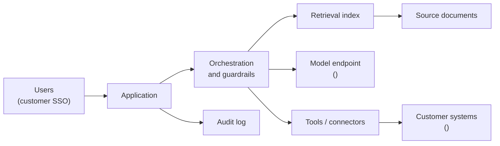

# Security and AI Risk Review: <Customer>: <System name>

*Version: <n> · Date: <YYYY-MM-DD> · Status: draft / submitted / approved with conditions / approved / rejected · Customer review reference: <ticket / questionnaire ID>*

> **Not legal or compliance advice.** Regulatory sections below are prompts for the right conversations, current as of October 2026. The customer's privacy, legal and compliance teams decide how regulations apply; regulatory timelines (notably the EU AI Act's) have been changing, so check current dates before relying on them.

## How to use this template

- **Purpose:** give the customer's security, privacy, risk and compliance reviewers one document that describes what the system does, what data it touches, how AI components could fail or be attacked, and what controls are in place, with evidence. A clear review document turns a months-long back-and-forth into a few focused meetings.
- **When:** start a draft in Phase 2 (Frame and scope), as soon as the architecture is sketched, because security review is often on the critical path. Submit for approval before production in Phase 4 (Productionise) of the [engagement lifecycle](../chapters/04-engagement-lifecycle.md). Update it whenever the model, provider, data or tools change.
- **Owner:** the lead FDE, with your company's security team for vendor evidence.
- **Sign-off:** the customer's information security lead, data protection officer (or privacy lead), model risk or AI governance lead where one exists, and the business owner who accepts residual risk. On your side, your security lead.
- **Use their format if they have one.** Many customers send their own questionnaire; answer it, and attach this document as the narrative it lacks.

Background reading: [Chapter 14](../chapters/14-security-and-restricted-environments.md), [Chapter 12](../chapters/12-ai-deployment.md) and [Chapter 13](../chapters/13-evaluation-and-impact.md).

*Write for a sceptical reviewer who has never seen your product. Be specific ("TLS 1.2+ between the connector and the API gateway"), not reassuring ("industry-standard security"). State residual risks honestly; reviewers trust documents that admit limitations.*

---

## 1. System description

| Item | Entry |
|---|---|
| System name and version | |
| Business purpose (one paragraph) | |
| Users (roles, number, internal / external) | |
| Decisions the system supports or makes | |
| Degree of automation | Advisory only / human approves every action / automated with sampling / fully automated |
| Deployment model | Supplier SaaS / customer cloud tenancy / on-premises / air-gapped |
| Components | <UI, API, orchestration, retrieval index, model endpoint, connectors, databases> |
| Business owner (customer) | |
| Technical owner (customer, after handover) | |

**Architecture diagram:**

## 2. Data flows and classification

*List every flow, including to logs, monitoring and the model provider. Use the customer's classification scheme.*

| # | From | To | Data elements | Classification (customer scheme) | Personal data? (category) | Volume / frequency | Transport protection | At-rest protection |
|---|---|---|---|---|---|---|---|---|
| F1 | | | | | No / yes: <ordinary / special category> | | | |
| F2 | | | | | | | | |
| F3 | | | | | | | | |

*Special-category data (health, biometric, religious belief, etc. under GDPR) and payment card, health or government-classified data usually trigger additional reviews. Say early whether you will touch them.*

**Data minimisation:** <what is excluded, masked or pseudonymised before reaching the model, and how>

## 3. Model and provider details

| Item | Entry |
|---|---|
| Model(s) and version(s) | <name, version / snapshot ID> |
| Provider and contracting entity | |
| Hosting | <provider API / cloud marketplace endpoint in customer tenancy / self-hosted open-weight model> |
| Provider's data use | <Is prompt / output data used for training? Contract reference> |
| Provider retention of prompts and outputs | <duration; zero-retention option?> |
| Provider sub-processors | |
| Fine-tuning or training on customer data | No / yes: <what, where, who owns the result> |
| Model change management | <How model version upgrades are tested (regression evaluation) and approved> |
| Fallback if provider unavailable | |

## 4. Data residency

| Data / processing | Location (country / region) | Contractual commitment | Transfers outside region? Mechanism |
|---|---|---|---|
| Application data | | | |
| Retrieval index | | | |
| Model inference | | | |
| Logs and monitoring | | | |
| Support access (supplier staff locations) | | | |

## 5. Retention and deletion

| Data | Retention period | Where | Deletion method | Who can trigger deletion |
|---|---|---|---|---|
| Prompts and outputs | | | | |
| Retrieved document chunks / embeddings | | | | |
| Audit logs | | | | |
| Evaluation datasets | | | | |
| Backups | | | | |

*Embeddings and evaluation sets derived from customer data are customer data. Include them.*

## 6. Access control

| Item | Entry |
|---|---|
| User authentication | <customer SSO (SAML / OIDC), MFA> |
| Authorisation model | <roles; mapping to customer groups> |
| Permission-aware retrieval | <Does the system only retrieve documents the user is already allowed to see? How are source permissions enforced and kept in sync?> |
| Service accounts and secrets | <scopes, storage (vault), rotation> |
| Least privilege for tools | <each tool's permissions; read vs write> |
| Supplier staff access | <who, when, how approved, logged> |
| Joiners / movers / leavers | <how access is removed> |

## 7. Prompt injection and tool risks

*Prompt injection is when text the model reads (an email, a document, a web page, a database field) contains instructions that the model follows instead of, or as well as, the user's and system's instructions. It matters most when the system can take actions through tools or can reach data the attacker cannot.*

| Question | Answer |
|---|---|
| Which untrusted content can reach the model? (emails, uploaded files, web, user free text, third-party data) | |
| Which tools can the model call? Read-only or with side effects? | |
| Can the model send data outside the organisation (email, HTTP, file write)? | |
| Which actions require human confirmation before execution? | |
| Are tool parameters validated against allow-lists and schemas outside the model? | |
| Are model outputs rendered safely (no active content, links checked)? | |
| Rate limits and spend limits | |
| Red-team / adversarial testing done (scope, date, results) | |

## 8. Evaluation evidence

| Evaluation | Dataset (size, source, date) | Metric | Result | Threshold | Reviewer |
|---|---|---|---|---|---|
| Task quality | | | | | |
| Critical / harmful errors | | | | | |
| Groundedness / citation accuracy | | | | | |
| Prompt-injection resistance | | | | | |
| Fairness / performance across relevant groups (if decisions affect people) | | | | | |
| Regression suite (run on each change) | | | | | |

*Link the evaluation report. Describe known failure modes plainly; see [Chapter 13](../chapters/13-evaluation-and-impact.md).*

## 9. Human oversight

| Item | Entry |
|---|---|
| Where a human reviews, approves or can override | |
| Information shown to the reviewer (sources, confidence, reasons) | |
| Training given to reviewers, including on over-reliance | |
| How users report a wrong or harmful output | |
| Kill switch: who can disable the AI component, how fast, and what happens to the workflow | |

## 10. Logging, monitoring and audit

| Item | Entry |
|---|---|
| What is logged (user, input, retrieved sources, model version, output, tool calls, approvals) | |
| Personal data in logs and how it is protected | |
| Log retention and access | |
| Integration with customer SIEM / monitoring | |
| Quality monitoring in production (sampling, drift, user feedback) | |
| Alerts and thresholds | |

## 11. Incident response

| Item | Entry |
|---|---|
| Incident types covered (security breach, data leak, harmful output, outage, provider incident) | |
| Detection | |
| Supplier notification commitment to customer | <e.g. within <n> hours of becoming aware> |
| Customer contacts and escalation | |
| Containment options (disable tool, disable AI, revert model version) | |
| Personal-data breach process (GDPR: notify the supervisory authority within 72 hours where required) | |
| Post-incident review | |

## 12. Regulatory mapping

*Prompts only; the customer's teams decide applicability. Delete rows that clearly do not apply and say why.*

| Regime | Applies? | Relevant obligations / questions | How addressed | Evidence |
|---|---|---|---|---|
| **GDPR / UK GDPR** | | Lawful basis; controller / processor roles and DPA; data minimisation; transparency to data subjects; data protection impact assessment (DPIA) if high risk; rights around solely automated decisions with legal or similarly significant effects (Article 22); international transfers | | |
| **EU AI Act** | | Risk categorisation: prohibited practice? High-risk (Annex III use cases such as employment, credit scoring, access to essential services; or AI in regulated products)? Transparency obligations (e.g. telling people they are interacting with AI; labelling synthetic content)? Minimal risk? Roles (provider vs deployer). Obligations for general-purpose AI models fall mainly on the model provider. *Phased application from 2025; check current dates for high-risk obligations (as of October 2026).* | | |
| **Sector rules: health (e.g. US HIPAA)** | | Is the supplier a business associate? Business associate agreement (BAA) in place, including with the model provider? Minimum necessary standard | | |
| **Sector rules: financial services** | | e.g. model risk management expectations; outsourcing and operational resilience rules (EU DORA, UK operational resilience); consumer duty / fair treatment | | |
| **Sector rules: other** | | <public sector, defence, telecoms, education> | | |
| **Customer internal policies** | | AI acceptable-use policy; data classification policy; third-party risk policy | | |

### Vendor assurance evidence

| Evidence | Held? | Scope covers this system? | Date / period | Link |
|---|---|---|---|---|
| SOC 2 Type II report (supplier) | | | | |
| ISO/IEC 27001 certificate (supplier) | | | | |
| ISO/IEC 42001 (AI management system), if held | | | | |
| Model provider's SOC 2 / ISO 27001 | | | | |
| Penetration test summary | | | | |
| Data processing agreement | | | | |
| Sub-processor list | | | | |

*Check scope: a certificate that covers the supplier's corporate IT but not the hosted platform answers less than it seems to.*

## 13. Threat table

*One row per credible threat. Likelihood and impact use the customer's risk scale if they have one.*

| # | Threat | Asset / data at risk | Likelihood | Impact | Controls | Residual risk | Owner |
|---|---|---|---|---|---|---|---|
| T1 | Indirect prompt injection via a retrieved document causes a tool call that exfiltrates data | Customer records | | | Read-only tools; no outbound network tools; parameter allow-lists; human confirmation for writes | | |
| T2 | Retrieval returns a document the user is not authorised to see | Confidential documents | | | Permission-aware retrieval enforced at query time; nightly permission sync; tests | | |
| T3 | Model produces confident but wrong output that a user acts on | Business decisions | | | Citations; evaluation thresholds; human review; user training | | |
| T4 | Provider retains or uses prompts containing personal data | Personal data | | | Zero-retention contract; minimisation; DPA | | |
| T5 | Compromised service-account secret | Connected systems | | | Vault; rotation; least privilege; alerting | | |
| T6 | Model version change degrades quality silently | Output quality | | | Pinned versions; regression suite before upgrade | | |
| T7 | Cost runaway (loops, abuse) | Budget, availability | | | Rate and spend limits; alerts | | |
| T8 | | | | | | | |

## 14. Open issues and conditions

| # | Issue / condition of approval | Owner | Due | Status |
|---|---|---|---|---|
| | | | | |

## 15. Sign-offs

| Role | Name | Organisation | Decision (approve / approve with conditions / reject) | Date |
|---|---|---|---|---|
| Information security lead | | <Customer> | | |
| Data protection officer / privacy lead | | <Customer> | | |
| AI governance / model risk lead | | <Customer> | | |
| Business owner (accepts residual risk) | | <Customer> | | |
| Security lead | | <Your company> | | |
| FDE lead (author) | | <Your company> | | |

**Re-review triggers:** new model or provider; new data category; new tool with side effects; new user population; material incident; <n> months elapsed.

---

## Example (filled excerpt)

*Fictional: Fabrikam Health, a UK private hospital group, deploying a discharge-summary drafting assistant.*

| Item | Entry |
|---|---|
| Business purpose | Drafts discharge summaries from the electronic patient record for a clinician to review, edit and sign |
| Degree of automation | Human approves every output; nothing is sent to patients or GPs without clinician signature |
| Deployment model | Customer cloud tenancy, UK South region; model accessed through a cloud-marketplace endpoint in the same tenancy |
| Data | Special-category health data; minimised to the current admission; no free-text from previous admissions |
| Provider data use | No training on customer data; no prompt retention beyond abuse-monitoring exemption agreed in contract (reference <…>) |
| UK GDPR | Fabrikam is controller, supplier is processor; DPIA completed and reviewed by DPO on <date> |
| EU AI Act | UK-only deployment; Fabrikam's AI governance group asked for an Act-style risk assessment anyway for its EU clinics later |
| Kill switch | Clinical safety officer can disable drafting per ward from the admin console; clinicians fall back to the existing template |
