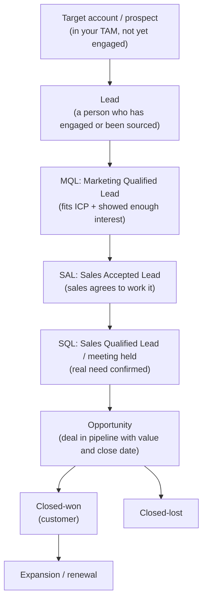

# Chapter 3. How B2B Companies Sell: Motions, Funnels and Metrics

> "You can't automate a process you don't understand."

## What you will learn

- The main go-to-market motions: inbound, outbound, product-led, account-based, partner-led.
- The funnel stages and their acronyms (lead, MQL, SQL, SAL, opportunity, closed-won).
- The metrics that GTM engineers are judged on, with formulas: conversion rates, pipeline, win rate, sales cycle, ACV, CAC, payback, LTV, NRR.
- How deal size shapes which motions and systems make sense.

Appendix B collects every formula in this chapter in one place.

---

## 3.1 Why a technical reader must learn this

The systems you build exist to move buyers through a commercial process. If you do not know what an SQL is, why pipeline coverage matters, or why an enterprise deal is handled differently from a $50/month self-serve plan, you will build the wrong thing very efficiently. This chapter is the commercial foundation for everything that follows.

---

## 3.2 GTM motions

A **motion** is a repeatable way of acquiring customers. Most companies run several.

| Motion | How buyers arrive | Typical deal size | GTM engineering focus |
|---|---|---|---|
| **Inbound** | Buyers find you (search, content, referrals) and raise their hand (demo request, sign-up, download) | Any | Form enrichment, instant routing, qualification, nurture |
| **Outbound** | You reach out first (email, phone, LinkedIn) to people who have not asked | Mid to large | List building, enrichment, signals, sequences, deliverability |
| **Product-led growth (PLG)** | Users sign up and use the product (free trial or freemium), then buy, often self-serve | Small to mid, expanding to large | Product signals, PQLs, user-to-account mapping, sales-assist plays |
| **Account-based (ABM / ABX)** | A defined list of high-value accounts is targeted with coordinated sales and marketing | Large / enterprise | Account selection, buying-committee mapping, intent, orchestration |
| **Partner-led / ecosystem** | Partners (resellers, integrations, marketplaces, agencies) source or influence deals | Varies | Partner attribution, co-selling data, marketplace listings |
| **Community-led** | Buyers come through a community (Slack groups, open source, events) | Varies | Community signals, user-to-account resolution |
| **Expansion (land and expand)** | Existing customers buy more seats, products or tiers | Varies | Usage signals, whitespace analysis, renewal and upsell alerts |

**Sales-led vs product-led** is the biggest strategic split. In a sales-led company, revenue flows through salespeople and the CRM is the centre of the universe. In a product-led company, revenue flows through the product, the warehouse holds the most important data, and sales assists the users most likely to expand. Many companies are hybrid: **product-led sales**.

---

## 3.3 The funnel and its vocabulary

A **funnel** is a sequence of stages a potential buyer moves through. Terminology varies by company; this is the most common version.

Key terms:

| Term | Meaning |
|---|---|
| **Prospect** | A person or company you might sell to. |
| **Lead** | A person record, usually from a form, event, import or sourcing. In Salesforce, the *Lead* object is separate from *Contact* (Chapter 5). |
| **MQL** (marketing qualified lead) | A lead marketing judges ready for sales, typically by fit and engagement score. |
| **PQL** (product qualified lead) | A user or account whose *product usage* indicates buying potential. |
| **SAL** (sales accepted lead) | Sales has accepted the lead for follow-up. |
| **SQL** (sales qualified lead) | Sales has confirmed a real opportunity, often after a first meeting. Some companies treat "meeting booked" or "meeting held" as the SDR's output. |
| **Opportunity / deal** | A potential sale tracked in the CRM with an amount, a stage and an expected close date. |
| **Pipeline** | The total value of open opportunities, or the newly created pipeline in a period. |
| **Closed-won / closed-lost** | The outcome of an opportunity. |
| **Buying committee** | The several people involved in a B2B purchase: economic buyer, champion, technical evaluator, end users, procurement, legal. Gartner research has long found B2B purchases involve many stakeholders, often 6–10. |
| **Qualification frameworks** | Checklists sellers use: BANT (Budget, Authority, Need, Timeline), MEDDIC/MEDDPICC (Metrics, Economic buyer, Decision criteria, Decision process, Paper process, Identify pain, Champion, Competition), SPICED. |

Opportunity **stages** (for example Discovery → Solution validation → Proposal → Negotiation → Closed) each carry a **probability**, used in forecasting.

### Why definitions matter to you

Your automation will create records, set stages and fire alerts based on these definitions. If "MQL" means three different things to three teams, your scoring model and your dashboards will be wrong. **Write definitions down and agree them with sales and marketing leadership.** A template is in [`templates/funnel-definitions.md`](../templates/funnel-definitions.md).

---

## 3.4 Metrics that matter

### Volume and conversion

- **Stage conversion rate** = records reaching stage *n+1* ÷ records reaching stage *n* (for a cohort).
- **Lead-to-meeting rate**, **meeting-to-opportunity rate**, **opportunity win rate** (= closed-won ÷ (closed-won + closed-lost), by count or by value).
- **Reply rate** (outbound) = replies ÷ delivered emails, and **positive reply rate** (interested replies). Measure **meetings booked** and **pipeline created**, not replies alone.

Always measure conversion by **cohort** (all leads created in March) rather than by period counts (leads in March vs opportunities in March). Deals take time to convert, so period ratios mislead.

### Pipeline

- **Pipeline created** = value of new opportunities in a period. This is the headline metric for most GTM engineering work.
- **Pipeline coverage** = open pipeline for the period ÷ revenue target for the period. A common rule of thumb is 3–4×, since only a fraction closes.
- **Pipeline velocity** = (number of opportunities × average deal size × win rate) ÷ average sales cycle length (days). It is revenue per day. Each term is a lever your systems can pull.

### Deal economics

- **ACV** (annual contract value): average annualised value of a contract. **ARR** (annual recurring revenue): annualised value of all active subscriptions.
- **Sales cycle length**: days from opportunity creation (or first touch) to close.
- **CAC** (customer acquisition cost) = total sales and marketing cost in a period ÷ new customers acquired in that period. Also **blended** vs **paid** CAC, and **cost per meeting** or **cost per opportunity** for specific plays.
- **CAC payback period** (months) = CAC ÷ (new monthly recurring revenue per customer × gross margin). Under 12–18 months is often considered healthy for SaaS; it varies by segment and capital environment.
- **LTV** (lifetime value) ≈ (ARPA × gross margin) ÷ churn rate, where ARPA is average revenue per account per period. **LTV:CAC** of about 3:1 is a classic benchmark.
- **NRR** (net revenue retention) = (starting ARR + expansion − contraction − churn) ÷ starting ARR, over a year. Above 100% means existing customers grow faster than they churn.
- **GRR** (gross revenue retention) excludes expansion.

### Efficiency

- **SaaS magic number** = net new ARR in a quarter ÷ sales and marketing spend in the previous quarter. Definitions vary slightly between companies; above roughly 0.7 is often read as efficient growth.
- **Meetings per SDR per month**, **pipeline per rep**, **cost per meeting** for automated plays.
- **Speed to lead**: time from inbound request to first human (or meaningful) response (Chapter 9).

### Worked example

A company targets $3M new ARR this year. Average ACV is $30k, so it needs 100 new customers. The opportunity win rate is 25%, so it needs 400 opportunities. Meetings convert to opportunities at 50%, so it needs 800 qualified meetings, about 67 a month. If outbound plays convert positive replies to meetings at 50% and positive replies are 1% of delivered emails, outbound alone would need about 13,400 delivered emails a month for those meetings. Doubling relevance (a 2% positive reply rate) halves the required volume, and with it the deliverability risk. This kind of **reverse funnel** calculation is how GTM engineers size plays. A calculator is in [`examples/funnel-metrics/`](../examples/funnel-metrics/).

---

## 3.5 Segments and deal size

The same company often runs different motions per segment:

| Segment (example definitions) | Typical ACV | Typical motion | Systems emphasis |
|---|---|---|---|
| **SMB** (1–100 employees) | < $10k | Self-serve, PLG, inside sales | High-volume automation, product signals, low-touch |
| **Mid-market** (100–1,000) | $10k–$100k | Inbound + outbound, SDR/AE | Enrichment, signals, routing, sequences |
| **Enterprise** (1,000+) | $100k+ | Account-based, field sales | Account intelligence, buying-committee mapping, ABM orchestration, partner data |

The rule: **the higher the deal value, the more each touch is worth, so the more research and personalisation each prospect deserves.** Automating a $500k enterprise opportunity like a $500 SMB sale is a mistake, and so is the reverse.

---

## 3.6 How GTM engineering moves the numbers

| Lever | Example system |
|---|---|
| More of the right accounts in the funnel | Better TAM, enrichment, signal-based targeting |
| Higher conversion at each stage | Relevant messaging, better timing (signals), fast routing |
| Larger deals | Targeting by fit score; identifying expansion |
| Shorter cycles | Speed-to-lead; multithreading the buying committee |
| Lower cost | Automated research replacing manual work; cheaper data through waterfalls and caching |
| Better decisions | Clean data and attribution by play |

Measure your own work in these terms. "Built an enrichment pipeline" is an activity. "Added $1.2M pipeline at $180 per meeting" is an outcome.

---

## Summary

- Companies sell through inbound, outbound, product-led, account-based, partner, community and expansion motions, often combined.
- Learn the funnel vocabulary (lead, MQL, PQL, SAL, SQL, opportunity, closed-won) and agree the definitions in writing.
- Know the core metrics: conversion by cohort, pipeline created and coverage, velocity, win rate, ACV, CAC, payback, LTV and NRR.
- Deal size decides how much research and personalisation each prospect deserves.
- Judge GTM engineering by pipeline and revenue outcomes, not activity.

## Exercises

See [`exercises/03-how-b2b-sells.md`](../exercises/03-how-b2b-sells.md).

## Further reading

- Mark Roberge, *The Sales Acceleration Formula* (2015).
- Jacco van der Kooij, *Blueprints for a SaaS Sales Organization* (Winning by Design).
- David Skok, "SaaS Metrics 2.0" (forEntrepreneurs.com).
- Gartner research on the B2B buying journey.
