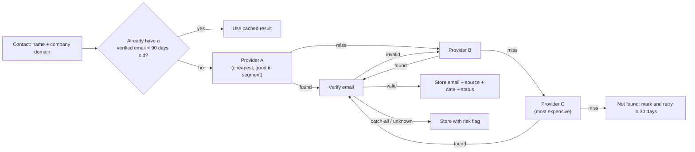

# Chapter 7. Data Sourcing and Enrichment

> "Enrichment is not about having more data. It's about having the right field, correct, at the moment you need it."

## What you will learn

- The B2B data provider landscape, and why no single provider is enough.
- Enrichment types: company, person, contact data (email, phone), technographics, AI-researched custom fields.
- Waterfall enrichment: design, ordering, confidence and cost control.
- Email verification and catch-all domains.
- Data decay, refresh strategies and job-change tracking.
- Measuring data quality and cost per usable record.

---

## 7.1 What enrichment is

**Enrichment** adds attributes to a record you already have. Given a domain, add industry, employee count and tech stack. Given a name and company, add a verified email, phone number and LinkedIn URL. **Sourcing** finds records you don't have yet: companies matching filters, or people at an account matching persona rules.

## 7.2 The provider landscape *(as of October 2026)*

| Category | Examples | Notes |
|---|---|---|
| **Large B2B databases** | ZoomInfo, Apollo.io, Cognism (strong in Europe), Lusha, Seamless.AI, UpLead, LeadIQ | Search plus enrichment plus (often) sequencing. Coverage and accuracy vary by region and segment. |
| **Person and company data APIs** | People Data Labs, Coresignal, Crustdata, Proxycurl-style LinkedIn data APIs (check legal status and terms, Chapter 16) | Developer-oriented; bulk licensing |
| **CRM-native enrichment** | HubSpot Breeze Intelligence (formerly Clearbit, acquired December 2023; HubSpot-only since then), Salesforce data partners | Convenient; limited outside their platform |
| **Email finders and verifiers** | Hunter, Findymail, Prospeo, Icypeas, Dropcontact (EU-focused), LeadMagic; verifiers such as ZeroBounce, NeverBounce, MillionVerifier, Kickbox | Finders guess and verify patterns; verifiers check deliverability |
| **Phone data** | Cognism, Lusha, ZoomInfo, Kaspr, ContactOut, LeadMagic | Mobile numbers have the lowest coverage and highest regulatory sensitivity |
| **Technographics** | BuiltWith, Wappalyzer, HG Insights, Enlyft, TheirStack (from job posts) | Website-detectable tech is easier than back-office tech |
| **Funding and firmographics** | Crunchbase, PitchBook, Dealroom | Funding events, investors |
| **Job posts** | Provider APIs, careers-page scraping, LinkedIn Jobs data | Hiring signals (Chapter 8) |
| **Aggregators / orchestrators** | Clay (waterfalls across 100+ providers), Apollo's waterfall, Databar, Persana, FullEnrich, BetterContact | Run waterfalls without separate contracts with each provider |

Provider claims about database size and accuracy are marketing. **Test providers on your own ICP sample** (§7.7).

## 7.3 Why one provider is not enough

Coverage differs by geography (US-centric databases are weaker in DACH, the Nordics, LATAM and Asia), by company size (SMB and very large enterprises are both harder), by industry, and by data type (emails vs mobile phones). Accuracy differs too: one provider's "verified" email may bounce. Hence the **waterfall**.

## 7.4 Waterfall enrichment

A **waterfall** queries providers in sequence for a field, stopping at the first acceptable result.

### Design decisions

1. **Order** providers by expected *value per credit*: hit rate on your segment × accuracy ÷ cost. Put a cheap provider with decent coverage first, and the expensive, high-accuracy one last.
2. **Acceptance criteria:** what counts as "found"? For emails: format valid *and* verification status `valid` (or, by policy, `catch-all` with a risk flag). For job titles: matches persona rules. Reject results that conflict with known data (an email at a different domain from the company).
3. **Verification after every finder:** if verification fails, *continue* the waterfall instead of stopping.
4. **Caching:** never pay twice for the same lookup within the freshness window. Key the cache on normalised inputs (`email:` + name + domain).
5. **Run conditions:** only enrich rows that pass cheaper filters first (ICP fit, persona match). Enriching a contact you will never email is wasted money.
6. **Provenance:** store **source**, **timestamp** and **confidence** for each enriched field. This lets you audit providers and refresh selectively.
7. **Budgets:** cap spend per play and per run; alert on overruns.
8. **Failure handling:** treat provider errors (`429`, `5xx`) as *retry later*, not *not found*. Otherwise you permanently mark findable records as missing.

A runnable, tested waterfall with caching, verification, cost tracking and provenance is in [`examples/enrichment-waterfall/`](../examples/enrichment-waterfall/).

## 7.5 Email verification

Email verifiers check, without sending a message:

1. **Syntax** (RFC-valid format).
2. **Domain:** DNS resolves; **MX records** exist (the domain accepts mail).
3. **Mailbox:** an SMTP conversation with the mail server, up to `RCPT TO`, to see whether the address is accepted (no email is actually sent).
4. **Risk checks:** disposable domains, role accounts (`info@`, `sales@`), known spam traps, and recent bounce history.

Results are typically `valid`, `invalid`, `catch-all` (accept-all), `unknown` and sometimes `risky`.

**Catch-all domains** accept mail for any address at SMTP time, so verification cannot confirm the mailbox exists. Many larger companies, and domains behind security gateways such as Microsoft 365 and Proofpoint configurations, behave as catch-all. Options: exclude them; send only at low volume with careful monitoring; use providers offering "catch-all verification" (based on engagement data or other heuristics; treat their claims carefully); or reach those people through other channels.

Bounce rates above about 2% damage sender reputation (Chapter 11). **Verify every list before sending**, and re-verify if the list is older than about 30–60 days.

## 7.6 Data decay and refresh

B2B data decays continuously: people change jobs, get promoted, leave companies; companies grow, shrink, merge, close and rebrand. A widely cited industry rule of thumb is 20–30% of contact data going stale per year. Vendors' own estimates vary.

Refresh strategies:

- **Time-based:** re-enrich fields older than *N* months, prioritised by tier.
- **Event-based:** re-verify an email before adding it to a sequence; refresh on bounce; refresh on job-change signal.
- **Usage-based:** only refresh records that are actively being worked.

### Job-change tracking

When a **champion** (a past buyer or power user) moves to a new company, they are among the warmest prospects you will ever have. Job-change tracking (UserGems, Common Room, Clay job-change monitors, provider APIs) watches your contacts and alerts you when they move. Two plays follow: (1) **follow the champion** to their new company; (2) **re-thread** the old account, because your champion left and you need a new relationship there to protect the renewal.

## 7.7 Evaluating providers

Run a **bake-off**:

1. Build a test set of 200–500 records **representative of your ICP** (regions, sizes, personas). Include some with known ground truth (your customers' contacts with confirmed emails, recent bounces).
2. Run each provider on the same set.
3. Measure per field: **coverage** (% returned), **accuracy** (% correct against ground truth or verified), **freshness**, **cost per returned result** and **cost per *correct* result**.
4. Compute the waterfall's combined hit rate for different orderings.
5. Check **terms**: data-sourcing practices, GDPR posture, usage rights (can you store data in your CRM? after contract end?), API limits, and support.

| Metric | Provider A | Provider B | Provider C |
|---|---|---|---|
| Email coverage | 62% | 48% | 71% |
| Email accuracy (verified valid) | 91% | 96% | 88% |
| Cost per lookup | $0.05 | $0.08 | $0.15 |
| **Cost per correct email** | **$0.089** | **$0.174** | **$0.240** |

*(Illustrative numbers.)* Cost per correct email for A = $0.05 ÷ (0.62 × 0.91) ≈ $0.089. The cheapest per lookup is not always cheapest per *correct* result, and ordering also depends on overlap between providers.

## 7.8 AI-researched custom fields

LLM agents can read websites, job posts, filings and news to answer custom questions ("Does this company offer same-day delivery? Answer YES/NO/UNKNOWN with the URL of your evidence"). Guidelines:

- Ask **narrow, answerable questions** with an `UNKNOWN` option.
- **Require evidence** (URL, quote) and store it.
- **Ground** the model in fetched content rather than its memory.
- **Evaluate** on a labelled sample before scaling (Chapter 13).
- **Prefer cheap filters first** (keyword checks on the scraped page) before calling a model.

## 7.9 Cost management

Enrichment spend can quietly grow into one of the largest GTM tool costs. Controls:

- Enrich in **stages**: company-level filters before person-level; persona filter before email lookup; email before phone (phones cost most).
- **Cache** and **deduplicate** inputs.
- **Tier-based depth:** Tier 1 gets everything; Tier 3 gets only what the play needs.
- **Monitor** credits per play and per meeting booked (Chapter 15).
- **Renegotiate** contracts using your measured hit rates.

---

## Summary

- No single data provider covers every region, segment and field well. Combine providers in waterfalls ordered by value per credit, with verification, caching, run conditions, provenance and budgets.
- Verify every email before sending; handle catch-all domains deliberately; keep bounce rates low.
- Data decays roughly 20–30% per year by common estimates. Refresh by time, event and usage, and track job changes of champions.
- Evaluate providers on your own ICP sample by cost per *correct* result.
- Use AI research for custom fields with narrow questions, evidence and evaluation.

## Exercises

See [`exercises/07-enrichment.md`](../exercises/07-enrichment.md).

## Further reading

- Clay's documentation on waterfall enrichment.
- Email verification vendor documentation (ZeroBounce, NeverBounce, Kickbox) on result categories.
- RFC 5321 (SMTP), for how mailbox checks work.
