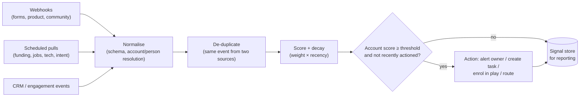

# Chapter 8. Signals and Intent

> "The best time to reach out is when something just changed."

## What you will learn

- What signals are, and how they differ from fit and from third-party intent data.
- A taxonomy of signals: first-party, second-party, third-party; account- and person-level.
- How to source, normalise, score and decay signals.
- How to build a signal-to-action pipeline with deduplication, thresholds and routing.
- How to measure whether a signal actually predicts pipeline.

---

## 8.1 Fit, intent and signals

- **Fit** (Chapter 4) answers *should we ever sell to them?* It changes slowly.
- **Intent** answers *are they likely to be buying now?* It changes quickly.
- A **signal** is a discrete, time-stamped event that suggests changed circumstances or interest: "raised a Series B on 3 October", "visited the pricing page twice this week", "hired a new VP Operations".

Signal-based selling means **prioritising and timing outreach by signals, and referencing them in the message**. Industry writing in 2025–2026 describes a shift away from passive intent dashboards toward tools that turn signals into actions automatically. An intent dashboard that nobody acts on has no value.

## 8.2 A taxonomy of signals

### First-party (your own data)

| Signal | Source | Strength |
|---|---|---|
| Demo request, contact-sales form | Website forms | Very strong (hand-raiser) |
| Pricing-page or comparison-page visits | Web analytics + reverse-IP or identified visitors | Strong |
| Product sign-up, activation, usage spikes, seats added, hitting plan limits | Product data (Chapter 12) | Strong (PLG) |
| Email replies, clicks, webinar attendance | Engagement tools | Medium |
| Support tickets mentioning features you upsell | Help desk | Medium (expansion) |
| Champion job change (a past user or buyer moved companies) | Job-change tracking | Strong |

### Second-party (partners' and communities' data shared with you)

| Signal | Source |
|---|---|
| Activity in your community (Slack, Discord, forums), GitHub stars and issues | Community tools (Common Room and others) |
| Review-site activity: viewing your category or competitor pages | G2 Buyer Intent, TrustRadius |
| Partner and marketplace activity | Partner portals, cloud marketplaces |
| Co-marketing event attendance | Partners |

### Third-party (public or purchased)

| Signal | Source |
|---|---|
| **Topic intent** (a company's employees are researching "transport management software" more than usual) | Bombora's publisher co-op; resold inside ZoomInfo, Apollo, Cognism, 6sense, Demandbase and others |
| Funding rounds, M&A, IPO | Crunchbase, PitchBook, news |
| Leadership changes (new CRO, new VP Ops) | Enrichment providers, LinkedIn, news |
| Hiring activity (roles, keywords, volume) | Job boards, careers pages |
| Tech-stack changes (adopted or dropped a tool) | BuiltWith, Wappalyzer, job posts |
| Headcount growth or decline | LinkedIn-derived data |
| Regulatory or news events (new market entry, compliance deadline, layoffs) | News APIs, filings |
| Social activity (posts about a problem you solve) | LinkedIn and social monitoring |
| Competitor engagement (followers of, or reviewers of, a competitor) | Social and review data |

A 2026 commentary notes that much "unique" third-party topic intent across vendors traces back to the same Bombora co-op. Buying it from two vendors may not give you two independent signals.

### Account-level vs person-level

Some signals identify an **account** (topic intent, reverse-IP website visits, funding). Others identify a **person** (a form fill, a LinkedIn post, a job change). Account-level signals need a second step: **who at the account should we contact?** (Chapter 4 personas.)

### Website visitor identification

- **Reverse-IP lookup** maps visitor IP addresses to companies (Clearbit/Breeze Reveal, 6sense, Demandbase, Leadfeeder/Dealfront, Warmly, RB2B and others). Accuracy is imperfect: remote work, VPNs and mobile networks blur it.
- **Person-level de-anonymisation** (some US-focused vendors claim to identify individual visitors) raises serious privacy and legal questions, especially under GDPR and US state privacy laws. Get legal review before using it (Chapter 16).

## 8.3 Turning raw events into usable signals

Signals arrive messy. A pipeline:



### Normalise

Give every signal a common shape:

```json
{
  "signal_id": "sig_01JA...",
  "type": "pricing_page_visit",
  "source": "web_analytics",
  "occurred_at": "2026-10-13T15:02:11Z",
  "account_domain": "acme-logistics.com",
  "person_email": null,
  "strength": "strong",
  "evidence": {"url": "https://example.com/pricing", "visits": 3},
  "dedupe_key": "pricing_page_visit:acme-logistics.com:2026-10-13"
}
```

Resolve each signal to an **account** (by domain, Chapter 5) and, where possible, a **person**.

### De-duplicate

The same funding round arrives from two providers; the same person fills two forms. Use a **dedupe key** (type + entity + date window) and keep the first.

### Score and decay

Combine signals into an **intent score** per account:

```
intent_score(account) = Σ  weight(signal type) × decay(age of signal)
decay(age) = 0.5 ^ (age_days / half_life_days)
```

For example, with a 14-day half-life, a pricing-page visit worth 30 points today is worth 15 in two weeks and 7.5 in four. Different signal types can have different half-lives: a funding round stays relevant for months; a pricing-page visit for days.

### Threshold and action

Act when the score crosses a threshold, **or** immediately for strong single signals (demo request, champion job change). Add **cool-downs** so the same account isn't actioned repeatedly, and **suppression** for existing customers in active deals, competitors, and opted-out contacts.

Actions include: alert the account owner in Slack with context; create a CRM task; enrol relevant personas in a signal-specific sequence; add the account to an ad audience; or route an unowned account to a rep (Chapter 9).

A runnable signal pipeline with dedupe, decay, thresholds, cool-downs and suppression is in [`examples/signal-pipeline/`](../examples/signal-pipeline/).

## 8.4 Using signals in messaging

Signals make outreach relevant, but use them with care:

- **Reference public, professional signals** naturally ("Saw you're hiring three dispatch analysts. Usually that means the team is buried in manual load planning.").
- **Do not reveal surveillance.** "I noticed you visited our pricing page three times yesterday" feels creepy and may breach privacy expectations. Use website signals for *timing and prioritisation*, not as message content.
- **Verify before referencing.** A wrong signal ("congrats on the acquisition" when there wasn't one) destroys credibility.

## 8.5 Measuring signal value

A signal is only useful if accounts showing it convert better. Measure:

1. For each signal type, compare **meeting rate**, **opportunity rate** and **win rate** for accounts *with* the signal (in a time window) vs a comparable baseline *without* it, within the same tier.
2. Track **lift** = signal conversion rate ÷ baseline conversion rate.
3. Watch **volume:** a signal with 5× lift that fires twice a year matters less than one with 2× lift that fires weekly.
4. Re-weight scores based on measured lift; retire signals with no lift. That includes expensive intent subscriptions that do not move numbers.

| Signal type | Accounts w/ signal | Opp rate (90d) | Baseline opp rate | Lift |
|---|---|---|---|---|
| Demo request | 410 | 38% | — | (hand-raiser) |
| Champion job change | 120 | 14% | 3% | 4.7× |
| New VP Ops hired | 260 | 7% | 3% | 2.3× |
| Bombora topic surge | 1,900 | 3.4% | 3% | 1.1× |

*(Illustrative.)* In this example, the topic-intent subscription barely beats baseline for this company, while champion job changes are gold.

Be careful about causality: accounts with signals may differ in other ways. Holdout tests (Chapter 15), where some signal-positive accounts are deliberately not actioned, give the cleanest answer.

## 8.6 Tools *(as of October 2026)*

- **Signal platforms:** Common Room (community and multi-source signals), Unify, Warmly (website visitors plus engagement), Pocus (product-led sales), UserGems (job changes), Trigify (social signals), and Clay's signal monitors.
- **Intent and ABM platforms:** 6sense, Demandbase, Bombora, G2 Buyer Intent, ZoomInfo intent.
- **DIY:** scheduled jobs pulling funding, job-post and tech data via APIs into a warehouse signal table, with scoring in SQL or Python and actions through webhooks.

Many teams combine a CRM and enrichment layer with a few specialist signal providers, plus custom signals built in-house.

---

## Summary

- Fit says *who*; signals say *when*. Signals are time-stamped events from first-, second- and third-party sources, at account or person level.
- Normalise, resolve to accounts and people, de-duplicate, score with decay, then act at thresholds with cool-downs and suppression.
- Use signals for timing and relevance; never make outreach feel like surveillance; verify before referencing.
- Measure each signal's lift on meetings and opportunities, re-weight, and drop signals that don't predict pipeline.

## Exercises

See [`exercises/08-signals.md`](../exercises/08-signals.md).

## Further reading

- Bombora and G2 documentation on how their intent data is generated.
- Vendor guides on signal-based selling (Common Room, Clay, UserGems). Read them critically: they sell signals.
