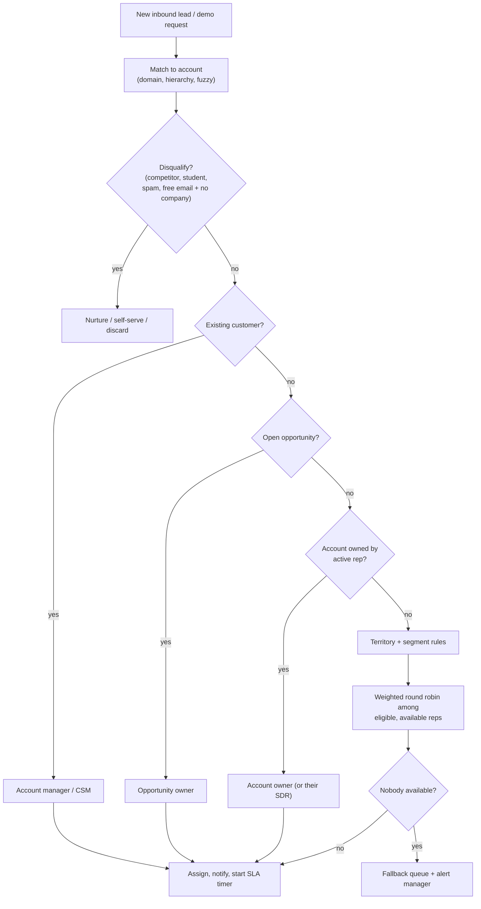

# Chapter 9. Scoring, Routing and Speed-to-Lead

> "A demo request that waits an hour is a demo request for your competitor."

## What you will learn

- How to combine fit, intent and engagement into lead and account scores, and how to keep scores honest.
- Why speed-to-lead matters, and what the research actually says.
- Routing design: matching, ownership rules, territories, round robin, capacity and fallbacks.
- Meeting scheduling at the point of conversion.
- SLAs, monitoring and the failure modes of routing systems.

---

## 9.1 Scoring

### Three dimensions

| Dimension | Question | Inputs |
|---|---|---|
| **Fit** | Is this the right kind of account and person? | Firmographics, technographics, persona match (Chapter 4) |
| **Intent** | Are they likely in market now? | Signals with decay (Chapter 8) |
| **Engagement** | Are they engaging with us? | Form fills, email replies, meetings, product usage |

Keep the dimensions **separate** rather than adding them into one opaque number. A 2×2 or 3×3 grid is easier to act on:

| | Low intent | High intent |
|---|---|---|
| **High fit** | Nurture and account-based plays | **Act now:** route to sales immediately |
| **Low fit** | Ignore or self-serve | Self-serve or partner; do not waste AE time |

### Lead score vs account score

Classic MQL scoring sums points per *person* (form fill +20, webinar +10, VP title +15). In B2B, where buying committees decide, **account-level scoring** usually works better: aggregate engagement and intent across all people at the account. Many teams use both: an account score for prioritisation, and a person-level score to choose whom to contact.

### Keeping scores honest

- **Negative scoring:** subtract for competitors, students, personal emails, careers-page visits, unsubscribes, and inactivity (decay).
- **Calibration:** each quarter, compare conversion (MQL → opportunity) by score band. If higher bands don't convert better, fix the model.
- **Explainability:** store score components ("+30 industry, +25 size, +20 pricing visits") so sellers trust and use it.
- **Versioning:** record which model version produced each score; change models with a changelog.
- **Predictive scoring:** ML models (built in-house, or features in HubSpot, Salesforce Einstein, 6sense, MadKudu and others) help when you have enough historical outcomes. They still need calibration and explainability.

## 9.2 Speed-to-lead: the evidence

- Oldroyd, McElheran and Elkington, "The Short Life of Online Sales Leads" (*Harvard Business Review*, 2011), audited 2,241 US companies by submitting test web leads. Only 37% responded within an hour, and 23% never responded. In a separate analysis of 1.25 million leads, firms that contacted leads within an hour were nearly **7×** as likely to qualify them as firms that waited longer, and over **60×** as likely as those that waited 24 hours or more.
- The often-quoted "**100× more likely to contact a lead within 5 minutes than at 30 minutes**" comes from InsideSales.com's earlier *Lead Response Management* study, not from the HBR article.

Exact multipliers vary by business, but the direction is consistent: **hand-raisers cool off within minutes to hours**. Inbound routing should be measured in seconds, and first human response in minutes during business hours.

## 9.3 Routing design

**Routing** decides who handles a lead, account or meeting, and makes it happen. Inputs: the record, its matched account (Chapter 5), scores, and your rules of engagement.

### Rules of engagement (agree them first)

Write down, with sales leadership:

1. **Ownership:** who owns an account? (Named-account lists, territories, segments.) Do leads at an owned account go to the account owner, their SDR, or a queue?
2. **Existing customers:** route to the account manager or CSM, not new-business AEs.
3. **Open opportunities:** route to the opportunity owner.
4. **Territories:** by geography, segment (employee count), industry, or named lists.
5. **Unowned accounts:** round robin among eligible reps, weighted by capacity.
6. **Ownership expiry:** when does an untouched account return to the pool (for example, no activity in 90 days)?
7. **Conflicts:** who arbitrates disputes, and how?

### Routing logic

### Round robin, properly

Naive round robin breaks when reps are on holiday, overloaded or in different segments. Better:

- **Eligibility:** only reps matching the territory and segment.
- **Availability:** skip reps who are out of office or have reached daily caps.
- **Weighting:** ramping reps get fewer leads; top performers may get more (a management decision).
- **Fairness by value:** balance by expected value (fit tier), not only count, so one rep doesn't get all the Tier 3 leads.
- **Persistence:** store the round-robin pointer durably, so restarts don't reset it.
- **Auditability:** log every decision and the reason.

A runnable router implementing these rules, with tests, is in [`examples/lead-routing/`](../examples/lead-routing/).

### Tools *(as of October 2026)*

LeanData (Salesforce-native routing and matching), Chili Piper (scheduling and routing), Default, RevenueHero, Distribute and HubSpot's and Salesforce's native assignment rules. Clay and custom code are used for bespoke logic.

## 9.4 Booking at the point of conversion

The fastest response is no wait at all: **let a qualified buyer book a meeting on the form's thank-you page**.

1. A form is submitted; enrichment runs in under a couple of seconds.
2. Qualification rules decide: book with sales now, route to a nurture path, or send to self-serve.
3. Routing picks the right rep and shows their calendar availability.
4. The buyer books instantly. The CRM records the lead, the meeting and the owner.

Tools such as Chili Piper, Default, RevenueHero, Calendly Routing and HubSpot meetings implement this. Design notes: keep forms short (enrichment fills the rest); handle enrichment failures gracefully (fall back to asking, or to a generic queue); and avoid over-qualifying good leads away.

## 9.5 SLAs and monitoring

Define SLAs per lead type, for example:

| Lead type | Assignment SLA | First-touch SLA |
|---|---|---|
| Demo request (high fit) | < 1 minute | < 5–15 minutes in business hours |
| Contact sales (other) | < 5 minutes | < 1 business hour |
| High-intent account alert | < 1 hour | < 1 business day |
| PQL | < 1 hour | < 1 business day |

Monitor:

- **Assignment latency** (p50 and p95) and **first-touch latency** by rep and team.
- **Unassigned or orphaned leads** (no owner after *X* minutes), as an alert.
- **Leads assigned to inactive users** (deactivated reps): a classic failure.
- **Distribution fairness** per rep.
- **Routing errors** (matching failures, rule gaps) from logs.

Escalate breaches: notify the rep, then the manager, then reassign.

## 9.6 Failure modes

| Failure | Cause | Prevention |
|---|---|---|
| Lead goes to a deactivated rep | Offboarding didn't update routing | Check user status; a fallback queue |
| Customer's employee routed to a new-business SDR | No customer check or hierarchy match | Match on hierarchy; customer-first rule |
| Duplicate assignment | Two systems both route (CRM rules + routing tool) | One routing authority |
| Round robin resets after deploy | Pointer stored in memory | Durable state |
| Lead never assigned | Rule gap (new country, new segment) | A catch-all default rule plus an alert |
| Enterprise lead to the SMB team | Employee count missing | Fall back on matched account data; "unknown" path |
| Spam floods queues | No bot protection | CAPTCHA, honeypots, disposable-email filtering |

---

## Summary

- Score fit, intent and engagement separately; prefer account-level scoring for B2B; calibrate, explain and version scores.
- Speed-to-lead matters: hand-raisers cool off within minutes to hours. Know which study says what.
- Agree rules of engagement first, then implement routing: matching, disqualification, customer and opportunity checks, ownership, territories, and weighted, availability-aware round robin with fallbacks and audit logs.
- Let qualified buyers book instantly. Define SLAs; monitor latency, orphans and inactive owners.

## Exercises

See [`exercises/09-scoring-and-routing.md`](../exercises/09-scoring-and-routing.md).

## Further reading

- James B. Oldroyd, Kristina McElheran and David Elkington, "The Short Life of Online Sales Leads," *Harvard Business Review* (March 2011).
- InsideSales.com, *Lead Response Management Study* (2007 onwards).
- LeanData and Chili Piper documentation on matching and routing patterns.
