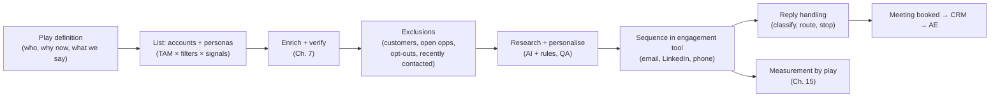

# Chapter 10. Outbound Systems and Personalisation at Scale

> "Personalisation is not '{first_name}'. It's proof you understand their problem."

## What you will learn

- How an outbound system is structured: plays, lists, sequences, channels and handoffs.
- How to design a **play**, the unit of outbound work.
- Sequences: steps, timing, channels, stop conditions and reply handling.
- Personalisation tiers, from templated to deeply researched, and how to use AI safely.
- Copywriting principles that GTM engineers need to know.
- QA, guardrails and measurement for outbound.

---

## 10.1 The anatomy of an outbound system

## 10.2 The play

A **play** is a repeatable outbound motion with a clear hypothesis. Write a play brief before building anything (template: [`templates/play-brief.md`](../templates/play-brief.md)):

| Element | Example |
|---|---|
| **Name** | "New VP Ops at mid-market 3PLs" |
| **Hypothesis** | New operations leaders review tooling in their first 90 days |
| **Audience** | Tier 1–2 3PLs; VP or Director of Operations hired in the last 90 days |
| **Trigger / signal** | Leadership change (Chapter 8) |
| **Why now** | First-90-days agenda |
| **Message angle** | Benchmarks other new ops leaders used to build their plan |
| **Offer / call to action** | A 15-minute benchmark review, not a demo |
| **Channels** | Email (3 steps), LinkedIn (connection + 1 message), phone for Tier 1 |
| **Volume and capacity** | ~40 new contacts/week; 2 SDRs |
| **Success metric** | Meetings held per 100 contacts; pipeline per 100 contacts |
| **Kill criteria** | < 1 meeting per 100 contacts after 300 contacted |
| **Exclusions** | Customers, open opportunities, contacted in the last 90 days, opt-outs |
| **Owner** | GTM engineer (system) + SDR manager (execution) |

Run several plays in parallel, measure each, and reallocate volume to the winners.

## 10.3 Sequences

A **sequence** (or cadence) is a timed series of touches. Typical structure for a mid-market play:

| Day | Channel | Purpose |
|---|---|---|
| 1 | Email 1 | Relevant opener tied to the signal; one clear question |
| 1–2 | LinkedIn | View profile / connect (no pitch in the connection request) |
| 3 | Phone (Tier 1) | Call; voicemail referencing the email |
| 4 | Email 2 (reply in thread) | A different angle or proof point |
| 8 | LinkedIn message | Short, human |
| 11 | Email 3 | Useful resource, or a "should I reach out to someone else?" |
| 16 | Email 4 (break-up) | Close the loop politely |

Design rules:

- **Stop conditions:** stop on any reply (positive, negative, out-of-office handled separately), meeting booked, unsubscribe, bounce, or the account entering an opportunity or becoming a customer.
- **Business days and time zones:** send in the recipient's working hours.
- **Threading:** follow-ups as replies in the same thread usually perform better than new subjects, and look more human.
- **Throttling:** respect per-inbox daily limits (Chapter 11) and LinkedIn limits (Chapter 16).
- **Multithreading:** for Tier 1, run coordinated sequences to two or three personas, and avoid sending them identical emails on the same day.
- **Fewer, better touches** beat long automated sequences. Buyers in 2026 are saturated with automated outreach.

### Reply handling

Replies need fast, correct handling:

| Reply type | Action |
|---|---|
| Positive / interested | Alert the owner immediately; propose times; create or update the CRM record |
| Referral ("talk to Sam") | Add Sam with context; reference the referrer |
| Not now / timing | Stop the sequence; set a follow-up task or nurture in N months |
| Not interested | Stop; record the reason; suppress for an agreed period |
| Unsubscribe / remove me | Stop; add to **global suppression** immediately (Chapter 16) |
| Out of office | Pause, and resume after the return date; note any alternative contact |
| Wrong person / left company | Update the record; trigger re-sourcing; job-change check |
| Bounce | Mark invalid; trigger re-enrichment; watch the bounce rate |

LLM classifiers handle reply categorisation well, with human review of anything ambiguous and of all positive replies.

## 10.4 Personalisation tiers

| Tier | What it uses | Effort per contact | Use for |
|---|---|---|---|
| **0: Template** | Name, company | Seconds | Rarely appropriate now |
| **1: Segment** | Industry and persona-specific copy | Seconds | Tier 3, high-volume plays |
| **2: Signal-based** | The trigger event, plus segment copy | Seconds (automated) | Most plays |
| **3: Researched** | Account-specific insight from website, job posts, filings, LinkedIn posts (AI-assisted research plus human review) | Minutes (assisted) | Tier 1–2 |
| **4: Bespoke** | A deep account plan, custom asset, multi-person outreach | Hours | Strategic enterprise accounts |

Match effort to value (Chapter 3 §3.5).

## 10.5 AI-assisted personalisation, safely

LLMs make Tier 2–3 personalisation cheap. They also make it easy to send thousands of confident, wrong, robotic messages. A safe pipeline:

1. **Gather evidence first** (scrape the company site, job posts, recent news) and pass it to the model as input. Do not ask the model to "find something interesting" from memory.
2. **Constrain the task:** generate *one or two sentences* (an opener or a relevance line) inside a human-written template, rather than whole emails.
3. **Require structured output:** `{ "line": "...", "evidence_url": "...", "confidence": "high|medium|low" }`.
4. **Validate automatically:** length limits; banned phrases ("I hope this email finds you well", "game-changer", "revolutionise", "I noticed you visited our website"); no unfilled placeholders; no fabricated numbers; the evidence URL is present and from the company's domain or a trusted source; the language matches the recipient.
5. **Fall back** to segment copy when evidence is weak or validation fails. A good generic line beats a bad specific one.
6. **Human QA:** review a random sample of each batch (for example 5–10%, and 100% for Tier 1) before sending. Track the error rate; if it rises, stop and fix the prompt.
7. **Log** prompts, model versions, inputs and outputs for every generated line, for debugging and accountability.

A runnable personalisation-guardrail example (template rendering, validation, fallback and QA sampling) is in [`examples/safe-personalization/`](../examples/safe-personalization/).

## 10.6 Copywriting principles for GTM engineers

You don't need to be a copywriter, but you need to recognise good outbound:

- **Relevance first:** why them, why now (the signal), why you.
- **Short:** 50–125 words for a first email is a common guideline. Mobile-readable. One idea.
- **About them, not you:** their problem, their context.
- **Low-friction ask:** a question or a small next step ("Worth a look?") rather than "book a 30-minute demo".
- **Plain text,** minimal links, no images or tracking-heavy HTML in the first touches (it helps deliverability, Chapter 11).
- **Honest subject lines:** short, lower-case, no clickbait. Misleading subject lines are illegal under CAN-SPAM (Chapter 16).
- **Proof:** a specific, relevant result from a similar customer, and only one that is true and approved.
- **Test** angles and offers, not just subject lines (Chapter 15).

## 10.7 LinkedIn and phone

- **LinkedIn:** connection requests and messages complement email. Automation tools exist (HeyReach, Expandi, Waalaxy, Dripify and others), but LinkedIn's User Agreement prohibits automated access and scraping, and LinkedIn enforces against tools and accounts (Chapter 16). Keep volumes modest, prefer manual or assisted actions, and never put the company's key accounts at risk.
- **Phone:** still effective for many segments. Parallel dialers raise connect volume. Mobile numbers have strict rules in some jurisdictions (US TCPA rules on autodialled calls to mobiles; EU and UK rules on direct marketing calls). Check them before dialling at scale (Chapter 16).
- **Video, direct mail and gifting** are useful for Tier 1 accounts in some markets.

## 10.8 Measuring outbound

Per play and per step:

- Delivered, bounce rate, spam complaints (from mailbox tools)
- Reply rate, **positive reply rate**
- Meetings booked, **meetings held** (no-shows matter)
- Opportunities and **pipeline created**, win rate, revenue (lagging)
- **Cost per meeting** = (data + tool + AI + people cost for the play) ÷ meetings held
- Unsubscribe rate

**Don't optimise opens.** Apple Mail Privacy Protection (2021) pre-fetches images, which inflates open rates, and tracking pixels can hurt deliverability. Optimise for replies, meetings and pipeline.

---

## Summary

- Outbound is a system of plays: hypothesis, audience, trigger, angle, offer, channels, metrics and kill criteria.
- Build sequences with stop conditions, sensible timing, threading, throttling and multithreading. Handle replies quickly and correctly, especially unsubscribes.
- Match personalisation depth to account value. Use AI on evidence, generate small constrained pieces, validate, fall back, and QA by sampling.
- Know basic copywriting principles. Use LinkedIn and phone within the platform's rules and the law.
- Measure meetings held, pipeline and cost per meeting by play, not opens.

## Exercises

See [`exercises/10-outbound.md`](../exercises/10-outbound.md).

## Further reading

- Public writing on outbound messaging by practitioners such as Josh Braun, Becc Holland and Lavender's team (lavender.ai research on email length and reply rates).
- Jeb Blount, *Fanatical Prospecting* (2015).
- Mailbox-provider guidance on bulk sending (Chapter 11).
