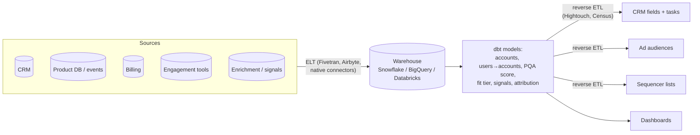

# Chapter 12. Inbound, Product-Led Growth and Warehouse-Native GTM

> "Your best leads already told you they're interested. Don't make them wait or fill in twelve fields."

## What you will learn

- Inbound systems: form design, real-time enrichment, qualification and routing.
- Product-led growth (PLG) data: users, workspaces, events, and how to turn them into product-qualified leads (PQLs) and product-qualified accounts (PQAs).
- Warehouse-native GTM: the warehouse as the GTM data hub, with reverse ETL into CRM and tools.
- Nurture and lifecycle automation.

---

## 12.1 Inbound systems

### Form design

Every extra field reduces conversion. With real-time enrichment, a form can ask for **work email** (and perhaps one qualifying question) and fill the rest:

1. The visitor enters an email.
2. Enrichment (Clearbit/Breeze, Apollo, ZoomInfo FormComplete, Clay webhook tables or similar) returns company size, industry, title and country in about 1–2 seconds.
3. The form shows only questions enrichment couldn't answer.
4. Hidden fields capture **UTM parameters** (campaign source), the referrer and the landing page, for attribution (Chapter 15).

Design for failure: if enrichment times out, show the full form, or accept the submission and enrich asynchronously.

### Qualification and routing at submission

Covered in Chapter 9: match to account, disqualify (spam, students, competitors), check customer and open-opportunity status, score fit, then route instantly and offer a booking calendar to qualified buyers. Unqualified submissions go to self-serve or nurture with a useful next step, not a dead end.

### Spam and abuse

Forms attract bots and junk. Use bot protection (reCAPTCHA, hCaptcha, Cloudflare Turnstile), honeypot fields, rate limits, disposable-email detection, and validation of email domains (MX check).

### Inbound workflow as code

A typical inbound webhook handler:

```
on form_submitted(event):
    verify signature; ignore duplicates (event id)          # integration hygiene
    email = normalise(event.email)
    if is_disposable(email) or is_spam(event): discard
    person, company = enrich(email)  with 2s timeout        # fallback: async enrich
    account = match_account(company.domain)                 # Chapter 5
    decision = qualify(person, company, account)            # Chapter 9
    upsert CRM records by email/domain                      # idempotent
    route(decision) and notify owner; show scheduler if qualified
    log decision with reasons
```

## 12.2 Product-led growth data

In a PLG company, the product generates the strongest buying signals. Data concepts:

| Concept | Meaning |
|---|---|
| **User** | A person with a login |
| **Workspace / organisation / team** | The billing or collaboration unit in the product; may map to a company, a department, or a personal account |
| **Events** | Actions tracked in product analytics (Segment, RudderStack, Amplitude, Mixpanel, PostHog, Heap) or the product database: signed up, invited teammate, created project, connected integration |
| **Activation** | Reaching the "aha moment": the actions most associated with retention |
| **Plan / billing state** | Free, trial, paid tier; limits reached |

### From users to accounts

Product users must be **mapped to companies** (Chapter 5): by email domain (excluding free-email domains), by enrichment, or by asking during onboarding. One company may have many workspaces (a team in Berlin and a team in Austin who don't know about each other), which is a key expansion insight.

### PQLs and PQAs

A **product-qualified lead (PQL)**, or more usefully a **product-qualified account (PQA)**, combines usage and fit:

| Signal | Example threshold |
|---|---|
| Fit | Company ICP tier 1–2 (from enrichment) |
| Breadth | ≥ 5 active users in the last 14 days, or several workspaces at the same domain |
| Depth | Used key features (integrations connected, ≥ 10 projects) |
| Limits | Hit a plan limit, or viewed the pricing / upgrade page |
| Enterprise needs | Asked about SSO, security review, admin controls |
| Velocity | Usage growing week over week |

Derive thresholds the same way as an ICP (Chapter 4): compare accounts that converted to paid or enterprise against those that didn't. Typical PLG motions:

- **Sales-assist:** a rep offers help to high-fit, high-usage accounts (trial extension, onboarding call, enterprise features).
- **Expansion:** existing paid accounts with growing usage or new teams.
- **Consolidation:** several workspaces at one company becomes an enterprise-plan pitch.
- **Reverse trial and limit outreach:** contact accounts that hit limits.

Product-led sales tools (Pocus, Endgame, Correlated and others) and in-house warehouse models implement PQA scoring.

## 12.3 Warehouse-native GTM

As data volume and sources grow, many companies make the **data warehouse** the hub of GTM data:



**Benefits:**

- One place joins product, billing, CRM and engagement data.
- Scores and segments are **version-controlled SQL** (dbt), testable and reviewable.
- **Reverse ETL** syncs results to every tool consistently, so segment logic lives in one place (Chapter 4 §4.7).
- Analysis and attribution are straightforward (Chapter 15).

**Costs:** you need data engineering skills, warehouse spend and sync latency (minutes to hours, so not suitable for instant inbound routing). Reverse ETL writes count against CRM API limits.

**Patterns:**

- Keep **instant** flows (inbound routing) event-driven (webhooks and APIs); keep **analytical** flows (scores, segments, PQAs) in the warehouse.
- Write warehouse results to **dedicated CRM fields** owned by the sync, never fields humans edit.
- **Upsert by external ID** and sync only changed rows ("diff" mode) to save API calls.
- Monitor sync failures and row-level errors.

*(As of October 2026)* reverse ETL tools include Hightouch and Census (Fivetran agreed to acquire Census in 2025). Warehouse-native features also exist in CDPs (Segment, RudderStack) and in some GTM platforms.

## 12.4 Nurture and lifecycle automation

Not every lead is ready. **Nurture** keeps relevant, useful contact going until they are:

- **Segment by persona and stage;** send useful content, not "just checking in".
- **Trigger on behaviour:** re-engagement or product usage moves a contact from nurture to sales.
- **Lifecycle stages** in the CRM or marketing automation (Subscriber → Lead → MQL → SQL → Opportunity → Customer) must be updated by clear rules owned by one system (Chapter 5 §5.7).
- **Consent:** marketing email requires consent or another lawful basis in many jurisdictions (Chapter 16). Keep the subscription status in the marketing automation platform as the system of record.

---

## Summary

- Inbound: short forms plus real-time enrichment, spam protection, instant qualification and routing, and graceful fallbacks.
- PLG: map users and workspaces to companies, then combine fit and usage into PQLs and PQAs, with thresholds derived from conversion data. Run sales-assist, expansion and consolidation plays.
- Warehouse-native GTM centralises data and logic in SQL models and syncs results out with reverse ETL. Keep instant flows event-driven.
- Nurture with relevant, behaviour-triggered content; keep lifecycle stages rule-based and owned by one system.

## Exercises

See [`exercises/12-inbound-and-plg.md`](../exercises/12-inbound-and-plg.md).

## Further reading

- Wes Bush, *Product-Led Growth* (2019); OpenView Partners' PLG benchmark reports (archived).
- Hightouch and Census documentation on reverse ETL and sync modes.
- dbt documentation (docs.getdbt.com).
