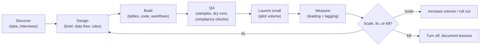

# Chapter 18. Working as a GTM Engineer

> "Your customer is the sales team. Your product is pipeline."

## What you will learn

- How to take a vague request ("we need more pipeline") and turn it into a scoped, measurable build.
- A delivery process for plays and systems: discover, design, build, QA, launch, measure, iterate.
- How to work with sales leadership, SDRs, AEs, marketing, RevOps, data and legal.
- Operating cadences, prioritisation and documentation.
- Common anti-patterns and how to avoid them.

---

## 18.1 From request to scoped work

Requests arrive vague: "Can you get us more enterprise meetings?", "Build an AI SDR", "Our data is bad". Turn each into a scoped problem:

1. **Clarify the outcome:** which metric, by how much, by when? ("+40 qualified enterprise meetings per quarter")
2. **Find the bottleneck** with data: not enough target accounts? Low reply rates? Slow routing? Poor meeting-to-opportunity conversion? Build the reverse funnel (Chapter 3).
3. **Generate options:** new plays, better data, signals, routing fixes, inbound conversion.
4. **Size each option:** expected impact × confidence ÷ effort (an ICE-style score).
5. **Agree** priorities and success criteria with the requester and their leader.
6. **Write a brief** before building (template: [`templates/play-brief.md`](../templates/play-brief.md)).

Often the highest-leverage fix isn't new outbound at all. It is speed-to-lead, an inbound form that loses half its submissions, or routing that sends hot leads to the wrong team.

## 18.2 Delivery process

**Discover:** pull the data; interview 2–3 reps and a manager about the buyers; read call recordings for the target persona; check what's been tried before.

**Design:** data sources, enrichment steps, filters, exclusions, scoring, message angle, channels, routing and handoff, metrics, cost estimate, compliance review.

**Build:** in the right tool for the job (Chapter 6); keep logic in version control where possible.

**QA:** this is where good GTM engineers stand out.

- Manually review 20–50 sample rows end to end (data, matching, generated copy).
- Dry-run CRM writes and confirm what would change.
- Check exclusions and suppression actually work (put a test suppressed address in the list and confirm it is blocked).
- Confirm deliverability readiness (Chapter 11).
- Have a seller read the messages: "Would you send this?"

**Launch small:** for example 100–300 contacts or one week, then review.

**Measure:** leading indicators (bounce, positive reply rate) within days; meetings within 2–3 weeks; pipeline within 1–3 months.

**Decide:** scale, fix or kill, using the kill criteria set in the brief.

## 18.3 Working with stakeholders

| Stakeholder | What they need from you | What you need from them |
|---|---|---|
| **CRO / Head of Sales** | Pipeline, forecastable results, no surprises | Priorities, rules of engagement, air cover |
| **SDR / BDR team** | Better lists, research, fewer manual tasks, reliable tools | Feedback on lead quality, copy input, consistent CRM usage |
| **AEs** | Hot accounts, context before calls, fast routing | Feedback on meeting quality; account plans for Tier 1 |
| **Marketing** | Inbound conversion, attribution, audiences | Positioning, messaging, content assets |
| **RevOps / sales ops** | Clean data, respect for CRM governance, documentation | Admin access, change-management coordination |
| **Data team** | Well-defined requests, shared models | Warehouse access, modelling support |
| **Legal / security** | Early involvement; compliance by design | Policies, LIAs, vendor reviews |
| **Finance** | Cost visibility, ROI | Budget approvals |

Habits that build trust: **close the loop** on every request; publish a **weekly update** (what shipped, results, what's next); **involve sellers** in copy and play design; **never change routing or scoring silently**.

## 18.4 Operating cadence

| Cadence | Activity |
|---|---|
| Daily | Check alerts (routing, sync failures, deliverability); triage requests |
| Weekly | Play metrics review with the SDR manager; deliverability review; ship improvements; stakeholder update |
| Monthly | Play portfolio review (scale, fix, kill); spend review; data-quality report |
| Quarterly | ICP and scoring recalibration; signal lift analysis; stack and contract review; roadmap planning |

## 18.5 Prioritisation

Keep a visible backlog. Score items by **impact on pipeline or revenue**, **confidence** and **effort**. Reserve capacity (for example 20%) for maintenance and data hygiene, which otherwise never gets done until something breaks. Say no to requests that don't connect to a measurable outcome, or reshape them until they do.

## 18.6 Documentation

Minimum documentation for every production system:

- **Brief** (why, what, success metric)
- **Data flow** (sources → steps → destinations)
- **Rules** (scoring, routing, exclusions) in plain language
- **Owner and runbook** (what to do when it breaks)
- **Change log**

Store it where sellers and ops can find it (wiki or repo), and link it from the CRM field descriptions.

## 18.7 Anti-patterns

| Anti-pattern | Why it hurts | Instead |
|---|---|---|
| **Volume-first outbound** | Burns domains and the market | Relevance-first, signal-based plays |
| **Tool-first thinking** ("let's buy X") | Stack sprawl, no outcome | Start from the bottleneck |
| **Shadow systems** (critical logic in an undocumented table) | Breaks when you leave | Documented, version-controlled logic |
| **No QA on AI output** | Embarrassing, wrong emails | Sample review, validation, fallbacks |
| **Optimising vanity metrics** (opens, emails sent) | Looks busy, no pipeline | Meetings held, pipeline, cost per meeting |
| **Ignoring sellers' feedback** | Plays nobody believes in | Co-design; review meeting quality |
| **Silent changes to routing or scoring** | Lost trust, disputes | Announce, document, version |
| **Compliance as afterthought** | Fines, bans, reputational damage | Suppression and country rules in code from day one |
| **Every play bespoke** | No reuse, slow | Reusable components: enrichment functions, exclusion logic, templates |

---

## Summary

- Turn vague requests into outcome metrics; find the real bottleneck with data before building.
- Deliver through discover, design, build, rigorous QA, small launches, measurement and scale/fix/kill decisions.
- Treat sales as your customer: close loops, publish updates, co-design with sellers, never change things silently.
- Run daily, weekly, monthly and quarterly cadences; reserve capacity for maintenance; document every production system.

## Exercises

See [`exercises/18-practice.md`](../exercises/18-practice.md).

## Further reading

- Marty Cagan, *Inspired* (2nd edition, 2017), on product discovery, which applies to internal GTM products too.
- Will Larson, *An Elegant Puzzle* (2019), on prioritisation and operating cadences.
